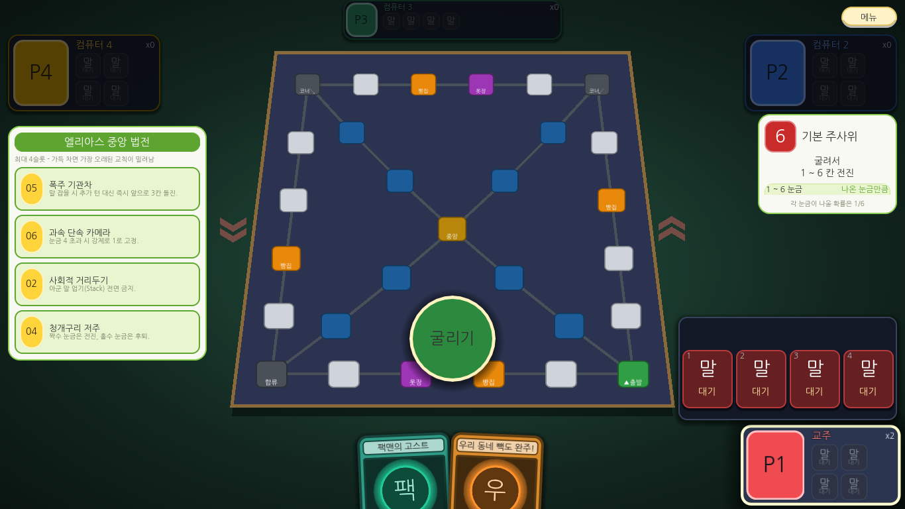
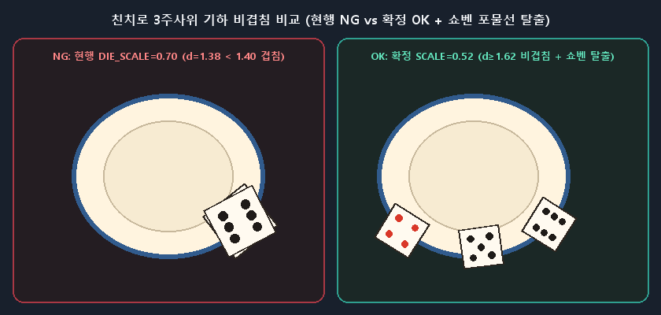
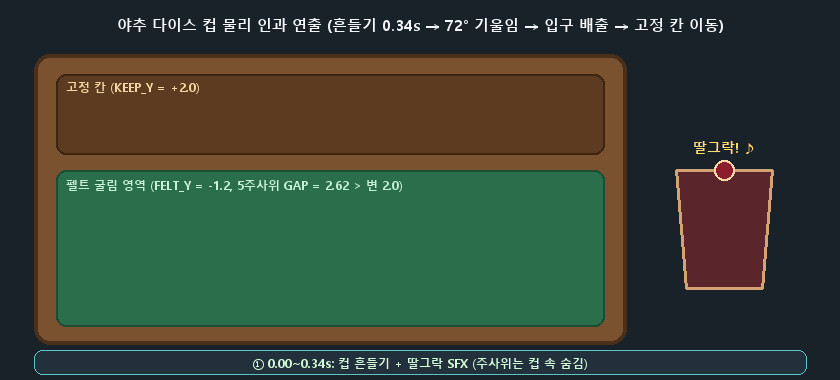
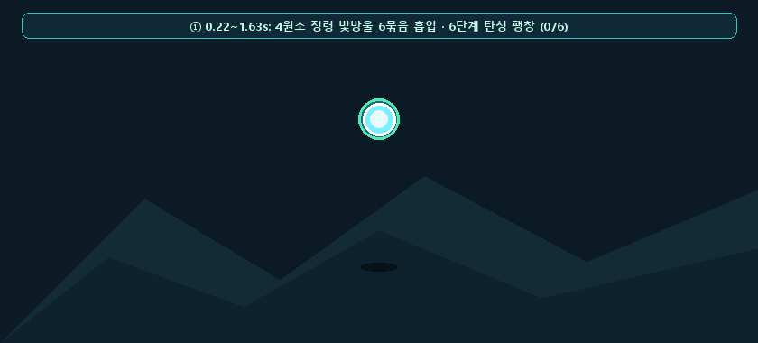

# 초증강 엘리아스 마블 (Hyper Augment Elias Marble)

> **트릭컬 리바이브 2차 창작 팬게임** (비공식 · 비영리 무료 배포)
> 2~4인이 21종의 판정 도구(주사위·윷·룰렛·포커·마작·리볼버·복권 등)를 직접 다루며 말을 달리고, 96종의 증강과 52종의 생떼 카드(방어·발동·함정·소환)로 판세를 뒤집으며 완주나 법전 특수 승리로 순위를 다투는 **카오스 보드 레이스**입니다.

- **현재 버전:** `1.3.1` (2026-11-28)
- **웹 바로 플레이 (무설치):** https://hypereliasmarble.xyz/
- **엔진 · 기술 스택:** Godot 4.7 / GDScript 2.0 · HTML5(분할 패킹) & PC · WebRTC P2P 서버리스 락스텝 멀티플레이
- **지원 언어:** 한국어 · English · 日本語 (인게임 실시간 전환)

> [!IMPORTANT]
> **이 `docs` 브랜치는 프로젝트 문서 안내판 전용입니다.**
> 기획서·예외 규칙 명세·개발 파이프라인·UI 검수 기록·변경 기록만 보관하며, 실제 게임 소스 코드와 CI/CD 자동 배포 설정은 메인 개발 브랜치([`dev`](https://github.com/mayjohn66-cmd/TRG/tree/dev))에 분리되어 있습니다.

---

## 한눈에 보는 게임 · 아키텍처 요약 (`1.3.1` 기준)

| 구분 | 핵심 내용 |
|---|---|
| **승리 방식** | **서바이벌 순위제 (1~4위 졸업)** — 내 말 4개 전원 완주 또는 중앙 법전의 공용 특수 승리 교칙 선착순 달성 |
| **수록 콘텐츠** | **테마 보드 4종**(32칸 순환 트랙) · **진화 기물 9계열(32종)** · **판정 도구 21종**(직접 조작·보드 위 연출) · **생떼 카드 52종**(기본 덱 89장: 방어 11 · 발동 24 · 함정 13 · 소환 4) · **증강 96종**(+ 규칙 수치 3행) · **특수 승리 법전 9종** · **일기토 미니게임 6종** · **아바타 8명**(상황별 보이스) |
| **플레이 모드** | **놀이터**(싱글 vs AI, 불닭 난이도 5단계 + 터보 AI 턴) · **친선 줘팸터**(5자리 방 코드·초대 링크, 카드/증강 밴) · **익명 줘팸터**(15초 자동 매칭) |
| **설계 · 품질** | UI 종속성 없는 순수 규칙 엔진(`core_engine/`) + 단일 FIFO 연출 큐(`scenes/`) 분리 · 시드 고정 결정론적 락스텝 · 단위 테스트 860+개 & 화면/온라인 자동 검증 게이트 |

---

## 시각 예시 · 핵심 연출 미리보기

| 인게임 보드 · HUD 화면 | 친치로 3주사위 비겹침 & 쇼벤 탈출 규격 |
|---|---|
|  |  |

| 야추 다이스 컵 쏟기 물리 인과 | 정령산 「정령 원기옥」 특수 승리 컷신 |
|---|---|
|  |  |

---

## 문서 안내판

| 문서 | 수록 내용 | 이럴 때 읽습니다 |
|---|---|---|
| **[AI 협업 전달사항 · 작업 지시판](docs/AI_HANDOFF.md)** | 다른 AI 에이전트(개발·아트·QA)에게 전달하는 필수 불변 수칙, 진행 대기 작업 지시(`HANDOFF-NNN`), 신규 지시서 작성 양식 및 완료 아카이브 | 다른 AI에게 수정·구현 사항을 지시하거나, 개발 AI가 작업 시작 전 필독 지침을 확인할 때 |
| **[현행 마스터 기획서](docs/GDD_TDD_Master.md)** | 현재(`1.3.1`) 게임의 전체 규칙, 콘텐츠 데이터 표(보드·기물·판정 도구·법전·카드·증강), 3D/UI 계약, 화면 레이아웃과 디렉토리 구조 | 지금 게임이 어떻게 설계되어 있고 어떻게 동작하는지 확인할 때 |
| **[1.4 업데이트 마스터 기획 초안](docs/V1_4_UPDATE_PLAN.md)** | 차기 `1.4.x` 기획 초안 — 신규 보드판 「유령 늪」, 기발한 판정 도구 14종(EV 조정), 신규 기물 4계열 16종, 특수 승리 10종, 생떼 카드 23종, 증강 8종 (`[패러디 슬롯]` 포함) | `1.4` 신규 콘텐츠 초안을 검토하거나 패러디명·우선순위를 확정할 때 |
| **[최종 기획 · 파이프라인 · 변천사](docs/FINAL_GAME_DESIGN_AND_HISTORY.md)** | 프로젝트 핵심 수치 비교(`0.9.0` vs `1.3.1`), 요약 기획서, 사람 + AI 협업 루프, 첫 초안과의 비교, `Ver.1 → 1.3.1` 타임라인 | 프로젝트 전체를 한눈에 파악하거나 소개·발표 자료로 볼 때 |
| **[예외 규칙 확정 명세](docs/EDGE_CASE_SPEC.md)** | 규칙 충돌 시 엔진 판정 경계(1부 `1.1~1.10`)와 연출·화면·입력·시스템 동작 순서(2부 `2.1~2.6`), 대응 코드·테스트 위치 | *"이 규칙과 저 카드가 겹치면 어떻게 처리되지?"* 싶을 때 |
| **[연출 · 모션 · 카메라 기획서](docs/PRESENTATION_SPEC.md)** | 판정 도구 21종 소품 물리 동작·금지 안티패턴, 보드 4종 특수 발판, 이동·처치·사출·결투 6종·오프닝·졸업 컷신 연출 시퀀스 | 도구·소품·카메라·컷신이 실제로 어떤 동작과 순서로 출력되어야 하는지 확인할 때 |
| **[규칙 도감 기획 및 검수 명세서](docs/RULEBOOK_SPEC.md)** | 인게임 규칙 도감 11개 장 구성, 동적 데이터 연동 원칙, 텍스트 검수 10건(`완료`) 및 UI/UX 종합 개선 규격 10건(`UI-01~10`) | 인게임 규칙 도감의 구성·레이아웃·텍스트·번역 정합성을 관리할 때 |
| **[개발 기록 아카이브](docs/DEV_HISTORY.md)** | 시간순 개발 의사결정 이력(`6.1~7.139`), 라이브 핫픽스 분석, 초기 프로토타입 규칙 해석 및 구 UI 기록 | 특정 설계 결정이 언제·어떤 계기로 내려졌는지 추적할 때 |
| **[변경 기록 (CHANGELOG)](CHANGELOG.md)** | 버전별 신규 콘텐츠·밸런스 조정·버그 원인 분석·최적화 수치·회귀 테스트 상세 내역 | 버전별 패치 내역과 기술적 해결 과정을 찾아볼 때 |
| **[이미지 · 3D · UI 제작 규격서](docs/visual/Visual_Asset_Guide_Draft.md)** | 기준 해상도(`1366×768`), 서체 사다리, 컬러 토큰, 2D 자산 규격, **3D 모델 43종 폴리곤·저용량 상한 계약**, **화면별 UI 버튼 크기·배치 좌표 고정 규격**, 웹 용량 예산 | 신규 일러스트·3D 모델·UI 화면을 제작·수정하거나 치수·폴리곤 상한을 확인할 때 |
| **[그림·UI 검수 기록 (`ui-trial`)](docs/ui-trial/README.md)** | 판정 도구·카드·증강·아바타·보드·이펙트·결투·화면·오디오 주제별 제작 및 검수 기록 103건 목차 | 개별 아트와 3D 연출의 시안 변천사를 확인할 때 |
| **[크레딧 (CREDITS)](CREDITS.md)** | 서체·효과음·배경 음악·캐릭터 보이스·아바타 이미지 등 외부 소재의 출처와 라이선스 | 외부 에셋 출처 및 저작권 안내를 확인할 때 |

---

## 버전 흐름

| 버전 | 출시일 | 주요 업데이트 내용 |
|---|---|---|
| **`0.9.0`** | 2026-10-21 | 오픈 테스트 시작 — 32칸 트랙, 서바이벌 순위제, 일기토 데스매치 6종, 턴 템포 최적화 |
| **`1.0.0` / `1.0.1`** | 11-04 / 11-06 | 정식 출시(주식·다트·방해령·만화 결과창) / 정식 도메인 이전·4R 첫 증강 온보딩·특수 승리 집계 개편 |
| **`1.1.0` / `1.1.1`** | 11-11 / 11-16 | 두 번째 보드 `[모나티엄 도시]`·TRPG 성장 기물 4종 / 만화 컷 오프닝·모바일 저화질 최적화 |
| **`1.2.0` / `1.2.1`** | 11-18 / 11-22 | 세 번째 보드 `[벨라티엔 왕국]`·포츈쿠키·캡슐뽑기·수집품 / 아바타 8명 상황별 보이스·웹 초기 로딩 분리 |
| **`1.3.0` / `1.3.1`** | 11-26 / 11-28 | 네 번째 보드 `[정령산]`·해적 룰렛·스크래치 복권·신규 카드 7종 / 판정 도구 직접 조작·보드 위 연출·카드 시점·`풀 파워` 증강 |

---

## 브랜치 및 배포 구조

| 브랜치 | 역할 |
|---|---|
| **`docs`** *(기본 브랜치)* | **문서 · AI 인계 전용 브랜치** — 기획서·예외 규칙 명세·AI 협업 지시판(`AI_HANDOFF.md`)·UI 검수·변경 기록 보관 (푸시 시 웹 배포 미실행) |
| **[`dev`](https://github.com/mayjohn66-cmd/TRG/tree/dev)** | **현재 버전 개발 · 실시간 패치 · 자동 배포 브랜치** — 푸시 시 전체 헤드리스 테스트 통과 후 분할 웹 빌드 및 `web` 브랜치 자동 배포 |
| **[`next`](https://github.com/mayjohn66-cmd/TRG/tree/next)** | **다음 버전 패치 · 신규 기능 작업 브랜치** — 미배포 상태로 작업 후 출시 시 `dev`에 병합 (인게임 `ReleaseGate` 이중 잠금) |
| **[`web`](https://github.com/mayjohn66-cmd/TRG/tree/web)** | **웹 배포 산출물 브랜치** — GitHub Actions가 생성한 HTML5 라이브 빌드 전용 (수동 수정 금지) |

---

## 비공식 팬게임 안내

이 프로젝트는 원작 《트릭컬 리바이브》의 제작사(EPIDGames)와 무관한 **비공식 팬 제작 게임**이며, 광고·후원·판매 등 일체의 수익 활동 없이 **비영리 무료 배포**를 전제로 운영됩니다. 사용된 외부 소재와 원작 관련 저작권 고지는 [CREDITS.md](CREDITS.md)를 참고해 주세요.
