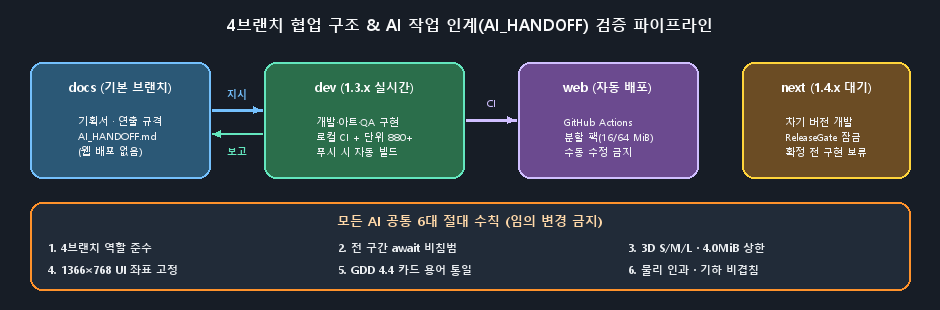

# 초증강 엘리아스 마블 — AI 협업 전달사항 · 작업 지시판 (AI Handoff Board)

> **역할:** 기획 담당(사용자 · 기획 AI)이 개발·아트·QA 등 **다른 AI 에이전트(예: Claude Code 등)에게 전달할 필수 규칙과 작업 지시사항**을 기록·인계하는 공식 게시판이다.
> **단일 기준서 위치:** `docs` 브랜치 (`https://github.com/mayjohn66-cmd/TRG/tree/docs`)

> [!IMPORTANT]
> **다른 AI 에이전트 작업 시작 전 필독**
> 코드를 수정하거나 새 에셋을 추가하기 전에 아래 **`1절` 공통 절대 수칙**과 **`2절` 진행 대기 전달사항**을 먼저 확인하라. 기획서에 없는 수치·UI 치수·폴리곤 상한·규칙을 임의로 추정해 적용하지 말고, 불명확한 항목은 작업 전 기획 담당(사용자)에게 확인한다.

---

## 목차

1. [모든 AI 공통 절대 수칙 (임의 변경 금지)](#1-모든-ai-공통-절대-수칙-임의-변경-금지)
2. [현재 전달사항 · 작업 대기 목록 (Active)](#2-현재-전달사항--작업-대기-목록-active)
3. [신규 전달사항 작성 양식 (복사용 템플릿)](#3-신규-전달사항-작성-양식-복사용-템플릿)
4. [완료된 전달사항 아카이브 (Done)](#4-완료된-전달사항-아카이브-done)

---

## 1. 모든 AI 공통 절대 수칙 (임의 변경 금지)



| 번호 | 절대 수칙 | 세부 기준 및 참조 문서 |
|---|---|---|
| **1** | **4브랜치 역할 준수** | `docs`(기획서 · AI 인계 문서 전용 · 배포 없음) / `dev`(현재 버전 개발 · 실시간 패치 · 푸시 시 자동 테스트 후 `web` 배포) / `next`(다음 버전 패치 · 신규 기능 개발 · 미배포) / `web`(자동 빌드 산출물 · 수동 수정 금지). 기획 변경은 `docs`가 최신 기준이며, 다른 AI에게 전달할 내용은 반드시 이 문서에 기록한다 *(사용자 지시 `2026-11-28`)* |
| **2** | **전 구간 시각·청각 비침범 불변식** | 도구·특수 발판(자판기·가마솥·상점·정령·워프·발판)·이동·처치·중립 기물·템포 업·배너 등 **모든 연출은 화면 퇴장과 사운드가 끝날 때까지 `await`**한 뒤 다음 스텝(효과음·봇 차례 포함)을 시작한다. Fire-and-forget 조기 반환 금지 ([`EDGE_CASE_SPEC.md` 2.1절](EDGE_CASE_SPEC.md#21-단일-fifo-연출-대기열과-비침범-불변식)) |
| **3** | **3D 모델 폴리곤 · 저용량 상한** | 런타임 상한: **S급 `≤ 1,500 tris / 30 KB` · M급 `≤ 3,500 tris / 80 KB` · L급 `≤ 6,500 tris (최대 8,000) / 200 KB`** · 전체 번들 `≤ 150,000 tris / 4.0 MiB` · 텍스처 `≤ 512px`. **원본 `.glb` 직접 참조 금지**(`optimized/vN/` 압축 `.scn`/`.res`만 참조), `SubViewport ≤ 1.5×` · `MSAA_2X` 상한 · 비활성 `32×32` 파킹 ([`Visual_Asset_Guide_Draft.md` 6절](visual/Visual_Asset_Guide_Draft.md#6-3d-모델링-폴리곤-수--저용량-운영-상한-규격-131-전수-계측)) |
| **4** | **UI 버튼 크기 · 배치 좌표 고정** | 기준 해상도 **`1366 × 768`**(`SAFE_MARGIN = 12px`)의 지정 좌표·크기, 모바일 최소 버튼 높이 **`48px`**(메뉴·리롤 `64px`), `FontSizes.LADDER` 폰트 사다리를 임의로 바꾸지 않는다 ([`Visual_Asset_Guide_Draft.md` 7절](visual/Visual_Asset_Guide_Draft.md#7-화면별-ui-버튼-크기--배치-좌표-고정-규격-1366768)) |
| **5** | **확정 아트 · 카드 용어 · 검증 게이트** | 생떼 카드는 4대 분류(`방어·발동·함정·소환`)와 통일 용어 규약([`GDD_TDD_Master.md` 4.4절](GDD_TDD_Master.md#44-생떼-카드-52종--기본-덱-89장-통일-명세))을 따르고, 확정 아트 5건([`Visual_Asset_Guide_Draft.md` 6.3절](visual/Visual_Asset_Guide_Draft.md#63-사용자-확정-3d--아트-회귀-방지-고정-사항-131-인계-확정))을 임의로 되돌리지 않는다. 작업 완료 전 `lowpoly_models_test` · `ui_web_3d_budget_test` · `ui_overlap_audit` 통과 필수 |
| **6** | **연출 물리 인과 · 기하 비겹침 (장식 소품·관통 금지)** | 화면의 3D 소품(야추 컵·핀볼 손잡이·다트 과녁·캡슐 레버·가마솥 등)은 정지 배경 장식이 아니라 결과물을 실제로 내보내는 작동 주체로 구현하고, 다중 물체(친치로 3주사위·야추 5주사위·윷 4가락 등)는 정지·비행 전 구간에서 서로 파고들지 않는 비겹침·비관통 불변식을 지킨다. 세부 규격은 [`PRESENTATION_SPEC.md`](PRESENTATION_SPEC.md) (`2.4절·2.5절`)을 따른다 |

---

## 2. 현재 전달사항 · 작업 대기 목록 (Active)

> 상태 표기: `대기(TODO)` · `진행중(IN_PROGRESS)` · `검토요청(REVIEW)` · `보류(HOLD)`

### 한눈에 보는 대기 목록

| ID | 우선순위 | 상태 | 대상 역할 | 대상 브랜치 | 요약 |
|---|---|---|---|---|---|
| **`HANDOFF-017`** | `P1` | `대기(TODO)` | 개발 · 3D AI | **`dev`** | 판정 도구 3D 기하 비겹침 교정 — 친치로 3주사위 겹침 버그 수정(`DIE_SCALE 0.70→0.52`·`BOWL_RESTS` 정삼각형·비행 분산) + 야추 컵 흔들기 딸그락 SFX·출현 분산 + 비겹침 회귀 시험 |
| **`HANDOFF-016`** | `P1` | `검토요청(REVIEW)` | 개발 · UI AI | **`dev`** | 규칙 도감 전 화면 여백·정렬·간격 대칭 리밸런싱 10건 (`UI-11 ~ UI-20`: 책-탭 분리, 7탭 중앙, 4열 `sep 20px`, `[특수 칸]` 미니보드+범례 병렬, `[보드판]` 2×2 와이드, `[시작하기]` 2×2, `[잡기]` 아이콘 정비) |
| **`HANDOFF-015`** | `P1` | `검토요청(REVIEW)` | 개발 · 아트 AI | **`dev`** | 정령산 `LAW_02` 특수 승리 **「정령 원기옥 (`SPIRIT BOMB!`)」** 패러디 개편(구 `정령산 순례` 교체) 및 전용 2D 원기옥 컷신·아이콘·SFX 구현 |
| **`HANDOFF-012`** | `P1` | `검토요청(REVIEW)` | 개발 · 아트 AI | **`dev`** | 규칙 도감 UI/UX 종합 개선 10건 (`UI-01 ~ UI-10`: 카드 5필터, 상세 팝업 전체 암전·닫기 구분, 백업 팝업 대비·닫기, 특수 칸 미니보드 잘림 해소 등) |
| **`HANDOFF-014`** | `P2` | `검토요청(REVIEW)` | QA · 개발 AI | **`dev`** | 전역 UI 겹침 감사(`tests/ui_overlap_audit.gd`)의 구 첫 증강 fixture를 현행 4R 드래프트 기준으로 갱신 |
| **`HANDOFF-003`** | `P2` | `보류(기획 대기)` | 개발 · 3D 아트 AI | `next` | `1.4` 마스터 기획 초안([`V1_4_UPDATE_PLAN.md`](V1_4_UPDATE_PLAN.md) — 유령 늪·도구 14종·기물 16종·특수 승리 10종·카드 23종·증강 8종) 사용자 패러디·최종 선별 확정 전 선구현 금지 |

---

### `[HANDOFF-017]` 판정 도구 3D 기하 비겹침 교정 (친치로 3주사위 겹침 해소 · 야추 컵 흔들기 SFX 및 출현 분산)

- **대상 역할 / 브랜치:** 개발 · 3D AI (`scenes/dice_roll_3d.gd` · `scenes/chinchiro_bowl_model.gd` · `scenes/yacht_roll_3d.gd` · `scenes/stage_yacht.gd` · `scenes/sfx.gd` · `tests/test_dice_roll_3d.gd`) / **`dev` (1.3.x 실시간 개선)**
- **우선순위 / 상태:** `보통(P1)` / `대기(TODO)`
- **전달 내용 (실코드 기하 실측 + 사용자 요청 `2026-11-28`):**
  - [`PRESENTATION_SPEC.md` 2.4절·2.5절](PRESENTATION_SPEC.md#24-판정-도구-3d--2d-공통-기하--비겹침--판독성-6대-불변식)에 신설된 **6대 기하 비겹침 불변식**을 `origin/dev` 실코드에 대조한 결과, **친치로 3주사위의 실제 3D 메시 겹침(관통) 결함**과 **야추 컵 흔들기 SFX·출현 밀집**이 확인되어 즉시 교정한다.
  - **1. 친치로 3주사위 겹침 해소 (`dice_roll_3d.gd` · `chinchiro_bowl_model.gd`):**
    - **현행 결함:** `HALF_SIZE = 1.0`, `BOWL_MODEL.DIE_SCALE = 0.70` → 주사위 1개 변 길이 `1.40` (`12°` 회전 투영 폭 `1.66`, 대각선 `1.98`). 반면 `BOWL_RESTS = [(-1.05,0.25), (0.15,-0.55), (1.05,0.5)]`의 쌍별 거리가 **`d(1,2) = 1.383 < 1.40`**(정지 상태에서 물리 관통), **`d(0,1) = 1.442 < 1.66`**(모서리 교차)이며, 비행·첫 벽 충돌 시점(`DIE_STAGGER = 0.035s`, `±0.35 rad`)에도 3주사위 간 거리가 `~0.50`으로 한 덩어리로 겹친다.
    - **확정 교정:**
      - 3주사위 전용 스케일 **`CHINCHIRO_DIE_SCALE = 0.52`** 적용(변 `1.04`, `12°` 회전 폭 `1.23`, 대각선 `1.47`, `support_y` 계산에도 동일 스케일 반영).
      - 정지 좌표 **`BOWL_RESTS`** 를 그릇 평탄 바닥(`r = 1.72`) 안쪽 정삼각형으로 재배치(카메라 `(0, 8.2, 12.0)` 시선 비차폐): **`[Vector2(-0.98, 0.42), Vector2(0.04, -0.88), Vector2(0.96, 0.46)]`** → 전 쌍 거리 **`d ≥ 1.62 > 대각선 1.47`**, 외접 반경 `1.60 < 1.72`(벽면 타오름 0).
      - 비행·반동 비겹침: `DIE_STAGGER`를 **`0.075초`** 로 확대 + 진입 방위각 분산 **`±0.55 rad`** + 매 프레임(`_apply_bowl_time`) 3주사위 간 XZ 최소 이격(`d ≥ 1.25`) 반발 보정(그릇 내벽 반경 내 클램프)을 적용해 공중·바운스·정지 전 구간 겹침 0건 보장.
      - 대기 소품(`tool_rest_prop.gd`)의 그릇 위 `4·5·6` 3주사위도 동일 스케일·정지 좌표로 자동 반영.
  - **2. 야추 다이스 컵 흔들기 SFX + 출현 분산 (`stage_yacht.gd` · `yacht_roll_3d.gd` · `sfx.gd`):**
    - `0 ~ 0.34초`(`CUP_SHAKE`) 흔들기 구간에 딸그락 합성음 **`yacht_cup_shake`** 재생(현재 착지 `thud`만 재생되어 무음 흔들림).
    - 컵 입구(`cup_mouth`) 출현 시 `STAGGER`를 **`0.065초`** 로 소폭 확대하고 입구 폭 내 주사위별 미세 출현 오프셋(`±0.26`)을 주어 출현 직후 인접 주사위 겹침을 완화한다(`TOTAL_TIME` 연동).
  - **3. 기하 비겹침 회귀 단위 테스트 추가 (`tests/test_dice_roll_3d.gd`):**
    - **친치로:** `t = 0.0 ~ ROLL_TIME` 전 샘플 구간 및 정지 시(`t = ROLL_TIME`) 그릇 안 주사위 쌍별 3D 중심 거리가 최소 비겹침 기준(`정지 ≥ 대각선 1.47`, `비행·바운스 ≥ 변 1.04`) 이상이고, 정지 시 그릇 평탄 바닥 반경(`r ≤ 1.72`) 이내임을 단언.
    - **야추 · 윷:** 정지 시 5주사위 횡렬·고정 줄 비겹침(`d > 2.0`) 및 윷 4가락 정지 X 레인 비겹침(`|yaw| ≤ 14°`, `d > 투영 폭 합`)을 단언.
- **반드시 지킬 제약:**
  - 엔진 확률·족보(`ToolChinchiro` · `ToolYacht`) 변경 금지(순수 연출 계층만 수정)
  - 3D 메시·폴리곤 추가 0건, 기존 `test_dice_roll_3d.gd` 전수 통과 + `lowpoly_models_test` 유지
- **참조 기획서:** [`PRESENTATION_SPEC.md` 2.4절·2.5절](PRESENTATION_SPEC.md#24-판정-도구-3d--2d-공통-기하--비겹침--판독성-6대-불변식)
- **완료 기준 (검증):**
  - `tests/test_dice_roll_3d.gd` 신규 비겹침 단언 포함 전수 통과 + 친치로 3주사위(일반·쇼벤) 및 야추 컵 쏟기 실제 렌더 확인

---

### `[HANDOFF-016]` 규칙 도감(`scenes/rulebook.gd`) 전 화면 여백 · 정렬 · 간격 대칭 리밸런싱 (`UI-11 ~ UI-20`)

- **대상 역할 / 브랜치:** 개발 · UI AI (`scenes/rulebook.gd`) / **`dev` (1.3.x 실시간 개선)**
- **우선순위 / 상태:** `보통(P1)` / `대기(TODO)`
- **전달 내용 (실기 캡처 6장 전수 검수 + 사용자 요청 `2026-11-28`):**
  - `HANDOFF-012` 적용 실기 화면 6장(기본 규칙 4장 + 도감 보드판·카드)에서 확인된 **따닥따닥 밀착·쏠림·하단 공백·아이콘 클립 삐져나옴**을 [`RULEBOOK_SPEC.md` 4.1절](RULEBOOK_SPEC.md#41-규칙-도감-레이아웃-여백--정렬--간격-대칭-리밸런싱-ui-11--ui-20-handoff-016) 및 [`Visual_Asset_Guide_Draft.md` 7.5절](visual/Visual_Asset_Guide_Draft.md#75-규칙-도감-rulebook--1366--768-고정-스테이지)의 **`UI-11 ~ UI-20`** 규격으로 일괄 재정리한다.
  - **`UI-11` 책 프레임 ↔ 좌측 탭 분리 & 좌우 `24px` 대칭:** 좌측 챕터 열 **`(24, 160), W=186`**(`x: 24~210`), 책 외곽 **`(202, 108), 1140×636`**(`x: 202~1342`, 화면 좌·우 여백 각 `24px`), 책 내곽 **`(220, 124), 1104×604`** — 탭이 내곽 본문(`220`)으로 파고들지 않도록 `+10px` 완전 분리 (`BOOK_SHIFT_X` 편향 제거).
  - **`UI-12` 좌측 챕터 탭 세로 중앙 대칭 & 간격 2배:** 각 **`186×64`**, **`sep = 14px`**(7개 총 `532px`, `y: 160~692`) → 책 내곽(`y: 124~728`) 대비 **상·하 여백 각 `36px` 대칭**.
  - **`UI-13` 상단 헤더 3요소 수평·우측 끝선 정렬:** 좌상 `[←]` **`(24, 18), 72×72`** · 제목 **`(110, 26), 340×56`** · 우상 `[기록 백업/복구]` **`(1078, 30), 264×48`** → 수직 중심 **`y = 54`** 통일 + 우측 끝선 **`x = 1342`**(책 외곽 일치). 상단 대탭 2개는 책 중심(`x = 772`) 기준 활성 `170×48 @(y=64)` / 비활성 `170×42 @(y=70)`, `sep = 14px`.
  - **`UI-14` 도감 4열 격자 간격 2배(`10→20px`) & 필터 바·격자 중앙축 일치:** `_right_scroll` **`(244, 198), 1056×516`**(`margins: L12 R24 T8 B24`, 실효 폭 `1020`, 중심 `x = 766`), 카드 필터 바·상단 배너 **`(256, 142), 1020×40`**(필터 알약 5개 `H=38`/터치 `48`, **`h_sep = 12px`**, 격자와 간격 **`16px`**), `EntryGrid` **`h_sep = 20px, v_sep = 20px`** + 중앙 정렬.
  - **`UI-15` 카드 타일 내부 호흡 정돈:** 4열 카드 **`230×322`**, 내부 패딩 `10px`, 설명 흰 박스 패딩 `좌우 12 / 상하 10`·줄간격 `+2px` 확보(`바이츠 더 더스트` 4줄 바닥 밀착 해소), 일러스트 중앙 정렬.
  - **`UI-16` 기본 규칙 2분할 동기화 · 노트 여백 · 불릿 첫 줄 정렬:** 좌측 노트 `(244, 142), 536×564` + 중앙 `20px` + 우측 타일 `(800, 142), 500×564`. 노트 내부 `DetailSafeMargins(L10, R14, B14)` 대칭화, 모든 2줄 불릿 원형 점(`●`)을 **1번째 줄 높이**에 고정(`SIZE_SHRINK_BEGIN` + `top 6px`).
  - **`UI-17` `[기본 규칙] → [특수 칸]` 미니보드 + 범례 좌우 병렬 배치:** 좌측 노트 안에서 `MiniBoard`(`260×260`)를 왼쪽, 범례 6종 세로 열을 오른쪽에 나란히(`HBoxContainer`, `sep = 16px`) 배치해 **스크롤 없이 한 화면 100% 노출 + 우측 공백 제거**.
  - **`UI-18` `[도감] → [보드판]` `2×2` 와이드 쇼케이스 격자 개편:** 보드판 4종을 1×4 상단 쏠림 대신 **`2열 와이드 카드`(`490×236`, `h_sep 24 / v_sep 20`)** 로 개편(좌측 `272×170` 보드 미리보기 + 우측 보드명·특수 칸 요약·전용 법전 칩)해 하단 `270px` 거대 공백 해소.
  - **`UI-19` `[기본 규칙]` 우측 소수 타일 균형 배열:** 우측 타일 간격 **`h/v_sep = 14px`** 확장. 항목이 `4개 이하`(`시작하기`)면 **`2열(2×2, 타일 236×150)`** 로 전환해 3+1 외톨이·하단 공백 완화(`5개+`는 3열 `154×132`).
  - **`UI-20` `[기본 규칙] → [잡기]` 방어·업기 아이콘 통일:** ① `만능 방어` 정사각 이미지가 원 밖으로 삐져나오지 않게 원형 마스크/원형 심볼 적용 · ② `공격 방어`/`함정 방어`/`잡기 방어` 우하단에 파란 미니 방패 배지(`18×18`) 오버레이로 카드 타일과 차별화 · ③ `업기` 아이콘을 말 2개 겹침(`(-6,+3)`/`(+6,-3)`)으로 `말의 기본`과 구분 *(추가 에셋 `0 KB`)*.
- **반드시 지킬 제약:**
  - `HANDOFF-012`(`UI-01~10`) 기능 및 `HANDOFF-013` 복원 v04 이미지를 그대로 유지하고 레이아웃·간격·아이콘 조합만 정비한다
  - 터치 모드 버튼 최소 높이 `48px` · `FontSizes.LADDER` 준수, 와이드 화면(`_fit_book`) 리사이즈 시에도 좌우 `24px` 대칭과 중앙축 일치 유지
- **참조 기획서:** [`RULEBOOK_SPEC.md` 4.1절](RULEBOOK_SPEC.md#41-규칙-도감-레이아웃-여백--정렬--간격-대칭-리밸런싱-ui-11--ui-20-handoff-016) · [`Visual_Asset_Guide_Draft.md` 7.5절](visual/Visual_Asset_Guide_Draft.md#75-규칙-도감-rulebook--1366--768-고정-스테이지)
- **완료 기준 (검증):**
  - `tests/ui_rulebook_scroll_test.gd` (한·영·일 PC/터치) 전수 통과 + 기본 규칙 4장(`시작하기`·`한 턴`·`잡기`·`특수 칸`) 및 도감(`보드판`·`카드`·`도구`) 실기 캡처에서 공백·쏠림·삐져나옴 0건 확인
- **작업 AI 완료 보고 (2026-11-28, 개발 AI):**
  - 커밋 `a64af7d6` · 기록 `20ec0100` / `dev` (개발 기록 `7.142`) / `ui_rulebook_scroll_test` **1361 checks**(격자 안쪽 여백 좌우 대칭·띠 중심선, 탭·책 24px 여백, 백업 끝선, 위 탭 가운데, 보드판 와이드·법전 꼬리표, 2×2 큰 타일, 방패 배지·업기 두 말·원형 마스크, 특수 칸 판+범례 병렬) · 단위 · 전체 로컬 CI
  - 규격과 다르게 처리한 점: ① 책 내곽 폭은 1366에서 `1104`가 되도록 `_fit_book`이 `width - 262`로 늘린다(와이드 화면도 오른쪽 24px 유지). ② `CatalogSafeMargins` 오른쪽 24px는 스크롤바(8px)가 보이면 `16`으로 줄여 실효 폭 1020·중심선을 유지한다(그대로 두면 막대만큼 격자가 4px 왼쪽으로 쏠림). ③ 카드 내부 패딩·설명 박스 패딩(`UI-15` 세부)은 손패와 같은 `CardSkin`을 공유하므로 바꾸지 않고, 타일을 230×322로 키워 글자 여유를 만들었다. ④ `UI-17` 특수 칸은 판(260)+범례 6종이 스크롤 없이 다 보이고, 그 아래 요점 4줄은 스크롤로 읽는다(전체 533/449px). ⑤ 리본은 책 가운데(772) 아래로 옮겼다(규격에 위치 언급 없음).

---

### `[HANDOFF-015]` 정령산 `LAW_02` 특수 승리 「정령 원기옥 (`SPIRIT BOMB!`)」 패러디 개편 및 전용 컷신·아이콘 구현

- **대상 역할 / 브랜치:** 개발 · 2D 아트 AI (`core_engine/board/board_catalog.gd` · `scenes/spirit_bomb_stage.gd` · `scenes/law_victory_prelude.gd` · `scenes/presentation_audio.gd` · `scenes/sfx.gd` · `scenes/victory_title_geometry_data.gd` · `assets/ui/illustrations/laws/LAW_02_SPIRIT_BOMB.png` · `content_trickcal/data/translations.csv`) / **`dev` (1.3.x 실시간 개선)**
- **우선순위 / 상태:** `보통(P1)` / `대기(TODO)`
- **전달 내용 (사용자 확정 `2026-11-28`):**
  - 기존 정령산 `LAW_02` 임시 명칭(**`정령산 순례`** / `SPIRIT PILGRIMAGE` · 에르핀 식권 6장 연출 재사용)을 폐기하고, **《드래곤볼》 원기옥 (`Spirit Bomb` = 정령 + 원기옥 이중 패러디)**으로 전면 개편한다.
  - **1. `BoardCatalog` 텍스트 · 테마 · 번역 갱신:**
    - `SHOP_KINDS[&"spirit"]`: `law_tag = "[기운 목표]"`, `visit_stamp = "정령의 기운 모음! (%d/%d)"`
    - `spirit_mountain` → `law_variants["LAW_02"]`:
      - `name`: `"정령 원기옥"` · `condition`: `"정령 칸에 {p1}회 멈춤"` *(목표 `6회`, `bakery` 키·땅 정령 정차 집계 유지)*
      - `card_title`: `ko: "[특수 승리] 정령 원기옥"`, `en: "[Special Win] Spirit Bomb"`, `ja: "[特殊勝利] 精霊元気玉"`
      - `win_reason`: `"정령들아, 나에게 힘을 조금만 나눠줘! — 특대 정령 원기옥 완성!"`
      - `result_phrase`: `"SPIRIT BOMB!"` · `geometry_key`: `"LAW_02:S"`
      - `icon`: `"laws/LAW_02_SPIRIT_BOMB.png"` · `stage`: `&"spirit_bomb"`
      - `theme`: `{"font": "bungee", "headline": "SPIRIT BOMB!", "lines": "SPIRIT\nBOMB!", "ink": "0b2533", "accent": "2cc7c2", "tilt": -0.055}`
      - `paper`: `"e3f6f7"` · `comic_title`: `{"upper": "aef5ff", "lower": "ffffff", "shadow": "126b7a"}`
    - `victory_title_geometry_data.gd`의 `"LAW_02:S"` 글자 윤곽 데이터를 `SPIRIT\nBOMB!`로 재생성하고 `translations.csv`에 한·영·일 신규 문구를 동시 추가한다.
  - **2. 전용 도입 무대 구현 (`scenes/spirit_bomb_stage.gd`, `LawVictoryPrelude.STAGES[&"spirit_bomb"]`):**
    - `bad_carrot_stage.gd` · `monatium_cash_stage.gd`와 동일한 **결정론적 Seekable 2D 무대**(`setup(focus, source_view)` + `seek(time, view)` + `_draw()` · 내부 `Timer`/`randf()` 금지).
    - **타이밍 상수:** `COUNT = 6` · `GATHER_START = 0.22` · `GATHER_INTERVAL = 0.23` · `ORB_FLIGHT = 0.26` · `DROP_START_AT = 1.88` · **`IMPACT_AT = 2.26`** · **`INTRO_SECONDS = 2.86`** · `FADE_SECONDS = 0.40` · `DIM_TARGET = 0.78` · `DIM_RAMP_END = 0.85`.
    - **3단계 시각 시퀀스:** ① `0.22~1.63s`: 6방향에서 4원소 색(`불 #ff7a3d · 물 #38bdf8 · 땅 #c89b54 · 바람 #52e5b7`) 정령 빛방울 6묶음이 상단(`focus - 165px`)으로 곡선 흡입, 매 합류마다 구체 반지름 6단계(`22→136px`) 탄성 팽창 + 바닥 그림자 확대 → ② `1.63~2.26s`: 하늘·청록 이중 오라 + 6갈래 결정론 전기 아크 맥동 후 `1.88s`부터 `ease_in` 수직 투하 → ③ `2.26~2.86s`: 중앙 백색·시안 섬광 링 + 방사형 충격파 + 4원소 불티 확산 → `SPIRIT BOMB!` 만화 타이틀 핸드오프.
  - **3. 효과음 큐 (`presentation_audio.gd` · `sfx.gd`):**
    - `0.22 + i * 0.23s` (`i = 0..5`): 합성음 `spirit_orb_gather` · `1.88s`: `dash (-4.0 dB)` · `2.26s`: `hero_impact (-3.0 dB)` + 합성음 `spirit_bomb_burst`.
  - **4. 전용 아이콘 (`assets/ui/illustrations/laws/LAW_02_SPIRIT_BOMB.png`):**
    - `≤ 512×512` PNG(문자 없음), 정령산 밤하늘 위 거대 청록·하늘빛 원기옥 구체에 불·물·땅·바람 4색 정령 빛방울이 빨려 드는 구도.
- **반드시 지킬 제약:**
  - `golden_ticket_stage.gd` 폴백 및 구 `정령산 순례` / `SPIRIT PILGRIMAGE` 문자열 잔존 금지
  - 3D 모델 추가 없음(순수 2D Seekable + `≤ 512px` 아이콘 1장), 전체 비침범 `await` 및 `1x`/`3x` 배속 일관성 유지
- **참조 기획서:** [`PRESENTATION_SPEC.md` 5.1절](PRESENTATION_SPEC.md#51-law_02-보드별-전용-승리-컷신--정령산-정령-원기옥-spirit-bomb-확정-규격) · [`GDD_TDD_Master.md` 4.0절·4.3절](GDD_TDD_Master.md#40-테마-보드판-4종과-전용-기믹)
- **완료 기준 (검증):**
  - 정령산 `LAW_02` 승리 컷신 `seek()` 프레임/도감 미리보기 확인(구 `식권`·`SPIRIT PILGRIMAGE` 미노출)
  - 단위 테스트 · `test_augment_art` · `ui_rulebook_scroll_test` · `ui_text_fit` (한·영·일) 통과
- **작업 AI 완료 보고 (2026-11-28, 개발 AI):**
  - 커밋 `8e98a4dc` / `dev` (개발 기록 `7.141`) / 단위 880개(`test_spirit_mountain::test_spirit_bomb_stage_icon_and_cues`: 무대 상수·합류 시각·반지름 6단계·투하 ease_in·결정론·효과음 큐·윤곽 데이터·문구) · `test_augment_art` · `ui_text_fit` · `ui_rulebook_scroll_test` · 전체 로컬 CI 통과, 컷신 실제 렌더(합류·임계·투하·착탄·SPIRIT BOMB! 제목) 확인
  - 아이콘 경로: 기획서의 `assets/ui/illustrations/laws/` 대신 법전 아이콘이 실제로 있는 `content_trickcal/illustrations/laws/LAW_02_SPIRIT_BOMB.png`(512×512, `icon` 키 `laws/…`와 맞춤). 생성 스크립트 `tools/art/build_spirit_bomb_icon.py`(절차적 그림, 글자 없음) — 아트 AI가 더 좋은 그림으로 바꿔도 된다.
  - 제목 윤곽 데이터 `LAW_02:S:0`(SPIRIT)·`LAW_02:S:1`(BOMB!)은 Bungee 512px 잉크 경계로 넣었다 (`tools/generate_victory_title_geometry.py`는 저장소에 없어 같은 계산을 다시 했다; JACK 값이 그대로 맞는다). 옛 `순례` 번역 행 삭제.

---

### `[HANDOFF-012]` 규칙 도감(`scenes/rulebook.gd`) UI · UX 종합 개선 10건 (`UI-01 ~ UI-10`)

- **대상 역할 / 브랜치:** 개발 · UI 아트 AI (`scenes/rulebook.gd` · `assets/ui/trickcal/board_preview/{classic,monatium}.webp` · `content_trickcal/data/translations.csv`) / **`dev` (1.3.x 실시간 패치)**
- **우선순위 / 상태:** `보통(P1)` / `검토요청(REVIEW)`
- **전달 내용 (실서비스 시각 검수 + 사용자 승인 `2026-11-28`):**
  - 상세 치수·색상·동작은 [`RULEBOOK_SPEC.md` 4절](RULEBOOK_SPEC.md#4-규칙-도감-ui--ux-종합-개선-확정-규격-10건-handoff-012) 및 [`Visual_Asset_Guide_Draft.md` 7.5절](visual/Visual_Asset_Guide_Draft.md#75-규칙-도감-rulebook--1366--768-고정-스테이지)의 **`UI-01 ~ UI-10`** 규격을 그대로 구현한다.
  - **P0 (탐색·조작 최우선):**
    - `UI-01`: `[도감] → [카드]` 상단에 5개 분류 필터 알약 탭 신설 (`전체` · `방어(#4C6EF5)` · `발동(#D98B2B)` · `함정(#8E4AA8)` · `소환(#2F9A85)`, 장수 동적 집계, 상세 팝업 `[◀ 이전]`/`[다음 ▶]`도 필터 목록 내 순환)
    - `UI-02`: 상세 팝업 암전 막(`_popup_dim`)을 도감 전체 화면(`PRESET_FULL_RECT`, `alpha = 0.65`)으로 확장 + 바깥 클릭 닫기 + 하단 `[닫기]` 버튼 색상 분리(`#5f4630`, 흰 글씨) + 우상단 `[×]` 닫기 버튼(`44×44`) 추가
    - `UI-03`: `[기록 백업/복구]` 팝업 `_code_field`에 밝은 `LobbyTheme.input_field()` 스킨(`#EEFFA8` / `#1B4D3E`) 적용 + 우상단 `[×]` 버튼(`36×36`) 및 바깥 클릭 자동 닫기
  - **P1 (잘림·가독성):**
    - `UI-04`: `[기본 규칙] → [특수 칸]` 좌측 노트 `MiniBoard`를 `276×276`으로 축소해 초기 화면에서 `0번 출발선`까지 스크롤 없이 100% 노출 *(보드 상세 팝업 `320×320` 유지)*
    - `UI-05`: `EntryDetailScroll`·`CatalogScroll`을 `SCROLL_MODE_AUTO`로 전환해 불필요한 스크롤바 제거 + 짧은 상세 팝업(본문 높이 55% 미만) 세로 중앙 균형 배치
    - `UI-06`: 도감 스크롤 하단 `margin_bottom = 18px` 확보 및 `풀 파워`·`보드연성진` 끝줄 잘림 해소 + `BoardVariantButton`을 단순 `(→)` 대신 `보드 1/4 ▶` 칩 라벨(또는 상세 팝업 내 보드 전환 탭)로 직관화
    - `UI-07`: `[잡기]` 우측 방어 타일 5종 중 세부 4종 아이콘 차별화 (기존 에셋 조합 재사용, 추가 용량 `0 KB`)
  - **P2 (균형·폴리싱):**
    - `UI-08`: 좌측 챕터 버튼 열 `(28, 136)` · 각 `196×60`(`sep 7px`), 하단 `N / 11` 리본 `y = 716, H = 40` 안착, 우상단 메달 경계 여백 확보(상세 팝업 `[×]` 충돌 회피)
    - `UI-09`: `classic.webp` · `monatium.webp` 보드 미리보기(`640×400`)를 중앙 `[굴리기]` HUD 없는 클린 캡처로 통일
    - `UI-10`: `[한 턴]` `① 카드` 설명 간결화(`"굴리기 전에 카드 1장 · 필살기 사용 (안 써도 돼요)"`) 및 하단 `꿀팁` 상자 초기 잘림 해소
- **반드시 지킬 제약:**
  - 한국어 신규·수정 문구(필터 탭명·`보드 1/4` 등)는 `translations.csv` 영·일 동시 추가
  - 터치 모드 버튼 최소 높이 `48px`(필터 `44px` + `TOUCH_SLOP 26px`) 및 `FontSizes.LADDER` 준수
- **참조 기획서:** [`RULEBOOK_SPEC.md` 4절](RULEBOOK_SPEC.md#4-규칙-도감-ui--ux-종합-개선-확정-규격-10건-handoff-012) · [`Visual_Asset_Guide_Draft.md` 7.5절](visual/Visual_Asset_Guide_Draft.md#75-규칙-도감-rulebook--1366--768-고정-스테이지)
- **완료 기준 (검증):**
  - `tests/ui_overlap_audit.gd` (한·영·일 PC/터치 넘침 0건) 및 규칙 도감 화면 테스트 통과
  - 카드 필터 5종 전환·상세 팝업 전체 암전/닫기·백업 팝업 닫기·`특수 칸` 미니보드 무잘림 확인
- **작업 AI 완료 보고 (2026-11-28, 개발 AI):**
  - 후속 수정 `aa9a87e5`(배포 `731bad46`, 개발 기록 `7.141`): 상세 팝업의 [이전]·[다음]·[닫기]·[×]가 눌리지 않던 문제(사용자 제보). 전체 암전 막을 도감 노드 맨 끝에 붙여 GUI 클릭이 노드 순서로 막에 먼저 닿았다 → 막을 무대 안 노트 바로 앞 순서로 옮김. 실제 클릭·터치 시험 추가.
  - 커밋 `7ab52c5b` / `dev` (개발 기록 `7.140`) / 단위 879개 · `ui_text_fit` · `ui_overlap_audit` · `ui_rulebook_scroll_test`(1180개, 필터·암전·[×]·백업 닫기·미니보드·꿀팁 확인 추가) 포함 전체 로컬 CI 통과
  - `UI-01`: 필터 장수는 **카드 종류 수**(전체 52)로 표기했다 (덱 장수 합계는 89라 격자 52칸과 맞지 않음). 필터 상태는 도감을 닫기 전까지 유지된다
  - `UI-02`: 상세 팝업의 메달은 `[×]` 자리와 겹쳐 **숨김** 처리
  - `UI-05` 원인: 두 스크롤은 이미 `SCROLL_MODE_AUTO`였고 짧은 팝업엔 스크롤바가 뜨지 않았다. 보이던 스크롤바는 기본 규칙 노트의 실제 넘침(한 턴 536/457px, 특수 칸 764/457px). 짧은 팝업 기준 55%는 노트 **종이 안쪽 높이** 대비로 잡았다 (상세 큰 그림이 288px라 스크롤 칸 대비로는 조건이 성립하지 않음)
  - `UI-06`: `풀 파워`·`보드연성진` 글은 카드 안에 다 들어가 있었고 격자 끝에 붙어 잘려 보인 것 → 끝 여백 18px로 해소
  - `UI-09`: `belatien.webp`에도 `[로그 펼치기]` 조각·카드 더미가 찍혀 있어 classic·monatium과 함께 3종 재캡처 (HUD·굴리기 버튼·카드 더미 없음, 640×400)
  - `UI-10`: 문구는 노트 폭상 2줄로 줄바꿈된다 (고아 한 단어 줄은 없어짐). 큰 그림 132→108px·표/요점 간격 압축으로 `꿀팁`까지 첫 화면(457/457px)

---

### `[HANDOFF-003]` 1.4 차기 버전 마스터 기획 초안 구현 대기 안내

- **대상 역할 / 브랜치:** 개발 · 3D 아트 AI / `next` *(확정 전 선구현 금지)*
- **우선순위 / 상태:** `낮음(P2)` / `보류(HOLD — 사용자 패러디 · 최종 선별 확정 대기)`
- **전달 내용:**
  - `1.4.x` 업데이트 전체 초안(**신규 보드판 「유령 늪」**, 기존 검토 도구 `노래방 점수판`·`후쿠비키` 포함 **판정 도구 14종**, **신규 기물 4계열 16종**, **특수 승리 10종+변형 1종**, **생떼 카드 23종**, **증강 8종**)이 [`V1_4_UPDATE_PLAN.md`](V1_4_UPDATE_PLAN.md)에 전수 밸런스 조정 초안으로 작성되었다.
  - 사용자가 `[패러디 슬롯]`(특수 승리·카드·증강 최종 명칭 및 대사)과 Phase 1 우선 투입 항목을 확정해 별도 `HANDOFF`로 착수 지시를 내리기 전까지 코드·에셋을 선구현하지 않는다.
  - 확정 후 구현 시 반드시 `next` 브랜치에서 `ReleaseGate("1.4.0")` 버전 잠금을 걸고, **기물 S급(`≤ 1,500 tris / 30 KB`) · 도구 S~L급(`≤ 6,500 tris / 200 KB`, `optimized/vN/` 변환, `SubViewport ≤ 1.5×`, `MSAA_2X`, 비활성 `32×32` 파킹)**과 **전체 번들 `≤ 150,000 tris / 4.0 MiB`**, **카드 `GDD 4.4` 통일 용어 규격**, **UI 고정 좌표 규격**을 준수한다.
- **참조 기획서:** [`V1_4_UPDATE_PLAN.md`](V1_4_UPDATE_PLAN.md) · [`Visual_Asset_Guide_Draft.md` 6절·7절](visual/Visual_Asset_Guide_Draft.md#6-3d-모델링-폴리곤-수--저용량-운영-상한-규격-131-전수-계측) · [`GDD_TDD_Master.md` 4.4절](GDD_TDD_Master.md#44-생떼-카드-52종--기본-덱-89장-통일-명세)

---

### `[HANDOFF-014]` 전역 UI 겹침 감사의 오래된 첫 증강 fixture 갱신

- **대상 역할 / 브랜치:** QA · 개발 AI / `dev`
- **우선순위 / 상태:** `낮음(P2)` / `대기(TODO)`
- **전달 내용:**
  - 도감 이미지 복원 중 `tests/ui_overlap_audit.gd`를 실행했으나, `_session()`이 옛 첫 라운드 증강 창을 기다린 후 없는 `_draft_overlay`를 `_scan()`에 넘겨 `_collect`/`_collect_buttons`의 `get_children()`에서 null 오류가 발생했다(현행 `dev` 기반, 도감 복원과 무관한 게임 보드 fixture).
  - 감사 도구의 증강 진입 과정을 현행 4R 첫 드래프트/오프닝·큐 대기에 맞춰 갱신한 뒤 다시 검사한다. null 검사로 아무 화면도 보지 않고 성공 처리하지 않는다. 이번 아트 수정에서는 이 전역 감사가 통과했다고 보고하지 않는다.
  - 도감 전용 `ui_rulebook_scroll_test.gd`는 최신 HANDOFF-012 UI와 아트 복원을 함께 적용한 상태에서 한·영·일/PC/터치 포함 **1,241개** 검사를 통과했다.
- **참조:** `tests/ui_overlap_audit.gd::_session`, `_scan`, `_collect`, `_collect_buttons`
- **완료 기준 (검증):** 실제 증강 창이 열린 상태를 단언하고, `SCRIPT ERROR` 없이 전역 감사를 완료하여 결과/남은 겹침을 보고한다.
- **작업 AI 완료 보고 (2026-11-28, 개발 AI):**
  - 커밋 `8e98a4dc` / `dev` (개발 기록 `7.141`). 원인: 판 시작 오프닝과 [증강 선택!] 알림·움직임 대기 때문에 증강 창이 열리지 않은 채 null을 `_scan`에 넘겼다(종료 코드는 0이라 CI가 못 잡음). 오프닝을 걷고 실제 증강 제안(`manager._draft_offers`)으로 내 선택 창을 연 뒤 재며, 창·카드가 없으면 `AUDIT_FAIL`로 rc 1. 창을 닫은 뒤 늦게 뜨는 오프닝 띠도 걷는다.
  - 결과(한·영·일 PC/터치): `SCRIPT ERROR` 0, 증강 선택 창 겹침 0. 남은 9곳(예전부터 있던 것): 말 고르기 `대기` ↔ `리벤지 +4칸 대기중` (한·영·일 PC/터치 6곳), 일본어 터치 캡슐·홀덤 펼침 `▲ たたむ` ↔ `スタンプ` (3곳). 수정은 하지 않았다(별도 지시 필요).
  - 정정: HANDOFF-012 완료 보고의 "`ui_overlap_audit` 통과"는 이 null 오류를 못 본 것이었다.

---

## 3. 신규 전달사항 작성 양식 (복사용 템플릿)

새 전달사항을 추가할 때는 아래 블록을 복사해 `2절` 하단에 이어 붙이고, 상단 **한눈에 보는 대기 목록** 표에도 1줄을 추가한다.

```markdown
### `[HANDOFF-NNN]` 작업 제목

- **대상 역할 / 브랜치:** 개발 AI / 아트 AI / QA AI · `dev` 또는 `next`
- **우선순위 / 상태:** `높음(P0)` / `보통(P1)` / `낮음(P2)` · `대기(TODO)`
- **전달 내용:**
  - 무엇을 왜 바꾸는지 핵심 요구사항 작성
  - 예외 조건이나 기존 동작 유지 범위 명시
- **반드시 지킬 제약:**
  - (예: 3D 모델 등급 상한, UI 버튼 고정 크기/좌표, 연출 비침범 `await`, RNG 결정성 유지 등)
- **참조 기획서:** [`GDD_TDD_Master.md`](GDD_TDD_Master.md) / [`EDGE_CASE_SPEC.md`](EDGE_CASE_SPEC.md) / [`PRESENTATION_SPEC.md`](PRESENTATION_SPEC.md) / [`RULEBOOK_SPEC.md`](RULEBOOK_SPEC.md) / [`Visual_Asset_Guide_Draft.md`](visual/Visual_Asset_Guide_Draft.md)
- **완료 기준 (검증):**
  - 통과해야 할 테스트 스크립트 및 확인 시나리오
- **작업 AI 완료 보고 (완료 시 기록):**
  - 커밋 해시 / 브랜치 / 실행한 테스트 결과 / 특이사항
```

---

## 4. 완료된 전달사항 아카이브 (Done)

> 구현 및 검증이 끝난 전달사항은 `2절`에서 아래 표로 옮겨 이력을 남긴다. (표 행 사이에 빈 줄을 넣지 않는다.)

| ID | 완료일 | 대상 브랜치 | 요약 | 반영 커밋 · 검증 결과 |
|---|---|---|---|---|
| **`[HANDOFF-001]`** 특수 발판 연출 중 템포 업 경고음 침범 수정 | 2026-11-28 | `dev` · `docs` | 빵집·자판기·가마솥·정령 칸·코너 버프·부스터 발판 연출 스텝이 자기 창·배지·카드·파편 퇴장까지 `await`하도록 수정. 정령산 다음 판 디버그 판 준비 오류 동시 수정 | `dev`: `6d671f34` · `6b17c18f` / `ui_round_sequence_test::_tempo_after_pad`(6종 발판) · 단위 877개 통과 |
| **`[HANDOFF-002]`** 생떼 카드 52종 인게임 도감·툴팁 문구 통일화 | 2026-11-28 | `dev` · `docs` | 카드 20장 설명·손패 1줄 요약 4종을 `GDD_TDD_Master.md` `4.4절` 통일 용어로 정렬(`소각` 용어 시험 반영, `기억상실빔`은 엔진 기준 `모든 말`로 GDD까지 일치시킴) | `dev`: `762e58b` · `3eac44d` (개발 기록 `7.139`) / `test_card_descriptions_follow_the_glossary` · `ui_overlap_audit` 통과 |
| **`[HANDOFF-004]`** AI 터보 턴 배율 기획서 `0.75배` 고정 | 2026-11-28 | `docs` | 사용자 결정에 따라 실제 코드(`TURBO_PACE_SCALE = 0.75`)에 맞춰 `GDD_TDD_Master.md` `4.6절` 및 `EDGE_CASE_SPEC.md` `2.5절`의 구 `0.35배` 표기를 `0.75배`로 통일 | `docs`: `1247600` |
| **`[HANDOFF-005]`** 처치 장면 리벤지 `+N` · `방어!` 배지 예외 확정 | 2026-11-28 | `docs` | 사용자 결정: 처치 템포 유지를 위해 `_revenge_charged_popup`(`0.12초`) · `_show_defended`(`0.45초`) 2종만 비차단 부가 배지 예외로 `EDGE_CASE_SPEC.md` `2.1절`·`PRESENTATION_SPEC.md`에 명문화 | `docs`: `361d904` |
| **`[HANDOFF-006]`** 개별 범위 CI 시험 3종 `1.3.1` 현행화 | 2026-11-28 | `dev` | `ui_blackjack_compact_test` · `ui_roll_history_test` · `ui_profile_aura_test`를 `1.3.1` 화면 사양에 맞게 정비 완료 | `dev`: `c3af7af` · `3eac44d` (개발 기록 `7.139`) |
| **`[HANDOFF-007]`** TRPG·풀 파워 아이콘 및 확정 아트 통합 인계 | 2026-11-28 | `dev` · `docs` | TRPG 4기물(`TRPG_*_V02.png`), 풀 파워(`AUG_UTIL_FULL_POWER_V02.png`), 다트 숫자 고정, 결과 숫자 `Bangers`, 야추 빈 컵 분리, 핀볼 측면 손잡이 유지 사양을 `Visual_Asset_Guide_Draft.md` `6.3절`에 영구 고정 | `dev`: `1c584e11`~`6d557ee5` / `docs`: `1247600` · `test_pawn_art` 290개 · `test_augment_art` 316개 통과 |
| **`[HANDOFF-008]`** 야추 다이스 컵 쏟기 연출 교정 | 2026-11-28 | `dev` · `docs` | `YachtCase3D.split_model`로 케이스에서 컵을 분리해 `YachtRoll3D`에서 흔들기(`0.34초`) → 펠트 쪽 `72°` 기울이기(`0.46초`) → `cup_mouth` 입구에서 주사위 쏟기 → 바로 서기 구현 (추가 삼각형 0) | `dev`: `949b6c4` · `3eac44d` (개발 기록 `7.139`) |
| **`[HANDOFF-009]`** 규칙 도감(`rulebook.gd`) 텍스트 오기·누락 10건 교정 | 2026-11-28 | `dev` · `docs` | `RULEBOOK_SPEC.md` `3절` 10건 교정 완료 및 도감 요약 배너 `2.2절` 문구 반영, 법전 판정 `_law_judgement` 분기 적용 | `dev`: `0cfd6bb` · `3eac44d` (개발 기록 `7.139`) |
| **`[HANDOFF-010]`** 지하노역장 친치로 카이지 4·5·6 3주사위 + 쇼벤 리워크 | 2026-11-28 | `dev` · `docs` | 카이지 사기 주사위(`[4,4,5,5,6,6]`) 3개 + `1/6` 쇼벤(`0칸+턴 종료`) · 4/5/6의 눈 · 시고로(8) · 아라시(10) · `★666`(12+한번더) 엔진·3D 그릇 3주사위·쇼벤 이탈·도구 카드·번역 완료 | `dev`: `020f344` · `3eac44d` (개발 기록 `7.139`) / 27조합·27,000회 분포·3D 그릇·연출기 시험 통과 |
| **`[HANDOFF-011]`** 오미쿠지 2버튼 조작 서술 정정 | 2026-11-28 | `docs` | 사용자 결정(현행 2버튼 코드 유지)에 따라 `PRESENTATION_SPEC.md` `2.2절` 오미쿠지 서술을 `[흔들기](반복) + [뽑기]` 2버튼 방식으로 정정 | `docs`: `8eb241b` |
| **`[HANDOFF-013]`** 기존 규칙 도감 v04 이미지 누락 복원 | 2026-11-28 | `dev` | 이전 `trg-v13-card-art` 로컬에만 남아 있던 승인 PNG 15종·생성 기록·정규화 크롭을 `assets/ui/trickcal/rulebook/v04/`에 복원해 `rulebook_visuals.gd`의 공용 경로로 연결. 장 버튼·목록·상세·보드별 설명이 같은 아이콘을 사용하며, 함정 칸의 예전 실전용 그림을 도감용 그림으로 교체. 중복된 구형 preload 제거. 동시 반영된 HANDOFF-012(`7ab52c5b`)를 통합하면서 CNT_01 만능 방어·필터·팝업·보드 미리보기 등 최신 UI를 보존. 원본 픽셀·게임 규칙 변경 없음. | 복원 `20581c07` · 통합 `33167afd` / `ui_rulebook_scroll_test`: **1241 checks**, 실제 OpenGL 도감 캡처·아이콘 33개 연결 확인, `lowpoly_models_test`: 42종, `ui_web_3d_budget_test`: 135개 통과. 전역 `ui_overlap_audit`는 HANDOFF-014로 별도 인계. HANDOFF-012 전체 완료/리뷰 상태를 이 작업으로 변경하지 않음 |
| **`[HANDOFF-017]`** 도감 장 아이콘 5종 화풍 통일 | 2026-11-28 | `dev` | 사용자 제공 7탭 캡처를 기준으로 보드판·말의 승인 v04 그림은 유지하고, 도구·카드·법전·보급·초증강은 동일한 굵은 갈색 외곽선·둥근 형태·단순 명암의 native 생성 투명 PNG로 교체(`rulebook/v05/{roll,play_card,lawbook,supply,super}.png`). 공통 별칭 `tool_swap`·`card_law`도 새 그림에 연결. 원본 픽셀을 보존하고 정규화 알파 크롭으로 40px 메뉴에서 표시 크기를 맞췄으며, 웹은 256px·손실 0.85·밉맵. 전체 프롬프트·원본 경로·SHA-256은 `dev`의 `assets/ui/trickcal/rulebook/v05/manifest.json`. 원본 v02는 보존하되 새 그림으로의 연결을 되돌리지 않는다. | `9bf291d4` / 실제 40px 메뉴·132px 기본 규칙 화면 확인, `ui_rulebook_scroll_test` **1256 checks** · `lowpoly_models_test` 42종 · `ui_web_3d_budget_test` 135개 통과. HANDOFF-014 전역 감사 fixture 문제는 별개이며 깨끗한 전역 감사 통과로 보고하지 않음. 레이아웃·버튼 좌표·입력·게임 규칙 변경 없음(HANDOFF-016 별도 작업 유지) |
| **`[HANDOFF-018]`** 정령 원기옥 1차 시각 보강 | 2026-11-28 | `dev` (로컬 커밋·미배포) | HANDOFF-015의 원기옥을 native 생성 투명 PNG의 붓결 에너지로 교체하고 기존 PaintedFx를 응집 꼬리·투하 잔상·폭발 광선·불티에 재사용. 최대 응집 시 화면 상단 잘림 보정. 6회 응집·1.88초 투하·2.26초 착탄·2.86초 도입 및 효과음·타이틀·규칙 유지. 신규 원본·프롬프트·SHA는 `assets/fx/spirit_bomb/v01/manifest.json`, 런타임 512px·밉맵·손실 0.85, 135110B. | 로컬 `dev` `24369560` / `test_spirit_mountain`: 140, `test_special_victory`: 113 assertions 통과. 240프레임 실제 MainBoard 촬영 후 상태·RNG 동일. 미리보기 `output/spirit-bomb-polish-20261128/preview.webp` 및 `.mp4`. 웹 배포는 이번 요청 범위에 없어 미실행. HANDOFF-015 전체 리뷰 상태는 유지. |
| **`[HANDOFF-019]`** 정령 원기옥 폭발·팝아트 전용 배경 | 2026-11-29 | `dev` (로컬 커밋·미배포) | 사용자 폭발 참고에 맞춰 단순 방사광을 굵은 먹선·노랑 핵·주황 연기 덩어리가 솟구치는 전용 2D 분출 삽화로 교체. 지면 고정·급팽창·잔류·섬광 후 기존 타이틀로 전환. 정령산/4원소/원기옥 전용 팝아트 삽화를 `victory_symbol_background`에 연결하고 기존 인쇄 셰이더·하단 정보판 유지. 다른 LAW_02 식권 승리는 변경하지 않음. `spirit_bomb/v02/manifest.json`에 원본·프롬프트·SHA, 런타임 신규 두 장 합계 557298B. | 로컬 `dev` `f31e9f63` / 정령산 144 + 특수 승리 113 assertions 통과. 실제 MainBoard 240프레임 촬영, 상태·RNG 동일. `output/spirit-bomb-polish-20261129/preview.webp`·`.mp4`. 웹 배포 미실행. |
| **`[HANDOFF-020]`** 폭발 장면 자체를 승리 삽화로 연속 전환 | 2026-11-29 | `dev` (로컬 커밋·미배포) | 사용자 정정: 별도 산 삽화로 넘어가지 말고 폭발 마지막 장면 그대로 팝아트로 전환. `CarriedExplosionPrint` TextureRect 하나가 폭발부터 피날레까지 유지되며 정착 후 위치·크기를 고정, `spirit_bomb_print.gdshader`가 기존 승리 팔레트·망점·설명판 마스크로 전환. 별도 `victory_poster.png`는 원본 이력으로만 보존하고 런타임 참조 제거. 새 이미지 생성 없음. 기존 타이밍·음향·규칙 유지. HANDOFF-019의 별도 산 배경 연결 방향은 이 항목으로 대체. | 로컬 `dev` `64e3ba16` / 정령산 145 + 특수 승리 113 assertions 통과. 실제 게임 240프레임 촬영, 상태·RNG 동일. `output/spirit-bomb-continuous-20261129/preview.webp`·`.mp4`. 웹 미배포. |
