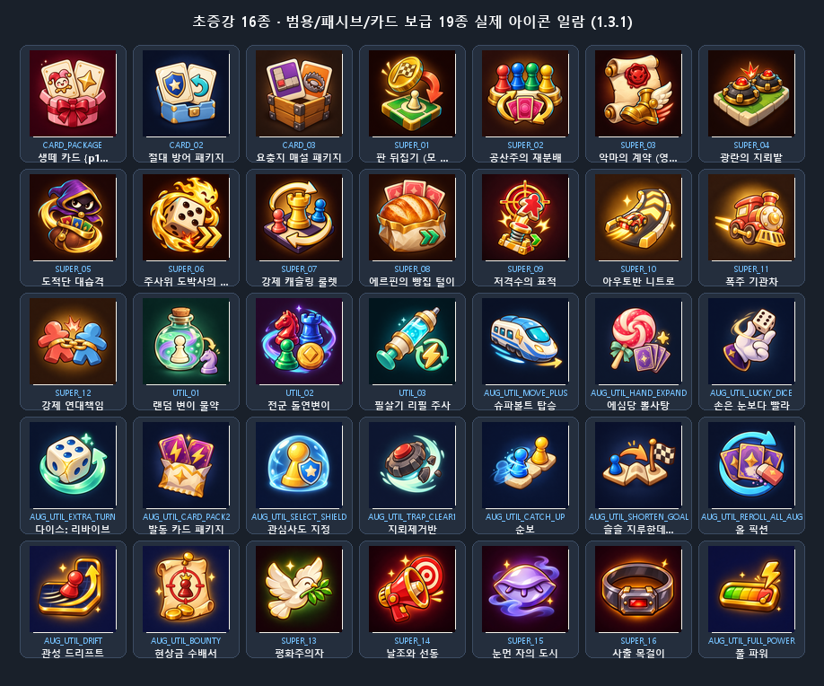
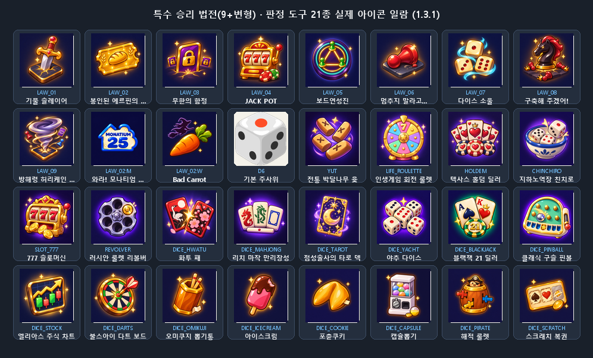
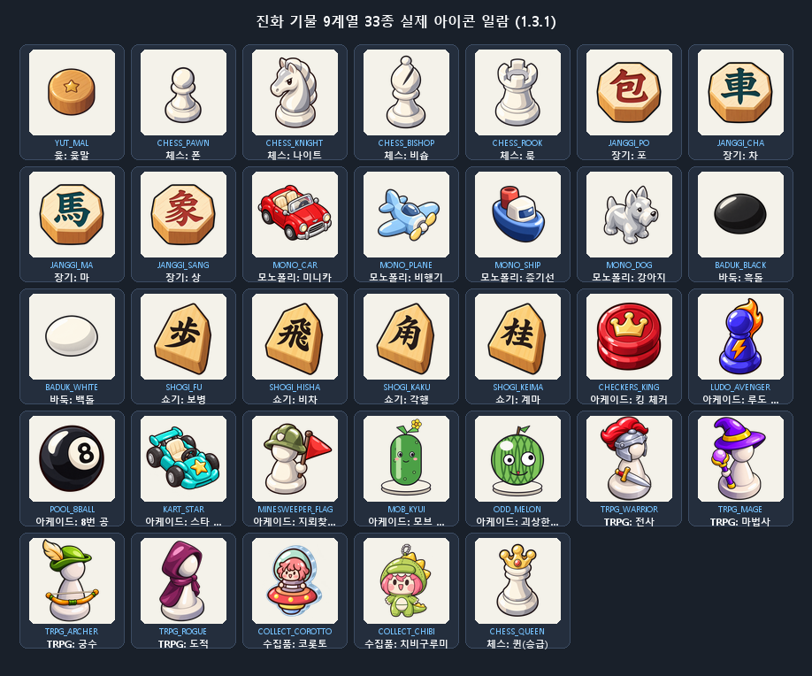
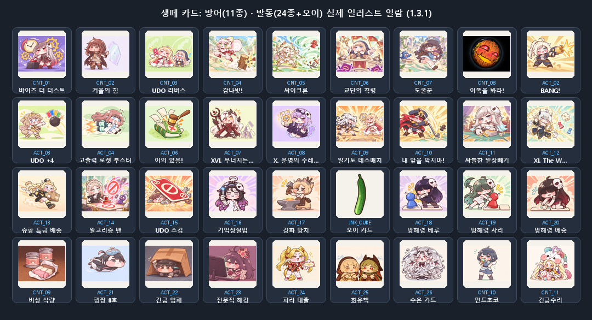
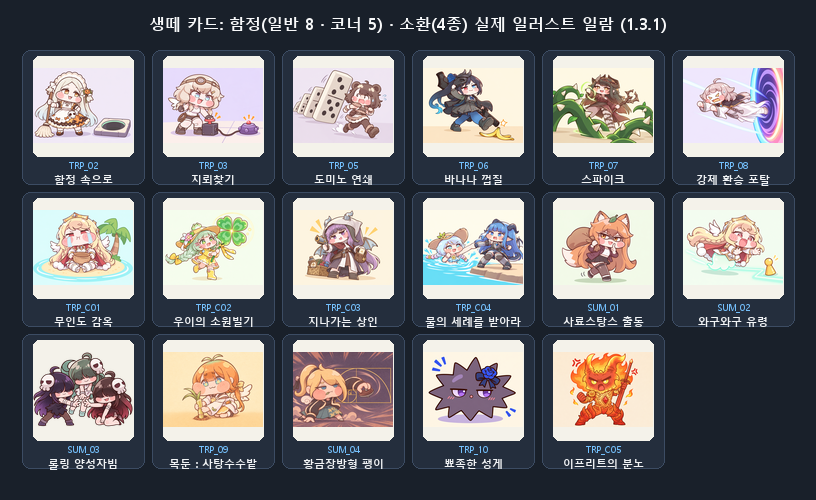

# 초증강 엘리아스 마블 — 전수 콘텐츠 아이콘 · 일러스트 · 개별 연출 백과사전 (`CONTENT_VISUAL_FX_CATALOG`)

> **문서 기준:** `v1.3.1` (`origin/dev` 실코드 · `content_trickcal/illustrations/` · `assets/cards/` 전수 대조)
> **목적:** 게임 내 **모든 증강(96종) · 특수 승리 법전(9종+보드 변형 3종) · 진화 기물(33종) · 판정 도구(21종) · 생떼 카드(52종+오이 1종)** 하나하나에 대해 **① 실제 아이콘/일러스트 파일 경로 ② 실제 그림 외형(썸네일 시트 포함) ③ 발동·선택·지속·피격 시 출력되는 고유 연출·타이밍·사운드·스크립트 위치**를 빠짐없이 기록한 단일 기준 백과사전이다.
>
> - **규칙 · 밸런스 수치 원본:** [`GDD_TDD_Master.md`](GDD_TDD_Master.md)
> - **21종 판정 도구 3D 물리 · 비겹침 규격:** [`PRESENTATION_SPEC.md`](PRESENTATION_SPEC.md)
> - **충돌 우선순위 · FIFO 비침범 불변식:** [`EDGE_CASE_SPEC.md`](EDGE_CASE_SPEC.md)
> - **3D 폴리곤 · UI 좌표 제작 규격:** [`visual/Visual_Asset_Guide_Draft.md`](visual/Visual_Asset_Guide_Draft.md)

---

## 목차

1. [초증강 16종 (`SUPER_01 ~ SUPER_16`) — 아이콘 외형 & 전용 보드 연출](#1-초증강-16종-super_01--super_16--아이콘-외형--전용-보드-연출)
2. [범용 · 패시브 · 카드 보급 증강 19종 (`CARD_*` · `UTIL_*` · `AUG_UTIL_*`)](#2-범용--패시브--카드-보급-증강-19종-card_--util_--aug_util_)
3. [특수 승리 법전 9종 (+ 보드별 변형 3종) — 아이콘 · 도입 무대 · 만화 타이틀 · SFX](#3-특수-승리-법전-9종--보드별-변형-3종--아이콘--도입-무대--만화-타이틀--sfx)
4. [진화 기물 9계열 33종 (`EVO_1_1 ~ EVO_9_2` + 퀸) — 아이콘 외형 & 패시브·필살기 연출](#4-진화-기물-9계열-33종-evo_1_1--evo_9_2--퀸--아이콘-외형--패시브필살기-연출)
5. [판정 도구 21종 (`D6` ~ `DICE_SCRATCH`) — 도구 아이콘 외형 & 연출 연계](#5-판정-도구-21종-d6--dice_scratch--도구-아이콘-외형--연출-연계)
6. [생떼 카드 52종 (+ 오이 카드 1종) — 일러스트 외형 & 발동·피격·기폭·소환 연출](#6-생떼-카드-52종--오이-카드-1종--일러스트-외형--발동피격기폭소환-연출)

---

## 1. 초증강 16종 (`SUPER_01 ~ SUPER_16`) — 아이콘 외형 & 전용 보드 연출

> 초증강은 드래프트에서 전원 선택 공개 카드가 뜬 뒤 `_draft_deferred` 큐에서 선택 순서대로 실행되며, `scenes/super_fx.gd` 및 초증강별 전용 스테이지 스크립트가 **로그를 읽지 않아도 보드만 보고 무슨 일이 일어났는지 알 수 있게** 고유 장면을 재생한다.

*▲ `origin/dev` 실제 게임 내 `content_trickcal/illustrations/augments/` 승인 아이콘 35종 전수 썸네일*

| ID | 증강명 | 아이콘 경로 (`illustrations/`) | 실제 아이콘 외형 | 게임 내 발동 · 지속 연출 시퀀스 & 스크립트 |
|---|---|---|---|---|
| `SUPER_01` | **판 뒤집기 (모 아니면 도)** | `augments/SUPER_01.png` | 초록 타일 위 말과 체커 깃발 황금 동전, 뒤집히는 빨간 화살표 | **`fate_coin_3d.gd` + `super_fx.gd`:** 보드 중앙에 3D 운명의 동전(`230×230`, `TOSS_TIME 1.05s`) 회전 투척 → 앞면(체커 깃발) 시 대상 말이 즉시 결승선으로 급행 완주, 뒷면 시 출발선 홈런 사출 |
| `SUPER_02` | **공산주의 재분배** | `augments/SUPER_02.png` | 4색 말 4개가 나란히 서고 앞쪽 빨간 카드들이 원형 화살표로 순환 | **`redistribution_stage.gd` + `redistribution_art.gd`:** 전원의 말·손패 중앙 집결(`GATHER_END 0.55s`) → 꼴찌 좌표로 일괄 이동(`0.62~1.22s`) → 카드 덱 셔플(`1.30s~`) 후 각 플레이어 프로필로 2장씩 재분배 비행 |
| `SUPER_03` | **악마의 계약 (영구 가속)** | `augments/SUPER_03.png` | 붉은 악마 인장이 찍힌 양피지 계약서와 날개 달린 황금 부츠 | **`devil_contract_stage.gd` (`TOTAL_TIME 2.78s`):** 완주 말 1개를 제물로 소환(`OFFER_END 0.68s`) → 붉은 마법진(`#f04465`)으로 계약서 흡수(`1.38s`) → 계약 에너지가 시전자에게 도달(`2.02s`)하며 영구 `+3칸` 각인 |
| `SUPER_04` | **광란의 지뢰밭** | `augments/SUPER_04.png` | 초록 보드 타일 위 빨간 경보 램프가 깜빡이는 둥근 지뢰 2기 | **`minefield_stage.gd`:** 대상 빈 칸 2곳에 바닥 경고 마크 투영(`WARNING_END 0.62s`) → `0.28s` 시차로 지뢰 낙하(`DROP_TIME 0.36s`) → 착지(`0.16s`) 후 은신 매설 전환 + 함정 카드 1장 비행 지급 |
| `SUPER_05` | **도적단 대습격** | `augments/SUPER_05.png` | 보라 후드를 쓴 그림자 도적과 카드가 가득 담긴 황금 보따리 | **`raid_cutin.gd` (`1.05s`) + `raid_stage.gd`:** 흰 붓 자국 찢김 → 좁은 눈매 컷인(`raid_shing.png`, `IMPACT 0.20s`, `EXIT 0.68s`) → 각 상대 프로필 테두리 점멸 및 카드 강탈 비행(`SNATCH_TIME 0.22s`) + 중립 소환 카드 지급 |
| `SUPER_06` | **주사위 도박사의 영혼** | `augments/SUPER_06.png` | 황금 불꽃 영혼이 감싸며 돌진하는 흰 주사위 | **`gambler_fx.gd`:** 선택 시 영혼 점화(`ACTIVATE_TIME 1.30s`) → 이번 라운드 굴림 시 황금 영혼 링(`#ffd267`) 점화(`IGNITE_TIME 0.86s`) 후 `×2배` 가속 또는 눈금 `1 이하` 과열 폭발(`RESULT_TIME 1.05s`, 0칸·턴 종료) |
| `SUPER_07` | **강제 캐슬링 룰렛** | `augments/SUPER_07.png` | 체스 룩과 적·청 말 3개가 둥근 화살표로 자리를 맞바꾸는 구도 | **`castling_stage.gd` (`TOTAL_TIME 2.92s`):** 보드 위 실제 말 뷰를 공중 부양(`LIFT_START 0.30s`) → 황금 궤도 고속 회전 셔플(`SPIN_START 0.74~1.94s`) → 엔진 확정 치환 좌표로 순차 착지 |
| `SUPER_08` | **에르핀의 빵집 털이** | `augments/SUPER_08.png` | 종이 봉투에 담긴 큼직한 식빵과 뒤에 꽂힌 빨간 카드 3장 | **`bakery_stage.gd` + `bakery_art.gd`:** 에르핀이 보드에 난입(`SPOT 0.28s` → `DASH 0.84s` → 빵집 진입 `1.80s`) → 빵집 내부 소동·연기 연출 후 빵 보따리를 들고 탈주하며 카드 3장 비행 + 대기 말 1개 첫 빵집 출격 |
| `SUPER_09` | **저격수의 표적** | `augments/SUPER_09.png` | 황금 조준대 위 빨간 말에 정통으로 꽂힌 붉은 십자 조준경 | **`sniper_stage.gd` (`TOTAL_TIME 1.23s`):** 선두 적 말에 화면 암전·줌인 조준(`LOCK_START 0.56s`) → 저격 발사(`SHOT_AT 1.02s`) → 명중(`HIT_AT 1.07s`) 슬로모션 후 대상 말 홈런 사출 + 내 말 `+4칸` 전진 |
| `SUPER_10` | **아우토반 니트로** | `augments/SUPER_10.png` | 불꽃 화살표 고속도로 트랙 위를 질주하는 빨간 미니 스포츠카 | **`nitro_stage.gd`:** 내 선두 말 점화 차지(`CHARGE 0.24s`) → 근접 카메라 추적하며 다음 코너까지 니트로 고속 질주(`DASH 0.60s`) → 충돌 시 임팩트 슬로모션(`SLOW 0.24s`)과 함께 해당 칸 모든 말 동시 장외 사출(`FLIGHT 0.74s`) |
| `SUPER_11` | **폭주 기관차** | `augments/SUPER_11.png` | 화염과 증기를 뿜으며 돌진하는 붉은 장난감 증기기관차 | **`runaway_train_stage.gd` + `runaway_train_3d.gd`:** 선택된 한 변에 3D 선로(`straight_track_v01.scn`) 투영 → 3D 기관차(`runaway_train_v02.scn`)가 보드 투영 좌표에 맞춰 변 전체를 횡단 질주하며 접촉 시각(`contact_time`)에 맞춰 말 사출·함정 일괄 파괴 |
| `SUPER_12` | **강제 연대책임** | `augments/SUPER_12.png` | 굵은 황금 쇠사슬로 단단히 묶인 빨간 말과 파란 말 | **`bond_stage.gd` + `bond_art.gd` (`TOTAL_TIME 1.68s`):** 선두 말과 꼴찌 말에 암전 포커스(`bond_focus.gdshader`) → 두 말에서 사슬 링크가 뻗어 나와(`REACH 0.22s`) 중앙 자물쇠 체결(`LOCK 0.82s`) → 이후 말 토큰 위 상시 사슬 표시, 동반 완주/사출 시 연쇄 펄스 |
| `SUPER_13` | **평화주의자** | `augments/SUPER_13.png` | 초록 올리브 나뭇가지를 입에 문 빛나는 흰 비둘기 | **`super_fx.gd::_pacifist` (`0.60s`):** 시전자 프로필에서 민트색 평화 링 확산 + `good` SFX → 보드 위 내 모든 말 위에 평화 파동(`&"peace"`) 재생 및 다음 증강전까지 말 토큰 상시 평화 오라 유지 |
| `SUPER_14` | **날조와 선동** | `augments/SUPER_14.png` | 붉은 과녁을 향해 쩌렁쩌렁 외치는 빨간 확성기 | **`super_fx.gd::_agitate`:** 시전자 손패 전체가 뒷면 카드로 중앙을 향해 소각 비행(`0.055s` 시차) → 지정 대상 프로필에 붉은 선동 표적 링 부착(다음 증강전까지 모든 공격 카드가 해당 대상으로 강제 유도) |
| `SUPER_15` | **눈먼 자의 도시** | `augments/SUPER_15.png` | 보랏빛 안개 구름 속에 눈꺼풀을 꾹 감은 신비로운 보라 눈 | **`super_fx.gd::_blind_city` (`0.90s`):** 보드 전체 영역을 보랏빛 안개 막(`&"fog"`)이 덮으며(`0.41s` 정점) 모든 말·함정이 일제히 은신 실루엣으로 전환(이번 라운드 동안 아군 포함 블라인드 충돌) |
| `SUPER_16` | **사출 목걸이** | `augments/SUPER_16.png` | 중앙에 붉은 경보 램프가 점등된 단단한 금속 목걸이 | **`super_fx.gd::_necklace` + `pawn_token.gd`:** 선택한 내 말 위(`y - 38px`)에서 금속 목걸이가 툭 떨어져 채결(`0.36s` + `toy_click` SFX) → 라운드 중 붉은 램프 점멸(`_necklace_signal_tween`)·공격 방어·`×2` 이동 → 라운드 종료 시 목걸이 폭발과 함께 해당 말 사출 |

---

## 2. 범용 · 패시브 · 카드 보급 증강 19종 (`CARD_*` · `UTIL_*` · `AUG_UTIL_*`)

> 아이콘 원본은 `1절` 상단 썸네일 시트(`sheet_augments_super_util.png`) 참조. 영구 패시브는 좌측 `[내 증강]` 목록에 상시 기록되며 조건 발동 시 보드 위 배지/이펙트가 출력된다.

| ID | 증강명 | 아이콘 경로 (`illustrations/`) | 실제 아이콘 외형 | 발동 · 지속 연출 방식 |
|---|---|---|---|---|
| `CARD_PACKAGE` | **생떼 카드 2장** | `augments/CARD_PACKAGE.png` | 빨간 리본 선물 상자에서 솟은 조커·별 카드 2장 | 드래프트 확정 직후 덱에서 시전자 손패로 카드 2장 비행(`_fly_card_to_profile`) |
| `CARD_02` | **절대 방어 패키지** | `augments/CARD_02.png` | 파란 상자 속 방패·반사 화살표 방어 카드 2장 | 드래프트 확정 직후 방어 카드 2장 손패 비행 지급 |
| `CARD_03` | **요충지 매설 패키지** | `augments/CARD_03.png` | 나무 함정 상자 속 보라 코너·일반 함정 카드 2장 | 드래프트 확정 직후 함정 카드 2장(코너 1 + 일반 1) 손패 비행 지급 |
| `AUG_UTIL_CARD_PACK2` | **발동 카드 패키지** | `augments/AUG_UTIL_CARD_PACK2.png` | 찢어진 황금 팩에서 튀어나온 번개 발동 카드 2장 | 드래프트 확정 직후 발동 카드 2장 손패 비행 지급 |
| `UTIL_01` | **랜덤 변이 물약** | `augments/UTIL_01.png` | 초록·보라 마법빛 플라스크 속 기본 말과 밖의 나이트 말 | 선택 말 위 변이 섬광·파티클 → 새 진화 기물 토큰으로 교체 + `+3칸` 즉시 도약 이동 + 필살기 충전 표시 |
| `UTIL_02` | **전군 돌연변이** *(PRISMA)* | `augments/UTIL_02.png` | 보라 오라 속 체스·장기·바둑 기물 4종이 함께 빛남 | 미완주 내 말 전원에 동시 변이 섬광 → 각기 다른 진화 기물로 일괄 교체 + 기물 독 필살기 버튼 전원 점등 |
| `UTIL_03` | **필살기 리필 주사** | `augments/UTIL_03.png` | 하늘빛 에너지 주사기와 초록 번개 재충전 마크 | 기물 독의 소진된 `[필살기 발동!]` 버튼들이 일제히 빛나며 재활성화 + 카드 1장 지급 |
| `AUG_UTIL_MOVE_PLUS` | **슈파볼트 탑승** | `augments/AUG_UTIL_MOVE_PLUS.png` | 파란 번개 줄무늬가 그려진 고속 탄환 열차 | 영구 패시브 — 매 굴림 결과 정산 시 최종 이동 눈금에 `+1` 합산 및 이동 로그/미리보기 반영 |
| `AUG_UTIL_HAND_EXPAND` | **에심당 뽈사탕** | `augments/AUG_UTIL_HAND_EXPAND.png` | 분홍 회오리 롤리팝 사탕과 보라 카드 3장 | 획득 시 카드 1장 지급 + 손패 카운터 상한이 `7 → 8장`으로 영구 확장 표시 |
| `AUG_UTIL_LUCKY_DICE` | **손은 눈보다 빨라** | `augments/AUG_UTIL_LUCKY_DICE.png` | 흰 마술사 장갑 손가락 끝에서 튕기는 주사위 | 영구 패시브 — 엔진 내부 상위 눈금 재추첨 보정(시각 개입 없이 자연 고눈금 출현) |
| `AUG_UTIL_EXTRA_TURN` | **다이스: 리바이브** | `augments/AUG_UTIL_EXTRA_TURN.png` | 초록 순환 화살표가 감싼 파란 점 주사위 | `0칸 · 턴 종료` 굴림 발생 시 `revive_triggered` 이벤트 알림 배너 재생 후 같은 플레이어 추가 턴 부여(1회 소모) |
| `AUG_UTIL_DRIFT` | **관성 드리프트** | `augments/AUG_UTIL_DRIFT_V02.png` | 코너 커브를 황금 불꽃을 뿜으며 꺾는 빨간 말 | 영구 패시브 — 내 말이 코너(`8·16·24`)를 통과할 때마다 보드 위 `+2칸` 드리프트 가속 배지 및 추가 도약 연결 |
| `AUG_UTIL_FULL_POWER` | **풀 파워** | `augments/AUG_UTIL_FULL_POWER_V02.png` | 녹→노→빨강 끝까지 차오른 게이지 바와 번개 마크 | 영구 패시브 — 게이지 도구 5종(주사위·윷·친치로·야추·핀볼) 조작 시 **파워 게이지 끝 `85%+` 구간에 금색 테두리 강조**, 적중 시 `+2칸` 풀 파워 보너스 배지 |
| `AUG_UTIL_SELECT_SHIELD` | **관심사도 지정** | `augments/AUG_UTIL_SELECT_SHIELD.png` | 파란 투명 보호막 구체 안의 황금 말과 별 방패 | 지정한 내 말 토큰 위에 반투명 파란 보호막 링 상시 표시 → 잡기·함정 1회 피격 시 `방어!` 배지(`0.45s`)와 함께 소멸 |
| `AUG_UTIL_BOUNTY` | **현상금 수배서** | `augments/AUG_UTIL_BOUNTY_V02.png` | 압정으로 꽂힌 수배지 속 빨간 말 과녁과 금화 | 1등 적 선두 말 위에 `WANTED` 수배 마크 상시 부착 → 해당 말 처치 시 수배 달성 알림 + 즉시 `+10칸` 고속 전진 |
| `AUG_UTIL_TRAP_CLEAR1` | **지뢰제거반** | `augments/AUG_UTIL_TRAP_CLEAR1.png` | 회오리 바람에 날아가 해체되는 검은 지뢰 | 선택 직후 대상 상대 함정 칸에 철거 이펙트·파괴 알림 재생(상대 함정이 없으면 카드 1장 지급) |
| `AUG_UTIL_CATCH_UP` | **순보** | `augments/AUG_UTIL_CATCH_UP.png` | 파란 잔상을 남기며 앞선 노란 말 바로 뒤로 순간이동 | 선택 직후 가장 뒤처진 내 말이 청색 잔상과 함께 보드 전체 선두 말 바로 뒤 칸으로 고속 점프 이동 |
| `AUG_UTIL_SHORTEN_GOAL` | **슬슬 지루한데...** | `augments/AUG_UTIL_SHORTEN_GOAL.png` | 접힌 보드 지도를 건너 체커 결승 깃발을 앞당기는 화살표 | 선택 직후 결승선 단축 알림 + 보드 끝자락 2칸에 결승선 단축 시각 표시 영구 반영 |
| `AUG_UTIL_REROLL_ALL_AUG` | **올 픽션** | `augments/AUG_UTIL_REROLL_ALL_AUG.png` | 지우개와 하늘빛 순환 화살표가 증강 카드 3장을 지워 다시 뽑음 | 전원 선택 공개 직후 `올 픽션!` 전면 알림 → 전원 선택 무효화 및 새 3지선다 드래프트 재개시(라운드당 1회) |

---

## 3. 특수 승리 법전 9종 (+ 보드별 변형 3종) — 아이콘 · 도입 무대 · 만화 타이틀 · SFX

> 특수 승리 달성 시 `VictoryCutscene` → 원인 칸 스포트라이트(`0.80s`) → **`LawVictoryPrelude` 전용 도입 무대(`2.5 ~ 3.3s`, 순수 결정론 Seekable)** → 만화 컷 타이틀(`LawVictoryTheme`) → 순위 도장 순으로 재생된다.

*▲ `origin/dev` 실제 게임 내 법전(`laws/`) 및 판정 도구(`dice/`) 승인 아이콘 32종 전수 썸네일*

| ID | 교칙명 | 아이콘 경로 (`illustrations/`) | 실제 아이콘 외형 | 전용 도입 무대 (`scenes/`) · 타이밍 · 시각 시퀀스 | 만화 타이틀 (`font` · `accent`) · 오디오 큐 |
|---|---|---|---|---|---|
| `LAW_01` | **기물 슬레이어** | `laws/LAW_01.png` | 갈라진 석판 타일에 깊숙이 꽂힌 붉은 손잡이 검 | **`mochi_slayer_stage.gd`** (`IMPACT 0.54s`): 거대한 검(`arena_sword_v01.webp`)이 지면에 꽂히며 균열(`arena_crack_v01.webp`) 생성 → 잉크 판화 프린트로 전환 후 좌측 이동 | **`Mochi Reality Shock`** (`Bangers`, `#d73335`) · `sword_plant (0.54s)` |
| `LAW_02` | **봉인된 에르핀의 식권** *(에르핀 왕국)* | `laws/LAW_02.png` | 식빵이 새겨진 빛나는 황금 식권 티켓 | **`golden_ticket_stage.gd`** (`COUNT 6`, `JOIN 2.50s`): 찢어진 황금 식권 6조각이 `0.34s` 간격으로 날아와 한 장의 완전한 황금 식권으로 합체 | **`Sweet Victory`** (`Pacifico`, `#c27a26`) · `ticket_rustle ×6` → `ticket_join (3.20s)` |
| `LAW_02:M` | **와라! 모나티엄 25** *(모나티엄 도시)* | `laws/LAW_02_MONATIUM.png` | 파란 편의점 간판 모양의 `MONATIUM 25` 로고 | **`monatium_cash_stage.gd`** (`COUNT 6`, `INTRO 3.16s`): 지폐 다발 6뭉치(`monatium_cash_v01.png`)가 `0.35s` 간격으로 쿵쿵 쌓이며 사방으로 동전 튕김 | **`MONATIUM\nDAYS`** (`Bungee`, `#2f86d6`) · `monatium_cash_drop ×6` → `monatium_cash_reward` |
| `LAW_02:W` | **Bad Carrot** *(벨라티엔 왕국)* | `laws/LAW_02_BAD_CARROT.png` | 보라 마녀 빗자루 실루엣 아래 빛나는 주황 당근 | **`bad_carrot_stage.gd`** (`COUNT 6`, `FLIGHT 1.39s`, `IMPACT 1.97s`, `INTRO 2.48s`): 당근 6개가 쌓인 뒤 마녀 실루엣이 빗자루로 가로지르며 당근 6개를 사방으로 흩날림 | **`BAD\nCARROT`** (`Bangers`, `#8a4fc4`) · `hop ×6` → `dash` → `hero_impact` |
| `LAW_02:S` | **정령 원기옥** *(정령산 · `HANDOFF-015`)* | `laws/LAW_02_SPIRIT_BOMB_V02.png` | 청록·백색 원기옥 아래의 주황·노랑 분출 폭발 (V02 · 실제 승리 컷신과 주제 통일) | **`spirit_bomb_stage.gd`** (`COUNT 6`, `DROP 1.88s`, `IMPACT 2.26s`, `INTRO 2.86s`, [실기 연출 WebP](visual/spec_media/spirit_bomb_victory_v02.webp)): 6방향 4원소 빛방울 6묶음 흡입·6단계 팽창 → 전기 아크 → 수직 투하 → 연속 폭발 피날레 | **`SPIRIT\nBOMB!`** (`Bungee`, `#2cc7c2`) · `spirit_orb_gather ×6` → `dash` → `hero_impact` + `spirit_bomb_burst` |
| `LAW_03` | **무한의 함정** | `laws/LAW_03.png` | 황금 자물쇠가 걸린 보라 함정 카드들과 갈라진 지면 | **`infinite_trap_stage.gd`** (`COUNT 18`, `FIELD 0.82s`, `HERO 2.48s`): 18장의 함정 카드가 언덕처럼 차례로 지면에 꽂힌 뒤 초대형 대표 함정 카드 낙하 → 전체 판화 전환 | **`Unlimited\nTrap Works`** (`Bungee`, `#a63d78`) · `trap_embed ×5` → `hero_impact (3.08s)` |
| `LAW_04` | **JACK POT** | `laws/LAW_04.png` | 빨간 `777` 슬롯머신과 앞쪽 빨간·초록 카지노 칩 | **`law_victory_prelude.gd::_jackpot`** (`IMPACT 0.54s`): 초록 카지노 테이블 암전 위 금색 잭팟 광선·코인 분수 폭발 | **`JACK\nPOT`** (`Bungee`, `#e7b743`) · `casino_win (0.54s)` |
| `LAW_05` | **보드연성진** | `laws/LAW_05.png` | 네온 청록·보라 이중 원 안에 삼각형으로 연결된 초록 말 3개 | **`alchemy_victory_motion.gd`** (`RISE 1.24s`, `FRONT 1.95s`, `INTRO 2.60s`): 보드 위 3말이 이룬 원형 연성진이 빛나며 공중으로 떠올라 정면 회전 전개 | **`CIRCLE\nCOMPLETE`** (`SongMyung`, `#7950c2`) · 연성진 공명음 |
| `LAW_06` | **멈추지 말라고...** | `laws/LAW_06.png` | 어두운 타일 위에 힘없이 옆으로 쓰러진 빨간 말과 붉은 잔상 | **`perma_death_stage.gd`** (`FALL 0.98s`, `IMPACT 1.58s`, `MORPH 1.92s`, `INTRO 2.80s`): 실제 기본 말 스프라이트가 비틀거리다 왼쪽으로 쓰러진 뒤 비장한 판화 아트로 변환 | **`Perma\nDeath`** (`BlackOpsOne`, `#9e4055`) · 쓰러짐·임팩트 SFX |
| `LAW_07` | **다이스 소울** | `laws/LAW_07.png` | 하늘빛 영혼 바람을 휘감고 도는 흰 주사위 3개 | **`dice_soul_stage.gd`** (`FRONT 2.05s`, `MORPH 2.40s`, `INTRO 3.25s`): 투명 3D 공간에서 둥근 주사위가 빛의 궤적을 그리며 정면 돌진 후 만화 프린트 전환 | **`ENDLESS\nDICE`** (`Bungee`, `#23bdcb`) · 연속 굴림 차징 SFX |
| `LAW_08` | **구축해 주겠어!** | `laws/LAW_08.png` | 붉은 갈기의 검은 체스 나이트와 주변에 쓰러진 빨간 말들 | **`attack_meeple_stage.gd`:** 왕관 쓴 선두 말 베어내기 → 검은 나이트 강하 임팩트 → 거인 패러디 판화 프린트 전환 | **`Attack on Meeple`** (`BebasNeue`, `#bd3035`) · 베기·강하 임팩트 SFX |
| `LAW_09` | **방해령 허리케인 포스!!** | `laws/LAW_09.png` | 보라색 초대형 회오리바람 속에 휘말린 방해령 카드들 | **`hurricane_force_stage.gd`:** 보드 중앙에서 보랏빛 대폭풍 회오리가 솟아오르며 방해령 3종 카드가 소용돌이친 뒤 보드 초토화 | **`HURRICANE\nFORCE`** (`Orbitron`, `#9767b8`) · 폭풍 굉음 SFX |

---

## 4. 진화 기물 9계열 33종 (`EVO_1_1 ~ EVO_9_2` + 퀸) — 아이콘 외형 & 패시브·필살기 연출

> 모든 기물 1회 필살기 발동 시 **`scenes/pawn_skill_cutin.gd`** 의 방향성 스킬 컷인이 중앙 알림(`EventAnnouncer`) 시계와 동기화되어 재생되며, 보드 위 기물 토큰(`PawnToken`)은 하단 중앙 기물 독과 동일한 일러스트/배지를 표시한다.

*▲ `origin/dev` 실제 게임 내 기물 진화 승인 아이콘 33종(체스 퀸 승급 포함) 전수 썸네일*

| 계열 | 기물 ID (`이름`) | 아이콘 경로 (`illustrations/`) | 실제 아이콘 외형 | 패시브 / `[1회]` 필살기 연출 방식 |
|---|---|---|---|---|
| **윷** | `YUT_MAL` (윷말) | `pawns/YUT.png` | 별이 새겨진 둥근 원목 윷말 | 처치 시 `한 번 더!` 재굴림 배지 · `[1회]` 스킬 컷인 + 즉시 재굴림 충전 |
| **체스** | `CHESS_PAWN` (폰) | `pawns/CHESS_PAWN.png` | 흰색 클래식 체스 폰 | 반환점(`16번`) 이상 도달 시 황금 승급 섬광과 함께 **`CHESS_QUEEN`** 으로 토큰 즉시 교체 |
| **체스** | `CHESS_QUEEN` (퀸) | `pawns/CHESS_QUEEN.png` | 황금 왕관을 쓴 흰색 체스 퀸 | *(폰 승급 전용)* 모든 이동 `+2칸` 표시 및 경로 위 말·함정 관통 도약 |
| **체스** | `CHESS_KNIGHT` (나이트) | `pawns/CHESS_KNIGHT.png` | 흰색 말 머리 체스 나이트 | 코너 직전 정차 시 `+2칸` 도약 · `[1회] 기사의 맹세`: 컷인 + 이번 턴 사출 면역 오라 |
| **체스** | `CHESS_BISHOP` (비숍) | `pawns/CHESS_BISHOP.png` | 십자 홈이 파인 흰색 체스 비숍 | 코너 직전 정차 시 `+1칸` 코너 진입 · `[1회] 피앙케토`: 컷인 + 대각선 코너 순간이동 |
| **체스** | `CHESS_ROOK` (룩) | `pawns/CHESS_ROOK.png` | 성탑 모양의 흰색 체스 룩 | 코너 미회전 직진 시 `+2칸` · `[1회] 단독 캐슬링`: 컷인 + 아군 말 1개와 포물선 위치 교환 |
| **장기** | `JANGGI_PO` (포) | `pawns/JANGGI_PO.png` | 빨간 한자 `包`가 새겨진 팔각 나무 장기알 | 경로에 내 말이 있으면 `+3칸` · `[1회] 포격`: 컷인 + 최선두 적 말에 포격 낙하·사출 |
| **장기** | `JANGGI_CHA` (차) | `pawns/JANGGI_CHA.png` | 초록 한자 `車`가 새겨진 팔각 나무 장기알 | 직진 시 `+2칸` · `[1회] 직선 전차 저격`: 컷인 + 직선 돌진 저격으로 선두 적 사출 |
| **장기** | `JANGGI_MA` (마) | `pawns/JANGGI_MA.png` | 초록 한자 `馬`가 새겨진 팔각 나무 장기알 | 앞 칸 비면 `+2칸` · `[1회] 뒷발차기`: 컷인 + 뒤 2칸 적 말 사출 |
| **장기** | `JANGGI_SANG` (상) | `pawns/JANGGI_SANG.png` | 빨간 한자 `象`이 새겨진 팔각 나무 장기알 | 앞 칸 비면 `+2칸` · `[1회] 코끼리 지진`: 컷인 + 앞뒤 2칸 지진 파동으로 설치물 전파괴 |
| **모노폴리** | `MONO_CAR` (미니카) | `pawns/MONO_CAR.png` | 빨간 클래식 오픈카 미니어처 | 부스터 발판 정차 시 카드 1장 비행 · `[1회] 호텔 건설`: 컷인 + 현재 칸에 내 호텔 설치물 생성 |
| **모노폴리** | `MONO_PLANE` (비행기) | `pawns/MONO_PLANE.png` | 하늘색 프로펠러 비행기 미니어처 | 반환점 통과 시 카드 1장 비행 · `[1회] 직항 워프`: 컷인 + 반환점(`16번`)으로 직항 비행 |
| **모노폴리** | `MONO_SHIP` (증기선) | `pawns/MONO_SHIP.png` | 파란 선체·빨간 굴뚝 미니 증기선 | 첫 적 설치물 조우 시 발동 없이 파괴 이펙트 재생 후 통과 |
| **모노폴리** | `MONO_DOG` (강아지) | `pawns/MONO_DOG.png` | 흰색 테리어 강아지 미니어처 | 특수 발판 스침 통과 시마다 덱에서 카드 1장 비행 지급 |
| **바둑** | `BADUK_BLACK` (흑돌) | `pawns/BADUK_BLACK.png` | 광택 나는 둥근 검은 바둑돌 | 홀수 눈금 전진 시 `+1칸` · **`[1회] 진짜 알까기 슈팅` (`stage_alkkagi.gd`, `960×660`):** 전용 알까기 보드 열림 → 방향·세기 직접 드래그 조준 발사 → 맞은 적 전원 사출 + 근처 안착 |
| **바둑** | `BADUK_WHITE` (백돌) | `pawns/BADUK_WHITE.png` | 매끈한 둥근 흰 바둑돌 | 상시 1회 방어막 표시 — 잡기·함정 피격 시 `방어!` 배지(`0.45s`)와 함께 무효화 |
| **쇼기** | `SHOGI_FU` (보병) | `pawns/SHOGI_FU.png` | `歩`가 적힌 오각 나무 쇼기말 | 반환점 통과 시 나리(토킨) 승급 광채 · `[1회] 모치고마 낙하`: 컷인 + 대기 말 1개 옆 칸 즉시 투하 |
| **쇼기** | `SHOGI_HISHA` (비차) | `pawns/SHOGI_HISHA.png` | `飛`가 적힌 오각 나무 쇼기말 | 반환점 통과 시 용왕 승급 · `[1회] 용왕 베기`: 컷인 + 앞 2칸 적 말 일괄 처치 |
| **쇼기** | `SHOGI_KAKU` (각행) | `pawns/SHOGI_KAKU.png` | `角`이 적힌 오각 나무 쇼기말 | 반환점 통과 시 용마 승급 · `[1회] 용마 십자 베기`: 컷인 + 앞뒤 1칸 적 말 처치 |
| **쇼기** | `SHOGI_KEIMA` (계마) | `pawns/SHOGI_KEIMA.png` | `桂`가 적힌 오각 나무 쇼기말 | 반환점 통과 시 승급 · `[1회] 계마 도약`: 컷인 + `+2칸` 도약(처치 시 `+1칸` 추가 연쇄) |
| **아케이드** | `CHECKERS_KING` (킹 체커) | `pawns/CHECKERS_KING.png` | 황금 왕관이 얹힌 이중 빨간 체커 말 | 이동 경로상 지나가는 적 말마다 스침 처치·사출 연쇄 발동 |
| **아케이드** | `LUDO_AVENGER` (루도 복수자) | `pawns/LUDO_AVENGER.png` | 불꽃 머리와 번개 마크가 박힌 파란 루도 말 | 리벤지 부스터 출격 시 추가 `+4칸` 로켓 가속 연장 |
| **아케이드** | `POOL_8BALL` (8번 공) | `pawns/POOL_8BALL.png` | 흰 원 안에 숫자 `8`이 적힌 검은 당구공 | 적 처치 직후 `+3칸` 추가 돌진 · `[1회] 뱅크샷`: 컷인 + 전방 최단 적에게 직진 돌격 처치 |
| **아케이드** | `KART_STAR` (스타 카트) | `pawns/KART_STAR.png` | 노란 별이 박힌 민트색 레이싱 카트 | 모든 추가 이동 `+2칸` · 이동 중 함정 통과 무적 반짝임 |
| **아케이드** | `MINESWEEPER_FLAG` (지뢰찾기 공병) | `pawns/MINESWEEPER_FLAG.png` | 철모를 쓰고 빨간 깃발을 든 흰 말 | 함정 면역 + 밟은 적 함정 해체 이펙트·카드 1장 비행 · `[1회] 지뢰 매설`: 현재 칸 지뢰 설치 |
| **아케이드** | `MOB_KYUI` (모브 큐이) | `pawns/MOB_KYUI.png` | 꽃잎이 달린 귀여운 초록 오이 캐릭터 토큰 | 지나가는 적 방어 무시 통과 · `[1회] 오이 대접`: 컷인 + 대상 상대 손패에 `오이 카드` 투입 |
| **아케이드** | `ODD_MELON` (괴상한 멜론) | `pawns/ODD_MELON.png` | 땡그란 두 눈이 달린 동그란 초록 멜론 토큰 | 이동 중 경로 적 말 처치 + 뒤 1칸 아군 업기 자석 연동 |
| **TRPG** | `TRPG_WARRIOR` (전사) | `augments/pawns/TRPG_WARRIOR_V02.png` | 붉은 깃털 투구를 쓰고 단검을 든 흰 말 | 처치 시 `Lv.UP!` 배지 + 추가 전진(`+1~3칸`) · `[1회] 일자 베기`: 컷인 + 1칸 전진 베기 처치 |
| **TRPG** | `TRPG_MAGE` (마법사) | `augments/pawns/TRPG_MAGE_V02.png` | 보라 마법사 모자와 마법 지팡이를 든 흰 말 | 처치 시 `Lv.UP!` 추가 전진 · `[1회] 파이어볼`: 컷인 + 선두 적 말에 화염구 사출 |
| **TRPG** | `TRPG_ARCHER` (궁수) | `augments/pawns/TRPG_ARCHER_V02.png` | 초록 깃털 모자와 활을 든 흰 말 | 처치 시 `Lv.UP!` 추가 전진 · `[1회] 애로우샷`: 컷인 + 최후방 적 말 화살 사출 |
| **TRPG** | `TRPG_ROGUE` (도적) | `augments/pawns/TRPG_ROGUE_V02.png` | 자주색 후드 망토를 둘러쓴 흰 말 | 처치 시 `Lv.UP!` 추가 전진 · `[1회] 은밀기동`: 컷인 + 이번 턴 사출 면역 은신 오라 |
| **수집품** | `COLLECT_COROTTO` (코롯토) | `augments/pawns/COLLECT_COROTTO_V02.png` | 빨간 UFO 투명 캡슐에 탄 분홍 머리 미니 피규어 | 결승선 완주 시 수집 버프 획득 알림 → 남은 경기 내내 주사위 `+1` 영구 적용 |
| **수집품** | `COLLECT_CHIBI` (치비구루미) | `augments/pawns/COLLECT_CHIBI_V02.png` | 공룡 잠옷을 입은 분홍 머리 열쇠고리 인형 | 결승선 완주 시 수집 버프 획득 알림 → 턴 종료 굴림 발생 시 50% 확률 자동 재굴림 발동 배지 |

---

## 5. 판정 도구 21종 (`D6` ~ `DICE_SCRATCH`) — 도구 아이콘 외형 & 연출 연계

> 21종 판정 도구의 3D 소품 동작·타이밍·기하 비겹침 불변식은 [`PRESENTATION_SPEC.md` 2절](PRESENTATION_SPEC.md#2-판정-도구-21종-개별-연출--소품-동작-명세)을 단일 기준으로 삼으며, 아래 표는 `sheet_laws_and_tools.png`(3절 상단)에 수록된 **도구 카드·전광판 실제 아이콘 외형**을 기록한다.

| ID | 도구명 | 아이콘 경로 | 실제 아이콘 외형 | 상세 3D 연출 참조 |
|---|---|---|---|---|
| `D6` | **기본 주사위** | `emoji/dice.png` | 빨간 1점·검은 2·3점이 그려진 둥근 흰 주사위 | [`PRESENTATION_SPEC` 2.1·2.5절](PRESENTATION_SPEC.md#21-보드-위-투척-도구-toss--3종) |
| `YUT` | **전통 박달나무 윷** | `dice/DICE_YUT.png` | `×` 각인이 새겨진 나무 윷가락 4개 | [`PRESENTATION_SPEC` 2.1·2.5절](PRESENTATION_SPEC.md#21-보드-위-투척-도구-toss--3종) |
| `LIFE_ROULETTE` | **인생게임 회전 룰렛** | `dice/DICE_ROULETTE.png` | 황금 테두리에 `★7`이 강조된 무지개 10분할 원판 | [`PRESENTATION_SPEC` 2.2·2.5절](PRESENTATION_SPEC.md#22-꺼내기-도구-drop--rise--10종) |
| `HOLDEM` | **텍사스 홀덤 딜러** | `dice/DICE_POKER.png` | 하트 로열 스트레이트 5장과 빨간 카지노 칩 3개 | [`PRESENTATION_SPEC` 2.3·2.5절](PRESENTATION_SPEC.md#23-카드-시점-매트-도구-card_table--8종) |
| `CHINCHIRO` | **지하노역장 친치로** | `dice/DICE_CHINCHIRO.png` | 푸른 무늬 도자기 밥그릇 안에 담긴 주사위 3개 | [`PRESENTATION_SPEC` 2.1·2.4·2.5절](PRESENTATION_SPEC.md#24-판정-도구-3d--2d-공통-기하--비겹침--판독성-6대-불변식) |
| `SLOT_777` | **777 슬롯머신** | `dice/DICE_SLOT.png` | 빨간 `777`이 뜬 황금 슬롯머신과 쏟아진 금화 | [`PRESENTATION_SPEC` 2.2·2.5절](PRESENTATION_SPEC.md#22-꺼내기-도구-drop--rise--10종) |
| `REVOLVER` | **러시안 룰렛 리볼버** | `dice/REVOLVER.png` | 6약실 중 1발에 황금 탄환이 장전된 금속 실린더 | [`PRESENTATION_SPEC` 2.2·2.5절](PRESENTATION_SPEC.md#22-꺼내기-도구-drop--rise--10종) |
| `DICE_HWATU` | **화투 패** | `dice/DICE_HWATU.png` | 1월 송학(학)과 3월 벚꽃 광 화투패 2장 | [`PRESENTATION_SPEC` 2.3·2.5절](PRESENTATION_SPEC.md#23-카드-시점-매트-도구-card_table--8종) |
| `DICE_MAHJONG` | **리치 마작 만리장성** | `dice/DICE_MAHJONG.png` | 중(빨간 용)·발(초록 용)·백 삼원패 3장 | [`PRESENTATION_SPEC` 2.3·2.5절](PRESENTATION_SPEC.md#23-카드-시점-매트-도구-card_table--8종) |
| `DICE_TAROT` | **점성술사의 타로 덱** | `dice/DICE_TAROT.png` | 보라 밤하늘에 황금 초승달·별이 새겨진 타로 카드 | [`PRESENTATION_SPEC` 2.3·2.5절](PRESENTATION_SPEC.md#23-카드-시점-매트-도구-card_table--8종) |
| `DICE_YACHT` | **야추 다이스** | `dice/DICE_YACHT.png` | 보라 오라 위에 모인 흰 주사위 5개 | [`PRESENTATION_SPEC` 2.3·2.4·2.5절](PRESENTATION_SPEC.md#23-카드-시점-매트-도구-card_table--8종) |
| `DICE_BLACKJACK` | **블랙잭 21 딜러** | `dice/DICE_BLACKJACK.png` | `A♠`·`K♥` 카드 2장과 초록 `21` 칩 | [`PRESENTATION_SPEC` 2.3·2.5절](PRESENTATION_SPEC.md#23-카드-시점-매트-도구-card_table--8종) |
| `DICE_PINBALL` | **클래식 구슬 핀볼** | `dice/DICE_PINBALL.png` | 민트색 보드 위 쇠구슬·못·빨간 플런저 미니 핀볼대 | [`PRESENTATION_SPEC` 2.3·2.5절](PRESENTATION_SPEC.md#23-카드-시점-매트-도구-card_table--8종) |
| `DICE_STOCK` | **엘리아스 주식 차트** | `dice/DICE_STOCK_V02.png` | 빨강·초록 캔들봉 위로 급등하는 황금 화살표 모니터 | [`PRESENTATION_SPEC` 2.2·2.5절](PRESENTATION_SPEC.md#22-꺼내기-도구-drop--rise--10종) |
| `DICE_DARTS` | **불스아이 다트 보드** | `dice/DICE_DARTS_V02.png` | 황금 테두리 과녁 정중앙에 꽂힌 빨간 깃 다트 | [`PRESENTATION_SPEC` 2.2·2.4·2.5절](PRESENTATION_SPEC.md#22-꺼내기-도구-drop--rise--10종) |
| `DICE_OMIKUJI` | **오미쿠지 뽑기통** | `dice/DICE_OMIKUJI_V02.png` | 육각 원목 뽑기통 상단 구멍에서 삐죽 나온 제비 막대 2개 | [`PRESENTATION_SPEC` 2.2·2.5절](PRESENTATION_SPEC.md#22-꺼내기-도구-drop--rise--10종) |
| `DICE_ICECREAM` | **아이스크림** | `dice/DICE_ICECREAM_V02.png` | 초코 코팅이 한 입 베어 물린 분홍 딸기 아이스바 | [`PRESENTATION_SPEC` 2.2·2.5절](PRESENTATION_SPEC.md#22-꺼내기-도구-drop--rise--10종) |
| `DICE_COOKIE` | **포츈쿠키** | `dice/DICE_COOKIE_V02.png` | 노릇하게 구워진 반달 접힘 황금 포츈쿠키 | [`PRESENTATION_SPEC` 2.2·2.5절](PRESENTATION_SPEC.md#22-꺼내기-도구-drop--rise--10종) |
| `DICE_CAPSULE` | **캡슐뽑기** | `dice/DICE_CAPSULE_V02.png` | 알록달록 캡슐이 가득한 흰 가챠 기계와 앞쪽 황금 캡슐 | [`PRESENTATION_SPEC` 2.2·2.5절](PRESENTATION_SPEC.md#22-꺼내기-도구-drop--rise--10종) |
| `DICE_PIRATE` | **해적 룰렛** | `dice/DICE_PIRATE.png` | 빨간·파란 칼이 꽂힌 오크통 속에서 고개 내민 해적 피규어 | [`PRESENTATION_SPEC` 2.2·2.4·2.5절](PRESENTATION_SPEC.md#22-꺼내기-도구-drop--rise--10종) |
| `DICE_SCRATCH` | **스크래치 복권** | `dice/DICE_SCRATCH.png` | 스페이드·하트·은박 3칸이 나란한 황금 복권과 동전 | [`PRESENTATION_SPEC` 2.3·2.5절](PRESENTATION_SPEC.md#23-카드-시점-매트-도구-card_table--8종) |

---

## 6. 생떼 카드 52종 (+ 오이 카드 1종) — 일러스트 외형 & 발동·피격·기폭·소환 연출

> 모든 생떼 카드는 공통적으로 사용 시 중앙 `(683, 330)`에 **카드 미리보기 + `84px` 도장 알림(`EventAnnouncer`)** 이 재생되며, `[공격 발동]` 8종은 빨간 공격 경보 띠와 피격자 방어 팝업(`InterceptionPrompt`)을 동반한다. 아래 표에는 공통 연출 외 **카드별 실제 일러스트 외형과 고유 전용 연출**을 전수 기록한다.

### 6.1 방어 (`COUNTER` · 11종) 및 발동 (`INSTANT` · 24종 + 오이 1종)

*▲ `origin/dev` 실제 게임 내 `assets/cards/` 방어·발동 승인 일러스트 36종 전수 썸네일*

| ID | 카드명 | 분류 | 일러스트 경로 (`assets/cards/`) | 실제 일러스트 외형 | 고유 발동 · 피격 연출 방식 |
|---|---|---|---|---|---|
| `CNT_01` | **바이츠 더 더스트** | 만능 방어 | `CNT_01.png` | 시계·톱니바퀴 앞에서 빨간 되감기 버튼을 누르는 림 | 피격 팝업 발동 → 시간 역행 알림 + `_fx_generation++` 잔류 이펙트 일괄 정리 + 턴 시작 스냅샷 좌표로 말·손패 즉시 복원 및 공격자 턴 종료 |
| `CNT_02` | **거울의 힘** | 잡기 방어 | `CNT_02.png` | 육각 투명 거울 방패를 펼친 가비아 | 피격 팝업 발동 → 반사 방어 배지 + 공격해 온 적 말 즉시 장외 홈런 사출 |
| `CNT_03` | **UDO 리버스** | 공격 방어 | `CNT_03.png` | 빨간 리버스 카드를 들고 웃는 에르핀과 놀란 네르 | 피격 팝업 발동 → 반사 알림 + 공격자 선두 말 장외 사출(해킹 반사 시 공격자 해킹 배지) |
| `CNT_04` | **감나빗!** | 공격 방어 | `CNT_04.png` | 화살 맞은 통나무 뒤로 뛰어 피하는 모모 | 피격 팝업 발동 → 회피 `방어!` 배지(`0.45s`) 출력 후 공격 무효화 |
| `CNT_05` | **싸이크론** | 함정 방어 | `CNT_05.png` | 회오리바람으로 함정과 말을 날려 보내는 실라 | 피격 팝업 발동 → 밟은 함정 파괴 이펙트 + 내 말 `+3칸` 즉시 도약 이동 |
| `CNT_06` | **교단의 칙령** | 함정 방어 | `CNT_06.png` | 보라 함정을 무효화하며 지팡이를 든 네르 | 피격 팝업 발동 → 함정 제거 + 설치자 프로필에서 내 손패로 카드 1장 강탈 비행 |
| `CNT_07` | **도굴꾼** | 함정 방어 | `CNT_07.png` | 함정 카드를 몰래 챙겨 도망가는 마요 | 피격 팝업 발동 → 보드 함정 회수 + 해당 함정 카드가 내 손패로 비행 획득 |
| `CNT_08` | **이쪽을 봐라!** | 잡기 방어 | `CNT_08.png` | 붉은 불빛 눈으로 노려보는 빅우드 | 피격 팝업 발동 → `방어!` 배지 후 공격 말과 같은 칸에 나란히 안착 |
| `CNT_09` | **비상 식량** | 잡기 방어 | `CNT_09.png` | 뜯어진 통조림 2캔과 분홍 비상식량 블록 | **`expansion_card_fx.gd(&"rations")` (`0.92s`):** 대상 칸 위 비상식량 포장 뜯기 연출 + `rations_wrap` SFX + 덱에서 카드 1장 획득 |
| `CNT_10` | **민트초코** | 공격 방어 | `CNT_10.png` | 민트초코 아이스크림을 든 시온 | **`cucumber_eat_fx.gd(mint=true)` (`1.48s`):** 방어자 아바타 입으로 민트초코를 3입 베어 먹는 셰이더 연출 + 카드 1장 획득 |
| `CNT_11` | **긴급수리** | 공격 방어 | `CNT_11.png` | 토끼 인형을 끌어안고 수리하는 리뉴아 | **`emergency_repair_fx.gd` (`1.65s`):** 인형 긴급 수리 연출(`doll.png`) + 상대가 쓴 공격 카드를 내 손패로 획득 |
| `ACT_02` | **BANG!** | 공격 발동 | `ACT_02.png` | 노란 불꽃을 뿜으며 리볼버를 쏘는 칸나 | **`bang_stage.gd` (`TOTAL 1.12s`):** 3D 리볼버가 대상 선두 말을 조준 → `0.58s` 발사 → `0.65s` 명중 → `0.74s` 홈런 사출 + 총구 연기 |
| `ACT_03` | **UDO +4** | 공격 발동 | `ACT_03.png` | 검은 폭탄과 4색 카드를 건네는 버터 | 폭탄 패스 알림 → 다음 플레이어 선두 말 사출 + 내 선두 말 `+4칸` 도약 |
| `ACT_04` | **고출력 로켓 부스터** | 버프 발동 | `ACT_04.png` | 등에 쌍발 로켓을 메고 급발진하는 엘레나 | 버프 알림 + 이번 굴림 결과 합산 시 `+4칸` 보너스 표기 |
| `ACT_06` | **이의 있음!** | 너프 발동 | `ACT_06.png` | 초록 법전 위에 빨간 X 도장을 내리찍는 나무 망치 | 대상 선택 모달 → 법전 슬롯 해당 기록 `0`으로 리셋 점멸 알림 |
| `ACT_07` | **XVI. 무너지는 탑** | 공격 발동 | `ACT_07.png` | 무너지는 카드탑 앞에서 당황한 벨리타 | 4변 중 1변 선택 → 해당 변의 모든 설치물 순차 파괴 이펙트 |
| `ACT_08` | **X. 운명의 수레바퀴** | 공격 발동 | `ACT_08.png` | 운명의 카드를 들어 올린 앨리스 | 내 꼴찌 말과 1등 적 선두 말이 쌍방향 포물선 궤적으로 위치 교환 |
| `ACT_09` | **일기토 데스매치** | 공격 발동 | `ACT_09.png` | 검을 겨누며 대치하는 티그와 상대 | **`DuelArenaModal` (`560×360`):** `2.6s` 카지노 릴 종목 추첨 → 6종 미니게임(`duel_*_stage.gd`) 결투 → 모달 완전 종료 후 패자 사출 + 승자 `+3칸`(하극상 `+5칸`) |
| `ACT_10` | **내 앞을 막지마!** | 공격 발동 | `ACT_10.png` | 붉은 아우라로 전방을 쓸어버리는 헤일리 | 내 선두 말 앞 3칸 순차 스윕 → 적 전원 사출 + 구간 설치물 일괄 파괴 |
| `ACT_11` | **싸늘한 밑장빼기** | 버프 발동 | `ACT_11.png` | 테이블 밑에서 주사위를 몰래 바꿔치기하는 셰이디 | `1~6칸` 직접 지정 팝업 → 이번 굴림 시 지정 숫자로 확정 덮어쓰기 |
| `ACT_12` | **XI. The World!!** | 버프 발동 | `ACT_12.png` | 회중시계로 시간을 멈추는 리뉴아 | 시간 정지 알림 + 현재 턴 종료 후 같은 플레이어 추가 턴 부여 |
| `ACT_13` | **슈팡 특급 배송** | 버프 발동 | `ACT_13.png` | 택배 상자를 안고 전력 질주하는 슈팡 | 반환점까지 빈 칸 직접 선택 → 내 선두 말이 선택한 칸으로 즉시 순간이동 |
| `ACT_14` | **알고리즘 밴** | 너프 발동 | `ACT_14.png` | 빨간 금지 도장을 쾅 찍는 아멜리아 | 대상 프로필에 2턴간 붉은 `BAN` 금지 마크 표시(카드·필살기·방어·재굴림 차단) |
| `ACT_15` | **UDO 스킵** | 너프 발동 | `ACT_15.png` | 거대한 빨간 스킵 카드에 깔린 캐릭터 | 대상 프로필에 `SKIP` 배지 표시 → 다음 차례 도래 시 자동 스킵 알림 |
| `ACT_16` | **기억상실빔** | 너프 발동 | `ACT_16_LETHE_MIB_V04.png` | 검은 선글라스를 쓰고 번쩍이는 기억 소거봉을 든 레테 | 화면 섬광 알림 → 보드 위 모든 말의 기물 패시브 1라운드 봉인 표시 |
| `ACT_17` | **강화 망치** | 버프 발동 | `ACT_17_BANA_V01.png` | 모루 위에서 망치를 내려치는 바나 | 강화 성공/파괴 확률 판정 알림 → 성공 시 이번 라운드 이동 보너스 적립 |
| `JNK_CUKE` | **오이 카드** | 토큰 발동 | `structures/CUCUMBER_V01.png` | 둥근 초록 생오이(손패 점유 토큰) | **`cucumber_eat_fx.gd` (`1.48s`):** 굴리기 전 사용 시 아바타 입 앞에서 오이를 3입 베어 먹는 전용 셰이더 연출(`cucumber_bite.gdshader`) 후 손패 소멸 |
| `ACT_18` | **방해령 베루** | 너프 발동 | `ACT_18_BERU_V01.png` | 파란 말을 뒤로 밀어내는 보라 유령 베루 | 지정 적 말 1칸 후퇴(도착 칸 비어 있을 때) · `LAW_09` 수집 3종 중 1 |
| `ACT_19` | **방해령 사리** | 버프 발동 | `ACT_19_SARI_V01.png` | 빨간 말을 앞으로 밀어 응원하는 초록 유령 사리 | 지정 내 말 1칸 전진(도착 칸 비어 있을 때) · `LAW_09` 수집 3종 중 1 |
| `ACT_20` | **방해령 메죵** | 너프 발동 | `ACT_20_MEJONG_V01.png` | 작은 말을 쓰다듬는 어두운 머리 유령 메죵 | 지정 적 다음 이동 눈금 `-1` 디버프 배지 · `LAW_09` 수집 3종 중 1 |
| `ACT_21` | **펭짱 8호** | 공격 발동 | `ACT_21.png` | 배로 미끄러지며 질주하는 동그란 펭귄 | **`expansion_card_fx.gd(&"penguin")` (`0.85s`):** 내 말에서 펭귄이 알까기처럼 고속 슬라이딩(`penguin_slide`/`penguin_hit` SFX)하며 부딪힌 적 전원 사출 |
| `ACT_22` | **긴급 엄폐** | 버프 발동 | `ACT_22.png` | 갈색 택배 박스 아래 숨어 엿보는 알레트 | **`expansion_card_fx.gd(&"cover")` (`0.62s`):** 선택한 내 말 위에 택배 박스 투하(`cover_drop` SFX) → 잡기·함정 1회 피격 시 **`&"box_break"`**(`0.46s`, `cover_rip` SFX) 찢어지며 방어 |
| `ACT_23` | **전문적 해킹** | 공격 발동 | `ACT_23.png` | 어두운 방 모니터 앞에서 키보드를 두드리는 리스티 | 대상 프로필에 해킹 경고 마크 표시 → 다음 대상 턴이 무작위 자동 진행(카드·필살기 차단) |
| `ACT_24` | **피라 대출** | 버프 발동 | `ACT_24.png` | 황금 떡과 동전을 들고 웃는 피라 | 대출 알림 + 이번 굴림 `+9칸` 가산, 이후 3턴간 첫 굴림 `-3칸` 상환 디버프 배지 표시 |
| `ACT_25` | **회유책** | 기타 발동 | `ACT_25.png` | 나란히 앉아 미소 짓는 두 사도 | 밴·스킵·해킹 상태로 내 턴 도래 시 예외 해제 팝업 출력 → 사용 시 모든 상태이상 즉시 정화 |
| `ACT_26` | **수은 가드** | 버프 발동 | `ACT_26.png` | 은빛 수은 보호막에 둘러싸인 비비 | 선택한 내 말 토큰에 은빛 수은 보호막 상시 표시 → 공격 카드 사출 1회 피격 시 무효화 후 소멸 |

---

### 6.2 함정 (`TRAP` 8종 · `TRAP_CORNER` 5종) 및 소환 (`SUMMON` 4종)

*▲ `origin/dev` 실제 게임 내 `assets/cards/` 함정·소환 승인 일러스트 17종 전수 썸네일*

| ID | 카드명 | 분류 | 일러스트 경로 (`assets/cards/`) | 실제 일러스트 외형 | 매설 · 기폭 · 소환 이동 연출 방식 |
|---|---|---|---|---|---|
| `TRP_02` | **함정 속으로** | 일반 함정 | `TRP_02.png` | 바닥 함정 구멍 옆에 빗자루를 든 스피키 | 일반 칸 은신 매설(`0.35s` 깜빡임) → 눈금 `4+` 통과 적 말 기폭 알림 + 출발선 홈런 사출 |
| `TRP_03` | **지뢰찾기** | 일반 함정 | `TRP_03.png` | 붉은 기폭 스위치를 누르는 마리와 지뢰 | 은신 매설 → 정차/기폭 시 반경 2칸 폭발 파동으로 모든 말(내 말 포함) 동시 사출 |
| `TRP_05` | **도미노 연쇄** | 일반 함정 | `TRP_05.png` | 쓰러지는 거대 도미노 앞에서 도망가는 베니 | 은신 매설 → 기폭 시 `[도미노 연쇄!]` 알림 후 반경 2칸 내 주변 함정들을 가까운 순으로 연쇄 기폭 |
| `TRP_06` | **바나나 껍질** | 일반 함정 | `TRP_06.png` | 노란 바나나 껍질을 밟고 미끄러지는 시온 | 은신 매설 → 밟은 적 말 `+3칸` 고속 미끄러짐 이동 + 설치자에게 카드 1장 강탈 비행 |
| `TRP_07` | **스파이크** | 일반 함정 | `TRP_07.png` | 날카로운 초록 가시 덩굴을 휘두르는 프리클 | 은신 매설 → 지나가던 적 말 기폭 즉시 해당 칸에 강제 정지 |
| `TRP_08` | **강제 환승 포탈** | 일반 함정 | `TRP_08.png` | 보라 소용돌이 포탈로 빨려 들어가는 에스피 | 은신 매설 → 밟은 적 말과 보드 꼴찌 말의 위치 쌍방향 순간이동 교환 |
| `TRP_09` | **목둔 : 사탕수수밭** | 일반 함정 | `TRP_09.png` | 사탕수수 줄기를 꼭 안고 있는 캬롯 | **`expansion_card_fx.gd(&"cane" / &"cane_snare")` (`0.70s`):** 공개 매설(`3턴` 다회성) → 밟은 모든 말(내 말 포함) 위에 사탕수수 속박 연출 + `cane_snare` SFX + 강제 정지 |
| `TRP_10` | **뾰족한 성게** | 일반 함정 | `TRP_10.png` | 파란 장미를 단 뾰족한 보라 성게 | 은신 매설 → 눈금 `4+`로 지나가는 적 말 기폭 시 해당 칸에 강제 정지 |
| `TRP_C01` | **무인도 감옥** | 코너 함정 | `TRP_C01.png` | 야자수 작은 섬에서 울고 있는 에르핀 | 코너 공개 매설(`3R·1회`) → 정차 적 말에 감금 표시(1턴 이동 불가) |
| `TRP_C02` | **우이의 소원빌기** | 코너 함정 | `TRP_C02.png` | 거대한 네잎클로버를 들고 웃는 우이 | 코너 공개 매설(`3R·1회`) → 내 말 통과 시 `+5칸` 축복 점프 / 적 말 통과 시 출발선 사출 |
| `TRP_C03` | **지나가는 상인** | 코너 함정 | `TRP_C03.png` | 물건 보따리를 멘 시스트 | 코너 공개 매설(`3R·1회`) → 지나가는 상대 카드 1장 강탈 비행(손패 0장이면 강제 정지) |
| `TRP_C04` | **물의 세례를 받아라** | 코너 함정 | `TRP_C04.png` | 물보라를 튀기며 잡아당기는 나이아와 상대 | 코너 공개 매설(`3R·1회`) → 밟은 적 정지 + 코너 반경 2칸 내 적 말들을 코너로 끌어당김 |
| `TRP_C05` | **이프리트의 분노** | 코너 함정 | `TRP_C05.png` | 활활 타오르며 화를 내는 불 정령 이프리트 | 코너 공개 매설(`3R·다회`) → 지나가는 적 말 주인의 손패 1장 소각 비행(덱 맨 밑으로) |
| `SUM_01` | **사료스탕스 출동** | 소환 | `SUM_01.png` | 붉은 망토를 두르고 달리는 루포 | 상단 코너(`16번`) `NpcRunner` 소환 → 매 라운드 끝 정방향 `1~3칸` 질주, 적 조우 시 처치·사출 후 퇴장 |
| `SUM_02` | **와구와구 유령** | 소환 | `SUM_02.png` | 말 쪽으로 입을 벌리고 날아가는 유령 에르핀 | 상단 코너(`16번`) `NpcRunner` 소환 → 매 라운드 끝 역방향 `1~3칸` 질주, 적 조우 시 처치·사출 후 퇴장 |
| `SUM_03` | **롤링 양성자빔** | 소환 | `SUM_03.png` | 손을 맞잡고 빙글빙글 도는 방해령 3인방(베루·사리·메죵) | 상단 코너(`16번`) `NpcRunner` 소환 → 빛 기둥 이펙트로 질주하며 마주친 적 사출 |
| `SUM_04` | **황금장방형 팽이** | 소환 | `SUM_04.png` | 황금 나선 회전 궤적을 그리며 팽이를 날리는 칸타 | **`expansion_card_fx.gd(&"top")` (`0.74s`):** 상단 코너(`16번`) 소환 → 매 라운드 가장 가까운 적 말 쪽으로 `1칸` 회전 이동(`top_spin`/`top_hit` SFX) → 부딪힌 칸 모든 말 사출 후 소멸 |
