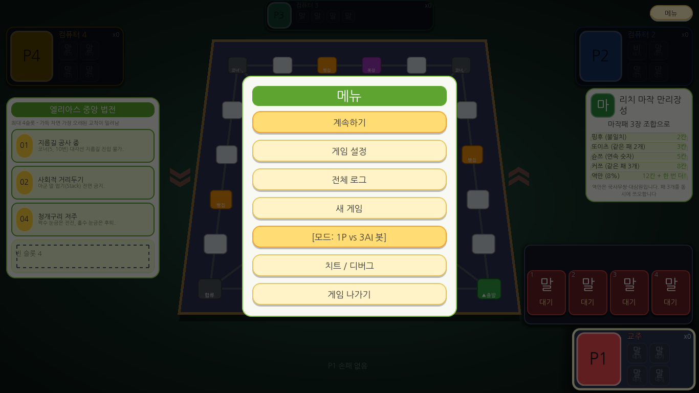
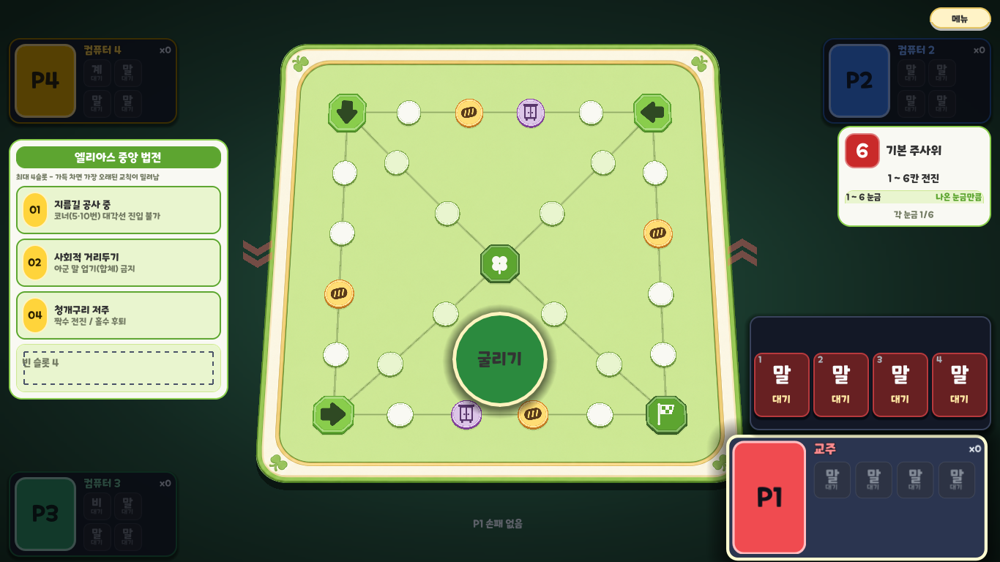

# 초증강 엘리아스 마블 — 최종 게임 기획서 · 개발 파이프라인 · 버전 변천사

> **트릭컬 리바이브 2차 창작 팬게임** (비공식 · 비영리 무료 배포)
> - **운영 주소:** https://hypereliasmarble.xyz/ *(초기 `0.9.0~1.0.0` 주소 `trickcal-board.vercel.app`에서 `1.0.1`부터 이전)*
> - **문서 기준:** `v1.3.1` (2026-11-28 라이브 서비스 및 `dev` 브랜치 동기화 기준)
> - **연계 문서:** 전체 규칙·데이터 표는 [`GDD_TDD_Master.md`](GDD_TDD_Master.md), 규칙 충돌·연출 순서는 [`EDGE_CASE_SPEC.md`](EDGE_CASE_SPEC.md), 상세 의사결정 기록은 [`DEV_HISTORY.md`](DEV_HISTORY.md)에 수록되어 있다.
>
> 이 문서는 프로젝트 전체를 한눈에 파악하거나 소개 영상·발표 자료로 바로 활용할 수 있도록 압축한 총괄 요약본이다.

---

## 목차

- [0. 숫자로 보는 프로젝트](#0-숫자로-보는-프로젝트)
- [1부. 최종 게임 기획서 (`1.3.1` 현행)](#1부-최종-게임-기획서-131-현행)
- [2부. 개발 파이프라인](#2부-개발-파이프라인)
- [3부. 첫 기획 초안 vs 현행 (`1.3.1`)](#3부-첫-기획-초안-vs-현행-131)
- [4부. 버전 변천사 (`Ver.1` → `1.3.1`)](#4부-버전-변천사-ver1--131)
- [부록. 소개 영상 · 발표 구성안](#부록-소개-영상--발표-구성안)

---

## 0. 숫자로 보는 프로젝트

| 항목 | `0.9.0` 테스트 오픈 (10일, 10-23) | `1.3.1` 라이브 현행 (46일, 11-28) |
|---|---|---|
| **개발 기간** | 2026-10-14 ~ 10-23 (10일) | 2026-10-14 ~ 11-28 (정식 출시 `1.0.0`은 11-04) |
| **누적 커밋** | 441개 | 950+개 |
| **자동 배포 실행** | 357회 | 1,255+회 (`dev` 푸시마다 테스트 → 웹 분할 빌드 → `web` 배포) |
| **게임 코드 (GDScript)** | 200개 파일 · 약 42,000줄 | 343+개 파일 · 약 73,000줄 (`core_engine/` + `scenes/`) |
| **테스트 코드** | 약 17,300줄 · 단위 574개 · 화면 20종 | 약 34,600줄 · 단위 860+개 · 화면 약 80종 · 봇 20판 완주 감사 |
| **수록 콘텐츠** | 보드 1종 · 기물 8계열 · 판정 도구 13종 · 카드 32종 · 증강 65종 · 법전 8종 · 결투 6종 · 아바타 8명 | **보드 4종 · 진화 기물 9계열(32종, 퀸 포함 33종) · 판정 도구 21종 · 생떼 카드 52종(기본 덱 89장) · 증강 96종(+ 규칙 수치 3행) · 법전 9종 · 결투 6종 · 아바타 8명(상황별 보이스)** |
| **플랫폼 · 언어** | Godot 4.7 / GDScript 2.0, 웹(HTML5) + PC | Godot 4.7 / GDScript 2.0, 웹(분할 로딩) + PC · **한국어 / English / 日本語** |

---

# 1부. 최종 게임 기획서 (`1.3.1` 현행)

## 1.1 한 줄 소개

교주가 모아 둔 전 세계 보드게임 상자를 에르핀과 사도들이 한꺼번에 엎어 버렸다. 윷말·체스·장기·바둑·쇼기·모노폴리부터 아케이드·TRPG·수집품 기물까지 한 판에 뒤섞이고, 주사위 대신 포커·마작·러시안 리볼버·다트·해적 룰렛·스크래치 복권을 손으로 직접 다루며 이동 칸 수를 정하는 **2~4인 대환장 카오스 보드 레이스**.

## 1.2 승리 조건 — 서바이벌 순위제

- 내 말 4개를 모두 완주시키거나, 중앙 법전에 올라온 **공용 특수 승리 교칙**을 먼저 달성하면 그 순서대로 **1위 → 2위 → 3위로 졸업**한다. 마지막까지 남은 사람이 4위가 된다.
- 한 판 길이는 **평균 10~15분**. 판이 길어지면 **템포 업**(`8R` 과열 · `14R` 광기 · `20R` 대붕괴)이 발동해 차례 첫 이동 보너스(`+1/+2/+3칸`)와 리벤지 부스터 칸수가 늘어나고, 법전 자동 제정 및 초증강 합류로 판세가 가속된다. 라운드 상한(`25R`) 도달 시 남은 인원을 레이스 진행도 순으로 확정해 종료한다.

## 1.3 보드 — 32칸 순환 트랙 × 테마 보드 4종

| 시작 허브 · 로비 화면 | 인게임 32칸 마름모 보드 실기 화면 |
|---|---|
|  |  |

- **공통 골격:** 가운데가 비어 있는 **32칸 사각 순환 트랙**(한 변 8칸, 부르마블형). 안쪽 빈 공간은 판정 도구 소품·매트 연출과 일기토 결투장이 펼쳐지는 중앙 무대가 된다.
- **공통 특수 칸:** 출발·결승(`0`) / 코너 `8·16(반환점)·24`(코너 버프 및 코너 전용 함정 슬롯) / ⚡ 부스터 발판 `3·27`(정차 시 `+3칸`).
- **선택 가능한 테마 보드 4종:** 상점 자리(`5·13·19·30`)와 장치 자리(`12·22`)의 기믹, 그리고 연동 특수 승리(`LAW_02`)가 보드마다 바뀐다.
  1. **에르핀 왕국:** 빵집(카드 1장 획득) + 옷장 포탈(`12 ↔ 22` 왕복 순간이동)
  2. **모나티엄 도시:** 편의점(카드 1장 획득) + 자판기(랜덤 음료 5종 버프)
  3. **벨라티엔 왕국:** 마녀 상점(카드 1장 획득) + 마녀의 가마솥(랜덤 물약 5종 — 이로운 3 · 해로운 2)
  4. **정령산:** 정령 칸 6곳(`5·12·13·19·22·30`)에 판 시작 및 **매 라운드 시작마다** 불·물·바람·땅 하급 정령 재배치 *(땅 정령은 결승선 앞 `22·30번` 중 1곳에만 배치)*
- **후퇴 눈금 삭제:** 판정 도구는 음수 눈금을 내지 않는다. 적이나 함정에 잡히면 **장외 홈런**으로 출발선에 복귀하는 대신, 다음 출발 때 🔥 **리벤지 부스터**(`+4~8칸`)를 얻어 단숨에 복귀한다.

## 1.4 한 턴의 흐름 (8단계 상태 머신)

1. **라운드 시작 (`ROUND_START`):** `4라운드`부터 3라운드마다(`4·7·10·13…`) 전원 동시 **증강 3지선다 드래프트** 및 선택 결과 공개
2. **차례 시작 (`TURN_BEGIN`):** 굴리기 전 발동·함정·소환 카드 1장 및 기물 1회용 필살기 사용 구간 (`회유책` 해제·턴 스킵·밴 처리)
3. **굴리기 (`ROLL_WAIT`):** 내 **판정 도구**를 직접 던지거나 꺼내거나 매트 위에서 골라 이번 이동 칸 수 결정
4. **굴림 개입 (`INTERRUPT_ROLL`):** 굴림 개입 카드 보유자가 있을 때만 열리는 반응 창
5. **말 선택 (`SELECT_PAWN`):** 이동할 내 말 선택 (`처치!`·`완주!`·`합류` 도착 결과 미리보기 제공)
6. **이동 (`MOVING_STEP`):** 순차 연출 — ① 리벤지 부스터 선행 전진 → ② 눈금(+기물 상시 능력·템포 보너스) 이동 → ③ 함정·잡기(피격 시 방어 카드 팝업 개입)·워프·특수 발판 판정 → ④ 부스터 발판·8번 공 돌진·TRPG 레벨업 등 후속 이동
7. **정산 (`RESOLUTION`):** 아군 업기(합류·앞뒤 1칸 업기 자석), 추가 굴림 여부, 완주 및 특수 승리 졸업 판정
8. **라운드 끝 (`NEUTRAL_NPC`):** 보드 위 중립 기물(`사료스탕스`·`와구와구 유령`·`롤링 양성자빔`·`황금장방형 팽이`)이 이동하며 마주친 말을 휩쓸고 라운드 종료 효과 정산

## 1.5 콘텐츠 시스템 요약

| 시스템 | 수록 구성 (`1.3.1` 기준) |
|---|---|
| **기물 (진화 9계열 · 32종)** | 기본 말에서 시작해 **윷 · 체스 · 장기 · 모노폴리 · 바둑 · 쇼기 · 아케이드 · TRPG · 수집품** 계열 세부 기물로 진화(폰 승급 전용 `퀸` 포함 총 33종). 기물별 고유 상시 능력과 **1회용 필살기**(흑돌 알까기, 차 직선 저격, 모브 큐이 오이 설치 등) 보유 |
| **판정 도구 21종** | 기본 주사위(`D6`) + 교체형 20종(윷·인생 룰렛·홀덤·친치로·777 슬롯·리볼버·화투·마작·타로·야추·블랙잭·핀볼·주식 차트·다트·오미쿠지·아이스크림·포츈쿠키·캡슐뽑기·해적 룰렛·스크래치 복권). **던지기(파워 게이지) · 꺼내기 · 카드 시점 매트** 3대 조작 체계 및 우측 족보표 상시 공개 |
| **생떼 카드 52종 (덱 89장)** | **방어 11종**(만능 1·잡기 3·공격 4·함정 3) · **발동 24종**(공격 8·버프 9·너프 5·기타 2) · **함정 13종**(일반 은신 8·코너 공개 5) · **소환 4종** *(+ 오이 토큰 카드 1종)*. 피격 순간 팝업 방어와 명확한 공격/너프 방어 경계 제공 |
| **중앙 법전 9종** | 공용 특수 승리 교칙 9종(슬롯 최대 4칸, 동시 활성 기본 2개). 제정 시점부터 전원이 `0`에서 새로 경쟁하며 선착순 달성자가 즉시 다음 순위로 졸업 |
| **증강 96종** | 기물 진화 `32` · 판정 도구 교체 `20` · 특수 승리 법전 `9` · 카드 패키지 `3` · 초증강(하이리스크 판세 전복) `16` · 범용/패시브 보급 `16`(`풀 파워` 포함) *(+ 비드래프트 규칙 수치 3행)* |
| **일기토 데스매치 6종** | 카드 한 장으로 여는 1:1 미니게임 결투 — 묵찌빠 단두대 · 할리갈리 · 병뚜껑 절벽 컬링 · 석양의 무법자(퀵드로) · E카드 · 스피키 룰렛 |
| **가속 기믹** | 🔥 **리벤지 부스터**(사출 후 복귀 가속) · ⚡ **부스터 발판**(`3·27번` 칸 `+3칸`) · ⏱️ **템포 업**(`8·14·20R` 단계별 가속) |

## 1.6 플레이 모드

- **놀이터 (싱글 AI 대전):** 컴퓨터 AI와 대결하며 연습하는 모드. 보드판을 고르고 불닭 매운맛 지표 **Fire Level 5단계** — `Lv.1 크림`(초반 자비·법전 비활성·자비 70%) / `Lv.2 로제`(초반 자비·법전 1개·사람 1위일 때만 견제) / `Lv.3 오리지널`(공정 경쟁 + 선두 견제) / `Lv.4 마라`(카드·함정·필살기 적극 연계) / `Lv.5 핵불닭`(사람 공격 가중치 2배, 공식 억까 모드)를 선택한다. AI 턴은 **터보 연출**로 빠르게 넘어가되 내 말이 잡히는 턴만 일반 속도로 비춘다.
- **친선 줘팸터 (온라인 친선전):** 별도 게임 서버 없이 5자리 방 코드 또는 **초대 링크**로 2~4인이 WebRTC P2P 직접 연결(락스텝 동기화). 방장이 보드·속도·함정 공개·**카드/증강 밴**을 직접 설정할 수 있다.
- **익명 줘팸터 (빠른 매칭):** 랜덤 매칭 대기열에 입장하며, `15초` 내 인원이 다 차지 않으면 빈자리를 AI로 채워 즉시 시작한다.

## 1.7 화면과 연출 원칙

- **글씨 대신 직관적 시각 효과:** 상태는 아이콘·스포트라이트·불꽃·도장으로 보여 주고, 긴 설명 문장 대신 핵심 도장과 중앙 알림 카드로 전달한다.
- **단일 FIFO 연출 대기열 (시각·청각 전 연출 비침범 불변식):** 판정 도구·이동·특수 발판(자판기·가마솥·상점·정령·워프·발판)·처치 컷인·템포 업 경고(경보음 포함)·배너·모달 등 모든 연출은 앞선 연출의 퇴장과 사운드가 완전히 끝난 뒤에야 다음 단계(효과음·봇 차례 포함)가 시작된다.
- **풍성한 시청각 손맛:** 3D 소품·전용 매트 판정 연출, 만화 컷 오프닝·결과창, 다키스트 던전 패러디 처치 컷인, 사도 아바타 8명의 감정 표현과 **상황별 보이스**, 한·영·일 3개 국어 실시간 전환을 지원한다.
- **모바일 가로 화면 최적화:** 터치 영역 보정, 저화질 옵션, 스크롤 창 아무 곳이나 끌기, 알까기·컬링 아무 곳이나 잡고 당기기, `1x`·`2x`·`3x` 배속 토글을 제공한다.

---

# 2부. 개발 파이프라인

## 2.1 사람 + AI 협업 루프 (프로젝트 핵심 운영 방식)

```text
① 기획자·기여자(사람)가 방향 · 재미 판단 · 피드백 · 아트 리소스를 결정한다
   (예: 신규 도구 기획, "특수발판 연출 중 템포업 소리가 겹쳐", 3D/일러스트 에셋 전달)
        │
② 기획·개발 AI가 코드와 실서비스를 대조·계측하고 기획서(`docs`) 및 구현 명세를 정립한다
   (프로브 스크립트로 턴 시간 · 프레임 처리 시간 · 초기 로딩 시간을 수치로 직접 측정)
        │
③ 규칙(`core_engine/`) · 연출(`scenes/`) 구현 + 자동화 회귀 테스트 추가
   (단위 테스트 860+개 · 화면 테스트 약 80종 · 봇 20판 전체 감사 헤드리스 실행)
        │
④ 문서 브랜치(`docs`) 현행화 (마스터 기획서 · 예외 규칙 명세 · 개발 기록 · CHANGELOG)
        │
⑤ 차기 버전(`next`) 검증 후 메인 개발(`dev`) 반영 → GitHub Actions 테스트 게이트 → 웹 분할 배포(`web`)
        │
⑥ 실제 유저 플레이 → 디스코드 텔레메트리(입장·시작·완료·체감 난이도) + 소감 투표·다국어 제보
        │
        └──────────▶ 다시 ①로 순환
```

- 초기 개발 10일 동안 한 바퀴 **30분~2시간** 주기로 수백 회 순환하며 코어 게임을 완성했고, 정식 출시 이후에는 기획·외부 아트 기여자·AI가 분업하는 4브랜치(`docs` / `dev` / `next` / `web`) 라이브 운영 체계로 발전했다.
- **추측 대신 계측과 재현 테스트:** 모든 성능·체감 개선은 전후 수치(평균 턴 `13.3초 → 5.8초`, AI 턴 `7.5초 → 4.2초`, 행동 처리 `14.4ms → 8.4ms`, 웹 첫 메뉴 도달 `22.8초 → 13.3초`)로 검증하고, 버그는 실패하는 테스트로 먼저 재현한 뒤 수정한다.

## 2.2 기술 아키텍처 파이프라인

```text
[core_engine]  UI 노드를 모르는 순수 결정론적 규칙 엔진
   GameState ─ BoardSpec/BoardCatalog(32칸×4보드) ─ MoveExecutor ─ RuleBook(특수 승리 법전)
   TurnManager(8단계 FSM, 행동 하나 = processing_started/finished 배칭 묶음)
   BotBrain / BotTemper(5단계 난이도·초반 자비) / BotController(사람과 동일한 act() 검증)
        │  시그널·이벤트만 발행
        ▼
[scenes]  화면 및 연출 계층
   MainBoard ─ 단일 FIFO 연출 큐(시각·청각 비침범 await 직렬화)
   3D 소품·카드 시점 매트 스테이지 / 특수 발판 모달 / 처치 컷인 / 결투장 / 중앙 알림
        │
        ▼
[online]  WebRTC P2P 직접 연결 + 공개 릴레이(ntfy) 5자리 방 코드·초대 링크 시그널링
   결정론적 락스텝: 단일 시드 RNG + 방장 행동 순서 직렬화 + state_hash 무결성 검증
        │
        ▼
[deploy]  GitHub Actions(dev) → 테스트 게이트 → 분할 웹 패킹(index.pck + game.pck + 아바타 팩)
   → web 브랜치 자동 배포 (https://hypereliasmarble.xyz/)
```

## 2.3 콘텐츠 및 품질 파이프라인

- **데이터 주도 확장:** `content_trickcal/data/`의 CSV(`cards_table`·`dice_table`·`augments_table`·`translations`·`ui_strings`)와 `BoardCatalog` 테이블만 갱신하면 인게임 규칙·규칙 도감·툴팁·한/영/일 번역이 함께 반영된다.
- **웹 용량 예산과 분할 패킹:** 초기 메뉴용 본체(`index.pck` 약 11 MiB)와 인게임(`game.pck`)·아바타 팩을 분리 로드해 첫 접속 대기 시간을 단축한다.
- **자동 검증 게이트:** `dev` 푸시마다 CI가 **단위 테스트 → 전체 게임 완주 감사 → UI·연출 순서·다국어 텍스트 넘침 검사 → 온라인 락스텝 2인/4인 동기화 테스트**를 모두 통과해야만 `web` 브랜치를 갱신한다(해제된 노드 참조 람다나 고아 노드 누수 감지 시 배포 즉시 차단).

---

# 3부. 첫 기획 초안 vs 현행 (`1.3.1`)

첫 초안은 개발 첫날(2026-10-14) 작성한 **「마스터 기획서 & 기술 설계서 v2.0 — 에르핀의 억지 레이스: 보드게임 대격돌」**이다.

| 항목 | 첫 초안 (`v2.0`, 10-14) | 현행 (`1.3.1`, 11-28) | 변화의 방향과 핵심 결정 |
|---|---|---|---|
| **제목** | 에르핀의 억지 레이스: 보드게임 대격돌 (가제) | **초증강 엘리아스 마블** | 주기적인 "증강"이 게임의 정체성이 되면서 확정 |
| **보드** | 윷판식 29타일 그래프 (대각선 지름길 2개) | **32칸 사각 순환 트랙 × 테마 보드 4종** | 대각선 지름길을 없애 중앙을 연출 무대로 비우고(`24칸 → 32칸`), 보드별 상점·장치 기믹으로 확장 |
| **승리 조건** | 말 4개 완주 1명 승리 + 기물 4세트 승리 | **서바이벌 순위제(1~4위 졸업)** + 법전 특수 승리 | 1위가 나와도 판이 끝나지 않고 남은 인원이 끝까지 순위를 다투도록 개편 |
| **기물** | 5계열, 2세트·4세트 시너지 효과 | **진화 9계열(32종, 퀸 포함 33종), 세트 효과 전면 삭제** | 복잡한 세트 강제를 없애고 개별 기물의 상시 능력 + 1회용 필살기로 개성 집중 |
| **판정 도구** | 7종 (할리갈리 종치기 포함) | **21종** (던지기·꺼내기·카드 시점 직접 조작, 족보표 공개) | 턴제에 어색한 할리갈리는 결투 미니게임으로 옮기고, 도박·뽑기·복권 등 손맛 도구 대폭 확충 |
| **중앙 법전** | 이동을 비트는 패시브 교칙 8종 | **공용 특수 승리 교칙 9종** (제정 시점부터 0 집계) | 법전을 승리 레이스의 장으로 재정의하고, 옛 패시브 규칙은 즉시형 초증강으로 이관 |
| **생떼 카드** | 즉발·함정·소환 12종 | **52종 / 기본 덱 89장** (방어 11·발동 24·함정 13·소환 4) | 피격 팝업 전용 **방어** 분류 신설 및 **발동**(공격·버프·너프·기타) 세분화, 방 규칙 밴 지원 |
| **페널티·가속** | 빽도·후퇴 눈금·후퇴 카드 다수 | **후퇴 눈금 완전 삭제**, 장외 사출 + 가속 기믹 | 모든 페널티를 시원한 '장외 홈런 사출'로 통일하고 리벤지 부스터·발판·템포 업으로 속도감 확보 |
| **증강 드래프트** | 1·4·7라운드 총 3회 | **4라운드부터 3라운드마다 계속 (총 96종)** | 첫 증강을 `4R`로 미뤄 기본 규칙 온보딩을 돕고, 템포 단계별로 고급·초증강이 합류하도록 설계 |
| **멀티플레이** | Listen Server (WebSocket) | **WebRTC P2P + 5자리 방 코드·초대 링크 + 락스텝** | 서버 유지비 0원으로 웹 브라우저 접속 즉시 친구·익명 매칭 가능 |
| **컴퓨터 AI** | 언급 없음 | **Fire Level 5단계 난이도 + 터보 AI 턴** | 입문자용 초반 자비 모드(`Lv.1~2`)부터 핵불닭(`Lv.5`)까지 세분화하고 AI 턴 대기 시간을 절반으로 단축 |
| **결투** | 없음 | **일기토 데스매치 6종 미니게임** | 카드 한 장이 즉석 파티 미니게임 한 판으로 이어지는 하이라이트 연출 |

- **초안부터 끝까지 변하지 않은 핵심:** 사도 아바타와 보드 기물의 역할 분리, 발동·함정·소환의 카오스 액티브 감성, 공용 법전 슬롯 구조, 8단계 턴 상태 머신, 규칙 코어와 화면을 분리한 아키텍처.

---

# 4부. 버전 변천사 (`Ver.1` → `1.3.1`)

> 소개 영상 챕터나 발표 타임라인으로 바로 쓸 수 있도록 시기·핵심 변화·계기를 묶어 정리했다. 세부 기록은 [`DEV_HISTORY.md`](DEV_HISTORY.md)와 [`../CHANGELOG.md`](../CHANGELOG.md)에 있다.

### Ver.1 — 초안과 뼈대 (10-14)
- 사람이 작성한 기획서 `v2.0`과 예외 규칙 명세를 바탕으로 코어 규칙 엔진 구축.
- 29타일 윷판 그래프, 판정 도구 7종, FIFO 법전 8종, 커맨드 스택(되감기), 8단계 턴 상태 머신 구현.
- 화면 없이 헤드리스 테스트만으로 규칙 검증 → 첫 핫시트(한 화면 4인) 프로토타입 완성.

### Ver.2 — 플레이 가능한 게임과 첫 대수술 (10-15)
- 증강 드래프트·카드·승리까지 **코어 루프 완성**, 푸시마다 웹 자동 배포 개시.
- **첫 대수술:** "기물 세트 시너지가 재미없다"는 판단으로 세트 효과 전면 삭제 → 개별 기물 상시 능력 + 1회용 필살기 체제로 전환.
- 1P vs 3AI 대전, 상용 보드게임식 HUD, 모바일 가로 화면, 증강 카드 선택, 손패 카드 UI 도입.

### Ver.3 — 서버리스 온라인과 트랙 개편 (10-16)
- 멀티플레이 진화: WebRTC 수동 코드 교환 → **5자리 방 코드 자동 시그널링** → 빠른 랜덤 매칭 → **결정론적 락스텝 온라인 대전**.
- 쇼기·화투·마작·타로 등 클래식 콘텐츠 6종 추가, 초기 운영 주소 오픈.
- 보드를 **24칸 부르마블형 사각 순환 트랙**으로 전면 교체하고 기획서 `v3.0` 개정.

### Ver.4 — 정체성 확정과 아트 (10-17)
- 공식 타이틀 **「초증강 엘리아스 마블」** 확정, 타이틀 로고·오프닝 인트로 적용.
- 아바타 8명(감정 프레임·숨쉬기 애니메이션), 일러스트 카드·증강 메달, 마름모 시점 보드, 규칙 도감, 효과음 22종 탑재.

### Ver.5 — 3D 손맛과 트랙 32칸 확장 (10-18 ~ 10-19)
- 판정 도구 3D 연출 도입(주사위·윷 4가락·마작 패·10칸 룰렛·777 릴·리볼버 실린더 직접 모델링).
- 다키스트 던전 패러디 **처치 컷인** + **장외 홈런 사출** 연출 적용.
- **후퇴 완전 삭제**, 폭풍 전진 가속 기믹 도입, 보드 **32칸** 확장.
- **단일 FIFO 연출 큐** 도입 및 밸런스 수치를 CSV 테이블로 분리.

### Ver.6 — `v4.0` 규칙 대개편 (10-20)
- **서바이벌 순위제**(1~4위 졸업) 도입, 법전을 **특수 승리 8종**으로 전환, 초증강 12종·아케이드 기물·생떼 카드 32종 전면 재편.
- **템포 업**(라운드 가속), **일기토 데스매치**, 감정 표현 이모트, 액션 로그, 웹 메모리 누수 방어 게이트 구축.

### Ver.7 — 테스트 오픈 `0.9.0` (10-21)
- 범용 보급 증강, 다국어 구조, **인게임 피드백 전송**(디스코드·구글 폼·클립보드 폴백) 탑재.
- 웹 패키지 `96.5 → 46.2 MiB` 경량화, **턴 템포 패치(평균 턴 `13.3초 → 5.8초`)**, 배속 토글, 결과 시상대 완성.
- 데스매치 미니게임 실물화(병뚜껑 컬링 물리, 3D 리볼버 퀵드로, E카드, 스피키 룰렛).

### Ver.8 — 실측 데이터로 다듬기 (10-22)
- **통계 텔레메트리**(입장·시작·완료, 킬/데스, 체감 난이도) + 결과 화면 원클릭 소감 투표 도입.
- 놀이터 난이도 세분화 및 억까 방지 AI, 이동 4단계 순차 연출, 방어 개입 후 처치 확정 파이프라인 정비.
- 아군 피해 가능 카드 경고 아이콘, 아우토반 니트로 리메이크, 온라인 접속 15초 타임아웃 안내 추가.

### Ver.9 — 체감 성능과 모바일 최적화 (10-22 ~ 10-23)
- **터보 AI 턴:** AI 차례 평균 `7.5초 → 약 4.2초` 단축, 사람 말이 잡히는 턴만 일반 속도로 전환.
- **웹 끊김 완화:** 행동 하나당 화면 갱신 1회 배칭(처리 중앙값 `14.4ms → 8.4ms`), 3배속 멈춤 제거.
- 모바일 터치 버튼 확대 및 더블 탭 오작동 차단, 추가 전진 사유 배지 표시, 중립 기물 알림 간소화.

### 1.0 — 정식 출시 (11-04)
- 2주간의 오픈 테스트 피드백을 집약해 **`1.0.0`** 정식 출시. 로비 **공지사항**(`N` 배지) 및 친선전 **초대 링크** 도입.
- 신규 추가: 판정 도구 `엘리아스 주식 차트`·`불스아이 다트 보드`, 기물 `모브 큐이`·`괴상한 멜론`, 카드 `기억상실빔`·`강화 망치`·`방해령 삼총사`·`이쪽을 봐라!`, 소환 `롤링 양성자빔`, 법전 `방해령 허리케인 포스!!`.
- 방어 카드를 잡기·공격·함정 방어 분류로 체계화, 템포 업 `8·14·20R` 및 라운드 상한 `25R` 확립, 만화 컷 결과창·특수 승리 컷신 추가.

### 1.0.1 — 핫픽스 통합 · 도메인 이전 · 온보딩 개선 (11-04 ~ 11-06)
- 출시 직후 라이브 핫픽스 29건을 묶고 정식 도메인 **hypereliasmarble.xyz**로 이전.
- **온보딩 개선:** 첫 증강 라운드를 `1R → 4R`로 늦춰 기본 규칙을 먼저 익히게 하고, 상단 증강 타임라인·사전 예고·말 이동 거리 계산식 툴팁 추가.
- 모든 특수 승리를 **제정 시점부터 `0`에서 집계**하도록 공정성 강화, 순위 도장(`1ST·2ND·3RD`) 및 하단 기물 독·접이식 손패 개편.

### 1.1 / 1.1.1 — 모나티엄 도시 · TRPG 기물 · 만화 컷 오프닝 (11-11 ~ 11-16)
- **보드판 선택** 시스템과 두 번째 보드 `모나티엄 도시`(편의점·자판기 음료 버프, `와라! 모나티엄 25`) 추가.
- 처치로 성장하는 **TRPG 기물 4종**(전사·마법사·궁수·도적), 신규 카드 6종, 판정 도구 `오미쿠지`·`아이스크림` 추가, 윷 누적 굴림 적용.
- `1.1.1`: 게임 시작 연출을 **만화 컷**으로 개편, 방해령 덱 비중 상향(각 6장), 모바일 `[저화질]` 기본 설정 및 3D 뷰 지연 생성으로 메모리 절감.

### 1.2 / 1.2.1 — 벨라티엔 왕국 · 수집품 · 보이스 · 첫 로딩 분리 (11-18 ~ 11-22)
- 세 번째 보드 `벨라티엔 왕국`(마녀 상점·마녀의 가마솥 물약, `Bad Carrot`), 판정 도구 `포츈쿠키`·`캡슐뽑기`, 완주 영구 버프 `수집품` 기물 2종, 지속형 초증강 4종 추가.
- `1.2.1`: 일본어 유저 건의를 반영해 아바타 8명 **상황별 보이스** 탑재, 웹 패키지를 메뉴 본체(약 11 MiB)와 인게임 팩으로 분리해 **첫 메뉴 도달 시간 `22.8초 → 13.3초` 단축**, 데이터 주도 `BoardCatalog` 구조 확립 및 규칙 도감 재정비.

### 1.3 — 정령산 · 해적 룰렛 · 스크래치 복권 · 협업 분업화 (11-26)
- 네 번째 보드 `정령산`(4원소 정령 칸 6곳, `정령산 순례`), 판정 도구 `해적 룰렛`·`스크래치 복권`, 신규 카드 7종(`뾰족한 성게`·`이프리트의 분노`·`피라 대출`·`회유책`·`수은 가드`·`민트초코`·`긴급수리`), 방 규칙 **카드·증강 밴** 추가.
- **릴리스 거버넌스 확립:** 개발 중인 차기 콘텐츠가 라이브 배포에 섞이지 않도록 **버전 잠금(`ReleaseGate`)**을 도입하고 외부 기여자(아트·3D 연출) + AI(규칙·연동·테스트) 분업 파이프라인 정착.
- 방어 창 대기 중 법전 진행도 미반영 수정, 봇 20판 전체 감사 테스트 추가, 모바일 드래그 스크롤 및 알까기·컬링 터치 조준 편의성 개선.

### 1.3.1 — 손으로 다루는 판정 도구 · 보드 위 연출 · 규칙 정돈 (11-28)
- **직접 조작 손맛 개편:** 결과·확률은 그대로 유지한 채 타로·화투 뒷면 고르기, 홀덤 1회 패 교환, 마작 패 꺼내기, 해적통 돌려 구멍 찌르기, 슬롯 레버로 릴 하나씩 멈추기, 복권 은박 손가락으로 긁기, 캡슐 레버 돌리기, 파워 게이지 부활 적용.
- **보드 위 3대 연출 체계:** 주사위·윷·친치로는 보드 위 소품이 제자리에서 튀어 오르고, 비투척 도구는 `[꺼내기]`로 내려앉으며, 카드·야추·블랙잭·마작·핀볼·복권은 보드 중앙으로 줌인해 전용 매트·케이스·계산대 위에서 다룬다.
- **유저 제보 반영 및 분류 정비:** 정령산 정령을 **매 라운드 시작마다 재배치**하고 땅 정령은 결승선 앞(`22·30번`)에만 배치, 모노폴리 기물(`미니카·비행기·강아지`) 패시브를 모든 보드에서 작동하도록 개편, 카드 `[즉발] → [발동]`(공격·버프·너프·기타) 세분화, 신규 범용 증강 **`[패시브] 풀 파워`**, `Lv.1~2` 초반 자비 도입 및 `docs / dev / next / web` 4브랜치 체계 확립.

---

## 부록. 소개 영상 · 발표 구성안

1. **훅 (15초):** 첫날 텍스트 기획서 → 현행 3D·매트 판정 및 처치 컷인 플레이 화면 전환. *"첫 10일 441번의 커밋으로 태어나, 46일간 1,250번 넘게 자동 배포하며 진화한 보드게임."*
2. **Ver.1~2 (과감한 덜어내기):** 기획서를 하루 만에 코드로 옮긴 뒤, 재미없는 '세트 시너지'를 즉시 버리고 개별 기물 필살기로 선회한 첫 결정.
3. **Ver.3~4 (서버비 0원 멀티플레이):** 별도 서버 없이 5자리 코드와 초대 링크로 붙는 WebRTC 락스텝 온라인, 타이틀과 사도 아바타 확정.
4. **Ver.5~6 (피드백 대개편):** 지인 테스트 후 답답한 '후퇴'를 전면 삭제하고 장외 홈런 사출 + 서바이벌 순위제 + 일기토 미니게임으로 방향 전환.
5. **Ver.7~9 (수치 기반 최적화):** 추측 대신 프로브 계측으로 고친 체감 속도 (평균 턴 `13.3초 → 5.8초`, AI 턴 `7.5초 → 4.2초`).
6. **1.0 → 1.3.1 (라이브 운영과 글로벌·기여자 협업):** 보드 1개 → 4개, 도구 21종, 카드 52종으로 확장. 한·영·일 유저 피드백이 캐릭터 보이스·직접 조작 손맛·규칙 개선으로 이어지는 과정.
7. **마무리:** *"사람은 방향과 재미를 판단하고, AI는 계측하고 구현하고 검증하고 기록한다"* — 협업 루프 다이어그램(2.1절).
