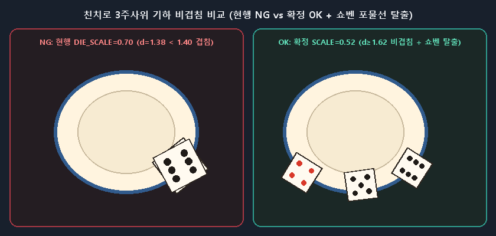
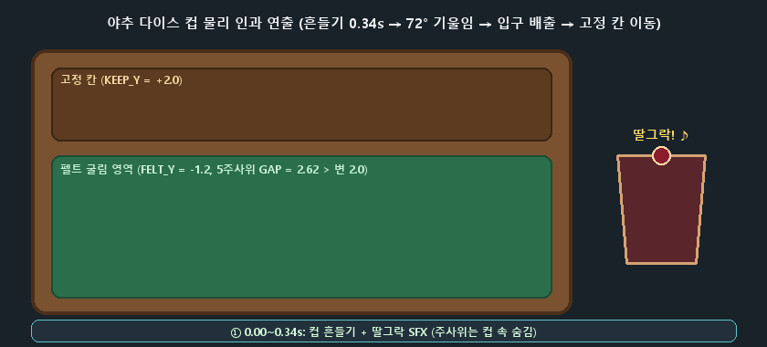
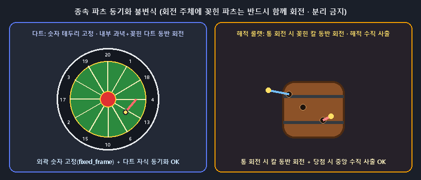
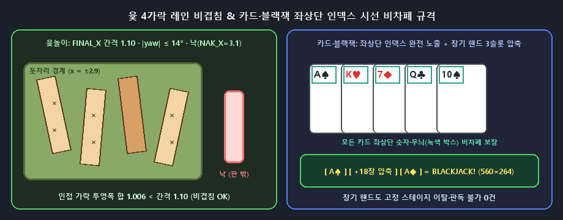
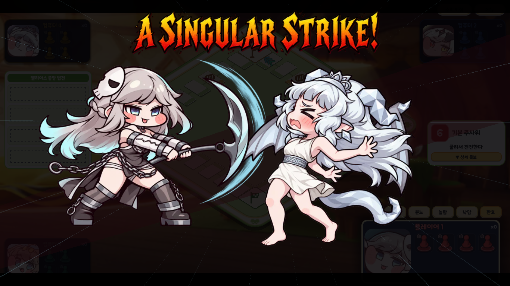
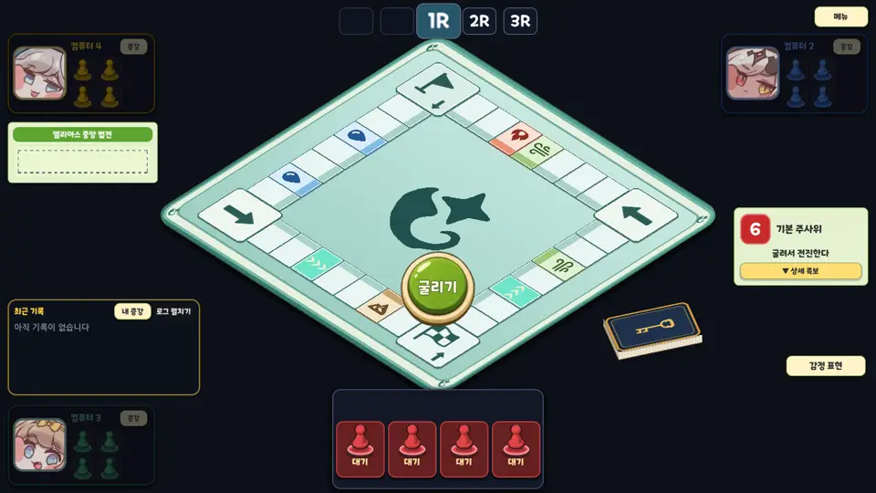
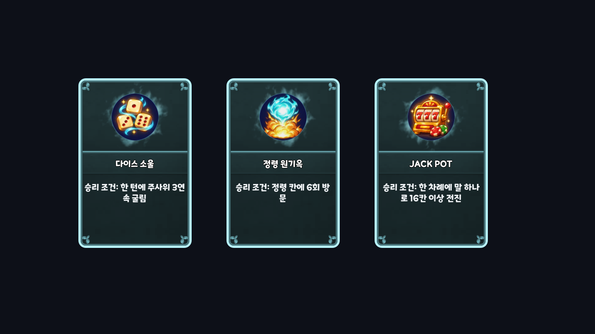

# 초증강 엘리아스 마블 — 연출 · 모션 · 카메라 기획서 (Presentation & Choreography Spec)

> **문서 기준:** `v1.3.1` (2026-11-28 기획 확정 · `dev` 실코드 전수 대조 및 교정 사양 포함)
> **목적:** 구현 담당(개발·3D·아트 AI 및 기여자)이 **소품의 물리적 작동 방식, 카메라 전환, 조작→결과 연속성, 타이밍, 퇴장 순서**를 임의로 해석하거나 소품을 단순 배경 장식으로 처리하지 않도록 못 박는 **공식 연출 기준서**다.
>
> - **기본 규칙 · 데이터 표:** [`GDD_TDD_Master.md`](GDD_TDD_Master.md)
> - **전수 콘텐츠 아이콘 · 개별 연출 백과사전 (증강 96 · 카드 53 · 기물 33 · 법전 12):** [`CONTENT_VISUAL_FX_CATALOG.md`](CONTENT_VISUAL_FX_CATALOG.md)
> - **규칙 충돌 · FIFO 큐 경계:** [`EDGE_CASE_SPEC.md`](EDGE_CASE_SPEC.md)
> - **3D 폴리곤 상한 · UI 좌표 규격:** [`visual/Visual_Asset_Guide_Draft.md`](visual/Visual_Asset_Guide_Draft.md)
> - **다른 AI 작업 지시판:** [`AI_HANDOFF.md`](AI_HANDOFF.md)

> [!IMPORTANT]
> **연출 구현 절대 원칙 — 장식 소품 금지 (Active Prop Causality)**
> 화면에 등장하는 모든 3D 소품(컵·통·레버·발사대·가마솥·자판기·접시·아이스박스 등)은 **단순 배경 그림이 아니라 결과물을 실제로 만들어 내는 작동 주체**여야 한다.
> - 예: **야추 다이스**는 컵을 정지 배경으로 세워 두고 주사위가 허공이나 다른 위치에서 튀어나오면 안 되며, **컵이 실제로 주사위를 담아 흔들고 기울어져 컵 입구에서 펠트 위로 쏟아내는 동작**으로 구현해야 한다.

---

## 목차

1. [연출 공통 5대 철칙 및 3대 무대 전환 규약](#1-연출-공통-5대-철칙-및-3대-무대-전환-규약)
2. [판정 도구 21종 개별 연출 · 소품 동작 명세](#2-판정-도구-21종-개별-연출--소품-동작-명세)
3. [보드 4종 특수 발판 · 이동 · 전투(잡기·사출·방어) 연출](#3-보드-4종-특수-발판--이동--전투잡기사출방어-연출)
4. [카드 · 함정 · 중립 기물 · 초증강 · 일기토 6종 연출](#4-카드--함정--중립-기물--초증강--일기토-6종-연출)
5. [오프닝 · 법전 · 졸업 컷신 · 결과창 및 사운드 연출](#5-오프닝--법전--졸업-컷신--결과창-및-사운드-연출)
6. [신규 연출(`1.4+`) 기획 · 구현 시 필수 체크리스트](#6-신규-연출14-기획--구현-시-필수-체크리스트)

---

## 1. 연출 공통 5대 철칙 및 3대 무대 전환 규약

### 1.1 연출 5대 철칙

1. **물리적 인과관계 (Active Prop Causality):** 소품이 있는 도구는 **결과물이 반드시 그 소품의 물리적 동작(흔들기·기울이기·당기기·돌리기·쪼개기·긁기·투입)의 결과로 출력**되어야 한다. 정지 그림 옆 허공에서 결과물만 스폰하는 연출은 금지한다.
2. **조작→결과 소품 연속성 (Seamless Handoff):** 직접 조작 단계(`ToolHandGate` · `ToolPickModal` · `HoldemExchangePanel` · 대기 소품)에서 플레이어가 만진 소품이 결과 재생 직전에 사라졌다가 다른 위치·각도로 튀어 나오지 않고 **같은 소품·같은 각도·같은 위치에서 곧바로 결과 연출로 이어진다.**
3. **전 구간 시각·청각 비침범 (`await` 직렬화):** 모든 도구·특수 발판·이동·처치·중립 기물·템포 업·법전·배너·모달은 **단일 FIFO 큐에서 앞선 연출의 퇴장과 사운드가 완전히 끝난 뒤에야** 다음 단계를 시작한다.
   - **명시적 비차단 부가 배지 예외 (`HANDOFF-005` 확정):** 처치 템포 유지를 위해 `리벤지 +N 팝업`(`_revenge_charged_popup`, `0.12초` 대기)과 `방어! 배지`(`_show_defended`, `0.45초` 대기) 2종만 `1.5초` 완전 퇴장 전 다음 단계 진행을 예외 허용한다.
4. **결정성 독립 (Presentation ≠ Simulation):** 모든 결과·확률·궤적은 `core_engine/`이 `GameState.rng`로 먼저 확정하고, 연출은 정해진 결과를 시각·음향으로 재현할 뿐 난수를 소비하거나 결과를 바꾸지 않는다.
5. **단일 시계 · 배속 · 세대 초기화 안전성:** 가능하면 단일 경과 시간(`set_time`)으로 모든 서브 모션을 구동해 `1x/2x/3x` 배속 · AI 터보(`0.75배`) · 헤드리스 `instant` 모드에서 어긋나지 않으며, `CNT_01` 되감기·새 판으로 세대(`_fx_generation`)가 바뀌면 잔류 노드·트윈·사운드를 즉시 정리한다.

### 1.2 판정 도구 3대 무대 · 카메라 전환 규약

| 무대 분류 | 적용 도구 | 진입 · 조작 · 퇴장 공통 시퀀스 |
|---|---|---|
| **① 보드 위 투척 (`TOSS`)** | `D6` · `윷` · `친치로` *(3종)* | 보드 중앙에 대기 소품(`ToolRestProp`, 높이 `112px`, `UPDATE_DISABLED` 저전력) 상시 배치 → 굴리기 버튼(또는 `Space`) 꾹 눌러 파워 게이지(`150×34`, `85%+` 빨간 끝 `풀 파워`) 조절 → 소품이 제자리에서 튀어 올라 보드 마당(`TOSS_LAND_OFFSET (0, +52)`)에 2~3회 바운스 착지 → **`0.55초` 뜸 들이기(`RESULT_SUSPENSE`)** → 결과 숫자 펀치(`0.14s`) → 페이드아웃(`0.2s`) |
| **② 꺼내기 (`DROP` / `RISE`)** | `인생 룰렛` · `777 슬롯` · `리볼버` · `주식 차트` · `다트` · `오미쿠지` · `아이스크림` · `포츈쿠키` · `캡슐뽑기` · `해적 룰렛` *(10종)* | 평소 보드 중앙을 비워 둠 → `[꺼내기]` 클릭 시 위에서 `420px` 낙하(`0.24초` + `0.16초` 찌그러짐 정착, 단 **주식 차트만 아래에서 태블릿처럼 위로 꺼냄**) → 도구별 직접 조작 → 결과 공개 및 여운 → 소품 수거·퇴장 완료 후 말 선택 진입 |
| **③ 카드 시점 매트 (`CARD_TABLE`)** | `홀덤` · `화투` · `마작` · `타로` · `야추` · `블랙잭` · `핀볼` · `스크래치 복권` *(8종)* | 보드 중앙으로 **카메라 줌인**(주변 보드 미세 암전) → 전용 매트(`CardMat`: 펠트 좌우 `unroll` / 나무 계산대) 또는 케이스/핀볼대 배치 → 직접 조작 → 결과 여운 → 매트 `roll_up` 및 소품 수거 → **보드 시점 완전 복귀 완료 후** 말 선택 진입 |

---

## 2. 판정 도구 21종 개별 연출 · 소품 동작 명세

> 코드 담당은 각 도구를 구현·수정할 때 반드시 아래 **핵심 소품 동작(물리적 인과)** 과 **금지 안티패턴**을 지켜야 한다.

### 2.1 보드 위 투척 도구 (`TOSS` · 3종)

| 도구 (`ID`) | 진입 · 조작 | 핵심 소품 동작 (물리적 인과) & 타이밍 | 금지 안티패턴 |
|---|---|---|---|
| **기본 주사위** (`D6`) | 대기 소품 + 파워 게이지 | 보드 위 제자리에서 공중으로 튕겨 올라 3D 회전 후 `0.72초`(`TOSS_LAND_TIME`) 동안 2회 바운스 착지 → 확정 눈금이 정면을 향한 채 `0.55초` 뜸 들이기 → 결과 공개 (`SHADOW_DROP 44px` 바닥 그림자 부착) | 팝업 창에 가둬 굴리기 · 착지 직후 눈금 치환 |
| **전통 박달나무 윷** (`YUT`) | 대기 소품 + 파워 게이지 | 윷 4가락이 묶음 비행(`0.42초`) 후 개별 3D 회전·착지(`1.12초 ÷ 1.4 = 0.80초`), 배·등 면이 정확히 엔진 결과와 일치. 윷·모 시 누적 스택 표시 후 재굴림, 낙 시 즉시 실패 배너 | 4가락이 한 덩어리로 똑같이 떨어지기 · 윷/모 누적 미표시 |
| **지하노역장 친치로** (`CHINCHIRO`) | 대기 그릇 + 파워 게이지 | 밥그릇(`v4/chinchiro/rice_bowl_v01.scn`) 안으로 **6면이 `4·4·5·5·6·6`으로만 각인된 카이지 사기 주사위 3개**(`DiceRoll3D` 공유 메시)가 함께 떨어져 그릇 벽면에 부딪히며 굴러 정착(`1.12초`) → `0.55초` 뜸 들이기 → 족보명(`4/5/6의 눈` · `시고로!` · `아라시!` · `★666 아라시!`)과 칸수 공개. **`쇼벤(낙)` 당첨 시 `out_index` 주사위 1개가 그릇 테두리에 맞고 바깥 바닥으로 튀어 나간 뒤** `쇼벤! (낙)` 이동 실패 배너(`0.9초`)와 함께 턴 종료 | 주사위 1개만 굴리기 · 주사위 면에 `1~3` 눈금이 그려져 있기 · 쇼벤인데 주사위 3개가 모두 그릇 안에 멀쩡히 멈추기 |

### 2.2 꺼내기 도구 (`DROP` / `RISE` · 10종)

| 도구 (`ID`) | 진입 · 조작 | 핵심 소품 동작 (물리적 인과) & 타이밍 | 금지 안티패턴 |
|---|---|---|---|
| **인생게임 회전 룰렛** (`LIFE_ROULETTE`) | 위에서 낙하 → 원판 드래그·탭 스핀 | 10칸 3D 원판(`roulette_spin_3d.gd`)이 드래그 방향·세기대로 회전하다 엔진 확정 칸으로 자연 감속 정지, 바늘 튕김음 연동. `★7` 당첨 시 금색 강조 + 한 번 더 | 드래그 방향과 반대로 돌기 · 정지 직전 부자연스러운 순간 스냅 |
| **777 슬롯머신** (`SLOT_777`) | 위에서 낙하 → 레버로 릴 3개 순차 정지 | 우측 레버 당김 애니메이션에 맞춰 3D 드럼 릴 3개(`slot_machine_3d.gd`, 48분할 6셀)가 회전, 플레이어 입력(또는 자동 타임아웃)마다 좌→중→우 순으로 확정 문양에 찰칵 정지 | 레버 미작동 · 3개 릴이 동시에 번쩍 바뀌기 |
| **러시안 룰렛 리볼버** (`REVOLVER`) | 위에서 낙하 → `[발사]` / `[멈추고 이동 확정]` | 3D 조립 리볼버(`v4/revolver/revolver_assembled_v01.scn`) 실린더 회전·격발. **생존 시 리볼버를 내리지 않고 화면에 유지(`holding=true`)**해 연속 격발 시 깜빡임 방지. 폭죽 당첨 시 총구에서 장난감 깃발·폭죽 연출(하단 불필요 작은 문구 없음) | 매 격발마다 리볼버를 지웠다 다시 띄우기 · 폭죽 아래 잔문구 노출 |
| **엘리아스 주식 차트** (`DICE_STOCK`) | **아래에서 위로 상승(`RISE`)** → 자동 시세 재생 | 태블릿을 아래에서 들어 올린 뒤 **꺼진 검은 화면에서 빛 줄이 퍼지며 부팅(`0.55초`)** → 실시간 주가 차트선 상승/하락 드로우(`0.85~1.65초`) → 도장(`1.80초`, 상한가 금색 / 상장폐지 빨간 추락) → 총 `3.40초` | 위에서 쿵 떨어뜨리기 · 부팅 없이 처음부터 완성된 차트 띄우기 |
| **불스아이 다트 보드** (`DICE_DARTS`) | 위에서 낙하 → 과녁 회전 중 클릭 투척 | **외곽 숫자 테두리(`v5/darts/fixed_frame.scn`)는 고정, 내부 과녁 판(`rotating_target.scn`)만 일정 속도로 회전(`2.4초/회전`)**. 클릭 순간 **돌던 각도(`face_turn`)를 그대로 이어받아** 다트가 비행(`0.45초`)해 확정 칸에 꽂히고, 꽂힌 채 `0.5초` 서서히 감속 정지 → 정면 `0.6초` 뜸 들이기 → 판이 옆으로 기울며(`0.55초`) 결과 공개 | 숫자까지 같이 돌기 · 던지는 순간 각도가 툭 초기화되기 · 투척 시 보드 위치가 위로 점프하기 |
| **오미쿠지 뽑기통** (`DICE_OMIKUJI`) | 위에서 낙하 → **`[흔들기]`(원하는 만큼 반복) + `[뽑기]` 2버튼** (`ToolHandGate`, 8초 무입력 시 자동 진행) | `[흔들기]`를 누를 때마다 통이 흔들리고, `[뽑기]`를 누르면 점괘 막대·두루마리가 구멍에서 뽑혀 나옴(`0.96~1.36초`) → 종이가 펼쳐지며(`1.70초`) 대길~대흉 결과 공개(`2.10초`) → 접어 수거(`2.70~3.35초`) *(현행 2버튼 코드 유지 확정)* | 흔들기 창과 뽑기 연출이 끊어져 별도 통으로 교체되기 |
| **아이스크림** (`DICE_ICECREAM`) | 아이스박스에서 3개 중 1개 선택 (`ToolHandGate`) | 선택한 아이스크림이 **제자리에서 포장지 해제 → 한 입 베어 물기(`0.84초`, `icecream_bite.gdshader`)** → 막대에 새겨진 숫자 공개(`1.20초`). `★"한번 더!"` 당첨 시 막대를 치우고(`1.65~2.08초`) 새 아이스크림 리필(`2.17초`) | 포장 벗긴 뒤 다른 위치에 막대만 덩그러니 띄우기 |
| **포츈쿠키** (`DICE_COOKIE`) | 접시 위 3개 중 1개 선택 (`ToolHandGate`) | 접시(`cookie_platter_heaped.scn`) 위에서 선택한 쿠키가 제자리로 떠올라 흔들림(`0.40~1.00초`) → **반으로 쪼개짐(`1.02초`, `fortune-cookie-broken.scn`)** → 내부 운세 종이(`fortune-cookie-slip.scn`)가 펼쳐지며(`1.45~1.95초`) 숫자 공개 | 온전한 쿠키가 그대로 있는데 옆에 종이만 뜨기 |
| **캡슐뽑기** (`DICE_CAPSULE`) | 위에서 낙하 → `0.5초` 감상 → 레버 줌인 → 레버 회전 | 기계(`v4/capsule_gacha/machine.scn`) 착지 후 **`0.5초` 전체 실루엣 감상(`CAPSULE_LOOK_PAUSE`)** → 레버 쪽 줌인(`0.34초`) → 동전 투입(`0.38초`) → 플레이어가 레버 직접 회전(`0.80~1.60초`) → 캡슐 출구 낙하(`1.65초`) → 캡슐 상하 분리(`2.30초`) → 사도 아크릴 키링(버터·셰이디·벨리타·죠안·시크릿 에르핀) 공개(`2.75초`) | 착지하자마자 즉시 줌인해 기계를 못 보게 하기 · 동전/레버 없이 캡슐만 스폰 |
| **해적 룰렛** (`DICE_PIRATE`) | 위에서 낙하 → 통 드래그 회전 & 빈 구멍 직접 클릭 | 오크통(`oak_barrel.scn`)을 좌우로 끌어 돌려 원하는 구멍을 누르면 장난감 칼(`toy_sword.scn`)이 꽂힘(`0.42초` 삽입 → `0.62초` 쿵 정착). 생존 시 칼이 꽂힌 상태 유지(`1.05초`), **폭탄 구멍 시 `0.66초`에 해적 피규어(`pirate_figure.scn`)가 통 중앙에서 펑 튀어 오름(`1.75초`)** | 누른 구멍이 아닌 엉뚱한 곳에 칼이 꽂히기 · 구멍 클릭 시 통 위치가 위로 튀기 |

### 2.3 카드 시점 매트 도구 (`CARD_TABLE` · 8종)

| 도구 (`ID`) | 매트 · 무대 구성 | 핵심 소품 동작 (물리적 인과) & 타이밍 | 금지 안티패턴 |
|---|---|---|---|
| **텍사스 홀덤 딜러** (`HOLDEM`) | 펠트 매트(`CardMat`) 위 5장 | 보드 중앙 줌인 + 매트 `unroll` → 5장 앞면 배분(`HoldemExchangePanel`, `88×128`) → 바꿀 카드 클릭 시 위로 `+18px` 상승 표시 → `[교환하기]` 클릭 시 버린 카드만 퇴장 후 새 카드 딜링 → 최종 족보 강조 → 매트 `roll_up` | 교환 시 남긴 카드까지 전부 새로 뒤집기 · 매트 수거 전 이동 시작 |
| **화투 패** (`DICE_HWATU`) | 펠트 매트 위 뒷면 패 (`ToolPickModal`) | 뒷면 화투 패를 늘어놓고 플레이어가 직접 2장 클릭 → 고른 자리의 패가 뒤집히며(`0.22초`) 끗·땡·광땡 족보 공개(`0.50초` 여운) → 매트 수거 | 고른 패가 아닌 중앙 다른 자리에서 카드가 뒤집히기 |
| **리치 마작 만리장성** (`DICE_MAHJONG`) | 펠트 매트 위 3D 뒷면 패 13장 (`ToolHandGate`) | 3D 뒷면 마작 패 13장 중 플레이어가 직접 3패를 꺼냄 → 꺼낸 3패가 `mahjong_slam_3d.gd`로 탁 내려치며 앞면 공개(앞면 `SubViewport` 최근 6장 캐시 유지) → 핑후~역만 판정 → 매트 수거 | 2D 아이콘만 휙 띄우고 3D 패 꺼내기 생략 |
| **점성술사의 타로 덱** (`DICE_TAROT`) | 펠트 매트 위 뒷면 타로 덱 (`ToolPickModal`) | 뒷면 카드 중 1장 직접 선택 → 선택 카드 중앙 확대 포커스(`0.22초`) + 뒤집기(`0.22초`) → 아르카나 효과(광대/매달린 남자/수레바퀴/전차/세계) 공개(`0.50초` 여운) → 매트 수거 | 선택 카드 위치에서 곧장 확대되지 않고 깜빡이며 전환 |
| **야추 다이스** (`DICE_YACHT`) | 목재 케이스(`v5/yacht_case/case.scn`) + **가동 주사위 컵** + 파워 게이지 | **★ 확정 사양 (`7.139` 구현 완료):** ① `YachtCase3D.split_model`로 케이스에서 분리된 **가동 3D 주사위 컵**이 굴릴 주사위(리롤 시 미고정 주사위만, 컵 속 숨김)를 품고 **`0.34초` 흔들림**(진동 + 딸그락 효과음) ② 컵이 펠트 트레이 쪽으로 **`72°` 기울어지며(`0.46초`) 컵 입구(`cup_mouth`)에서 주사위들이 실제로 쏟아져 나와** 펠트 위 5개 지정 자리(`FELT_Y`)에 시차(`0.035초`) 바운스 착지(`1.05초`) ③ 쏟아낸 뒤 컵은 우측 거치 위치로 바로 서서 대기(`UPDATE_DISABLED`) ④ 펠트 위 주사위 클릭 시 `0.16초` 동안 상단 고정 칸(`KEEP_Y`)으로 부드럽게 이동(재클릭 시 복귀) | 컵을 `UPDATE_ONCE` 정지 배경 장식으로 세워 두고 주사위가 허공·화면 끝에서 나타나는 연출 · 고정한 주사위까지 같이 굴리기 |
| **블랙잭 21 딜러** (`DICE_BLACKJACK`) | 펠트 매트 위 오픈 스테이지 (`560×264`) | 카드 1장씩 딜링(`0.20초`, `78×112`, 합계 11 미만 자동 추가 드로우) → `[히트]` 시 덱에서 새 카드 날아와 합계 갱신 / `[스탠드]` 또는 `21` 달성 시 금색 잭팟 / `22↑` 버스트 빨간 경고 → 매트 수거 | 카드가 한꺼번에 스냅 등장 · 합계 숫자(`합계-10 = 칸수`) 미표시 |
| **클래식 구슬 핀볼** (`DICE_PINBALL`) | 보드 중앙 줌인 → 핀볼대(`420×430`) 위에서 낙하(`0.24s+0.16s`) + 파워 게이지 | **스프링 본체는 고정 유지하고 측면 손잡이(플런저)만 아래로 당겼다가**(`WIND_TIME 0.16s`) 놓으면 쇠구슬(`steel_ball_v01.scn`)이 레일 아치(`0.52초`)를 타고 못을 6단계 튕기며 확정 구멍(`[2][4][6][★10][5][3][1]`)에 골인 → `0.45초` 여운 → 시점 완전 복귀 후 이동 | 스프링을 삭제하거나 핀볼대 통째로 흔들기 · 시점 복귀 전 말 선택 진입 |
| **스크래치 복권** (`DICE_SCRATCH`) | 복권방 나무 계산대(`CardMat` WOOD, `0.5초` 후 복권 낙하) | 복권(`scratch_ticket.glb` `v4`) 위 은박 3칸을 **사람 턴에는 손가락·마우스로 직접 문질러 벗김**(`scratch_foil.gdshader`, 동전 숨김) · AI/자동 시 3D 동전(`scratch_coin.scn`)이 3칸을 `0.52초`씩 문질러 벗김 → 일치 문양·황금 `×2배` 강조(`0.75초` 여운) → 계산대 수거 | 사람 턴에 긁지도 않았는데 은박이 한 번에 벗겨지기 · 긁은 궤적과 무관하게 은박 사라지기 |

---

### 2.4 판정 도구 3D · 2D 공통 기하 · 비겹침 · 판독성 6대 불변식

소품이 화면에 등장하기만 하면 끝이 아니라, **다중 물체가 서로 파고들거나(메시 관통·겹침), 용기 벽면을 뚫거나, 앞 물체가 뒤 물체의 눈금을 가리는 어색한 물리 연출을 원천 금지**하기 위한 정량 규격이다.

1. **다중 물체 비겹침 불변식 (No-Overlap Separation):**
   - 동시에 2개 이상의 강체가 놓이는 도구(`친치로 3주사위` · `야추 5주사위` · `윷 4가락` · `마작패 열` · `포츈쿠키 3개` · `아이스크림 3개` · `카드 5~20장`)는 **정지 시 모든 쌍의 중심 거리 `d ≥ 회전 투영 지름(또는 대각선) × 1.05`** 를 반드시 만족해야 한다.
   - **비행 · 바운스 중에도** 동일한 궤적에 3~5개가 한 덩어리로 겹쳐 통과하지 않도록 **시간차(`stagger`) + 방위각/레인 분산**(필요 시 프레임별 최소 이격 반발 보정)을 적용한다.
2. **바닥 · 용기 내벽 비관통 불변식 (Support & Wall Clearance):**
   - 회전 중인 주사위·윷·구슬의 어떤 꼭짓점도 바닥(`y = 0`)이나 밥그릇·케이스·핀볼대 벽면 내부로 파고들지 않도록 **외접 높이 보정(`support_height` / `support_y`)** 을 적용하며, 정지 위치는 용기 평탄 바닥 반경(`flat_radius - rotated_half_extent`) 안에 안착한다.
3. **용기 탈출 포물선 불변식 (Parabolic Rim Escape):**
   - 용기·판 밖으로 이탈하는 실패 연출(`친치로 쇼벤` · `윷 낙`)은 그릇 벽면이나 테두리를 직선 관통하지 않고, 반드시 **테두리 최상단(`rim_y + 0.5 × object_size`) 이상을 넘는 포물선 궤적**으로 넘어간 뒤 바깥 착지 좌표에 1~2회 바운스 후 멈춘다.
4. **카메라 시선 비차폐 불변식 (Clear Sightline):**
   - 정지 순간 카메라 각도에서 앞쪽 물체가 뒤쪽 물체의 결과 눈금·숫자·문양을 가리지 않도록 **삼각형·부채꼴·횡렬 배치**를 강제하며, 카드 부채꼴은 각 카드의 **좌상단 숫자/무늬 인덱스**가 온전히 보이도록 최소 노출 폭을 보장한다.
5. **종속 파츠 행렬 동기화 불변식 (Parent-Child Sync):**
   - 회전·기울임 주체에 꽂히거나 담긴 파츠(`다트 화살 → 회전 과녁`, `해적 칼 → 회전 오크통`, `주사위 → 흔들리는 야추 컵`)는 주체와 동일한 변환 계층(또는 동기화 행렬)을 따라 움직여 공중 부유·분리 잔류 버그를 차단한다.
6. **결과 정합 · 순간 치환 금지 불변식 (Zero Late-Swap):**
   - 정지 직후 눈금·릴·포인터·패를 몰래 갈아끼우는 연출을 금지한다. 3D 회전 감속 곡선은 착지 전 `80~100%` 구간에서 이미 엔진 확정 면으로 부드럽게 수렴해야 하며, 룰렛/슬롯/핀볼은 섹터 경계선에 걸치지 않고 **슬롯·섹터 중앙 `±25%` 이내**에 안착한다.

#### 시각 가이드 · 연출 동작 예시 (움짤 · 도면)

*▲ 친치로 3주사위 비겹침 불변식: 좌측 현행 `DIE_SCALE=0.70`(겹침 `d=1.38 < 1.40`) vs 우측 확정 `SCALE=0.52`(`d≥1.62`) 및 쇼벤 테두리 포물선 탈출*

*▲ 야추 다이스 물리 인과: 컵 흔들기(`0~0.34s` · 딸그락 SFX) → `72°` 기울임 → 컵 입구(`cup_mouth`) 5주사위 순차 배출 → 고정 칸(`KEEP_Y`) 이동*

*▲ 종속 파츠 동기화: 다트(외곽 숫자 고정 + 내부 과녁·꽂힌 다트 동반 회전) 및 해적 룰렛(통 회전 시 꽂힌 칼 동반 회전 + 해적 수직 사출)*

*▲ 윷 4가락 정지 레인(`|yaw| ≤ 14°`, `NAK_X = 3.1`) 및 카드·블랙잭 좌상단 인덱스 비차폐 · 장기 핸드 3슬롯 압축 규격*

---

### 2.5 판정 도구 21종 개별 기하 · 비겹침 · 정합 세부 규격표

| 도구 (`ID`) | 핵심 기하 · 비겹침 · 정합 규격 (구현 · 테스트 기준) | 실코드 검수 / 주의 사항 |
|---|---|---|
| **기본 주사위** (`D6`) | • 바닥 비관통: `support_height(rotation)`으로 모든 바운스 시점 꼭짓점 `y ≥ 0` 유지. • 파워(`0~1`)에 비례한 비행 높이(`0.45~0.85`)·회전수(`1.7~2.5바퀴`), 착지 후 `0.55초` 뜸 들이기 동안 흔들림 0 | 현행 `dice_roll_3d.gd` 정상 준수 |
| **전통 박달나무 윷** (`YUT`) | • 4가락 정지 레인: `FINAL_X = [-1.65, -0.55, +0.55, +1.65]`(간격 `1.10`), 반원통 폭 `0.54`, **`\|yaw\| ≤ 14°`** 상한 강제(`12°` 기준 투영 폭 합 `1.006 < 1.10` 비겹침). • 비행 중 4가락 X 레인 교차 금지, `낙` 표시 가락(`NAK_X = 3.1`)은 돗자리 경계(`2.9`) 바깥 완전 분리, 배/등 회전 `0°`/`180°` 정합 | 정지 비겹침 정상(`1.10 > 1.006`), `yaw` 상한 회귀 테스트 권장 |
| **지하노역장 친치로** (`CHINCHIRO`) | • **3주사위 스케일 · 정지 비겹침 (`HANDOFF-017` 교정):** 3주사위 전용 스케일 **`CHINCHIRO_DIE_SCALE = 0.52`**(한 변 `1.04`, `12°` 회전 폭 `1.23`, 대각선 `1.47`) 적용 + 그릇 평탄 바닥(`r = 1.72`) 내 **정삼각형 배치**(카메라 시선 `(0, 8.2, 12.0)` 비차폐: 좌전 `(-0.98, 0.42)` · 중앙후 `(0.04, -0.88)` · 우전 `(0.96, 0.46)`, **전 쌍 거리 `d ≥ 1.62 > 대각선 1.47`**, 외접 반경 `1.60 < 1.72`로 벽면 타오름 0). • **비행 · 반동 중 비겹침:** `DIE_STAGGER ≥ 0.075초` + 진입 방위각 분산 `±0.55 rad` + 프레임별 XZ 최소 이격(`d ≥ 1.25`) 보정으로 공중·벽 충돌 시 한 덩어리 관통 차단. • **쇼벤(낙) 탈출:** `out_index` 1개가 그릇 테두리(`rim_y ≈ 1.91`) 상단을 `y ≥ 2.6` 포물선으로 넘어 바깥 바닥(`OUT_REST`)에 안착. • **대기 소품(`ToolRestProp`):** 대기 그릇 안 3주사위(`4·5·6`)도 동일 스케일·정지 좌표 사용 | **실코드 결함 확인 (`HANDOFF-017`):** 현행 `DIE_SCALE = 0.70`(변 `1.40`, 회전폭 `1.66`)에 `BOWL_RESTS` 간격이 `d(1,2)=1.383 < 1.40` · `d(0,1)=1.442 < 1.66`으로 **정지 상태와 비행 중 모두 주사위가 겹쳐 관통함** → 즉시 교정 필요 |
| **야추 다이스** (`DICE_YACHT`) | • **정지 비겹침:** 5주사위 펠트 횡렬 `GAP = 2.619 > 변 2.0`, 상단 고정 줄(`KEEP_Y = 2.0`) ↔ 하단 펠트 줄(`FELT_Y = -1.2`) 수직 간격 `3.2 > 2.0` 보장. • **컵 흔들기·쏟아짐 (`HANDOFF-017` 보강):** `0 ~ 0.34초` 흔들기 구간 **딸그락 효과음(`yacht_cup_shake`) 필수 재생**, 컵 입구(`cup_mouth`) 출현 시 `STAGGER ≥ 0.065초` + 입구 폭 내 미세 오프셋(`±0.26`) 분산으로 출현 직후 인접 주사위 겹침 완화. • **고정 주사위 보호:** 재굴림 시 고정 칸 주사위는 제자리 유지, 쏟아지는 주사위 궤적과 충돌·겹침 금지 | 정지 간격 양호, **컵 흔들기 SFX 누락 + 출현 직후 겹침 완화** 보강 (`HANDOFF-017`) |
| **인생게임 회전 룰렛** (`LIFE_ROULETTE`) | • 10섹터(`36°` 단위) 정합: 정지 각도는 확정 섹터 중앙 **`±8°` 이내**(경계선 애매 정지 금지), 회전축 수직 이탈·상하 흔들림 0 | 드래그 방향과 감속 회전 방향 일치 |
| **777 슬롯머신** (`SLOT_777`) | • 3개 드럼 릴(`6셀`) 정지 시 심볼이 표시 창 **세로 중앙 ±2% 이내** 정합(반 걸침 금지), 좌→중→우 순차 정지, 레버 회전축이 본체 측면을 뚫지 않음 | 릴 동시 스냅 금지 |
| **러시안 룰렛** (`REVOLVER`) | • 실린더 6약실 회전 `60°` 배수 정합, 폭죽·깃발·연기 이펙트는 반드시 **총구 끝(`muzzle`)** 에서 전방 직선 배출(몸통/약실 측면 관통 출현 금지) | 연속 격발 시 `holding=true`로 위치 유지 |
| **엘리아스 주식 차트** (`DICE_STOCK`) | • 태블릿 상승 완료 후 화면 점등(`0.55초`) → 그래프 꺾은선/캔들이 화면 베젤 내부 안전 여백(`pad ≥ 10px`) 밖으로 삐져나가지 않게 동적 Y축 클램프 | 부팅 전 그래프 선출현 금지 |
| **불스아이 다트** (`DICE_DARTS`) | • 화살촉 끝이 과녁 표면(`z = target_face`)에 정확히 밀착(공중 부유·뒷면 관통 금지). • 꽂힌 직후 **회전 과녁(`rotating_target`)의 자식 변환**을 따라 함께 감속 회전·틸트(과녁은 도는데 다트만 공중에 고정되는 분리 버그 금지). • 고정 숫자 링(`fixed_frame`)과 다트 깃이 겹쳐 숫자를 가리지 않는 각도 유지 | 투척 시 과녁 각도(`face_turn`) 연속 인계 |
| **오미쿠지 뽑기통** (`DICE_OMIKUJI`) | • 흔들기마다 통 진동 + 딸그락 SFX, 뽑기 시 제비 막대가 **통 상단 구멍 중심**에서 수직 축으로 빠져나옴(통 옆면 관통 금지), 종이 펼침 시 통이 문구를 가리지 않게 Z/Y 분리 | 2버튼(`흔들기`+`뽑기`) 흐름 유지 |
| **아이스크림** (`DICE_ICECREAM`) | • 아이스박스 내 3개 비겹침 배치 → 선택 후 베어 물기(`icecream_bite.gdshader`) 진행 시 막대 위 숫자 영역이 아이스크림 본체에 가리지 않고 **100% 노출** | 리필 시 이전 막대 완전 퇴장 후 등장 |
| **포츈쿠키** (`DICE_COOKIE`) | • 접시 위 쿠키 3개 비겹침 배치 → 선택 쿠키가 좌·우 반쪽(`fortune-cookie-broken`)으로 벌어지며 **벌어진 틈 정중앙**에서 종이(`slip`)가 펼쳐짐(쿠키 반쪽 메시 관통 금지) | 온전한 쿠키 옆에 종이만 뜨기 금지 |
| **캡슐뽑기** (`DICE_CAPSULE`) | • 동전 → 투입구 수직 진입 → 레버 `360°` 회전(기계 전면 비관통) → 캡슐이 **하단 배출구(`chute`)** 에서 굴러나옴 → 상·하반구 분리 시 내부 아크릴 키링이 반구 벽면을 뚫지 않음 | 착지 `0.5초` 감상 후 줌인 준수 |
| **해적 룰렛** (`DICE_PIRATE`) | • 오크통 드래그 회전 시 **이미 꽂힌 칼들이 통의 자식 노드로 함께 회전**(공중 고정 금지). • 칼날이 클릭한 구멍 정중앙 법선 방향으로 진입(옆 구멍·테두리 관통 금지). • 당첨 시 해적 피규어는 **통 내부 중앙에서 수직 상방**으로만 사출(통 벽 관통 금지) | 구멍 클릭 시 통 위치 점프 금지 |
| **클래식 구슬 핀볼** (`DICE_PINBALL`) | • 쇠구슬 중심 높이 `y = ball_radius`(바닥 관통·공중 부유 금지), 레일·못·벽면 비관통 경로, 최종 슬롯(`[2][4][6][★10][5][3][1]`) 진입 시 **슬롯 중앙 안착**(칸막이 끼임 금지). • 플런저 손잡이만 당기고 스프링 본체 고정 유지 | 시점 복귀 완료 전 말 선택 금지 |
| **스크래치 복권** (`DICE_SCRATCH`) | • 은박 3칸 마스크 UV와 하단 문양 3칸 1:1 정합, 칸 간격 확보, 문지른 면적이 임계치(`≥ 55%`) 도달 시 해당 칸 깔끔 개방(긁었는데 모서리 남아 미판정 방지) | 사람 턴 3D 동전 숨김 유지 |
| **텍사스 홀덤** (`HOLDEM`) | • 5장 횡렬 비겹침 배치(`88×128`), 교환 선택 시 `+18px` 상승이 상단 HUD·안내 문구와 겹치지 않음, 교환 시 버린 자리만 교체(남긴 카드 위치·각도 불변) | 족보 강조 시 5장 전부 판독 가능 |
| **화투 패** (`DICE_HWATU`) | • 뒷면 패 격자 비겹침 배치, 선택 패 2장이 **선택한 제자리에서 `Y`축 플립**하며 살짝 부양(매트 바닥 관통 금지), 월·그림 판독 방해 요소 0 | 중앙 임의 위치 텔레포트 뒤집기 금지 |
| **리치 마작** (`DICE_MAHJONG`) | • 13장 1열 패 간 최소 간격 확보(좌우 패 모서리 관통 금지), 꺼낸 3패 내려치기(`mahjong_slam_3d`) 시 **3패 횡렬 비겹침(`gap ≥ 0.12 × tile_width`)** 및 전면 각도 정합 | 2D 아이콘 생략·3패 겹침 금지 |
| **점성술사 타로** (`DICE_TAROT`) | • 부채꼴/횡렬 뒷면 덱의 인접 카드가 선택 클릭 영역을 가리지 않음, 선택 카드가 제자리에서 중앙으로 부드럽게 확대·플립(바닥 관통·깜빡임 0) | 확대 시 아르카나 명칭·효과 비잘림 |
| **블랙잭 21** (`DICE_BLACKJACK`) | • 고정 스테이지(`560×264`) 내부에서 카드 겹침 오프셋 시 **모든 카드의 좌상단 숫자/무늬 인덱스 완전 노출**, 장기 핸드(4장+ ~ 20장)는 3슬롯 압축 표기로 스테이지 이탈·판독 불가 차단 | 합계 숫자·`BLACKJACK!`/`BUST` 배지 비겹침 |

---

## 3. 보드 4종 특수 발판 · 이동 · 전투(잡기·사출·방어) 연출

### 3.1 말 이동 4단계 시퀀스 (`MOVING_STEP`)

1. **리벤지 로켓 선행 이동:** 리벤지 부스터 보유 말 출격 시 프로필·기물 독의 불꽃이 꺼지며 `0.40초` 점화 대기(`REVENGE_LAUNCH_LEAD`) → 초반 1~3걸음을 로켓 점프 한 번으로 압축 착지(`0.60초` 정착)
2. **눈금 도약 이동:** 기본 칸당 `HOP_SECONDS = 0.20초`(높이 `20px`), 5칸 이상 장거리 이동 시 `0.06초/칸` 고속 연속 도약(중간 멈칫 없음). 도착 후 `0.45초` 여운(`BEAT_AFTER_MOVE`)
3. **도착 칸 판정 및 특수 발판 연출 (모두 완전 `await`):**
   - **상점 자리 (빵집 · 편의점 · 마녀 상점):** 최종 정차 시에만 카드가 덱에서 프로필 쪽으로 비행(`_fly_card_to_profile`) + 도착 파편 소멸까지 대기 (카드 정체는 본인 손패에서만 공개)
   - **옷장 포탈 (`12 ↔ 22`, 에르핀 왕국):** 발판 정차 대기 → 워프 배너·효과음(`0.45초`) → 말 축소·반대편 확대 출현 → 도착 칸 잡기·함정 이어서 재생
   - **모나티엄 자판기 (`12 · 22`):** `VendingPullModal` 중앙 팝업 → 3D 자판기(`v4/vending/monatium_vending_v02.scn`)에서 당첨 음료 캔(`can_*_v02.scn`) 배출 → 모달 페이드아웃 → 효과 배지 소멸까지 완전 `await`
   - **벨라티엔 마녀의 가마솥 (`12 · 22`):** `CauldronBrewView` 3D 가마솥(`cauldron.scn`)에서 연성 물약(`potion_*.scn`) 출현 → 모달 퇴장 → 효과 배지 소멸까지 완전 `await`
   - **정령산 하급 정령 (`5·12·13·19·22·30`):** 원소 발동 배지(불 뒤로 1칸 · 물 카드 1장 · 바람 앞으로 1칸 · 땅 통과 즉시 강제 정지) + 효과 이동 완료까지 `await`
   - **부스터 발판 (`3 · 27`) · 코너 버프 (`8 · 16 · 24`):** 발동 배지 및 `+3칸` 가속 비행 완료까지 `await`
4. **후속 이동 연쇄:** 8번 공 처치 돌진(`+3칸`), TRPG 레벨업 전진, 바나나 껍질 미끄러짐은 앞선 이동 트윈 종료 직후 독립 큐 스텝으로 이어짐.

### 3.2 잡기 · 처치 컷인 · 장외 홈런 · 방어 개입 연출

| 단계 | 연출 시퀀스 및 타이밍 | 대기 정책 |
|---|---|---|
| **방어 개입 팝업** | 피격자에게 유효한 방어 카드가 있으면 처치 컷인 전에 `InterceptionPrompt` 중앙 팝인(`0.85→1.0`, `0.15초`, 제한 `6초`). `[발동!]` 시 반격/회피/되감기 연출 실행 | **완전 `await`** (결정 전 처치·법전 기록 미확정) |
| **처치 컷인 (`CaptureCutin`)** | 다키스트 던전 패러디 전면 컷인 `0.96초` (`0.04s` 스윙 → `0.14s` 임팩트·화면 흔들림·공격/피격 사도 보이스 → `0.26s` 정지 → `0.72s` 반동 퇴장). AI끼리는 2배속 | **완전 `await`** |
| **장외 홈런 사출** | 잡힌 말(업힌 스택 전원)이 보드 바깥(좌상/우상)으로 `1080°` 회전하며 날아감(`_glide_homerun`, 흰 연기·별 잔상) → 출발선 대기석 복귀 + 리벤지 불꽃 점등 | **완전 `await`** |
| **부가 피드백 배지 2종** *(예외)* | `리벤지 +N 팝업`(`_revenge_charged_popup`) · 방어 성공 `방어!` 배지(`_show_defended`) | **비차단 예외 (`0.12s` · `0.45s` 대기 후 진행, `HANDOFF-005` 확정)** |

*▲ 처치 컷인(`CaptureCutin`) 실기 연출 예시 — 전면 스윙·임팩트·보이스 완료 후 장외 홈런 사출로 이어짐*

---

## 4. 카드 · 함정 · 중립 기물 · 초증강 · 일기토 6종 연출

- **카드 발동 · 도장 알림 (`EventAnnouncer`):** 카드 사용 시 중앙 `(683, 330)`에 카드 미리보기 + 큰 도장(`84px`, `0.16초` 내려찍기 + `0.12초` 정착) 재생. 공격 카드는 빨간 `[공격]` 경보 띠 동반.
- **함정 매설 · 기폭 · 도미노:** 일반 함정은 뒷면(은신)으로 타일에 깜빡이며 설치(`0.35초` 여운), 코너 함정은 앞면 공개. 기폭 시 `[발동!]` 알림 후 효과 재생. `도미노 연쇄`는 `[도미노 연쇄!]` 알림 후 반경 2칸 주변 함정들이 가까운 순으로 연쇄 기폭 알림 재생.
- **중립 기물 (`NpcRunner`) 및 `폭주 기관차`:** 소환 시 알림 1장, 라운드 끝 `[중립 기물 이동]` 알림 1장 뒤 트랙을 따라 이동하며 충돌 말 처치·사출. `폭주 기관차`는 `v4/runaway_train/runaway_train_v02.scn` + `straight_track_v01.scn`이 해당 변 전체를 직선 활주하며 말 사출·함정 파괴.
- **일기토 데스매치 6종 (`DuelArenaModal`, `560×360`):**
  - `카드 발동 알림 → 결투장 열림 → 2.6초 카지노 릴 종목 추첨 → 종목 안내 → 6종 미니게임(묵찌빠 · 할리갈리 · 병뚜껑 절벽 컬링 · 퀵드로 3D 리볼버 · E카드 · 스피키 룰렛) → 동시 공개 → 결과 배너 → 페이드아웃 및 queue_free`
  - 결투장 모달이 완전히 닫히고 해제된 뒤에야 보드 위 패자 사출 → 승자 `+3칸`(하극상 `+5칸`) 전진 연출을 재생한다.
- **초증강 드래프트 지연 재생 (`_draft_deferred`):** 드래프트 도중 선택된 즉시형 초증강 연출(폭주 기관차 · 저격수 · 지뢰밭 · 공산주의 재분배 · 도적단 대습격 · 아우토반 니트로)은 전원 선택 공개 카드가 뜬 뒤에 선택한 순서대로 재생한다.

---

## 5. 오프닝 · 법전 · 졸업 컷신 · 결과창 및 사운드 연출

- **만화 컷 오프닝 (`OpeningSequence`):** 암전 `0.30s` → 참가자 사선 컷 + 사도 일러스트 상하 교차 진입(`0.34s`, 좌석별 `0.17s` 시차) → 정지 `0.52s` → 일직선 `[GAME START!]` 슬래시 `0.32s` → 부제 `0.25s` 공개 + `1.0s` 유지 → 걷힘 `0.42s`.
- **중앙 법전 제정 · 리치 경보:** 신규 법전 제정 시 `v4/law_codex/law_codex.scn` 3D 책 펼침 연출 + 제정 알림. 달성 1보 직전(및 `보드연성진` 3개 완성) 시 좌측 법전 슬롯 `⚠` 점멸 및 사이렌(앞선 특수 발판 종료 후 자기 큐 스텝에서만 재생).
- **템포 업 경고 (`8R · 14R · 20R`):** 앞선 라운드 말미 특수 발판·처치·NPC 연출이 모두 끝난 뒤, 자기 큐 스텝에서 `tempo_warning` 반복 효과음 + 화면 흔들림 + `[템포 업 Lv.N]` 배너 동시 시작 → 배너 퇴장 완료 후 자동 법전 제정 → `0.45초` 여운 → 증강 드래프트 진입.
- **졸업 · 특수 승리 컷신 (`VictoryCutscene`):** 원인 칸 스포트라이트 `0.80초` → 화면 암전 + 사도 전신·법전/완주 테마 연출(`3.2초`, 전용 테마 컷신 `4.2초`, 임팩트 `0.62s`) → 순위 도장(`1ST·2ND·3RD`) → 경기 종료 시 만화 컷 결과창(`ResultComicPage` / `ResultComicReport`, `Bangers` 숫자 서체 · `7` 가로획 보강).
- **사도 보이스 8장면:** `opening` · `attack` · `hit` · `skill` · `augment` · `victory` · `special_victory` · `select` — 연출 큐 스텝과 동기화하며 `연출 끔` 또는 헤드리스 테스트에서는 자동 생략한다.

### 5.1 `LAW_02` 보드별 전용 승리 컷신 — 정령산 「정령 원기옥 (`SPIRIT BOMB!`)」 확정 규격

정령산 보드의 `LAW_02` 변형은 기존 임시 명칭(`정령산 순례` · 식권 6장 연출 재사용)을 폐기하고, **《드래곤볼》 원기옥(영문 원어 `Spirit Bomb` = 정령 + 원기옥 이중 패러디)** 테마와 전용 2D 도입 무대(`&"spirit_bomb"`)로 확정한다 *(사용자 확정 `2026-11-28`, `HANDOFF-015`)*.

#### A. 데이터 · 텍스트 · 테마 규격 (`BoardCatalog.BOARDS` `spirit_mountain`)

| 항목 | 확정 규격 |
|---|---|
| **교칙명 (`name` / `card_title`)** | KO: **정령 원기옥** (`[특수 승리] 정령 원기옥`) · EN: **Spirit Bomb** (`[Special Win] Spirit Bomb`) · JA: **精霊元気玉** (`[特殊勝利] 精霊元気玉`) |
| **달성 조건 (`condition`)** | `정령 칸에 {p1}회 멈춤` *(목표 `6회`, 기존 `bakery` 키·땅 정령 정차 집계 유지)* |
| **보드 표기 (`SHOP_KINDS[&"spirit"]`)** | `law_tag`: **`[기운 목표]`** · `visit_stamp`: **`정령의 기운 모음! (%d/%d)`** *(KO/EN/JA 동시 반영)* |
| **승리 문구 (`win_reason`)** | **`정령들아, 나에게 힘을 조금만 나눠줘! — 특대 정령 원기옥 완성!`** |
| **만화 타이틀 (`result_phrase` / `theme`)** | `headline`: **`SPIRIT BOMB!`** · `lines`: **`SPIRIT\nBOMB!`** · `font`: `bungee` · `ink`: `#0b2533` · `accent`: `#2cc7c2` · `tilt`: `-0.055` · `paper`: `#e3f6f7` · `comic_title`: `upper #aef5ff / lower #ffffff / shadow #126b7a` · `geometry_key`: **`LAW_02:S`** *(윤곽 데이터 `SPIRIT\nBOMB!`로 재생성 필수)* |
| **전용 아이콘 (`icon`)** | `content_trickcal/illustrations/laws/LAW_02_SPIRIT_BOMB_V02.png` (런타임 `512×512`, 텍스트 없음 — 청록·백색 원기옥 아래에서 주황·노랑 분출 폭발이 솟구치는 구도). 확정된 폭발 컷신과 주제를 맞추고 짙은 남색 바탕·공통 원형 테두리·`AugmentArt.SOFT_TONE`을 사용한다. 이전 아이콘 원본은 보존한다. |

#### B. 전용 도입 무대 연출 시퀀스 (`scenes/spirit_bomb_stage.gd`, `LawVictoryPrelude.STAGES[&"spirit_bomb"]`)

- **아키텍처 불변식:** `bad_carrot_stage.gd` · `monatium_cash_stage.gd`와 동일한 **결정론적 Seekable 2D 무대**(`setup(focus, source_view)` + `seek(time, view)` + `_draw()`). 내부 `Timer` · `_process` · `randf()` 사용 금지(배속·스크럽·헤드리스 테스트 결정성 보장).
- **핵심 상수:** `COUNT = 6` · `GATHER_START = 0.22` · `GATHER_INTERVAL = 0.23` · `ORB_FLIGHT = 0.26` · `DROP_START_AT = 1.88` · **`IMPACT_AT = 2.26`** · **`INTRO_SECONDS = 2.86`** · `FADE_SECONDS = 0.40` · `DIM_TARGET = 0.78` · `DIM_RAMP_END = 0.85`.

| 구간 (초) | 시각 동작 (1366×768 기준 비례 스케일) | 사운드 큐 (`presentation_audio.gd` · `sfx.gd`) |
|---|---|---|
| **`0.00 ~ 0.22s`** | 배경 암전 시작(`DIM_TARGET 0.78` 향해 상승), `focus` 상단 `-165px` 지점에 작은 청록빛 핵(`r = 18px`)과 바닥 그림자 등장 | 법전 확정음 (`law_confirm`, 기존 규격) |
| **`0.22 ~ 1.63s`** *(6회 기운 응집)* | 화면 6방향(좌상·우상·좌·우·좌하·우하)에서 4원소 색상(**불 `#ff7a3d` · 물 `#38bdf8` · 땅 `#c89b54` · 바람 `#52e5b7`** 순환) 정령 빛방울 6묶음이 `0.23초` 간격으로 곡선 궤적을 그리며 상단 핵으로 흡입. 매 합류마다 원기옥 반지름이 6단계(`22px → 136px`)로 탄성 팽창 + 바닥 그림자 확대 | `0.22 + i * 0.23s` (`i = 0..5`): 합성음 **`spirit_orb_gather`** (회차에 맞춰 맑은 상승 차징 톤) |
| **`1.63 ~ 1.88s`** *(임계 팽창)* | 최대 반지름(`136px`) 구체 외곽에 하늘·청록 이중 오라(`#aef5ff`, `#2cc7c2`)와 결정론적 6갈래 전기 아크 맥동, 미세 진동 | *(차징 잔향 유지)* |
| **`1.88 ~ 2.26s`** *(투하)* | 거대 원기옥 구체가 `ease_in` 가속 곡선으로 상단에서 중앙 `focus` 지점으로 수직 투하, 하강 잔상 꼬리 표시 | `1.88s`: **`dash`** (`-4.0 dB`, 낙하 풍절음) |
| **`2.26 ~ 2.86s`** *(착탄 폭발 & 핸드오프)* | `IMPACT_AT(2.26s)` 순간 섬광과 함께 굵은 먹선·노랑 핵·주황 연기 덩어리의 대형 분출 폭발. 마지막 폭발 구도를 고정한 채 `2.86s`부터 같은 그림의 색·망점만 팝아트로 전환하고 **`SPIRIT BOMB!`** 타이틀·캐릭터를 겹침 | `2.26s`: **`hero_impact`** (`-3.0 dB`) + 합성음 **`spirit_bomb_burst`** |

- **연속 삽화 전환 확정 (`2026-11-29` 사용자 지시 · HANDOFF-020):** 폭발부터 피날레까지 같은 `CarriedExplosionPrint` 객체와 텍스처를 유지한다. 착탄 후 `0.40s`에 정착한 위치·크기를 고정하고, 도입 종료 후 `0.40s` 동안 `spirit_bomb_print.gdshader`의 인쇄 색상·망점으로 전환한다. 별도의 정령산 배경 삽화로 교체하거나 폭발을 지웠다가 다시 등장시키지 않는다. 하단 설명판 마스크·캐릭터·타이틀의 공통 승리 컷신 규격은 유지한다.

- **금지 안티패턴:** 식권 6장(`golden_ticket_stage.gd`) 폴백 잔존 금지 · `SPIRIT PILGRIMAGE` 옛 타이틀 윤곽 데이터 잔존 금지 · `win_reason` 및 `visit_stamp`의 구 `순례` 문구 잔존 금지.

*▲ 실제 게임 수정본: 6묶음 응집 → 수직 투하 → 대형 분출 폭발 → 폭발 마지막 장면 그대로 팝아트 전환 → 승리 타이틀·캐릭터.*

*▲ 다이스 소울·정령 원기옥·잭팟의 실제 증강 카드 비교. 선택지·도감·법전이 같은 보드별 아이콘 경로를 사용한다.*

---

## 6. 신규 연출(`1.4+`) 기획 · 구현 시 필수 체크리스트

신규 판정 도구(예: `1.4` 노래방 점수판 · 후쿠비키)나 신규 보드 기믹 연출을 추가할 때는 **코드 작성 전에 반드시 이 문서에 아래 6항목을 먼저 명세**한다.

1. **무대 방식 확정:** `TOSS` / `DROP(RISE)` / `CARD_TABLE` 중 택 1 및 카메라 줌·매트 유무
2. **소품 물리 인과:** 어떤 3D 파츠가 어떻게 움직여서(돌리기·흔들기·기울이기·누르기) 결과물을 내보내는지 단계별 서술 (장식 소품 금지)
3. **직접 조작→결과 연속성:** 플레이어가 만진 소품의 상태·각도가 결과 연출로 끊김 없이 이어지는지
4. **타이밍 & `await` 경계:** 진입 → 조작 → 뜸 들이기 → 결과 공개 → 퇴장/시점 복귀 시간(초) 및 큐 완료 조건
5. **기하 비겹침 · 시선 비차폐 검증:** `2.4절` 6대 불변식(다중 물체 중심 거리 `d ≥ 대각선 × 1.05`, 바닥·용기 내벽 비관통, 용기 탈출 포물선, 카메라 시선 비차폐, 종속 파츠 동기화, 순간 치환 금지)을 정지·비행 전 구간에서 자동 단위 테스트로 검증
6. **3D 저용량 · UI 좌표 적합성:** [`Visual_Asset_Guide_Draft.md` 6절·7절](visual/Visual_Asset_Guide_Draft.md)의 삼각형·용량·`512px`·`MSAA_2X`·`32×32` 파킹·`1366×768` 좌표 준수
7. **회귀 검증 시나리오:** `1x`/`3x` 배속, AI 터보(`0.75배`), 특수 발판→템포 업 직렬화, `CNT_01` 되감기 시 잔류 노드·사운드 0건 확인
