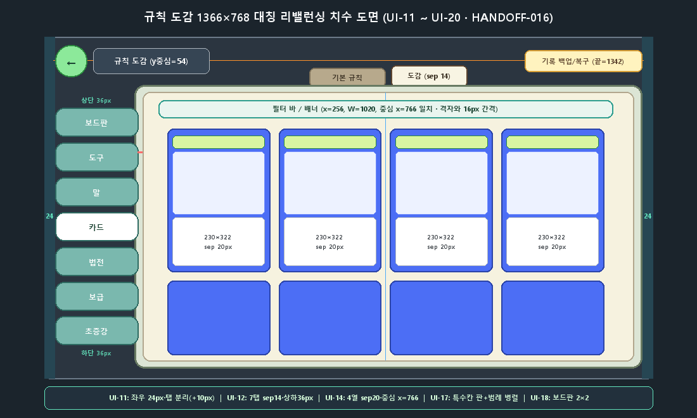

# 초증강 엘리아스 마블 — 규칙 도감 기획 및 검수 명세서 (Rulebook Spec)

> **문서 기준:** `v1.3.1` (2026-11-28 `dev` 브랜치 `scenes/rulebook.gd` · `scenes/rulebook_visuals.gd` 전수 검수 기준)
> **목적:** 인게임 **규칙 도감(`Rulebook`)** 의 11개 장 구성, 화면 레이아웃, 데이터 연동 원칙, 문구 통일 기준을 확정하고, 현재 코드(`scenes/rulebook.gd`)에 남아 있는 **구버전 오기·누락 10건의 정확한 교정 사양**을 명세한다.
>
> - **기본 규칙 · 전체 데이터 표:** [`GDD_TDD_Master.md`](GDD_TDD_Master.md)
> - **규칙 판정 · 연출 경계:** [`EDGE_CASE_SPEC.md`](EDGE_CASE_SPEC.md)
> - **연출 · 소품 동작 기획서:** [`PRESENTATION_SPEC.md`](PRESENTATION_SPEC.md)
> - **UI 버튼 크기 · 배치 좌표:** [`visual/Visual_Asset_Guide_Draft.md` 7.5절](visual/Visual_Asset_Guide_Draft.md#75-규칙-도감-rulebook--1366--768-고정-스테이지)
> - **개발 AI 전달 지시판:** [`AI_HANDOFF.md`](AI_HANDOFF.md)

---

## 목차

1. [규칙 도감 구조 · 레이아웃 · 데이터 연동 원칙](#1-규칙-도감-구조--레이아웃--데이터-연동-원칙)
2. [11개 장 전체 구성 및 확정 요약 배너](#2-11개-장-전체-구성-및-확정-요약-배너)
3. [현행 `rulebook.gd` 텍스트 검수 10건 (`HANDOFF-009` 완료)](#3-현행-rulebookgd-텍스트-검수-10건-handoff-009-완료)
4. [규칙 도감 UI · UX 종합 개선 확정 규격 10건 (`HANDOFF-012`)](#4-규칙-도감-ui--ux-종합-개선-확정-규격-10건-handoff-012)
5. [도감 텍스트 · 다국어 · 회귀 검증 기준](#5-도감-텍스트--다국어--회귀-검증-기준)

---

## 1. 규칙 도감 구조 · 레이아웃 · 데이터 연동 원칙

### 1.1 진입 경로 및 화면 골격 (`1366 × 768` 고정 스테이지)

- **진입 경로:** 시작 허브 우상단 원형 책 버튼(`56×56`) 또는 인게임 `[메뉴] → [규칙 책자]`.
- **전체 프레임 (`BOOK_SHIFT_X = -24`):** 배경 블러 + `0.75` 암전(`BookDim`) 위 중앙 고정 스테이지(`1366×768`), 책 외곽 `(162, 108) 1156×634`, 내곽 `(180, 126) 1120×598`.
- **상단 조작부:** 좌상 `[뒤로]` `(30, 18) 80×80` · 제목 `(126, 28) 360×66` · 상단 대탭 2개(`기본 규칙` / `도감`) `(500 + i×170, 66) 160×52`(비활성 `H 44`) · 우상 `[기록 백업/복구]` `(1056, 28) 280×46`(클릭 시 `(930, 80) W 406` 코드 복사/복구 팝업).
- **2가지 열람 모드:**
  1. **기본 규칙 탭 (`0 ~ 3장`):** 좌측에 챕터 버튼 4개(`(28, 148)`, 각 `196×66`), 책 좌측에 고정 노트(`(232, 140) 552×574`, 종이 `520×542`), 우측에 항목 버튼 목록(`(810, 142) 468×570`). 장을 열면 첫 항목(`overview`)을 좌측 노트에 표시하고 우측 타일에서는 제외한다.
  2. **도감 탭 (`4 ~ 10장`):** 좌측에 챕터 버튼 7개(각 `196×66`), 상단에 1줄 요약 배너(`(232, 140) 1046×40`), 그 아래 4열 격자(`(232, 188) 1046×526`, 터치 모드에서는 증강 3열 확대). 항목 클릭 시 중앙 확대 상세 팝업(`폭 88% × 720`, 하단 `[◀ 이전]` · `[다음 ▶]` · `[닫기]` 각 `160×64`, 확대 카드 `320×448`)이 열린다.

### 1.2 데이터 단일 출처 원칙 (하드코딩 금지)

| 도감 장 | 반드시 동적 참조해야 할 데이터 출처 | 하드코딩 금지 대상 |
|---|---|---|
| **보드판 (`4`) · 특수 칸 (`3`)** | `BoardCatalog.available()` · `BoardSpec` · `VendingDrinks` · `WitchPotions` · `MountainSpirits` | 보드 수·칸 번호·정령/물약/음료 텍스트 |
| **도구 (`5`)** | `AugmentRegistry` (`TOOL_SWAP`) · `MainBoard.TOOL_RULES` · `dice_table.csv` · `ReleaseGate` | 도구 종수·족보 칸수 |
| **말 (`6`)** | `AugmentRegistry` (`PAWN_EVOLUTION`) · `PawnCatalog` (`EVOLVABLE_SETS`, `SUB_ABILITIES`, `SKILL_IDS`) · `PawnArt` | 계열 수(`7계열` 같은 고정 숫자 금지 → `EVOLVABLE_SETS.size()`) |
| **카드 (`7`)** | `CardRegistry.DECK_COMPOSITION` · `MainBoard.card_summary()` · `CardSkin.FILLS` · `CardSkin.SELF_RISK` · `DuelRules` | 대분류 색상명·카드 장수 |
| **법전 (`8`)** | `AugmentRegistry` (`LAW_ENACT`) · `LawRegistry` · `SpecialVictory` · `PlayerSave`(수집 기록) | 목표 수치·제정 규칙 문구 |
| **보급 (`9`) · 초증강 (`10`)** | `AugmentRegistry` (`CARD_PACKAGE` · `UTILITY` · `SUPER_GAMBLE`) · `MainBoard.augment_card_info()` · `SuperAugments.SELF_RISK` | 종수·설명 텍스트 |

---

## 2. 11개 장 전체 구성 및 확정 요약 배너

### 2.1 기본 규칙 탭 (`0 ~ 3장`)

| 장 번호 · 이름 | 수록 항목 (Overview + 세부 항목) | 핵심 전달 목표 (`1.3.1` 기준) |
|---|---|---|
| **0. 시작하기** | `한눈에 보기` · `완주와 순위` · `말마다 능력` · `굴리는 도구` · `카드와 법전` | 4개 말 완주 서바이벌 순위제, 특수 승리 졸업, 손패 7장, 25R 상한, 9계열 진화·21종 도구·법전 개관 |
| **1. 한 턴** | `한눈에 보기` · `카드 한 장` · `굴리기` · `말 고르기` · `정산` · `보너스 이동` · `증강 라운드` · `템포 업` | `카드/필살기 → 굴리기(1.3.1 직접 조작 5유형) → 말 선택 → 정산` 흐름, 리벤지·부스터·코너·템포 업(`8·14·20R`)·4R 첫 증강 |
| **2. 잡기** | `한눈에 보기` · `말의 기본` · `업기` · `리벤지 부스터` · `공격 카드` · `방어 카드` · `잡기 방어` · `공격 방어` · `함정 방어` · `만능 방어` · `함정 카드` · `숨은 함정` | 잡기·업기·업기 자석, 리벤지 부스터(`+4/6/8`), `[공격 발동]` vs `[너프 발동]` 방어 경계, 방어 4분류, 일반 은신 vs 코너 공개 함정 |
| **3. 특수 칸** | `한눈에 보기`(현재 보드 미니맵) · `코너` · `반환점` · `부스터 발판` · `함정 칸` · `보드마다 다른 칸` | 전 보드 공통 특수 칸(`0`, `8·16·24`, `16` 승급·비행기, `3·27` 부스터·미니카, 특수 발판 스침 강아지) 및 보드별 차이 안내 |

### 2.2 도감 탭 (`4 ~ 10장`) 및 확정 1줄 요약 배너 (`BANNERS`)

| 장 번호 · 이름 | 격자 타일 수 (`1.3.1`) | 확정 상단 요약 배너 문구 | 상세 팝업 수록 구성 |
|---|---:|---|---|
| **4. 보드판** | **4종** | `[보드판] 보드판마다 상점 자리·장치 자리에 서는 특수 칸과 연동 법전이 달라요.` | 미리보기(`640×400`) + 미니 보드(`340×340`)·범례 + 보드별 장치 표(옷장 워프 · 자판기 음료 5종 · 가마솥 물약 5종 · 정령산 4원소 정령) |
| **5. 도구** | **20종** *(기본 D6 제외)* | `[판정 도구] 도구마다 족보와 조작 손맛이 달라요. 증강의 [도구 교체]로 바꿔 굴려요.` | 도구 증강 카드 격자 + 상세: 전진 범위 칩 · 전체 족보/확률 표 · 특수 주의사항 |
| **6. 말** | **32종** *(폰에 퀸 포함)* | `[말] 증강의 [기물 진화]로 기본 말을 진화시켜요. 말마다 상시 능력과 1회 필살기가 있어요.` | 진화 카드 격자 + 상세: 계열 칩 · 상시 능력 · 1회 필살기(폰은 퀸 승급 능력·이미지 병기) |
| **7. 카드** | **52종** *(+ 오이 안내)* | `[카드] 상점·증강에서 얻은 카드를 보드로 끌어다 놓아 써요. 손패는 기본 최대 7장이에요.` | 실제 `CardSkin` 타일(`200×280`) + 확대 카드(`320×448`) · 세부 종류 설명 · 자해 경고 · 패러디 인용구 · `ACT_09`는 일기토 6종 표 포함 |
| **8. 법전** | **9종** *(수집 수 표시)* | `[특수 승리 법전] 8라운드(과열)부터 증강에 등장하며, 제정 시점부터 0에서 경쟁해 조건을 채우면 즉시 다음 순위로 졸업해요!` | 법전 메달 카드 + 수집 도장 + 상세: 목표 칩 · 달성 조건 · 판정 시점 · `이의 있음!` 초기화 가능 여부 |
| **9. 보급** | **19종** *(카드 3 + 범용 16)* | `[보급 증강] 패시브·즉발 발동·범용 보급·카드 보급을 색상과 분류 이름으로 구분해요.` | `AugmentDef.SUPPLY_GROUPS` 순서 정렬 격자 + 상세: 분류 칩 · 핵심 효과 및 세부 조건 |
| **10. 초증강** | **16종** | `[초증강] 14라운드(광기)부터 등장하는 하이리스크 하이리턴. 경고 표시는 내 말도 사출될 수 있다는 뜻이에요.` | `PRISMA` 증강 카드 격자(자해 경고 아이콘 포함) + 상세: 리턴·리스크·주의 문구 |

---

## 3. 현행 `rulebook.gd` 텍스트 검수 10건 (`HANDOFF-009` 완료)

`dev` 브랜치 `scenes/rulebook.gd` 전수 대조 결과 확인된 아래 10건은 **`0cfd6bb` (`dev`, 개발 기록 `7.139`)에서 교정 완료**되었으며, 향후 회귀 방지 기준표로 유지한다.

| 번호 | 심각도 | 위치 (`rulebook.gd`) | 현행 코드의 문제 (오기 · 구버전) | 확정 교정 사양 (`1.3.1` 기준) |
|---|---|---|---|---|
| **1** | `높음` | `L2006` (`_ch_laws`) | `VictoryLaw.SESSION_KEYS` 여부로 `"법전에 있는 동안만 세요"` vs **`"게임 내내 쌓여요"`** 분기 (`1.0.1` 이전 규칙 잔재, 같은 파일 `L1595`와도 모순) | 현행 엔진(`SpecialVictory.on_law_enacted`)은 **9종 법전 모두 제정 순간 `0`으로 초기화**된다. **`"법전에 오른 순간부터 전원이 0에서 새로 세요"`** 로 통일 |
| **2** | `높음` | `L125` · `L1580` · `L1595` · `L1999` · `L2009` | 법전 등장 시점을 `"3라운드마다"`로만 적고, 모든 법전이 `"내 차례가 끝날 때"`만 졸업한다고 서술 | ① 등장은 **`8라운드(과열)부터 증강 라운드에 등장`** 으로 명시. ② 판정은 일반 7종 **`"각 차례가 끝나는 정산 시점(및 라운드 끝 NPC 뒤)에 조건을 채워 있으면 특수 승리!"`**, `LAW_09(방해령)`만 **`"내 차례가 끝날 때 손패에 3종을 모두 들고 있으면 특수 승리!"`**, `LAW_05(보드연성진)`는 **`"내 차례 끝에 조건을 채워 경보가 울린 뒤 다음 내 차례 끝까지 유지하면 특수 승리!"`** 로 정확히 분기 |
| **3** | `보통` | `L1885` (`_ch_pawns`) | 기물 계열 칩이 **`"7계열"`** 로 하드코딩 (TRPG·수집품 추가 미반영) | **`"%d계열" % PawnCatalog.EVOLVABLE_SETS.size()`** (`9계열`) 동적 표기로 변경 |
| **4** | `보통` | `L1888` (`_ch_pawns`) | **`"필살기는 내 프로필 카드에서 굴리기 전에 눌러요"`** (`1.0.1` 내 프로필 제거 이전 문구) | **`"필살기는 하단 중앙 기물 독(내 말 위 [필살기 발동!])에서 굴리기 전에 눌러요"`** 로 수정 |
| **5** | `보통` | `L1930` (`PAWN_LINES`) | 아케이드 계열 설명에 `모브 큐이` · `괴상한 멜론` 2종 누락 | **`"킹 체커·루도·8번 공·스타 카트·지뢰찾기 공병·모브 큐이·괴상한 멜론."`** 으로 보완 |
| **6** | `보통` | `L1614` (`_ch_turn`) | `1.3.1` 조작 설명 2곳 불일치: **`"쿠키는 과자통에서 집고"`**, **`"다트는 끌어 던지고"`** | **`"쿠키는 접시 위에서 집고"`** (`cookie_platter_heaped.scn`), **`"다트는 회전하는 과녁을 눌러 던지고"`** (`1.3.1` 공지 `961ffe3` 기준)로 수정 |
| **7** | `보통` | `L1957` · `L1976` (`_ch_cards`) | 카드 색상 불일치: **`"발동 (노랑)"`**, **`"소환 (분홍)"`** 및 소환 톤 `Color("f08aa8")` | `CardSkin.FILLS` 실색상과 일치시켜 **`"발동 (주황)"`**(`#D98B2B`), **`"소환 (청록)"`**(`#2F9A85`, `tone = Color("2f9a85")`)으로 통일 |
| **8** | `낮음` | `L123` · `L1886` · `L1998` | 증강 명칭 혼용: 구 **`"기물 지급"`** vs 신 **`"기물 진화"`**(`L1629`) | **`"기물 진화"`** 로 전 구간 통일 |
| **9** | `낮음` | `L2043` (`_ch_super`) | 초증강 Overview 분류표에 `1.2` 지속형 4종(`평화주의자·날조와 선동·눈먼 자의 도시·사출 목걸이`) 누락 | **`["지속/상태", "평화주의자 · 날조와 선동 · 눈먼 자의 도시 · 사출 목걸이"]`** 행 추가 |
| **10** | `낮음` | `L124` · `L1646` · `L1955` · `L1573` | ① `오이 카드`(`JNK_CUKE`) 설명 부재 · 손패 상한 확장 예외 미표기 ② 특수 칸 `"대부분 딱 멈출 때만"`에 땅 정령 통과 강제 정지 예외 미표기 ③ 주석 `장 10개` 오기 | ① `카드 쓰는 법`에 비덱 토큰 `오이 카드`(모브 큐이 필살기, 굴리기 전 1장 소비해 먹기) 및 `기본 최대 7장(에심당 뽈사탕 +1장)` 명시 ② `특수 칸`에 `땅 정령은 지나가기만 해도 강제 정지` 1줄 추가 ③ 주석 `장 11개` 수정 |

---

## 4. 규칙 도감 UI · UX 종합 개선 확정 규격 10건 (`HANDOFF-012`)

실서비스(https://hypereliasmarble.xyz/) 전 화면 시각 검수 결과를 바탕으로 **사용자 확정(`2026-11-28`)** 된 규칙 도감 UI/UX 개선 사양이다. 코드 담당은 아래 치수·색상·동작 규격을 그대로 구현하며 임의로 생략하거나 다른 스타일로 대체하지 않는다.

| 번호 | 우선순위 | 대상 화면 · 요소 | 현행 UI 문제점 | 확정 개선 규격 (`1366 × 768` 기준) |
|---|---|---|---|---|
| **UI-01** | `P0` | **`[도감] → [카드]` 52장 분류 필터 탭 신설** | 52장(4열 × 13행)이 단일 스크롤 목록에 나열되어 탐색 피로도가 높음 | `CARD_SPREAD(7)` 상단(`y = 140`, `H = 38px`, 격자 `y = 186`, `H = 528px`)에 5개 분류 필터 알약 버튼 배치 (`h_sep = 8px`, 각 `H = 36px`, 터치 `H = 44px`): **`[전체]` · `[방어]`(`#4C6EF5`) · `[발동]`(`#D98B2B`) · `[함정]`(`#8E4AA8`) · `[소환]`(`#2F9A85`)**. 장수는 `CardRegistry.DECK_COMPOSITION` 동적 집계. 필터 전환 시 스크롤 `0` 초기화 및 상세 팝업 `[◀ 이전]`/`[다음 ▶]`도 현재 필터 결과 내에서 순환 |
| **UI-02** | `P0` | **상세 팝업 버튼 위계 분리 + 전체 암전 백드롭** | 하단 `[◀ 이전]`·`[다음 ▶]`·`[닫기]` 3버튼이 모두 같은 크림색이라 구분감이 약하고, `_popup_dim`이 책 안쪽만 덮어 뒷면 좌측 7개 챕터·`[←]`·`[기록 백업/복구]`가 바깥으로 산만하게 비침 | ① `_popup_dim`을 **도감 전체 화면(`PRESET_FULL_RECT`, `alpha = 0.65`)** 으로 확장하고 팝업 바깥 클릭 시 닫기 지원. ② 하단 **`[닫기]`** 버튼은 `[◀ 이전]`/`[다음 ▶]`(청록/크림)과 명확히 대비되는 **짙은 갈색/회색(`#5f4630`, 흰 글씨)** 으로 고정(외부 스킨 덮어쓰기 방지)하고, 팝업 우상단에 명시적 **`[×]` 닫기 버튼(`44×44`)** 추가 |
| **UI-03** | `P0` | **`[기록 백업/복구]` 미니 팝업 대비 · 닫기 동선** | `_code_field`가 기본 `LineEdit`(어두운 회색 배경 + 연회색 글자)라 대비가 낮고, 팝업에 닫기 버튼·바깥 클릭 닫기가 없어 우측 타일을 가린 채 남음 | ① `_code_field`에 밝은 **`LobbyTheme.input_field()` 스킨**(`INPUT_BG = #EEFFA8`, 글자 `#1B4D3E`, 플레이스홀더 `#5A7A68`) 적용. ② 팝업 우상단에 **`[×]` 닫기 버튼(`36×36`)** 추가 및 팝업 바깥 클릭 시 자동 닫기 |
| **UI-04** | `P1` | **`[기본 규칙] → [특수 칸]` 미니 보드판 하단 잘림** | `MiniBoard`(`340×340`)가 좌측 노트 높이를 넘어 초기 화면에서 `24~31번 · 출발` 행이 절반 잘림 | 기본 규칙 노트 안 `MiniBoard` 크기를 **`276 × 276`** 으로 축소하고 상단 간격을 조정해 **초기 스크롤 위치에서 `0번 출발선`까지 100% 한 화면 노출** *(도감 `보드판` 상세 팝업은 넓은 영역이므로 `320 × 320` 유지)* |
| **UI-05** | `P1` | **상세 팝업 공백 균형 및 불필요 스크롤바 제거** | 내용이 2~3줄인 짧은 팝업(`기물 슬레이어`·`윷말`·`슈파볼트`) 하단 절반이 텅 비고, 넘치지 않는 페이지에도 회색 스크롤바 노출 | ① `EntryDetailScroll`·`CatalogScroll` 모두 **`vertical_scroll_mode = SCROLL_MODE_AUTO`** 로 변경해 넘침 시에만 스크롤바 표시. ② 본문 높이가 노트 내부의 `55%` 미만인 짧은 상세 팝업은 콘텐츠를 **세로 중앙 정렬(상단 동적 여백)** 해 하단 공백 불균형 완화 |
| **UI-06** | `P1` | **`[도감]` 긴 카드 잘림 방지 & `법전` 변형 버튼 직관화** | `보급`(`풀 파워`)·`법전`(`보드연성진`) 하단 텍스트 잘림, 마지막 행 카드가 스크롤 바닥에 밀착. `식권` 우상단 `(→)` 버튼 의미 불분명 | ① 스크롤 내부 하단 **`margin_bottom = 18px`** 확보 및 타일 텍스트 최소 축소 하한(`10px`)·줄간격 점검으로 끝줄 잘림 제거. ② `BoardVariantButton`을 단순 화살표 대신 **`보드 1/4 ▶` 칩 라벨**(또는 상세 팝업 내 보드 4종 전환 탭 병행)로 용도를 즉시 인지 가능하게 개선 |
| **UI-07** | `P1` | **`[기본 규칙] → [잡기]` 방어 타일 5종 아이콘 차별화** | `방어 카드`·`잡기 방어`·`공격 방어`·`함정 방어`·`만능 방어` 5개 타일이 전부 동일 방패 아이콘(`&"defense"`) 공유 | 공통 `방어 카드`만 `&"defense"` 유지하고, 세부 4종은 기존 에셋 조합/대표 카드 삽화로 차별화(`잡기 방어`: `&"capture"`/파랑, `공격 방어`: `&"attack"`/파랑, `함정 방어`: `&"trap_card"`/파랑, `만능 방어`: `CNT_01` 삽화 또는 `&"turn"`/파랑 — 추가 용량 `0 KB`) |
| **UI-08** | `P2` | **좌측 7개 챕터 · 메달 · 하단 `N / 11` 리본 여백 정비** | 좌측 7개 버튼 중 `초증강`이 하단 테두리에 밀착, 우상단 메달이 노트 모서리를 덮고, 하단 `N / 11` 리본(`y=706~762`)이 외곽선(`y=742`)을 가로지름 | ① 좌측 챕터 버튼 열: 시작 **`(28, 136)`**, 버튼 크기 **`196 × 60`** (`sep = 7px`, 7개 총 `462px`, `y 136~598`, 터치 `≥ 48px` 충족). ② 하단 리본: 책 외곽 하단선과 어긋나지 않게 **`y = 716`, `H = 40`** 으로 안착. ③ 우상단 메달: 기본 규칙 노트에서는 모서리 안쪽으로 `+8px` 여유 배치, 상세 팝업에서는 우상단 `[×]` 닫기 버튼과 겹치지 않게 숨기거나 좌상단 장식으로 이동 |
| **UI-09** | `P2` | **`[도감] → [보드판]` 미리보기 썸네일 4종 통일** | `classic.webp` · `monatium.webp`에 중앙 `[굴리기]` 버튼 UI가 찍혀 있고 `belatien` · `spirit_mountain`에는 없음 | 4종 보드 미리보기(`640×400` WebP) 모두 **인게임 중앙 HUD 버튼이 없는 클린 보드 캡처**로 통일 (`classic.webp` · `monatium.webp` 재캡처) |
| **UI-10** | `P2` | **`[기본 규칙] → [한 턴]` 줄바꿈 및 `꿀팁` 잘림 해소** | `"필살기도 이때"` 1단어 고아 줄바꿈 및 하단 노란 `꿀팁` 상자 초기 잘림 | `① 카드` 설명을 **`"굴리기 전에 카드 1장 · 필살기 사용 (안 써도 돼요)"`** 로 다듬고 항목 간격을 미세 압축해 `꿀팁` 상자가 초기 화면에 온전히 노출되도록 조정 |

### 4.1 규칙 도감 레이아웃 여백 · 정렬 · 간격 대칭 리밸런싱 (`UI-11 ~ UI-20`, `HANDOFF-016`)

`HANDOFF-012` 적용 실기 화면 6장(기본 규칙 4장 + 도감 보드판·카드) 전수 캡처 검수 결과(`2026-11-28`), 책 프레임 좌측 편향(`BOOK_SHIFT_X = -24`), 좁은 격자·탭 간격(`7~10px`), `[특수 칸]` 미니보드-범례 수직 적층 공백, `[보드판]` 1×4 하단 공백, `[시작하기]` 3+1 외톨이 배열, `[잡기]` 아이콘 사각 클립 삐져나옴 등이 확인되었다. 아래 10건으로 **`1366 × 768` 스테이지 전체의 여백·정렬·시각 균형을 대칭 재정의**한다 *(아래 좌표는 기존 `UI-08` 좌표를 대체하는 최신 확정 기준이다)*.

*▲ 규칙 도감 `1366 × 768` 대칭 리밸런싱(`UI-11 ~ UI-20`) 기준 치수 도면 — 좌우 `24px` 대칭, 7탭 상하 `36px` 대칭, 필터·4열 격자 중심축 `x=766` 일치*

| 번호 | 우선순위 | 대상 영역 | 실기 화면에서 확인된 문제 | 확정 재정리 규격 (`1366 × 768` 기준) |
|---|---|---|---|---|
| **UI-11** | `P0` | **책 프레임 ↔ 좌측 탭 분리 & 좌우 `24px` 대칭** | 책 외곽(`x=162~1318`)이 좌측으로 쏠려 좌측 챕터 탭(`x=28~224`)이 크림 내곽(`x=180`) 안쪽으로 **`44px`** 파고들고, 첫 번째 카드 열(`x=232`)·좌측 노트가 탭 끝과 겨우 **`8px`** 간격으로 압박됨 | • 좌측 탭 열: **`x = 24, W = 186`** (`x: 24 ~ 210`) • 책 외곽 (`_book_outer`): **`x = 202, W = 1140`** (`x: 202 ~ 1342`, 화면 좌·우 여백 **각 `24px` 완벽 대칭**) • 책 내곽 (`_book_inset`): **`x = 220, W = 1104`** (`x: 220 ~ 1324`) — 탭 끝(`210`)이 책 외곽선에 `8px`만 바인더처럼 맞물리고, 내곽 본문(`220`)은 **`+10px` 완전 분리** |
| **UI-12** | `P0` | **좌측 챕터 탭 세로 대칭 & 간격 2배 확장** | `y = 136`, `60px × 7`, `sep = 7px`로 7개 탭이 서로 바짝 붙은 채 위쪽으로 쏠리고 하단에 `126px` 빈 공백이 남음 | • 버튼 크기 **`186 × 64`**(원형 아이콘 `44×44 @(10,10)`, 라벨 `122×64 @(58,0)`), 세로 간격 **`sep = 14px`** *(기존 2배)* • 도감 7개 총 높이 `532px`를 **`y = 160 ~ 692`** 에 배치 → 책 내곽(`y: 124 ~ 728`) 대비 **상단 `36px` · 하단 `36px` 완벽 중앙 대칭** (기본 규칙 4개도 동일 간격 `sep = 14px`, `y = 160` 시작) |
| **UI-13** | `P1` | **상단 헤더 3요소 수평·우측 끝선 정렬** | `[기록 백업/복구]`(`x=1056, W=280 → 1336`)가 책 외곽 우측 끝(`1318`) 밖으로 `18px` 삐져나오고, `[←] 규칙 도감`·`[기본 규칙/도감]`·`[기록 백업/복구]` 3요소의 수평 리듬이 어긋남 | • 좌상 `[←]` **`(24, 18), 72×72`** · 제목 `규칙 도감` **`(110, 26), 340×56`** · 우상 `[기록 백업/복구]` **`(1078, 30), 264×48`** → 수직 중심 **`y = 54`** 수평 통일 + 우측 끝선 **`x = 1342`**(책 외곽 우측 끝과 1px 일치) • 상단 대탭 2개(`기본 규칙`·`도감`): 책 외곽 중심(`x = 772`) 기준 대칭 배치, 활성 **`170 × 48 @(y=64)`** · 비활성 **`170 × 42 @(y=70)`**, 간격 **`14px`** |
| **UI-14** | `P0` | **4열 도감 격자 간격 2배(`10→20px`) & 필터 바·격자 중앙축 일치** | 카드 사이 `h/v_sep = 10px`로 4장이 벽돌처럼 밀착되고, 필터 바·배너↔격자 간격(`~8px`)이 비좁으며, 스크롤바 여백 탓에 카드 격자가 좌측으로 쏠려 필터 바와 중심이 어긋남 | • `_right_scroll`: **`(244, 198), 1056 × 516`**, 내부 `CatalogSafeMargins`(`left=12, right=24[스크롤바 포함], top=8, bottom=24`) → 실효 콘텐츠 폭 **`1020px`** · 시각 중심 **`x = 766`** • **카드 필터 바 · 상단 요약 배너:** **`(256, 142), 1020 × 40`** (필터 알약 5개 `H = 38` · 터치 `48`, **`h_sep = 12px`**, 책 상단 여백 **`18px`** · 격자 사이 숨통 여백 **`16px`**) — 4열 격자와 좌우 끝선·중심(`x = 766`) **100% 일치** • `EntryGrid`: **`h_separation = 20px`**, **`v_separation = 20px`** *(기존 2배)*, 중앙 정렬로 좌우 크림 여백 대칭 보장 |
| **UI-15** | `P1` | **카드 타일 내부 여백 확대 & 설명 고아줄 해소** | `바이츠 더 더스트` 4줄 설명 마지막 단어(`"종료"`)가 하단 테두리에 밀착되고, 카드 내부 여백·일러스트 정렬이 답답함 | • 4열 카드 타일 크기 **`230 × 322`**(비율 `1:1.4` 유지, `4×230 + 3×20 = 980px` → `1020px` 내 양옆 `+20px` 추가 대칭 여유) • 카드 내부 프레임 패딩 `10px`, 제목띠·일러스트·설명박스 간격 `8px`, 설명 흰 박스 내부 패딩 **`좌우 12px · 상하 10px`** · 줄간격 `+2px` 확보, 일러스트 `STRETCH_KEEP_ASPECT_CENTERED` 중앙 정렬 |
| **UI-16** | `P1` | **기본 규칙 2분할 동기화 · 노트 내부 여백 · 불릿 첫 줄 정렬** | ① 새 책 프레임(`x: 220~1324`) 기준 좌측 노트·우측 타일 재정렬 필요. ② 노트 내부 `DetailSafeMargins`가 `left=0 / right=14`로 좌측 표 테두리가 바짝 붙고 비대칭. ③ `[한 턴]` 2줄 불릿의 초록 원형 점(`●`)이 2줄 세로 중앙에 붕 떠 보임 | • 기본 규칙 좌측 노트(`x=244, W=536`) + 중앙 간격 `20px` + 우측 타일(`x=800, W=500`) 대칭 배분. • 노트 내부 `DetailSafeMargins`: **`margin_left = 10, margin_right = 14, margin_bottom = 14`** 대칭 보정. • 모든 불릿(`points`)의 원형 점(`●`)을 `SIZE_SHRINK_BEGIN` + 상단 오프셋 `6px`로 **항상 1번째 줄 중앙에 고정** |
| **UI-17** | `P0` | **`[기본 규칙] → [특수 칸]` 미니보드 + 범례 좌우 병렬 배치** | `MiniBoard`(`276×276`)가 좌측에 쏠려 오른쪽 `200px`이 텅 비고, 범례 6종이 아래로 밀려 4종이 스크롤 밖으로 잘림(불필요한 회색 스크롤바 노출) | 좌측 노트 안에서 **`MiniBoard`(`260 × 260`)를 왼쪽**, **범례 6종(`출발·결승`·`코너`·`반환점`·`빵집/상점`·`옷장/장치`·`부스터 발판`) 세로 열을 오른쪽**에 나란히(`HBoxContainer`, `sep = 16px`) 배치 → **스크롤 없이 한 화면 100% 노출 + 우측 공백 완전 제거** |
| **UI-18** | `P0` | **`[도감] → [보드판]` 2×2 와이드 쇼케이스 격자 개편** | 보드판 4종이 상단 1줄(`1×4`)에 작게 몰려 아래쪽 절반(`~270px`)이 완전히 텅 비어 있음 | `[도감] → [보드판]`(`spread == 4`)을 4열 대신 **`2열 와이드 쇼케이스 격자`**(`columns = 2`, 카드 각 **`490 × 236`**, `h_sep = 24px, v_sep = 20px`)로 개편 → 좌측 큼직한 보드 미리보기(`272 × 170`) + 우측 보드명·특수 칸 요약·전용 법전 칩 배치 (4종 기준 `492px`로 페이지 꽉 차게 채움, `1.4` 5번째 보드 추가 시에도 자연 스크롤) |
| **UI-19** | `P1` | **`[기본 규칙]` 우측 소수 타일(`시작하기` 4개 · `특수 칸` 5개) 균형 배열** | `[시작하기]` 4개가 3열(`3+1` 외톨이)로 위쪽에 쏠려 우하단 65%가 비고, 우측 타일 간격(`10px`)이 좁음 | • 기본 규칙 우측 타일 격자 공통 **`h_sep = 14px, v_sep = 14px`** 확장. • 항목이 **`4개 이하`(`시작하기`)면 `2열`(`2×2`, 타일 대형 `236 × 150`)** 로 전환해 외톨이 행·하단 공백 완화 (`5개+`인 `특수 칸`·`한 턴`·`잡기`는 `3열`, 타일 `154 × 132` 유지) |
| **UI-20** | `P1` | **`[기본 규칙] → [잡기]` 방어·업기 아이콘 시각 통일** | ① `만능 방어` 타일에 정사각 `CNT_01` 이미지가 둥근 흰 원 밖으로 사각 모서리가 삐져나옴. ② `공격 방어`/`함정 방어`가 `공격 카드`/`함정 카드`와 아이콘이 100% 동일. ③ `말의 기본`과 `업기`가 동일한 단일 말 아이콘 사용 | ① `만능 방어`: 둥근 원형 마스크(`ui_circle_clip` 또는 원형 내부 여백 `38×38` 축소) 적용 또는 방패+되감기 원형 심볼로 교체해 사각 삐져나옴 제거. ② `공격 방어`·`함정 방어`·`잡기 방어`: 기존 아이콘 우하단에 작은 파란 미니 방패 배지(`18×18`)를 겹쳐 `공격/함정 카드`와 즉시 구분. ③ `업기`: 단일 말 아이콘 대신 말 아이콘 2개를 살짝 겹쳐(오프셋 `(-6, +3)` / `(+6, -3)`) 업기 의미 직관화 *(추가 에셋 `0 KB`)* |

---

## 5. 도감 텍스트 · 다국어 · 회귀 검증 기준

1. **번역 동시 갱신 (`L10n`):** `scenes/rulebook.gd`의 한국어 문구를 수정할 때는 반드시 `content_trickcal/data/translations.csv`의 영어(`en`)·일본어(`ja`) 대응 키도 함께 갱신해 원문 불일치로 번역이 풀리지 않게 한다.
2. **가독성 · 넘침 검증:** 수정 후 `tests/ui_overlap_audit.gd`를 한·영·일 3개 국어 + PC/터치 모드로 실행해 도감 좌측 챕터 버튼(`196×66`), 4열 격자, 확대 상세 팝업, 1줄 배너(`1046×40`)에서 글자 잘림·겹침 0건을 확인한다.
3. **신규 콘텐츠 자동 연동 검증:** `1.4+`에서 보드·도구·기물·카드·법전·증강을 추가할 때 `rulebook.gd`에 별도 하드코딩을 늘리지 않고 데이터 테이블과 `ReleaseGate`를 통해 도감에 자동 반영·잠금되는지 `tests/test_board_catalog.gd` 및 도감 화면 테스트로 확인한다.
