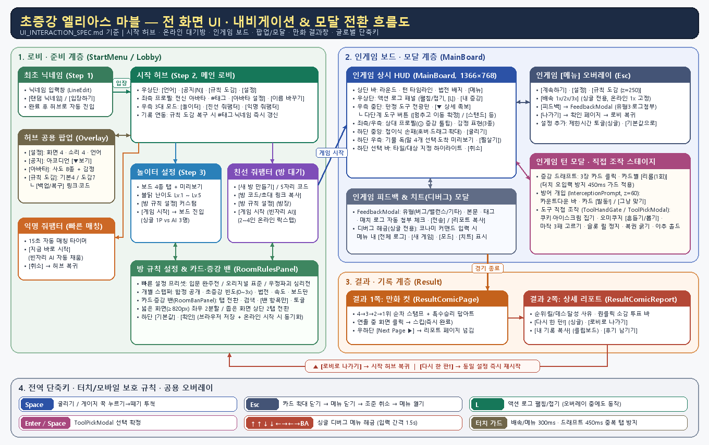
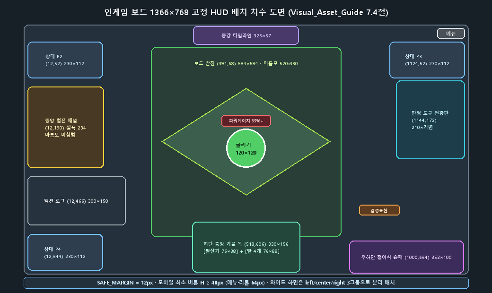

# 초증강 엘리아스 마블 — 전 화면 UI · 버튼 역할 및 조작 흐름 명세서 (UI Interaction Spec)

- **문서 성격:** `origin/dev` 구현 코드(`scenes/*.gd`, `core_engine/match_rules.gd`, `core_engine/emote_catalog.gd`) 전수 대조 기반의 **전 화면 UI·버튼·토글·슬라이더·모달·단축키·터치 가드 단일 원천(Single Source of Truth)**
- **관련 문서:**
  - 좌표·해상도·디자인 토큰 규격: [`docs/visual/Visual_Asset_Guide_Draft.md`](visual/Visual_Asset_Guide_Draft.md) (`7절`)
  - 규칙 도감 전용 여백·배치 규격: [`docs/RULEBOOK_SPEC.md`](RULEBOOK_SPEC.md)
  - 판정 도구 3D 연출·카메라·비겹침 불변식: [`docs/PRESENTATION_SPEC.md`](PRESENTATION_SPEC.md)
  - 153종 개별 콘텐츠 아이콘·연출 백과사전: [`docs/CONTENT_VISUAL_FX_CATALOG.md`](CONTENT_VISUAL_FX_CATALOG.md)
  - 게임 규칙·우선순위·상태 머신 원전: [`docs/GDD_TDD_Master.md`](GDD_TDD_Master.md)

---

## 1. 전체 화면 전환 흐름도 & 전역 입력 규격

### 1.1 전역 키보드 단축키 (`MainBoard` / `ToolPickModal`)

| 단축키 | 적용 화면 | 동작 및 우선순위 | 예외 · 안전장치 |
| :--- | :--- | :--- | :--- |
| **`Space`** | 인게임 보드 (`PHASE_ROLL_WAIT` 등) | 1) 일반 판정 도구: 1회 누르면 즉시 굴리기(`_roll_by_key`) 2) 파워 게이지 도구(볼링·다트·포켓볼 등): **꾹 누르면 차지 시작 → 떼면 투척/발사** 3) 야추 첫 굴리기·다시 굴리기, 블랙잭 첫 `[카드 받기]` 지원 | `Ctrl / Alt / Meta / Shift` 조합 키가 함께 눌리면 브라우저 기본 단축키 보호를 위해 무시. **핀볼(`DICE_PINBALL`)은 발사 버튼 전용**(`Space` 미지원). |
| **`Esc`** | 인게임 보드 전역 | 아래 우선순위대로 **가장 위 레이어 1개만 닫고** 나머지는 유지: ① 카드 확대 보기 닫기 ② `[메뉴]` 오버레이가 열려 있으면 상위 페이지(`설정`/`나가기 확인` → 메인) 또는 메뉴 닫기 ③ 카드/스킬 타일·대상 조준 선택 중이면 선택 취소 ④ 위 3개가 모두 없을 때 인게임 `[메뉴]` 열기 | 방어 개입 팝업이나 결과창 등 강제 진행 모달을 우회하지 않음. |
| **`L`** | 인게임 보드 전역 | 우상단 **액션 로그 패널 펼치기 / 접기** 토글 | 증강 드래프트·연출 오버레이가 떠 있는 상태에서도 로그 확인용으로 동작. |
| **`Enter` / `Space`** | 카드 선택 모달 (`ToolPickModal`) | 현재 포커스/선택된 카드(또는 자리) 즉시 확정 | 카드 선택 모달이 열려 있을 때만 활성화. |
| **`↑↑↓↓←→←→BA`** | 인게임 보드 (싱글 전용) | **코나미 커맨드:** 각 키 입력 간격 `1.5초` 이내 연속 입력 시 개발자 디버그 메뉴(`_debug_enabled`) 해금 | 온라인 대전(`net != null`)에서는 비활성(공정성 보호). |

### 1.2 모바일 · 터치 전용 안전 가드 (`MobileSupport`)

| 보호 규격 | 상수 / 기준값 | 역할 및 방지 대상 |
| :--- | :--- | :--- |
| **중복 탭 방지 가드** | `TAP_GUARD_MSEC = 300ms` | 터치 기기에서 한 번의 탭이 2회 입력으로 들어와 `[배속]`이 두 단계 넘어가거나 `[메뉴]`가 열리자마자 닫히는 현상 차단 (`_accept_tap`). |
| **드래프트 오입력 가드** | `DRAFT_PICK_GUARD_MSEC = 450ms` | 증강 드래프트 창이 막 열리거나 `[리롤]` 클릭으로 카드가 갱신된 직후 `0.45초` 동안 카드 선택 클릭을 무시(같은 자리를 연타해 새 카드를 실수로 고르는 사고 방지). |
| **터치 버튼 최소 크기** | 일반 `TOUCH_BUTTON_HEIGHT` (`48px`), 인게임 메뉴 `440×64px` | 좁은 폰 가로 화면(기준 `1366×768`의 약 0.5배 축소)에서도 손가락 터치 영역 확보. 감정 표현 버튼은 프로필과 겹치지 않도록 `16px` 위로 상향 배치. |
| **드래프트 터치 확대** | `DRAFT_TOUCH_SCALE = 1.22` | 터치 기기에서 증강 선택 카드 3장과 `[리롤]` 버튼(`DRAFT_REROLL_GAP = 14px`)을 화면이 허용하는 최대 1.22배까지 확대하고, 장식용 부제 라벨 1줄을 숨겨 세로 여백 확보. |
| **네이티브 가상 키보드 연동** | `MobileSupport.attach_native_text_input` | 웹 모바일 브라우저에서 닉네임·방 코드·기록 복구 코드·피드백 입력창 터치 시 OS 네이티브 입력창을 연결해 한글 IME 깨짐 방지. |

---

## 2. 시작 허브 · 최초 닉네임 · 아바타 · 놀이터 설정 (`scenes/start_menu.gd`)

시작 화면(`StartMenu`)은 내부적으로 **4단계(Step 1~4)** 페이지 전환 구조로 동작한다.

### 2.1 Step 1 — 최초 닉네임 등록 (신규 프로필 진입 시 1회)

| UI 요소 | 종류 | 역할 및 동작 |
| :--- | :--- | :--- |
| **닉네임 입력창 (`_name_edit`)** | `LineEdit` | 플레이어 표시 이름 입력. `Enter` 입력 또는 `[입장하기]` 클릭 시 프로필에 저장. |
| **`[랜덤 닉네임]`** | `Button` | 사도/엘리아스 테마 랜덤 닉네임 1종을 생성해 입력창에 즉시 채움. |
| **`[입장하기]`** | `Button` | 입력된 닉네임을 저장(`PlayerSave`)하고 **Step 2 (시작 허브)**로 이동. 공백만 입력 시 기본/랜덤 값으로 보정. |

### 2.2 Step 2 — 시작 허브 (메인 로비)

| 구역 | UI 요소 | 종류 | 역할 및 동작 |
| :--- | :--- | :--- | :--- |
| **우상단 유틸 바** | **`[언어 선택]`** | `OptionButton` / 드롭다운 | `L10n.LANGUAGES` (`한국어 / English / 日本語`) 중 선택. 선택 즉시 전체 허브 텍스트가 실시간 재번역되며 설정 파일에 저장. |
| | **`[공지]` (`N` 배지)** | `Button` | `UpdateNotes` 오버레이 오픈. 아직 읽지 않은 최신 버전 패치노트가 있으면 빨간 `N` 배지 표시(열람 시 소거). |
| | **`[규칙 도감]`** | `Button` | `Rulebook.open()` 실행. 도감 우상단 `[기록 백업/복구]`에서 코드를 복구하면 `records_imported` 시그널을 받아 허브의 `#태그`·닉네임·법전 달성 수 배지를 즉시 재렌더링. |
| | **`[설정]`** | `Button` | 공용 설정 팝업(`LobbyTheme.show_settings`) 오픈. |
| **좌측 프로필 카드** | **전신 아바타 프리뷰** | `AvatarSlot` | 현재 선택된 사도의 Live/PNG 아바타 표시. 클릭 또는 이벤트 시 감정 리액션 재생. |
| | **닉네임 + `#태그` 배지** | `Label` | 현재 닉네임과 고유 식별 `#태그`(예: `#4BGC`) 표시. |
| | **`[아바타 설정]`** | `Button` | **Step 4 (아바타 설정)** 페이지로 전환. |
| | **`[이름 바꾸기]`** | `Button` | 닉네임 수정 입력 팝업/Step 1로 이동해 표시 이름 변경. |
| **우측 3대 모드** | **`[놀이터]`** | 대형 카드 버튼 | 싱글 AI 대전 설정 화면(**Step 3**)으로 이동. |
| | **`[친선 줘팸터]`** | 대형 카드 버튼 | 커스텀 온라인 방 생성·입장 로비(`Lobby`, 친선 모드)로 전환. |
| | **`[익명 줘팸터]`** | 대형 카드 버튼 | 빠른 매칭 대기 화면(`Lobby`, 15초 자동 매칭 모드)으로 전환. |

### 2.3 Step 3 — 놀이터 설정 (싱글 1P vs AI 3인)

| UI 요소 | 종류 | 역할 및 동작 |
| :--- | :--- | :--- |
| **보드판 선택 탭 (4종)** | 탭 버튼 그룹 | `에르핀 왕국`, `모나티엄 도시`, `벨라티엔 왕국`, `정령산` 중 1종 선택. 선택 시 좌측 보드 미리보기 이미지·특수 칸 설명·전용 법전 안내가 즉시 갱신. |
| **불닭 난이도 선택 (5단계)** | 선택 버튼 5종 | `Lv.1 크림` · `Lv.2 순한맛` · `Lv.3 보통` · `Lv.4 불닭` · `Lv.5 핵불닭` 중 선택. 난이도별로 기본 함정 공개 여부(`Lv.1~3 공개 / Lv.4~5 비공개`), 페이싱 디렉터 단계, AI 지능(`BotTemper`), 드래프트 가중치(`Lv.1`은 입문 완화·법전 비활성)가 자동 적용됨. |
| **`[방 규칙 설정]`** | `Button` | `RoomRulesPanel.open(self, false)` 오픈. 싱글 커스텀 규칙 및 카드/증강 밴 편집. |
| **`[게임 시작]`** | 메인 CTA 버튼 | 선택한 보드·난이도·커스텀 규칙을 `GameSession`에 확정하고 인게임 보드(`MainBoard`) 씬으로 진입. |
| **`[뒤로]`** | `Button` | **Step 2 (시작 허브)**로 복귀. |

### 2.4 Step 4 — 아바타 설정

| UI 요소 | 종류 | 역할 및 동작 |
| :--- | :--- | :--- |
| **사도 선택 타일 (8종)** | 그리드 타일 버튼 | 8종 사도 중 1명 선택. 선택 즉시 좌측 전신 프리뷰(`_avatar_preview`) 교체 및 해당 사도의 선택 대사 보이스 재생. |
| **감정 미리보기 버튼** | 액션 버튼 행 | `_avatar_preview.react()`를 호출해 웃음·분노·놀람·낙담·환호 등 사도 표정/모션을 미리 확인. |
| **`[선택 완료]`** | 메인 CTA 버튼 | 선택한 아바타 ID를 프로필에 저장하고 **Step 2 (시작 허브)**로 복귀. |

---

## 3. 공통 `[설정]` 팝업 · `[공지]` · `[피드백]` 모달

### 3.1 공통 `[설정]` 팝업 (`scenes/lobby_theme.gd` & `scenes/main_board.gd`)

시작 허브의 `[설정]`과 인게임 `[메뉴] → [설정]`은 동일한 공통 위젯(`LobbyTheme.show_settings`)을 공유하며, 인게임 진입 시에만 오프라인 제한시간 옵션이 추가된다.

| 섹션 | UI 요소 (노드명) | 컨트롤 종류 | 역할 · 저장 및 즉시 반영 동작 |
| :--- | :--- | :--- | :--- |
| **화면** | **전체화면** (`FullscreenSwitch`) | 토글 스위치 | 창 모드 ↔ 전체화면 전환. |
| | **화면 흔들림** (`ShakeSwitch`) | 토글 스위치 | 처치·함정·승리 임팩트 시 카메라 진동(`screen_shake`) 켜기/끄기. |
| | **배터리 절약 (초당 30프레임)** (`BatterySwitch`) | 토글 스위치 | 모바일/노트북 발열·배터리 절약을 위해 프레임 상한을 `30fps`로 제한. |
| | **저화질 (아바타 애니메이션 640px)** (`LowQualitySwitch`) | 토글 스위치 | 웹 아바타 팩을 고화질(`hq`) ↔ 저화질(`lq`, 640px)로 전환해 저사양 기기 메모리 절약. |
| **소리** | **전체 음량** | `[음소거]` 토글 + `HSlider` | 마스터 오디오 버스 볼륨 조절 및 일괄 음소거. |
| | **효과음 크기** | `[음소거]` 토글 + `HSlider` | UI 클릭·주사위·카드·처치 SFX 버스 볼륨 조절 및 음소거. |
| | **배경음악 크기** | `[음소거]` 토글 + `HSlider` | 로비·보드별 BGM 버스 볼륨 조절 및 음소거. |
| | **캐릭터 음성** | `[음소거]` 토글 + `HSlider` | 사도 보이스 버스 볼륨 조절. **슬라이더 드래그를 놓는 순간 현재 아바타의 선택 보이스 1회를 미리듣기로 재생**해 볼륨 확인 지원. |
| **언어** | **화면 언어** | 드롭다운 (`OptionButton`) | `한국어 / English / 日本語` 즉시 실시간 전환(미번역 문구는 한국어 원문으로 안전 폴백). |
| **인게임 전용** | **제한 시간 (시간이 지나면 자동 진행)** | 토글 스위치 | **싱글(오프라인) 전용:** 턴 제한시간 자동 진행 켜기/끄기. *(온라인 대전은 락스텝 공정성을 위해 항상 3배 넉넉한 제한시간으로 고정되어 토글 비활성/숨김.)* |
| **하단 액션** | **`[기본값으로]`** | `Button` | `reset_settings()` 호출로 모든 화면·소리 설정을 출고 기본값으로 일괄 복구. |
| | **`[닫기]` / `[뒤로]`** | `Button` | 변경 사항을 `GameSession.save_settings()`로 확정 저장하고 허브 또는 인게임 메뉴 메인으로 복귀. |

### 3.2 `[공지]` 업데이트 노트 (`scenes/update_notes.gd`)

| UI 요소 | 종류 | 역할 및 동작 |
| :--- | :--- | :--- |
| **버전별 아코디언 헤더 (`[▼ 보기]` / `[▲ 접기]`)** | 토글 버튼 | 각 버전의 패치 내역 본문을 펼치거나 접음. 최신 버전은 기본 펼침 상태. |
| **`[닫기]`** | `Button` | 공지 오버레이 닫기 및 최신 버전 열람 기록 저장(허브 `N` 배지 제거). |

### 3.3 `[피드백]` 모달 (`scenes/feedback_modal.gd`)

인게임 `[메뉴] → [피드백]` 또는 결과 2쪽 `[후기 남기기]`에서 호출된다.

| UI 요소 | 종류 | 역할 및 동작 |
| :--- | :--- | :--- |
| **피드백 유형 (3종)** | 라디오 토글 그룹 | `버그 제보` / `밸런스 의견` / `기타 의견` 중 1종 선택. *(결과창 `[후기 남기기]`로 진입 시 `밸런스 의견`이 자동 사전 선택됨.)* |
| **닉네임 입력창** | `LineEdit` | 기본값으로 현재 프로필 닉네임 자동 채움(수정 가능). |
| **내용 입력창 + 글자수 카운터** | `TextEdit` + `Label` | 본문 작성 및 실시간 `현재 / 최대 글자수` 카운트 표시. |
| **빠른 태그 칩** | 다중 토글 칩 | 자주 나오는 주제(예: 주사위·카드·UI·렉 등)를 원클릭으로 본문 메타데이터에 부착. |
| **매치 로그 자동 첨부 체크박스** | `CheckBox` | 체크 시 현재/직전 판의 결정론 시드·턴 로그 요약을 리포트에 자동 첨부. |
| **`[전송]`** | 메인 CTA 버튼 | 개발자 웹후크로 피드백 JSON 전송. 전송 중 중복 클릭 잠금 및 성공/실패 안내 표시. |
| **`[리포트 복사]`** | 보조 버튼 | 네트워크 전송이 실패하거나 직접 공유하고 싶을 때 전체 피드백 + 로그 텍스트를 클립보드에 복사. |
| **`[닫기]`** | `Button` | 피드백 창 닫기(인게임이면 보드 복귀, 결과창이면 리포트 복귀). |

---

## 4. 온라인 대기방 (`Lobby`) · 방 규칙 (`RoomRulesPanel`) · 밴 (`RoomBanPanel`)

### 4.1 익명 줘팸터 (빠른 매칭)

| UI 요소 | 종류 | 역할 및 동작 |
| :--- | :--- | :--- |
| **매칭 카운트다운 (15초)** | 타이머 표시 | 서버 대기열에서 다른 플레이어를 탐색. `15초` 만료 또는 4인 충족 시 자동 시작. |
| **`[지금 바로 시작 (빈자리 AI 채우기)]`** | `Button` | 15초를 기다리지 않고 현재 모인 인원 + 나머지 빈자리 AI 봇 조합으로 즉시 경기 시작. |
| **`[취소]` / `[뒤로]`** | `Button` | 매칭 큐 이탈 후 시작 허브로 복귀. |

### 4.2 친선 줘팸터 (커스텀 방)

| 단계 | UI 요소 | 종류 | 역할 및 동작 |
| :--- | :--- | :--- | :--- |
| **방 선택** | **`[새 방 만들기]`** | `Button` | 호스트(방장)로 새 비공개 방을 생성하고 5자리 방 코드를 발급받아 대기방 진입. |
| | **5자리 방 코드 입력 + `[입장하기]`** | `LineEdit` + `Button` | 호스트에게 받은 5자리 영숫자 코드를 입력해 기존 대기방 참가. |
| **대기방 내부** | **참가자 슬롯 4칸** | 프로필 카드 | 현재 입장한 플레이어 아바타·닉네임·방장 왕관 표시(빈자리는 시작 시 AI 대입 안내). |
| | **`[방 코드 복사]`** | `Button` | 5자리 방 코드를 클립보드에 복사 + 복사 완료 피드백. |
| | **`[초대 링크 복사]`** | `Button` | 방 코드 쿼리가 포함된 웹 접속 URL을 클립보드에 복사(링크 클릭만으로 자동 입장). |
| | **`[방 규칙 설정]`** | `Button` (방장) | `RoomRulesPanel.open(self, true)` 오픈. 설정한 규칙은 방 시작 시 `config["rules"]`로 모든 참가자에게 락스텝 동기화. |
| | **`[게임 시작 (빈자리는 AI)]`** | 메인 CTA (방장) | 현재 인원(1~4명) 확정 후 빈자리를 설정된 봇 난이도 AI로 채워 경기 시작. |
| | **`[나가기]`** | `Button` | 대기방 퇴장 후 시작 허브로 복귀. |

### 4.3 방 규칙 설정 (`scenes/room_rules_panel.gd`) & 카드·증강 밴 (`scenes/room_ban_panel.gd`)

- **반응형 레이아웃:** 화면 가로폭 `≥ 820px`이면 **좌측 [규칙] + 우측 [카드·증강 밴] 2분할** 동시 표시, `820px` 미만 좁은 화면에서는 **상단 2탭(`[규칙]` / `[카드·증강 밴]`) 전환**으로 자동 전환.

#### A. 빠른 설정 프리셋 & 개별 규칙 스텝퍼 (`RuleStepper` 좌/우 화살표)

| 항목 키 | 표시 제목 | 선택 가능 값 & 설명 |
| :--- | :--- | :--- |
| **`Preset`** | **빠른 설정** | ① **입문/클래식 완주전** (`법전 끄기 · 함정 공개 · 초증강 끄기`) ② **오리지널 표준** (`법전 켜기 · 함정 공개 · 초증강 기본`) ③ **우정파괴 심리전** (`법전 켜기 · 함정 비공개 · 초증강 축제 2배`) *(개별 항목을 수동 변경해 프리셋과 달라지면 표시가 `사용자 설정`으로 자동 전환. 속도·봇 난이도는 유지.)* |
| **`trap_reveal`** | **함정 카드 정체** | `공개 [기본]` (모든 함정 정체·효과 표시) / `비공개 [심리전]` (상대 함정은 `❓`로 숨김, 밟거나 해체 시 공개) |
| **`super_freq`** | **초증강 등장 빈도** | `기본 (1x)` / `축제 (확률 2배)` / `대축제 (확률 3배)` / `끄기 (0x)` |
| **`laws`** | **특수 승리 법전** | `켜기 [기본]` (법전 조건 달성 시 즉시 특수 승리) / `끄기 [완주 승부만]` (말 4개 완주 승부만) |
| **`speed`** | **게임 속도** | `기본 템포` (`8·14·20R` 템포 업) / `스피드전` (`4·8·12R` 템포 업 + 리벤지 부스터 `+2칸`, 10~12R 결판) |
| **`board`** | **보드판** | `에르핀 왕국` / `모나티엄 도시` / `벨라티엔 왕국` / `정령산` |
| **`bot_level`** | **빈자리 봇 난이도** *(친선전)* | 불닭 난이도 `Lv.1 크림 ~ Lv.5 핵불닭` |

#### B. 카드·증강 밴 패널 (`RoomBanPanel`) 및 하단 버튼

| UI 요소 | 종류 | 역할 및 동작 |
| :--- | :--- | :--- |
| **카테고리 탭 (`카드` / `증강`)** | 탭 버튼 | 밴 목록 대상을 생떼 카드 풀 ↔ 증강 풀로 전환. |
| **검색창** | `LineEdit` | 이름·키워드로 카드/증강 실시간 필터링. |
| **`[밴 항목만 보기]`** | 토글 버튼 | 현재 밴 처리된 항목만 모아 확인. 상단에 **`밴 N개`** 실시간 카운터 표시. |
| **항목별 `[밴 / 밴 해제]` 토글** | 리스트 행 버튼 | 클릭 시 해당 카드 또는 증강을 이번 판 등장 풀(`card_bans` / `augment_bans`)에서 제외/복원. |
| **`[기본값]`** | 하단 보조 버튼 | 모든 규칙과 밴 목록을 기본값(`MatchRules.defaults()`)으로 일괄 초기화. |
| **`[확인]`** | 하단 메인 버튼 | 변경 내용을 브라우저 프로필(`GameSession.set_rule`)에 저장하고 팝업 닫기. |

---

## 5. 인게임 상시 HUD & 조작 체계 (`scenes/main_board.gd`, `1366×768`)

인게임 보드 HUD의 정확한 `1366×768` 픽셀 좌표 청사진은 [`Visual_Asset_Guide_Draft.md` 7절](visual/Visual_Asset_Guide_Draft.md)의 도면을 참조한다.

### 5.1 상단 정보 바 & 우상단 액션 로그

| 구역 | UI 요소 | 종류 | 역할 및 동작 |
| :--- | :--- | :--- | :--- |
| **상단 바** | **라운드 / 템포 업 표시** | 배지 라벨 | 현재 라운드(`R1~R25`) 및 활성 템포 업 단계(1~3단계) 표시. |
| | **턴 타임라인 칩 (`y=4~61`)** | 가로 칩 열 | 현재 턴 순서 및 다음 증강 드래프트/템포 업 예정 라운드를 순서대로 표시. |
| | **활성 법전 배지 (최대 2개)** | 인터랙티브 배지 | 현재 판에 제정된 특수 승리 법전 아이콘·진척도 표시. 호버/클릭 시 법전 달성 조건 및 각 플레이어 진행도 상세 툴팁 표시. |
| | **`[메뉴]` 버튼** | `Button` | 인게임 `[메뉴]` 오버레이 열기(`Esc` 동일). 싱글에서 `2x`/`3x` 배속이 켜져 있으면 현재 배속 배지를 버튼에 병기해 잊지 않게 안내. |
| **우상단 로그** | **`[내 증강]` 버튼** | 토글 버튼 | 내가 현재 보유한 증강(기물·도구·범용·초증강) 전체 목록과 효과 요약 툴팁을 토글 표시. |
| | **액션 로그 펼침/접기 토글** | 토글 버튼 (`L`) | 최근 턴·주사위·카드·처치·함정 기록 패널을 펼치거나 접음. |

### 5.2 우측 중단 판정 도구 전광판 (`210×250` 고정형)

| UI 요소 | 종류 | 역할 및 동작 |
| :--- | :--- | :--- |
| **도구 헤더 (48×48 아이콘 + 이름)** | 정보 카드 | 현재 턴 플레이어가 보유한 판정 도구 명칭·핵심 규칙 1~2줄 요약 표시. |
| **`[▼ 상세 족보]` (`_tool_toggle`)** | 토글 버튼 | 클릭 시 `_tool_expanded`를 토글해 도구의 전체 눈금/족보/특수 발동 조건 상세표를 아래로 펼침(하단 다단계 액션 행도 자동으로 아래에 재배치). |
| **다단계 도구 전용 액션 행** | 동적 버튼 행 | **야추**(`[다시 굴리기]` / `[현재 족보로 이동 확정]`), **블랙잭**(`[히트]` / `[스탠드]`), **러시안 룰렛·해적 룰렛**(`[계속]` / `[멈추고 이동 확정]`, `_stop_button`) 등 중간 멈춤·재도전이 가능한 도구일 때 전광판 바로 아래에 동적 노출. |

### 5.3 플레이어 프로필 · 감정 표현 (`EmoteCatalog`)

| UI 요소 | 종류 | 역할 및 동작 |
| :--- | :--- | :--- |
| **상대 프로필 카드 + `ⓘ` 버튼** | 프로필 위젯 | 플레이어 아바타·닉네임·완주 말 수·보유 카드 수·현재 턴 강조 표시. **`ⓘ` 버튼 클릭 시 해당 플레이어의 보유 증강·상태이상 툴팁 토글**. |
| **`[감정 표현]` 버튼 (`EmoteButton`)** | `Button` | AI 대전 또는 온라인 대전(`ai_mode or net != null`)의 내 자리가 있을 때만 우하단(`y=554`, 터치 `y=538`)에 표시 *(4인 핫시트 수동 조작에서는 기물 독과 자리가 겹쳐 숨김)*. 클릭 시 `EmotePicker`(`z=65`) 팝업 토글. |
| **감정 선택 3종 (`EmotePicker`)** | 버튼 3종 | ① **기쁨** (`"야호!"`, 환호) · ② **당황** (`"어라라?!"`, 놀람) · ③ **슬픔** (`"흑흑…"`, 낙담). 클릭 시 내 아바타 표정이 즉시 바뀌고 말풍선이 보드에 뜨며, 온라인에서는 `NetGame.send_emote(emote_id)`로 전원에 동기화. 연속 도배 방지 **`1.2초` 쿨다운(`EMOTE_COOLDOWN_MSEC = 1200`)** 적용. |

### 5.4 하단 중앙 접이식 손패 & `[굴리기]` 버튼

| UI 요소 | 종류 | 역할 및 동작 |
| :--- | :--- | :--- |
| **접이식 손패 (최대 7장)** | 팬형 카드 바 | • **기본 상태:** 하단에 반쯤 접혀 보드 시야 확보. • **호버 / 터치:** 카드가 위로 솟아오르며 이름·분류·효과 텍스트 선명 표시. • **사용(클릭 또는 위로 드래그):** 굴리기 전 턴당 **발동/함정/소환 카드 1장** 사용 가능(`card_limit`). 대상 지정이 필요 없는 카드는 즉시 발동, 대상/칸 지정이 필요한 카드는 자동으로 **타일·대상 선택 모드** 진입. • **확대 보기:** 카드 상세 확인 팝업 오픈(`Esc` 또는 바깥 클릭으로 닫기). • **방어 카드(`CNT`):** 내 턴에 직접 낼 수 없으며 비활성 표시(피격 시 `InterceptionPrompt`에서만 발동). |
| **`[굴리기]` 메인 버튼** | `Button` (`Space`) | • **일반 도구:** 1회 클릭으로 굴림 확정. • **게이지형 도구(다트·볼링·포켓볼·핀볼 등):** **버튼을 꾹 누르면 파워/타이밍 게이지가 왕복 충전되고, 손을 떼는 순간 해당 힘으로 투척/발사.** *(핀볼은 버튼 전용, `Space` 미사용.)* • **비활성 조건:** 내 턴이 아니거나, 연출 재생 중(`_ui_busy()`), 말 고르기/대상 선택 단계일 때 자동 잠금. |

### 5.5 하단 우측 기물 독 (`Pawn Dock`) & 타일/대상 선택 바

| UI 요소 | 종류 | 역할 및 동작 |
| :--- | :--- | :--- |
| **내 말 4개 선택 버튼** | 말 슬롯 4종 | 굴림으로 이동 칸수가 확정(`PHASE_PAWN_SELECT`)되면 움직일 수 있는 내 말 버튼과 보드 위 기물이 동시에 하이라이트. **호버/포커스 시 도착 예정 칸과 예상 결과(잡기·업기·함정·특수 칸·완주)를 보드에 미리보기 화살표로 표시**, 클릭 시 해당 말 이동 확정. |
| **`[필살기 발동!]` 버튼** | 전용 1회성 버튼 | 기물 독 상단 전용 슬롯. 보유한 말/증강에 액티브 필살기(예: 대포 발사·순간이동·1회용 특수기)가 충전되어 있고 사용 가능한 타이밍(보통 굴리기 전)일 때 활성화. 클릭 시 즉시 발동 또는 대상 선택 모드 진입. *(알고리즘 밴 상태에서는 잠금.)* |
| **타일 / 대상 선택 바 + `[취소]`** | 하단 가이드 바 | 카드·필살기·특수 칸 효과로 보드 칸 또는 적/아군 말을 지정해야 할 때 노출. 보드 위 유효 대상만 밝게 하이라이트되며 클릭 시 확정, **`[취소]` 버튼(또는 `Esc`)** 클릭 시 카드 소모 없이 이전 단계로 안전 복귀. |

---

## 6. 인게임 `[메뉴]` 오버레이 & 턴 특수 모달

### 6.1 인게임 `[메뉴]` 오버레이 (`_show_menu_page`)

| 페이지 | 버튼 / 항목 | 활성화 조건 | 역할 및 동작 |
| :--- | :--- | :--- | :--- |
| **메인 (`main`)** | **`[계속하기]`** | 상시 | 메뉴를 닫고 즉시 게임 재개(`Esc` 동일). |
| | **`[설정]`** | 상시 | 인게임 설정 페이지(`settings`, 3.1절 참조)로 전환. |
| | **`[규칙 도감]`** | 상시 | 게임 위 최상단(`z_index = 250`)에 `Rulebook` 오버레이를 띄워 진행 중인 판을 유지한 채 룰·도구·카드 확인 가능. |
| | **`[배속 1x / 2x / 3x]`** | **싱글 전용** | 클릭마다 `1x → 2x → 3x → 1x` 순환(`Engine.time_scale` 전역 적용, 제한시간은 실제 초 유지). **온라인 대전은 `1x` 고정**으로 변경 불가. (`300ms` 중복 탭 가드 적용.) |
| | **`[피드백]`** | 상시 | 메뉴를 닫고 `FeedbackModal` 오픈(호출처 `"메뉴"` 자동 태깅). |
| | **`[나가기]`** | 상시 | 확인 페이지(`confirm_exit`)로 전환. |
| **디버그 확장** *(코나미 커맨드 해금 시)* | **`[전체 로그]`** | `_debug_enabled` | 전체 엔진 로그 뷰어 토글. |
| | **`[새 게임]` / `[모드]` / `[치트]`** | `_debug_enabled` & 싱글 | 테스트용 즉시 재시작, AI/수동 모드 전환, 치트(증강·카드·주사위 강제 지정) 패널 토글. |
| **나가기 확인 (`confirm_exit`)** | 안내 문구 + **`[나가기]`** / **`[취소]`** | 확인 단계 | • 싱글: `"진행 중인 판은 저장되지 않습니다."` • 온라인: `"내 자리는 컴퓨터가 이어받습니다."` `[나가기]` 클릭 시 시작 허브로 복귀, `[취소]` 시 메뉴 메인으로 복귀. |

### 6.2 증강 드래프트 모달 (증강 라운드 / 템포 업)

| UI 요소 | 종류 | 역할 및 동작 |
| :--- | :--- | :--- |
| **증강 후보 카드 3장** | 대형 선택 카드 | 카드 아이콘·분류 배지(기물/도구/법전/범용/초증강)·이름·효과 전문 표시. 클릭 시 즉시 선택 확정(`augment_pick` 효과음) 후 보드에 적용(범용 즉시 발동 증강은 보드 상단 콜아웃 알림 동반). **모달 오픈/리롤 직후 `450ms` 오입력 가드 적용.** |
| **카드별 `[ 리롤 (1회) ]` (`_draft_reroll_buttons`)** | 카드 하단 버튼 | 3개 슬롯 각각 1회씩 개별 재추첨 가능. 사용 후 텍스트가 **`리롤 완료`**로 바뀌고 비활성화. 바꿀 후보가 없거나 거절되면 사유(`"이미 리롤한 카드입니다"`, `"바꿀 수 있는 다른 증강이 없습니다"` 등)를 버튼에 표시하고 잠금. *(알고리즘 밴은 증강 리롤을 막지 않음.)* |

### 6.3 방어 개입 팝업 (`InterceptionPrompt`, `z_index = 60`)

> [!IMPORTANT]
> 구 HUD의 상시 `[개입 패스]` 버튼은 폐기되었다. 모든 방어 대응은 피격 순간 보드 중앙에 뜨는 `InterceptionPrompt` 팝업 내에서만 완결된다.

| UI 요소 | 종류 | 역할 및 동작 |
| :--- | :--- | :--- |
| **공격 상황 요약 + 제한 시간 게이지 바** | 팝인 모달 (`0.15s`) | 누가 어떤 공격(잡기 / 공격 카드 / 함정)을 가했는지 표시하고, `REACTION_SECONDS` 카운트다운 바가 실시간 감소. |
| **유효 방어 카드별 `[발동!]` 버튼** | 액션 버튼 | 현재 공격 유형에 대응 가능한 손패 방어 카드(`CNT` 만능/잡기/공격/함정 방어)만 필터링되어 표시. 클릭 시 방어 카드 소모 및 반격/무효화 연출 실행. |
| **`[그냥 맞기]` 버튼** | 패스 버튼 | 방어 카드를 아끼고 공격을 그대로 수용. 제한 시간이 `0초`가 되어도 자동으로 `[그냥 맞기]`와 동일하게 처리되어 게임이 멈추지 않음. |

### 6.4 판정 도구 직접 조작 모달 (`ToolHandGate` / `ToolPickModal` / 스테이지 직접 조작)

직접 조작은 현재 굴리는 사람이 로컬 플레이어(AI·타 기기 원격 유저 제외)일 때만 활성화되며, AI/원격 유저는 동일한 소품 애니메이션을 자동으로 끝까지 재생한다.

| 대상 도구 | UI 컨트롤 및 조작 방식 | 확정 / 결과 흐름 |
| :--- | :--- | :--- |
| **포춘 쿠키 (`DICE_COOKIE`)** | 접시 위 쿠키 중 1개 직접 클릭 (`"접시에서 쿠키를 하나 집으세요"`) | 선택한 쿠키가 접시 위에서 제자리 개봉 → 속지 문구 & 칸수 공개. |
| **아이스크림 (`DICE_ICECREAM`)** | 포장된 아이스크림 중 1개 클릭 (`"아이스크림을 하나 꺼내세요"`) | 포장 해제 후 제자리 섭취 애니메이션 → 막대 각인(`한 번 더` 등) 공개. |
| **오미쿠지 (`DICE_OMIKUJI`)** | 육각 나무 통 하단 **`[흔들기]` (`ShakeButton`)** · **`[뽑기]` (`DrawButton`)** 버튼 | `[흔들기]` 클릭마다 통을 흔들며 횟수 카운트 표시 → `[뽑기]` 클릭 시 3회 흔든 뒤 운세 막대 인출 및 칸수 확정. |
| **마작 패 (`DICE_MAHJONG`)** | 3D 뒷면 패 배열에서 3개 직접 클릭 (`"패를 골라 꺼내세요 (n / 3)"`) | 3개 선택 완료 시 선택한 3D 패를 함께 뒤집어 족보/칸수 공개. |
| **카드 선택 계열 (`ToolPickModal`)** | 테이블/오버레이 카드 중 선택 클릭 또는 **`Enter` / `Space`** 확정 | 선택한 카드 번호를 굴림 액션에 실어 전송 → 결과 공개. |
| **슬롯머신 / 즉석복권** | 스테이지 위 **릴 정지 직접 클릭(슬롯)** / **은박 영역 직접 문지르기·클릭(복권)** | 플레이어 손동작에 맞춰 릴 정지·스크래치 완료 후 칸수 확정. |
| **야추 / 블랙잭 / 룰렛 계열** | • **야추:** 주사위 5개 중 유지할 주사위 직접 클릭(홀드 토글) + `[다시 굴리기]`(최대 2회) / `[현재 족보로 이동 확정]` • **블랙잭:** `[히트]`(카드 더 받기) / `[스탠드]`(`합계-10`칸 확정, `22+` 버스트) • **러시안/해적 룰렛:** 계속 진행 / `[멈추고 이동 확정]` | 멈춤·스탠드 선택 또는 버스트/폭발 발생 시 최종 이동 칸수 확정. |

---

## 7. 만화 결과창 (`ResultComicPage` & `ResultComicReport`)

경기 종료 시 마지막 이동·처치·특수 승리 연출이 끝날 때까지 대기한 뒤 **2쪽 만화 리포트**로 자동 전환된다.

### 7.1 결과 1쪽 — 순위 공개 만화 컷 (`scenes/result_comic_page.gd`)

| UI 요소 / 상호작용 | 동작 및 타이밍 |
| :--- | :--- |
| **4등 → 3등 → 2등 → 1등 순차 공개** | 검은 페이드(`0.42s`) 후 하위 순위부터 박자별 스탬프 랜딩(`result_panel` SFX) → `4.37s`에 1위 대형 승리 일러스트·도장·팝아트 특수승리 문구 + 화면 흔들림(`10px, 0.15s`) + `win` 스팅어 재생. |
| **화면 아무 곳이나 클릭 (스킵)** | 연출 진행 중(`active == true`) 마우스/터치 클릭 시 즉시 `skip()` 실행해 `DURATION (4.88s)` 최종 상태로 점프. |
| **`[Next Page ▶]` (`NextPageButton`)** | 연출 완료(`4.60s~4.88s` 슬라이드 인) 시 활성화. 호버 시 화살표 애니메이션, 클릭 시 `page_flip` SFX와 함께 1쪽이 넘어가고 2쪽 리포트가 내려찍힘(`report_slam` SFX). |

### 7.2 결과 2쪽 — 상세 리포트 & 기록 공유 (`scenes/result_comic_report.gd`)

| UI 요소 | 노드명 / 색상 | 역할 및 동작 |
| :--- | :--- | :--- |
| **최종 순위표 (4인)** | 리포트 본문 | 각 플레이어의 순위·얼굴 아트·닉네임·처치(킬)/피격(데스) 수·달성 사유(특수 승리 문구 또는 완주/진행 순위)·총 라운드 수 표시. |
| **원클릭 소감 투표 바** | `VoteBar` | `"이번 판 어땠나요?"` 질문 + 4종 소감 버튼. **1회 클릭 즉시 개발자 웹후크로 전송**되고 감사 문구로 바뀌며 중복 투표 불가 상태로 잠금. |
| **`[다시 한 판!]`** | `RestartButton` *(싱글 전용)* | 동일한 보드·난이도·규칙 설정으로 즉시 새 게임(`_new_game`) 시작. *(온라인에서는 표시되지 않음.)* |
| **`[로비로 나가기]`** | `LobbyButton` | 경기 종료 후 시작 허브로 복귀. |
| **`[내 기록 복사]`** | `CopyRecordButton` | 내 순위·모드/난이도·라운드·졸업 사유·판정 도구·기물 4종을 요약한 2줄 자랑 텍스트(`brag_text`, 현재 설정 언어 반영)를 클립보드에 복사하고 버튼 라벨을 **`복사했어요!`**로 변경. |
| **`[후기 남기기]`** | `ReviewFeedbackButton` | `FeedbackModal`을 `밸런스 의견` 유형 + 로그 첨부 활성 상태로 즉시 오픈(호출처 `"결과 화면"`). |

---

## 8. 규칙 도감 (`Rulebook`) 조작 흐름 & `[기록 백업/복구]` (`scenes/rulebook.gd`)

도감의 여백·비율·배치 규격(`UI-11 ~ UI-20`)은 [`RULEBOOK_SPEC.md`](RULEBOOK_SPEC.md)에서 상세 관리하며, 여기서는 모든 버튼과 사용자 조작 흐름을 명세한다.

| 구역 | UI 요소 | 종류 | 역할 및 동작 |
| :--- | :--- | :--- | :--- |
| **상단 바** | **`[←]` 닫기 버튼** | 원형 백 버튼 | 규칙 도감 오버레이를 닫고 이전 화면(허브 또는 인게임 메뉴)으로 복귀. |
| | **상단 모드 탭 2종** | `[기본 규칙]` / `[도감]` | 초보자용 핵심 규칙 가이드(4장) ↔ 전체 콘텐츠 백과사전(7탭) 전환. |
| | **`[기록 백업/복구]` (`SaveBackup`)** | 법전 아이콘 버튼 | 우상단 미니 팝업(`_save_popup`, `z=20`) 토글. |
| **기록 백업/복구 팝업** | **`[내 전용 링크 복사]` (`CopyShareLink`)** | `Button` | 내 프로필·전적·해금 기록이 인코딩된 전용 URL을 클립보드에 복사. 다른 기기/브라우저에서 해당 링크로 접속하기만 하면 `PlayerSave.apply_url_params`로 기록이 자동 이어짐. |
| | **기록 코드 입력창 (`ShortCodeField`) + `[코드 입력]` (`ApplyShortCode`)** | `LineEdit` + `Button` | 짧은 백업 코드(예: `4BGC-A51F`) 입력 후 `Enter` 또는 `[코드 입력]` 클릭. 유효 코드면 `PlayerSave.import_any()`로 복구 후 `"기록을 불러왔어요 (#태그)"` 표시 + `records_imported` 시그널 발행(허브 즉시 갱신). 잘못된 코드면 형식 안내 문구 표시. |
| **좌측 세로 탭** | **기본 규칙 4장** | `시작하기` · `한 턴` · `잡기` · `특수 칸` | 각 장 선택 시 좌측 노트 영역에 `한눈에 보기` 요약 + 우측에 하위 토픽 타일 표시. |
| | **도감 7탭** | `보드판` · `도구` · `말` · `카드` · `법전` · `보급` · `초증강` | 선택한 카테고리 전체 항목 그리드/목록 표시. |
| **도감 내부 조작** | **카드 서브필터 5종** | `전체` · `방어` · `발동` · `함정` · `소환` | `카드` 탭 전용 상단 필(Pill) 필터. 각 분류별 장수 실시간 표시 및 필터링. |
| | **항목 카드 / 타일 클릭** | 인터랙티브 카드 | 클릭 시 해당 항목의 상세 설명·규칙·실제 아이콘/일러스트를 상세 패널에 표시(기본 규칙은 좌측 노트 갱신 및 하단 `N / 11` 페이지 리본 갱신). |
