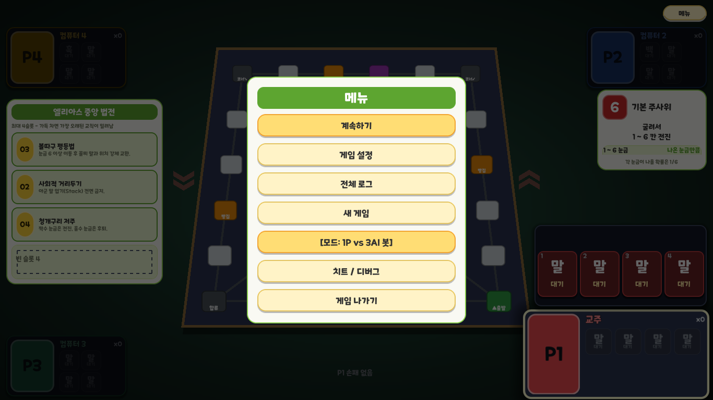

# ONE 모바일 POP체 인게임 적용

프로젝트 공통 글꼴을 `assets/fonts/game_ui_font.tres`로 변경했다. 원스토어 공식 배포 OTF를 기본으로 사용하고, 없는 문자를 위해 기존 나눔고딕을 보조로 지정했다. 시작 화면·로비·보드·메뉴·판정 연출의 기본 테마 글꼴에 함께 적용된다.

폰트 원본을 게임에 포함하므로 사용자 PC의 설치 글꼴에 의존하지 않는다. 텍스트 내용과 지정된 크기는 유지했다. 시작 화면·인게임 메뉴·설정 화면의 실제 렌더링으로 한글·숫자와 줄바꿈을 확인했고 기존 시작 메뉴 검사를 통과했다.

공식 배포본과 파일 해시는 [폰트 출처 기록](../../assets/fonts/ONE-Mobile-POP-NOTICE.md)에 있다.

