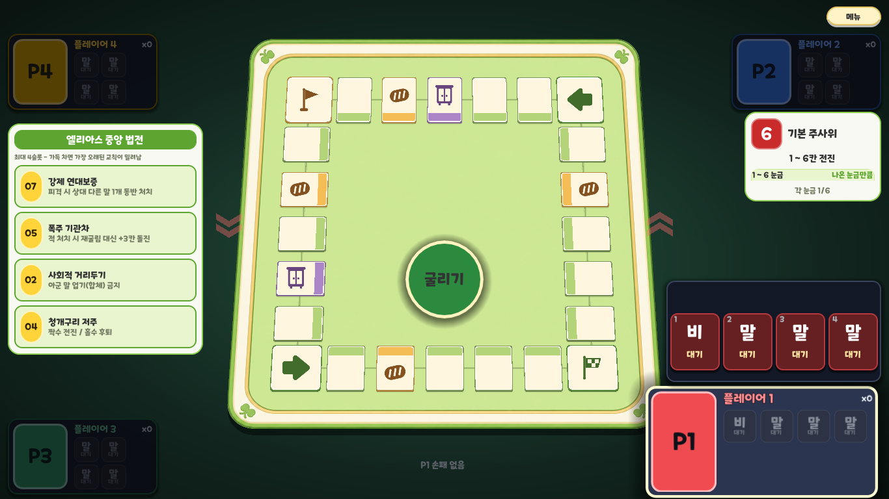

# 부루마불 느낌의 보드 발판 v0.1

2026-10-17. [부루마불 공식 보드 구성](https://www.bluemarble1982.com/boardgame)의 길쭉한 칸·색 띠를 참고하고 기존 녹색·크림색 보드에 맞춰 실제 게임 발판을 조정했다. 새 래스터 생성 대신 기존 코드 기반 발판 시스템의 기하와 색상을 수정했다.

## 형상

보드 한 변=1 기준. 기존 24개 타일 중심은 `0.08 + norm × 0.84`로 유지한다. 상판·색 띠·클릭 윤곽·선택 윤곽 모두 동일한 투영을 쓴다.

| 항목 | 값 |
|---|---|
| 일반 칸 경로 방향 폭 | 0.108 |
| 일반 칸 보드 안팎 방향 깊이 | 0.142 |
| 모서리 정사각 칸 한 변 | 0.144 |
| 좌우 줄 크기 | 0.142 × 0.108 |
| 위아래 줄 크기 | 0.108 × 0.142 |
| 기준 보드 520px의 일반 칸 | 56.16 × 73.84px, 줄별 회전 |
| 기준 보드 520px의 코너 | 74.88 × 74.88px |
| 형상 기준 좌표 | 96 × 96 |
| 일반/모서리 둥근 반경 | 5 / 8 기준 단위 |
| 외곽/하이라이트/상판 인셋 | 0 / 1.8 / 3.6 기준 단위 |
| 안쪽 색 띠 | 기준 21/96 영역을 상판과 교차해 클립 |
| 두께 | 2 × span / 760 × depth px |
| 그림자 오프셋 | 두께의 2배, 검정 대신 기존 녹갈색 알파 0.12 |

색 띠는 위쪽 줄의 아래·오른쪽 줄의 왼쪽·아래쪽 줄의 위·왼쪽 줄의 오른쪽에 둔다. 색은 기존 타일 종류를 뜻하며 플레이어 소유권이 아니다. 주요 모서리는 색 띠 없이 큰 문양을 사용한다.

## 팔레트

| 역할 | 색 |
|---|---|
| 크림 상판 | #FFF6DF |
| 밝은 테두리 | #FFFDF5 |
| 일반 칸 외곽 | #7C9558 |
| 일반 색 띠 | #B4D479 |
| 빵집 색 띠 / 문양 | #F4BD55 / #845221 |
| 옷장 색 띠 / 문양 | #AC87C7 / #69457D |
| 출발·점프 코너 외곽 / 문양 | #5D8C3D / #416C2B |
| 반환점 외곽 / 문양 | #B68B43 / #845221 |

## 동작과 검수

기존 24칸 경로·점프 목적지·교칙·이동·설치 판정을 유지한다. 일반 칸은 그림 없이 비워 두고 빵집·옷장·깃발·둥근 굵은 화살표는 기존 도형을 유지한다. 문양은 화면에서 동일한 가로·세로 배율로 그린다. 문양은 색 띠 바깥쪽으로 0.014만큼 이동해 크림 상판 안에 둔다.

초기 0.116×0.154 시안은 모서리 이웃 두 쌍의 제어 영역이 겹쳐 0.108×0.142로 줄였다. `UI_FX_OK`: 24개 중심 클릭, 겹침 없음, 보드 안전 윤곽 내부 배치, 색 띠의 상판 내부 배치, 문양 비율·화살표 목적지·탑뷰 복원 검사. `UI_SMOKE_OK`: 1,315동작, 93라운드, 정상 승리 종료, 타일 선택 29회·보드 클릭 63회. 탑뷰·기울임 실제 렌더와 기물 배치 검수 화면을 확인했다. 기존 Windows 인증서 및 종료 리소스 경고는 별도다.

