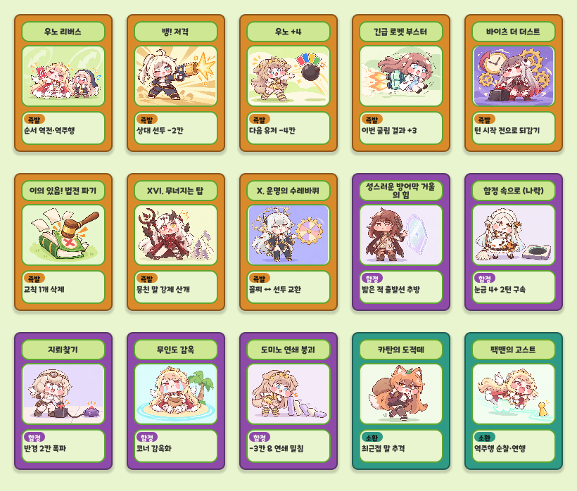
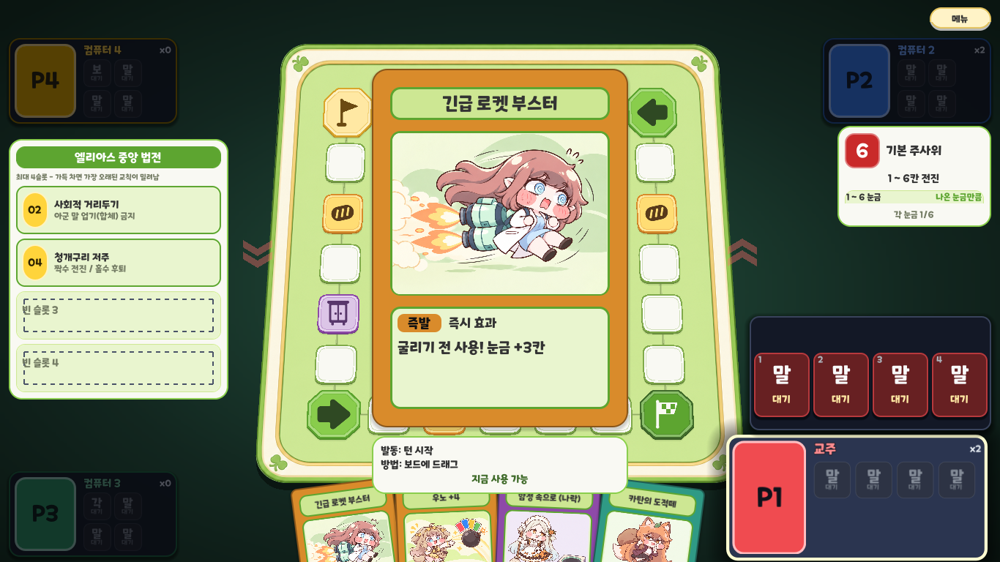

# 카드 일러스트 실제 적용 v0.2

2026-10-17. ACT_01~08·TRP_01~05·SUM_01~02의 검토 삽화 15장을 연결했다. 기존 소품 시안 3장도 교체했다. 신규 ACT_09는 미제작 상태로 글자 표식을 유지한다. 게임 규칙·카드명·효과·비공개 손패/함정의 공개 범위는 변경하지 않았다.

## 표시 규격

손패 140×196, 확대 350×490 등 공통 카드 화면에서 사용한다. 1448×1086 PNG 원본과 게임 복사본의 SHA256 일치를 확인했다. 파일별 시안 버전·해시는 `assets/cards/illustrations.json`.

엘레나·벨리타·리뉴아는 v0.2 수정본을 사용한다. 결승선 제거, 작은 카드 탑, 단독 캐릭터와 톱니바퀴 룰렛을 반영했다.

다른 작업의 최신 ACT_04 긴급 로켓 부스터(+3) 변경을 함께 보존했다. 갤러리와 실제 인게임 화면은 새 카드명·요약을 읽어 렌더했다.

중앙 크롭을 전체 비율 유지 맞춤으로 바꿨다. 창 안쪽에서 2×배율 px를 띄우고 가로·세로 배율의 최솟값으로 이미지를 맞춘다. 둥근 클립도 실제 이미지 크기에 맞춘다. 손패의 120×88 창에는 112×84 삽화를 중앙 표시한다. 확대는 제목 길이별 창 크기를 유지하면서 같은 계산을 쓴다.

## 글자

문자열을 넣기 전에 줄바꿈·클립을 설정해 Label의 초기 최소 너비가 이름판을 넘지 않게 했다. 손패 제목 12px·최대 2줄·줄 간격 -2px, 요약 11px·최대 2줄·줄 간격 -3px. 확대의 기존 배율·영역은 유지한다. 줄 수 외에 실제 보이는 줄 수와 패널 가로·세로 경계도 검사한다.

## 검수

Godot 4.7.1에서 15종 손패·확대 실제 렌더와 15종 파일 연결·4:3 비율·창 내부 배치를 확인한다. 전체 16종 제목·효과 영역을 검사한다. Windows 환경의 기존 인증서 저장소 및 종료 시 RID/리소스 정리 경고는 테스트 완료 마커와 별도로 기록한다.

로컬 결과: `UI_FX_OK`(16종×손패/확대 텍스트·연결·영역 및 클릭·드래그·확대 등), `UI_SMOKE_OK`(한 판 1,156동작, 정상 승리 종료). 전체 카드 갤러리는 실제 CardSkin을 Godot에서 렌더한 화면이다.

