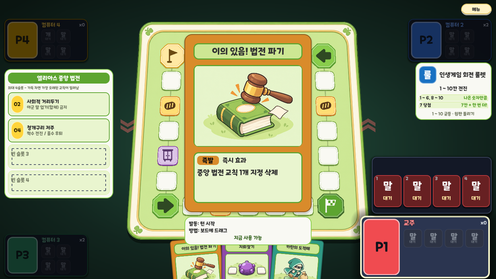

# 카드 이미지 실제 적용 v0.1

작성: 2026-10-17. 기존 즉발·함정·소환 시안 3종의 그림을 연결하고 공통 네이티브 프레임을 15종에 적용했다.

## 범위

- 개별 삽화: ACT_06, TRP_03, SUM_01. 나머지 12종은 글자 표식이며 후속 제작 대상이다.
- 동일 스킨 사용: 손패, 드래그 중인 카드, 카드 발동 알림, 피해 대응 미리보기, 클릭 확대.
- 실제 카드명과 효과 요약을 표시하며 과거 시안의 게임 설명을 이미지로 굳히지 않는다.
- 지뢰 카드에는 삭제된 숫자 타일 기능의 `1`을 표시하지 않는다.
- 게임 규칙, 숨겨진 상대 손패, 비공개 함정 표시 방식은 변경하지 않는다.

## 팔레트

| 역할 | 바탕 | 테두리 |
|---|---|---|
| 즉발 | #D98B2B | #89551A |
| 함정 | #8E4AA8 | #58366B |
| 소환 | #2F9A85 | #205E54 |
| 이름판 | #CDE793 | #5DA530 |
| 효과 설명판 | #E9F5CF | #5DA530 |

본문 #333333. 종류 배지: 함정 문자 #F9F9F3, 즉발·소환 문자 #111111. 선택/호버 테두리는 #E3C360. 발광 고리는 사용하지 않는다. 그림자 검정 알파 0.16, 오프셋 (0,3), 기본 크기 4px, 호버 8px.

## 손패

140×196px, 외곽 반경 8px, 선 2px (호버 3px). 좌우 여백 10px.

| 영역 | x | y | 너비 | 높이 |
|---|---:|---:|---:|---:|
| 이름판 | 10 | 10 | 120 | 30 |
| 삽화 창 | 10 | 44 | 120 | 88 |
| 설명판 | 10 | 138 | 120 | 48 |

제목 12px·최대 2줄, 종류 10px, 짧은 요약 11px·최대 2줄. 확대 카드의 모든 설명을 축소하지 않고 기존 `CARD_SHORT`의 짧은 요약을 쓴다.

## 확대

실제 게임에서 쓰던 350×490px 크기를 유지한다. 기준 설계 280×392에 배율 1.25를 적용한다.

| 영역 | 기준 x/y | 기준 너비/높이 |
|---|---|---|
| 이름판 | 20/20 | 240/36 |
| 삽화 창 | 20/68 | 240/180 |
| 설명판 | 20/260 | 240/112 |

긴 제목은 실제 폰트 폭으로 판정해 제목 20→18px, 이름판 높이 36→52px, 삽화 y 68→84px, 높이 180→164px를 적용한다. 수치는 280 기준이며 화면에서는 1.25배다. 종류 배지 14px, 효과 16px·최대 3줄. 모서리 반경 20px, 외곽선 2px.

카드 아래 12px를 띄워 별도 크림색 안내 패널을 배치한다. 내부 여백 12px, 안내·상태 14px. 카드와 안내 전체를 화면 중앙에 두며 가장자리에서 최소 24px를 확보한다. 그림은 비율을 유지해 중앙 크롭하고 둥근 창 안쪽에 클립한다. 그림·글자 모두 입력을 가로채지 않는다.

## 검수

- Godot 4.7.1 임포트 및 1366×768의 즉발·함정·소환 실제 게임 렌더 확인.
- 전체 15종 × 손패/확대에서 실제 글꼴의 제목 2줄 및 효과 2/3줄 제한, 설명판 내부 배치 검사.
- 3종의 카드 ID와 실제 삽화 파일 연결 검사.
- 기존 클릭 확대/닫기, 드래그, 타일 설치, 카드 사용과 입력 잠금 검사: `UI_FX_OK`.
- Windows 인증서 및 종료 시 리소스 경고는 기존 실행 환경에서 발생한다.

