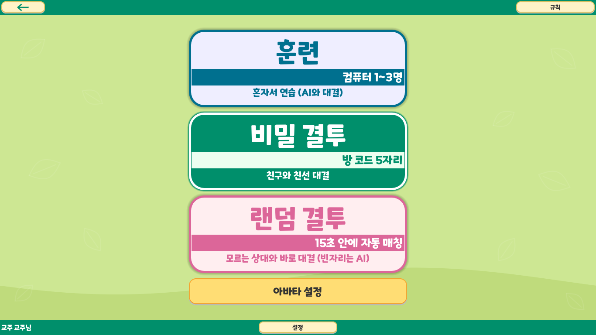

# 로비 배경 v0.1

적용일: 2026-10-17. 사용자와 정한 연두색 바탕·아래 곡선·옅은 잎사귀 방향의 첫 실제 적용본이다.

## 적용 범위

시작/이름 입력, 모드 선택, 훈련 설정, 아바타 설정, 멀티플레이 방 로비가 같은 배경을 사용한다. 기존 메뉴 구성과 게임 규칙은 유지한다. 모드 카드·상하단 바의 세부 디자인은 후속 작업이다.

## 재현 수치

| 항목 | 값 |
|---|---|
| 기본색 | `#CDE793`, 불투명 |
| 아래 곡선 | `#BFDB7C`, 불투명 |
| 곡선의 위쪽 경계 | 정규화 좌표 `y = 0.84 + 0.04 × sin(2πx + 0.35)` |
| 곡선 점 수 | 97개, 양 끝 포함 |
| 곡선 범위 | 화면 아래쪽 12~20% |
| 잎 색 | `#F9F9F3`, 알파 `26/255` (약 10.2%) |
| 잎 개수 | 10개, 위치·길이·회전 고정 |
| 장식 기준 해상도 | 1920×1080 |
| 장식 배율 | `min(화면 너비/1920, 화면 높이/1080)`로 등비 확대·축소 |
| 잎 길이 | 기준 해상도에서 76~108px |
| 잎 폭 | 길이의 56% |
| 선 두께 | 기준 해상도 2.5px, 축소 시 최소 1px |
| 장식 없는 중앙 | 가로 20~80% |
| 필터링 | 윤곽 안티앨리어싱 |
| 질감·움직임 | 없음 |
| 입력 처리 | 배경 전체 `MOUSE_FILTER_IGNORE` |

잎의 정규화 중심 좌표·회전·길이는 `scenes/lobby_background.gd`의 `LEAVES` 배열이 원본 데이터다. 글자나 버튼을 배경에 합성하지 않고 네이티브 UI 위젯으로 표시한다. 실행마다 무늬가 바뀌는 노이즈 텍스처를 제거했다.

## 확인

- Godot 4.7.1 임포트 성공.
- 기존 메뉴 흐름 테스트 `UI_MENU_OK`, 방 로비 테스트 `UI_LOBBY_OK`.
- 1366×768 실제 렌더에서 모드 선택·이름 입력 화면과 장식 배치를 확인했다.
- Windows 인증서 저장소, headless WebRTC와 종료 시 리소스 경고는 기존 환경 제한이며 온라인 통신 성공을 검증한 결과는 아니다.

