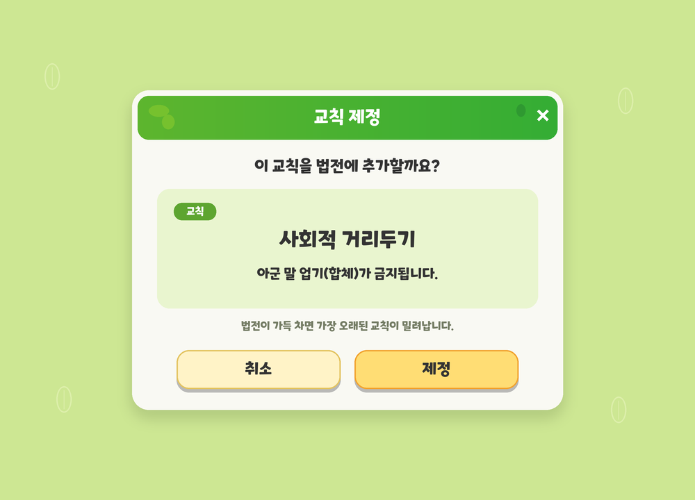

# 이미지·UI 제작 문서 (`docs/visual/`)

게임의 시각 자산과 UI 부품을 제작·검수할 때 참고하는 기준 문서 모음이다.

- **[이미지·UI 제작 규격서 v1.0](Visual_Asset_Guide_Draft.md):** 현행(`1.3.0`) 기준 해상도·서체·컬러 토큰·자산별 원본 크기·임포트 정책·웹 용량 예산 *(가장 우선하는 현행 규격)*
- **[초기 UI 색상 추출 v0.1](UI_Color_Palette_v0.1.md):** 초기 프로토타입 방향 설정을 위해 수행한 표본 색상 빈도 분석 및 집계 방법
- **[색상 집계 데이터 및 ROI 좌표](UI_Color_Extraction.json)**
- **[초기 교칙 제정 팝업 예시](UI_Example_Law_Confirm_v0.1.png)** · **[치수 및 색상 기록](UI_Example_Law_Confirm_v0.1.json)**

> **참고:** `references/` 폴더에는 초기 시각 톤 분석을 위해 검토한 원작 UI 참고 스크린샷 6장과 분석 영역(ROI) 표시 이미지 6장이 보관되어 있다(원작 리소스를 인게임에 직접 포함하거나 재배포하지 않으며, 폰트 바이너리도 이 문서 폴더에는 넣지 않는다). 팔레트 `v0.1`과 팝업 예시는 초기(2026-10-16) 방향 설정 자료이며, 현재 인게임이 실제로 사용하는 색상과 치수는 **[제작 규격서 v1.0 (4~5절)](Visual_Asset_Guide_Draft.md)**을 따른다.
