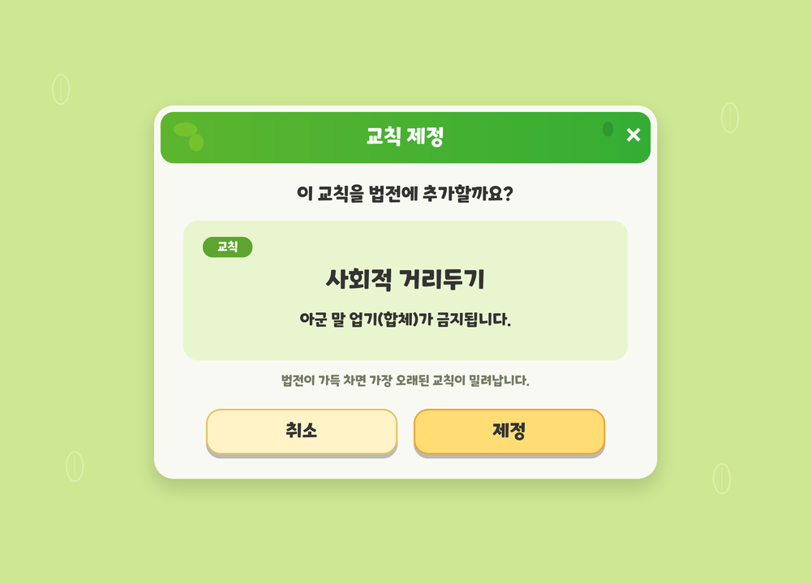

# 이미지·UI 제작 문서

- [제작 규격서 v0.6](Visual_Asset_Guide_Draft.md): 확정 원칙, 미정 항목, 자산 범위, 검수 기준
- [추출 팔레트 v0.1](UI_Color_Palette_v0.1.md): 색상값과 집계 방법
- [전체 색상 집계·표본 영역 좌표](UI_Color_Extraction.json)
- [교칙 제정 팝업 예시](UI_Example_Law_Confirm_v0.1.png)
- [팝업 예시 치수 기록](UI_Example_Law_Confirm_v0.1.json)

`references/`에는 사용자가 제공한 원작 UI 참고 이미지 6장과 분석 영역을 표시한 이미지 6장이 있다. 원작 리소스를 게임용으로 재배포하거나 직접 사용하기로 정한 것은 아니다. 폰트 바이너리는 포함하지 않는다.

기준 기획서는 사용자 제공 `GDD_TDD_Master.md` v2.0이다. 이 업로드에는 이미지·UI 문서와 관련 자료만 포함한다. 게임 구현이나 실행 리소스는 변경하지 않는다.
