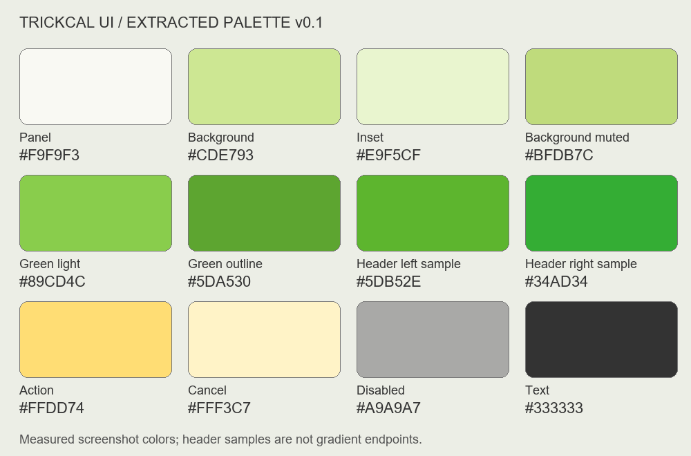

# 트릭컬 UI 색상 추출 분석 v0.1 (초기 참고 자료)

> **안내:** 이 문서는 개발 초기(2026-10-16) UI 톤앤매너 방향을 잡기 위해 사용자 제공 스크린샷 6장의 UI 영역에서 관측된 RGB 빈도를 집계한 기록이다. 원작의 공식 컬러 토큰이 아니며, **현행 게임(`1.3.0`)이 실제로 사용하는 확정 컬러 코드는 [이미지·UI 제작 규격서 4절](Visual_Asset_Guide_Draft.md)을 따른다.**

---

## 1. 집계 방법

- 어두워진 배경 장면과 큰 캐릭터 일러스트를 제외한 직사각형 UI 영역(ROI)을 수동 지정했다(작은 아이콘·글자·장식 일부 포함).
- 아래 비율은 지정 영역의 단순 픽셀 면적 비율이며 화면별 동일 가중치 평균이 아니다.
- RGB 각 채널을 `8` 단위로 양자화한 뒤, 빈도순으로 유클리드 RGB 거리 `20` 이내의 인접 묶음을 병합했다.
- 대표 HEX는 각 묶음 안에서 실제로 가장 많이 관측된 최빈 색상값이다(묶음 전체 면적과 대표 HEX 단일 픽셀 수를 구분해 기록).
- 화면 반복 수는 해당 묶음이 각 화면 표본 면적의 `0.1%` 이상을 차지한 화면 수(`N/6`)다.
- 영역 좌표는 원본 픽셀 기준 `[left, top, right, bottom)`(우측·하단 경계 제외)이며, ROI 확인 이미지의 자홍색 표시선은 집계에서 제외했다.

---

## 2. 빈도 상위 색상 묶음 (총 분석 픽셀: `408,511`)

| 대표 HEX | 유사색 포함 픽셀 | 면적 비율 | 화면 반복 수 | 대표 HEX 단일 픽셀 |
|---|---:|---:|---:|---:|
| `#F9F9F3` | 143,137 | 35.04% | 6/6 | 69,000 |
| `#CDE793` | 72,907 | 17.85% | 4/6 | 62,006 |
| `#E9F5CF` | 67,742 | 16.58% | 6/6 | 54,056 |
| `#BFDB7C` | 28,672 | 7.02% | 3/6 | 25,431 |
| `#2F9931` | 11,584 | 2.84% | 3/6 | 761 |
| `#89CD4C` | 11,172 | 2.73% | 3/6 | 7,614 |
| `#5DA530` | 10,418 | 2.55% | 6/6 | 1,194 |
| `#A9A9A7` | 7,466 | 1.83% | 5/6 | 3,978 |
| `#747C64` | 4,334 | 1.06% | 5/6 | 1,967 |
| `#333333` | 4,086 | 1.00% | 6/6 | 2,949 |
| `#9DDF60` | 3,552 | 0.87% | 3/6 | 1,736 |
| `#76C12E` | 2,647 | 0.65% | 4/6 | 1,634 |

---

## 3. 역할별 제작 팔레트 초안

상위 빈도 묶음과 버튼·제목 바 국소 영역 표본을 바탕으로 도출한 초기 역할 배정안이다.

| 역할 | HEX | 추출 근거 |
|---|---|---|
| 패널 본체 | `#F9F9F3` | 전체 UI 표본 최다 면적 묶음의 대표색 |
| 화면 기본 배경 후보 | `#CDE793` | 두 번째 면적 묶음의 대표색 |
| 내부 정보 영역 | `#E9F5CF` | 세 번째 면적 묶음의 대표색 |
| 보조 배경 | `#BFDB7C` | 네 번째 면적 묶음의 대표색 |
| 밝은 녹색 면 | `#89CD4C` | 반복 등장하는 밝은 녹색 |
| 녹색 선 · 보조 강조 후보 | `#5DA530` | 6개 화면 모두에 등장하는 녹색 묶음의 대표색 |
| 제목 바 왼쪽 표본 | `#5DB52E` | 모집 팝업 `[190, 75, 250, 94)` 영역의 최빈색 |
| 제목 바 오른쪽 표본 | `#34AD34` | 모집 팝업 `[350, 75, 400, 94)` 영역의 최빈색 |
| 주요 실행 버튼 | `#FFDD74` | 구매 팝업 `[320, 250, 390, 266)` 영역 최빈색 (962px) |
| 취소 버튼 | `#FFF3C7` | 구매 팝업 `[190, 250, 280, 266)` 영역 최빈색 (1,249px) |
| 비활성 버튼 | `#A9A9A7` | 회색 묶음 대표색 (시각 관찰 기준 역할 부여) |
| 기본 본문 문자 | `#333333` | 6개 화면에 공통 등장하는 짙은 본문색 |

- 제목 바의 좌·우 표본은 그라데이션 양 끝단이 아니라 내부 관측 표본이며, 플레이어 고유색·위험 경고색·카드 속성색은 별도 의미 색상([제작 규격서 4.3절](Visual_Asset_Guide_Draft.md))으로 정의했다.

---

## 4. 재현 자료

- **전체 집계 및 ROI 좌표 원본:** [UI_Color_Extraction.json](UI_Color_Extraction.json)
- **ROI 표시 확인 이미지:** `references/roi_trickcal_01_birthday.png` ~ `roi_trickcal_06_mail.png` (총 6장)
