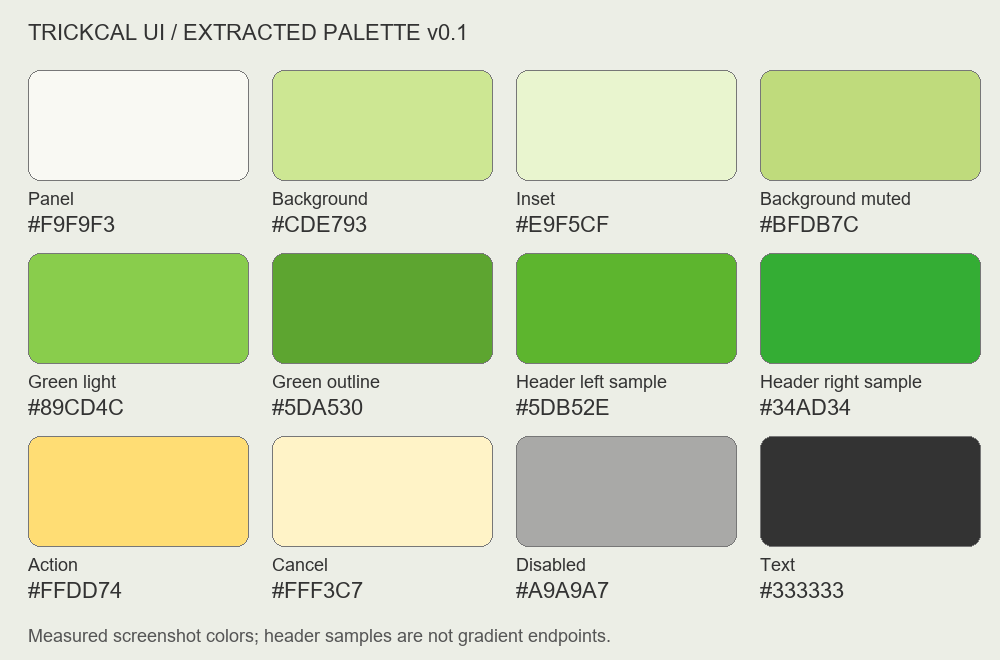

# 트릭컬 UI 색상 추출 v0.1

사용자 제공 스크린샷 6장의 UI 영역에서 추출했다. 원본 UI 리소스의 공식 색상값이 아니라 첨부 이미지에서 실제로 관측된 RGB 값이다.

## 집계 방법

- 어두워진 배경 장면과 큰 캐릭터 일러스트를 제외한 직사각형 UI 영역을 수동 지정했다. 작은 아이콘·글자·장식은 일부 포함된다.
- 아래 비율은 지정 영역의 픽셀 면적 비율이다. 화면마다 동일한 가중치를 준 수치는 아니다.
- RGB 각 채널을 8단위로 묶은 뒤, 빈도순으로 RGB 거리 20 이내의 인접 묶음을 합쳤다. 지각 색차가 아닌 단순 RGB 거리다.
- 대표 HEX는 각 묶음에 실제로 존재하는 색 중 최빈값이다. 묶음 면적과 대표 HEX 자체의 픽셀 수를 구분한다.
- 화면 반복 수는 해당 묶음이 각 화면 표본 면적의 0.1% 이상인 경우를 센다.
- 영역 좌표는 원본 픽셀 기준 [left, top, right, bottom), 우측·하단 제외다. ROI 확인 이미지의 자홍색 선은 분석 범위 표시용이며 집계에 포함하지 않았다.

## 빈도 상위 색상 묶음

총 분석 픽셀: 408,511

| 대표 HEX | 유사색 포함 픽셀 | 면적 비율 | 화면 반복 수 | 대표 HEX 자체 픽셀 |
|---|---:|---:|---:|---:|
| #F9F9F3 | 143,137 | 35.04% | 6/6 | 69,000 |
| #CDE793 | 72,907 | 17.85% | 4/6 | 62,006 |
| #E9F5CF | 67,742 | 16.58% | 6/6 | 54,056 |
| #BFDB7C | 28,672 | 7.02% | 3/6 | 25,431 |
| #2F9931 | 11,584 | 2.84% | 3/6 | 761 |
| #89CD4C | 11,172 | 2.73% | 3/6 | 7,614 |
| #5DA530 | 10,418 | 2.55% | 6/6 | 1,194 |
| #A9A9A7 | 7,466 | 1.83% | 5/6 | 3,978 |
| #747C64 | 4,334 | 1.06% | 5/6 | 1,967 |
| #333333 | 4,086 | 1.00% | 6/6 | 2,949 |
| #9DDF60 | 3,552 | 0.87% | 3/6 | 1,736 |
| #76C12E | 2,647 | 0.65% | 4/6 | 1,634 |

## 역할별 제작 팔레트 초안

상위 빈도를 바탕으로 역할을 배정했다. 기능상 중요한 버튼과 그라데이션은 좁은 영역을 별도 집계했다. 정확한 값이 생겼지만, 실제 게임 화면에서의 최종 승인과 가독성 검수는 아직 수행하지 않았다.

| 역할 | HEX | 근거 |
|---|---|---|
| 패널 본체 | #F9F9F3 | 전체 UI 표본 최다 면적 묶음의 대표색 |
| 화면 기본 배경 후보 | #CDE793 | 두 번째 면적 묶음의 대표색 |
| 내부 정보 영역 | #E9F5CF | 세 번째 면적 묶음의 대표색 |
| 보조 배경 | #BFDB7C | 네 번째 면적 묶음의 대표색 |
| 밝은 녹색 면 | #89CD4C | 반복 등장하는 밝은 녹색 |
| 녹색 선·보조 강조 후보 | #5DA530 | 6개 화면에 반복되는 녹색 묶음의 대표색 |
| 제목 바 왼쪽 표본 | #5DB52E | 모집 팝업 [190,75,250,94) 영역의 최빈색 |
| 제목 바 오른쪽 표본 | #34AD34 | 모집 팝업 [350,75,400,94) 영역의 최빈색 |
| 주요 실행 버튼 | #FFDD74 | 구매 팝업 [320,250,390,266)에서 962픽셀, 지역 최빈색 |
| 취소 버튼 | #FFF3C7 | 구매 팝업 [190,250,280,266)에서 1,249픽셀, 지역 최빈색 |
| 비활성 버튼 | #A9A9A7 | 회색 묶음 대표색, 적용 역할은 시각 관찰 기준 |
| 기본 본문 | #333333 | 반복되는 짙은 회색 대표색 |

제목 바 두 표본은 그라데이션의 실제 양 끝값이 아니다. 원작과 비슷한 그라데이션 제작을 위한 내부 표본이며, 최종 시작·끝 색은 후속 비교에서 정한다. 녹색 선·강조도 화면 내 실제 역할을 부품별로 검증한다. 플레이어색·위험색·카드 종류색·보조 문자색은 이번 추출로 확정하지 않는다.

## 재현 자료

- [전체 집계 및 ROI 좌표](UI_Color_Extraction.json)
- ROI 확인 이미지: `references/roi_trickcal_01_birthday.png`부터 대응하는 6개 파일.
