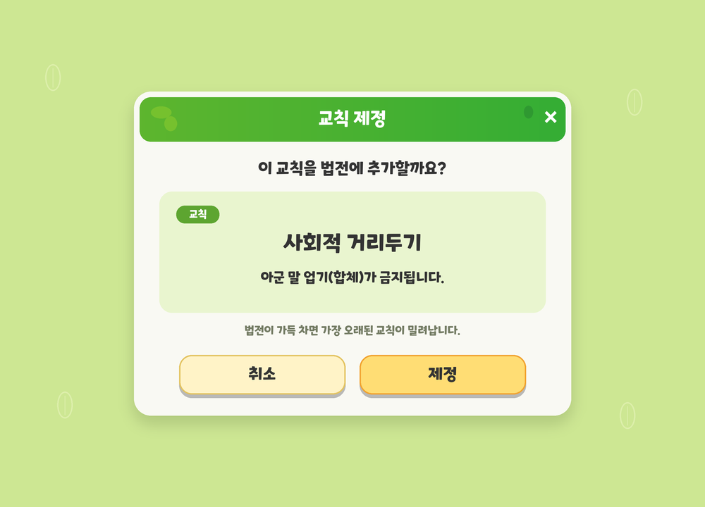

# 초증강 엘리아스 마블 — 이미지 · 3D · UI 제작 및 레이아웃 규격서

- **문서 버전:** `v1.1` (2026-11-28, 게임 `1.3.1` 라이브 및 `dev` 브랜치 실측 기준 현행화)
- **이전 판:** `v1.0` (2026-11-26, `1.3.0` 기준) / `v0.6` (2026-10-16, 초기 시안)
- **목적:** 신규 일러스트 · 아이콘 · **3D 모델(폴리곤 수 · 저용량 상한)** · **UI 버튼 크기 · 배치 좌표**를 제작하거나 수정할 때 구현자가 임의로 치수나 용량을 바꾸지 못하도록 못 박는 **단일 시각·레이아웃 계약서**다.
- **관련 문서:** 게임 규칙·데이터 기준서는 [`../GDD_TDD_Master.md`](../GDD_TDD_Master.md), 연출·화면 경계는 [`../EDGE_CASE_SPEC.md`](../EDGE_CASE_SPEC.md), 개별 아트 검수 기록은 [`../ui-trial/README.md`](../ui-trial/README.md), 외부 소재 라이선스는 [`../../CREDITS.md`](../../CREDITS.md)를 참고한다.

> [!IMPORTANT]
> **구현 시 임의 변경 금지 계약 (Strict Compliance)**
> 1. **3D 모델:** 아래 `6절`의 **폴리곤(삼각형) 상한 · 파일 용량 상한 · 텍스처 512px 제한 · `optimized/vN/` 압축 변환 · `SubViewport` `32×32` 대기 축소**를 지키지 않은 모델은 어떤 이유로도 런타임에 직접 연결할 수 없다.
> 2. **UI 버튼 · 좌표:** 아래 `7절`의 **기준 해상도(`1366×768`) 고정 좌표 · 버튼 크기 · 최소 터치 높이(`48px`) · 폰트 사다리(`FontSizes.LADDER`)**는 기획서 개정 없이 임의로 바꾸지 않는다.

---

## 목차

1. [화면 기본 및 모바일 터치 규격](#1-화면-기본-및-모바일-터치-규격)
2. [공통 시각 제작 원칙](#2-공통-시각-제작-원칙)
3. [서체 및 글자 크기 표준 사다리](#3-서체-및-글자-크기-표준-사다리)
4. [컬러 토큰](#4-컬러-토큰)
5. [2D 자산 종류별 규격 및 임포트 정책](#5-2d-자산-종류별-규격-및-임포트-정책)
6. [3D 모델링 폴리곤 수 · 저용량 운영 상한 규격 (`1.3.1` 전수 계측)](#6-3d-모델링-폴리곤-수--저용량-운영-상한-규격-131-전수-계측)
7. [화면별 UI 버튼 크기 · 배치 좌표 고정 규격 (`1366×768`)](#7-화면별-ui-버튼-크기--배치-좌표-고정-규격-1366768)
8. [웹 패키지 용량 예산 및 신규 자산 투입 절차](#8-웹-패키지-용량-예산-및-신규-자산-투입-절차)
9. [상세 기록 위치 및 변경 이력](#9-상세-기록-위치-및-변경-이력)
10. [부록 A ~ C. 초기 원작 UI 분석 · 추출 팔레트 · 팝업 시안](#부록-a-사용자-제공-원작-ui-참고-분석)

---

## 1. 화면 기본 및 모바일 터치 규격

| 항목 | 확정 수치 | 구현 출처 |
|---|---|---|
| **기준 해상도 (`DESIGN_SIZE`)** | **`1366 × 768`** (16:9 가로 고정) | `project.godot` · `MainBoard.DESIGN_SIZE` |
| **안전 여백 (`SAFE_MARGIN`)** | **`12 px`** (화면 외곽 최소 여백) | `MainBoard.SAFE_MARGIN` |
| **화면 늘이기 (`stretch`)** | `canvas_items` · 비율 유지(`keep`) · 남는 여백은 와이드 3분할(`left / center / right`) 보정 | `project.godot` · `MainBoard.layout_for` |
| **텍스처 필터** | 선형 + 밉맵 (`default_texture_filter = 2`) | `project.godot` |
| **화면 방향** | 가로 전용 (세로 진입 시 `"화면을 가로로 돌려 주세요"` 전면 오버레이) | `MobileSupport` |
| **모바일 버튼 최소 높이** | **`48 px`** (인게임 메뉴·증강 리롤 등 주요 버튼은 **`64 px`**) | `MobileSupport.TOUCH_BUTTON_HEIGHT` |
| **모바일 글자 보정** | `18 px` 미만 글씨 **`×1.2배`** (최대 `18 px`) | `MobileSupport.TOUCH_TEXT_SCALE` |
| **모바일 팝업 확대** | 로비 팝업 **`×1.3배`**, 증강 드래프트 최대 **`×1.22배`** (화면 내 자동 맞춤) | `LobbyTheme.TOUCH_POPUP_SCALE` · `DRAFT_TOUCH_SCALE` |
| **모바일 터치 판정 반경** | 버튼 바깥 **`26 px`** (상·하단 끝 `16 px` 띠는 **`48 px`**) 내 터치도 가장 가까운 버튼으로 보정 | `MobileSupport.TOUCH_SLOP` · `EDGE_SLOP` · `EDGE_BAND` |
| **드래그 스크롤 · 중복 차단** | `10 px` 초과 이동 시 드래그 스크롤 전환 · 터치 직후 `600 ms / 60 px` 내 합성 클릭 차단 | `MobileSupport.DRAG_SCROLL_START` · `DUPLICATE_PRESS_*` |

> 모바일 가로 화면은 기준 해상도의 약 `0.5배`로 축소되어 보이므로, 모든 신규 UI는 **PC(`1366×768`)와 폰 가로 화면(터치 모드) 양쪽에서** 버튼 겹침·글자 가독성을 함께 검증한다.

---

## 2. 공통 시각 제작 원칙

| 규칙 ID | 내용 |
|---|---|
| `COMMON-01` | 트릭컬 리바이브 팬게임에 어울리는 귀엽고 장난스러운 인상 유지 |
| `COMMON-02` | 패널·버튼은 둥근 모서리, 아이콘은 둥근 선 끝 |
| `COMMON-03` | 기본 서체는 ONE 모바일 POP (3절) |
| `COMMON-04` | **UI 문구·숫자는 그림에 굽지 않는다.** 버튼명·카드 설명·타이머·수량은 게임이 텍스트로 렌더링 (예외: 타이틀 로고, 룰렛 `7`·슬롯 `777` 같은 소품 식별 숫자) |
| `COMMON-05` | 같은 기능의 UI 부품은 공통 스킨(`UiSkin` · `LobbyTheme` · `HubKit`)을 재사용 |
| `COMMON-06` | 소유자 표시와 기물 본체를 분리한다 (흑돌·백돌 등을 플레이어 색으로 덮지 않음) |
| `COMMON-07` | 주요 상태 정보는 색과 함께 문양·아이콘·도장으로 이중 구분 |
| `COMMON-08` | 같은 버튼의 상태(기본·호버·누름·선택·비활성)는 형태와 기준점을 공유 |
| `COMMON-09` | 원본과 게임용 출력을 분리한다 (원본은 보존하고 `.import` 또는 `optimized/vN/` 변환으로 경량화) |
| `COMMON-10` | 기초 UI 주조색은 녹색 계열 (4절) |
| `COMMON-11` | 원작 리소스를 저장소에 직접 넣지 않는다. 캐릭터는 정식 공개 사도만 사용하며 출처는 `CREDITS.md` 기록 |
| `COMMON-12` | 임시 그림을 정식 그림으로 교체할 때 경로·파일명을 유지해 Godot UID 연결을 깨뜨리지 않는다 |
| `COMMON-13` | **(1.3.1 신설) 3D 모델·UI 치수 임의 확장 금지:** 모든 3D 자산은 `6절`의 폴리곤·용량·뷰포트 상한을, 모든 화면 UI는 `7절`의 버튼 크기·좌표 규격을 준수한다 |

---

## 3. 서체 및 글자 크기 표준 사다리

| 용도 | 글꼴 | 파일 경로 |
|---|---|---|
| **기본 UI · 카드 · 제목** | ONE 모바일 POP | `assets/fonts/ONE-Mobile-POP.otf` (`game_ui_font.tres`, 프로젝트 기본) |
| **작은 글씨 (로그·보조)** | TRG Gothic Bold (나눔고딕 Bold 서브셋, OFL) | `TRGGothic-Bold.ttf` (`game_small_font.tres`) |
| **한글 대체 폴백** | 나눔고딕 Regular | `NanumGothic-Regular.ttf` |
| **일본어 전용** | Mochiy Pop One (약 3,600자 서브셋, OFL) | `MochiyPopOne-Regular.ttf` (`L10n` 일본어 선택 시 전환) |
| **이모지** | 글꼴 대신 PNG 스프라이트 (`EmojiText`) | `assets/ui/trickcal/emoji/` (Noto Color Emoji) |

- **표준 글자 크기 사다리 (`FontSizes.LADDER` — 임의 중간 픽셀 금지):**
  - `[6, 7, 8, 9, 10, 11, 12, 13, 14, 16, 18, 20, 22, 24, 26, 28, 32, 36, 40, 44, 48, 56, 64, 72, 96, 120]`
  - 한글·일본어 글꼴은 폰트 크기마다 별도 글리프 아틀라스를 굽므로 반드시 `FontSizes.snap(px)`으로 위 사다리 값에 스냅한다.
- **고정 상자 자동 축소 하한:** 확대 카드 설명 `10px`, 손패 카드 설명 `7px`, 증강 제목 `12px`, 증강 설명 `10px` (한·영·일 넘침 여부는 `tests/ui_overlap_audit.gd`로 필수 검증).

---

## 4. 컬러 토큰

### 4.1 기초 UI (`UiSkin` · `CardSkin`)

| 토큰 | 값 | 사용처 |
|---|---|---|
| `ink` | `#333333` | 본문 글자 (`UiSkin.INK`, `CardSkin.INK`) |
| `soft` | `#747C64` | 보조 글자 (`UiSkin.SOFT`) |
| `green` | `#5DA530` | 주 강조 녹색 (`UiSkin.GREEN`) |
| `panel.inner` | `#E9F5CF` | 카드·패널 내부 면 (`CardSkin.PANEL`) |
| `header` | `#CDE793` | 머리 띠·연두 배경 (`CardSkin.HEADER`) |
| `warning` | `#E03131` | 위험·자해 경고 (`CardSkin.WARNING_RED`) |

### 4.2 로비 · 메뉴 (`LobbyTheme` · `HubKit`)

| 토큰 | 값 | 토큰 | 값 |
|---|---|---|---|
| `TEAL` (상하단 띠·주 버튼) | `#008F6B` | `TEAL_DARK` | `#006B50` |
| `MINT` (밝은 면) | `#ECFFF0` | `MINT_EDGE` | `#5FC9A6` |
| `INK` (로비 본문) | `#1B4D3E` | `INK_SOFT` | `#3D6B5C` |
| `CREAM` / `CREAM_EDGE` | `#FFE9B8` / `#D9B97A` | `INPUT_BG` | `#EEFFA8` |
| `BLUE` / `BLUE_PALE` | `#00708F` / `#EFEEFF` | `PINK` / `PINK_PALE` | `#DC6699` / `#FFEEF0` |
| `HUB GREEN` / `GOLD` | `#86D94F` / `#FFD34E` | `HUB INK` / `CREAM` | `#1F5A2A` / `#FFF6D6` |

### 4.3 의미 색 (`MainBoard` · `CardSkin`)

| 의미 | 값 | 출처 |
|---|---|---|
| **플레이어 1 / 2 / 3 / 4** | `#E5484D` / `#3E8BFF` / `#30A46C` / `#F5B700` | `MainBoard.PLAYER_COLORS` |
| **카드 발동 (면 / 테두리)** | `#D98B2B` / `#89551A` | `CardSkin.FILLS` · `EDGES` |
| **카드 함정 (면 / 테두리)** | `#8E4AA8` / `#58366B` | `CardSkin.FILLS` · `EDGES` |
| **카드 소환 (면 / 테두리)** | `#2F9A85` / `#205E54` | `CardSkin.FILLS` · `EDGES` |
| **카드 방어 (면 / 테두리)** | `#4C6EF5` / `#2B3F9E` | `CardSkin.FILLS` · `EDGES` |
| **증강 링 (기물 / 도구 / 교칙 / 카드)** | `#20C997` / `#9775FA` / `#FFD43B` / `#FF6B6B` | `illustrations/README.md` |

---

## 5. 2D 자산 종류별 규격 및 임포트 정책

| 자산 | 폴더 | 원본 크기 | 화면 표시 크기 | 임포트 상한 | 비고 |
|---|---|---|---|---|---|
| **카드 삽화** | `assets/cards/<ID>.png` | **`1448 × 1086`** (4:3) | 손패 `140×196`, 도감 `200×280` / 확대 `320×448` | 최대 `640px` · 손실 WebP 0.85 · 밉맵 | 3등신 치비, 글자는 `CardSkin` 렌더링 |
| **함정 칩** | `assets/board/traps/` | 정사각 | 보드 타일 위 작은 칩 | 최대 `256px` | 은신 함정은 뒷면만 노출 |
| **증강·도구·교칙 아이콘** | `content_trickcal/illustrations/{augments,dice,laws}/` | **`1254 × 1254`** (1:1) | 메달 안 `110×110`, 도구 HUD `48×48` | 최대 `256px` (일부 `512px`) · 밉맵 | 원형 크롭 안전 구도, 글자 없음 |
| **세부 기물** | `content_trickcal/illustrations/pawns/<ID>.png` | **`1254 × 1254`** 투명 | 보드 말·기물 독 (`76×88` 슬롯 내) | 최대 `256px` | 플레이어 색 미포함 |
| **사도 초상 · 전신** | `content_trickcal/avatars/<id>/portrait.png` · `fullbody.png` | `1254 × 1254` 투명 권장 | 프로필 `84×84`, 로비 전신 `H 520` | 최대 `1024px` | 정식 공개 사도 한정 |
| **처치 공격 · 피격 포즈** | `avatars/<id>/attack.png` · `hit.png` | `1254 × 1254` 투명 | 처치 컷인 `0.5초` | `1024px` 유지 | 공격 포즈는 우측 향함 |
| **로비 대기 애니메이션** | `avatars/<id>/idle_hq/` · `idle_lq/` | 프레임 시퀀스 | 로비 좌측 전신 | HQ `1024px`(WebP 0.9) / LQ `640px` | 별도 `avatars/<id>.pck` 분할 로드 |
| **감정 표현 스티커** | `illustrations/ui/emotes/` | 약 `120 × 120` | 피커 `96×82` 내 · 말풍선 | — | 기쁨·당황·슬픔 등 |
| **보드 바닥** | `assets/board/<보드>/board_surface*.png` | `1254×1254` 또는 `1672×941` | 받침 `584×584` / 타일 영역 `520×520` | 최대 `1280px` | 마스크 경계는 `BoardSkin.DECAL_BOUNDS` 동기화 |
| **보드 미리보기** | `assets/ui/trickcal/board_preview/<보드>.webp` | **`640 × 400`** | 놀이터 `516×326`, 도감 보드 카드 | — | — |
| **특수 칸 칩** | `assets/board/<보드>/` | `192 × 192` | 칸 위 칩 | — | 정령·상점·장치 칩 |
| **효과음 · 보이스** | `assets/sfx/` · `avatars/<id>/*_voice.ogg` | `ogg` / `wav` | — | — | 보이스 8장면(`opening·attack·hit·skill·augment·victory·special_victory·select`) |

- **2D 임포트 공통 정책:** 원본을 덮어쓰지 않고 `tools/optimize_texture_imports.py`로 `.import` 설정만 최적화한다(손실 WebP 품질 `0.85`, 128px 이하 소형 이미지 및 픽셀 좌표 스프라이트 시트는 무압축/원크기 유지).

---

## 6. 3D 모델링 폴리곤 수 · 저용량 운영 상한 규격 (`1.3.1` 전수 계측)

> HTML5 웹(WebGL2 + 모바일 브라우저)에서 메모리 폭주와 초기 로딩 지연을 막기 위해 **모든 3D 모델과 프로시저럴 메시는 아래 하드 리밋(상한선)과 경량화 파이프라인을 강제**한다.

### 6.1 3D 자산 등급별 폴리곤(삼각형) · 용량 · 텍스처 · 뷰포트 상한선 (강제 계약)

| 자산 등급 / 항목 | 삼각형 수 상한 (런타임) | 파일 용량 상한 (런타임 압축) | 제작 · 변환 필수 규칙 |
|---|---|---|---|
| **S급 · 소형 단품 소품**<br>*(코인 · 칼 · 다트 · 음료 캔 · 복권 · 쿠키 1개 · 주사위 1개)* | **최대 `1,500 tris`**<br>*(권장 `300 ~ 1,000 tris`)* | **최대 `30 KB`**<br>*(공유 재질·텍스처 별도)* | 베벨 세그먼트 `1` 이하, 원통 분할 `12~16`면 이하 |
| **M급 · 중형 단일 도구·소품**<br>*(물약 · 캡슐 · 피규어 · 밥그릇 · 법전 · 야추 케이스 · 윷 4가락 · 슬롯머신)* | **최대 `3,500 tris`**<br>*(권장 `1,200 ~ 2,500 tris`)* | **최대 `80 KB`**<br>*(압축 `.scn`/`.res` 기준)* | 외곽 베벨 최대 `2`, 원통 분할 `16~24`면, 반복 파츠는 `MultiMesh` 또는 공유 `ArrayMesh` |
| **L급 · 대형 복합 스테이지**<br>*(캡슐 기계 · 자판기 · 가마솥 · 해적통 · 핀볼판 · 리볼버 · 폭주 기관차 · 신규 노래방/후쿠비키 본체)* | **최대 `6,500 tris`**<br>*(절대 상한 `8,000 tris`)* | **최대 `200 KB`**<br>*(씬 + 전용 메시 합계)* | 작은 화면(`350~500px`)에서 안 보이는 내부 면·뒷면 삭제, 중복 파츠(못·리벳·버튼)는 단일 메시 공유 |
| **전체 3D 런타임 번들 합계**<br>*(`assets/models/optimized/` 전체)* | **고유 합계 `≤ 150,000 tris`**<br>*(현행 `1.3.1`: `109,063 tris`)* | **전체 `≤ 4.0 MiB`**<br>*(현행 `1.3.1`: `2.56 MiB`)* | 신규 도구 추가 시 총합 상한 초과 금지 (초과 시 기존/신규 LOD 재절감 필수) |
| **3D 모델 내장·외부 텍스처** | — | **최대 `512 × 512 px`** | `PortableCompressedTexture2D` 손실 품질 `0.86` + 밉맵 (노멀맵만 무손실), 단색 파츠는 텍스처 대신 버텍스 컬러·머티리얼 알베도 사용 |
| **런타임 참조 경로 · 웹 내보내기** | — | 원본 `.glb`/`.blend` **배포 0 바이트** | 런타임 씬은 **오직 `res://assets/models/optimized/vN/`의 압축 `.scn`/`.res`만 참조** (원본 `.glb` 직접 참조 시 `lowpoly_models_test.gd` 실패). `export_presets.cfg`에서 원본 폴더 제외 |
| **자동 경량화 LOD 기준**<br>*(`tools/art/build_lowpoly_models.gd`)* | 인덱스 `240`개(`80 tris`) 이상 서피스 자동 단순화 | 목표 **`max(48 idx, 12%)`** | 바운딩 박스 대각 실루엣 오차 **`≤ 3.5%`** (검증 허용치 `≤ 6.5%`), 중복 정점 용접(`SurfaceTool.index()`) + 미사용 정점 컴팩션 + 메시/재질/텍스처 중복 외부화 |
| **3D `SubViewport` 해상도 · MSAA** | — | 표시 크기 대비 **최대 `1.5배`** *(소형 주사위·인쇄 텍스처만 예외 `2.0배`)* | **`Viewport.MSAA_2X` 상한** (런타임 씬에서 **`MSAA_4X` 전면 금지**). 비활성·대기 3D 뷰포트는 반드시 `Web3DBudget.park()`로 **`32 × 32 px` + `UPDATE_DISABLED`** 축소 보관 후 사용 시 복원 |

---

### 6.2 현행 `1.3.1` 3D 파일 모델 전수 계측표 (`dev` 브랜치 실측)

#### A. 런타임 최적화 번들 총괄 (`v4` 42종 + `v5` 신규)

| 구분 | 원본(소스) 합계 | 현행 런타임 (`v4` + `v5`) | 절감률 · 검증 수치 |
|---|---|---|---|
| **모델 파일 묶음 (`v4` 42건)** | `16,445,250 bytes` (`15.68 MiB`) | **`2,635,463 bytes` (`2.51 MiB`)**<br>*(공유 메시 799개 `1,885.9 KB` · 재질 303개 `341.4 KB` · 텍스처 19개 `219.5 KB` · 씬 42개 `121.8 KB`)* | **용량 `-84.0%`** |
| **고유 처리 삼각형 수 (`v4` 42건)** | `612,541 tris` | **`107,247 tris`** *(모델당 평균 약 `2,553 tris`)* | **폴리곤 `-82.5%`** *(최대 실루엣 오차 `3.45%`)* |
| **고유 처리 정점 수 (`v4` 42건)** | `755,329 verts` | **`92,295 verts`** | **정점 `-87.8%`** |
| **`v5` 추가 (`yacht_case` + `darts` 분할)** | `yacht-case-v1.glb` (`4,184 tris`, `186.7 KB`) | **`case.scn` (`1,816 tris`, `53.5 KB`)**<br>*(+ 다트 프레임/과녁 분할 2씬 `1.4 KB`, `v4` 메시 공유)* | **폴리곤 `-56.6%` / 용량 `-72.0%`** |

#### B. 활성 3D 모델 43종 전수 계측표 (소스 원본 수치 및 런타임 매핑)

> 아래 표의 `원본 삼각형 / 정점 / KB`는 `dev` 브랜치 소스 파일의 실측값이다. 런타임에는 모두 `optimized/v4/`(또는 `v5/`) 압축 `.scn`/`.res`로 평균 **82.5% 감축**되어 로드된다. 과거 소스 중 `10,000 tris`를 초과했던 모델은 **신규 `1.4+` 모델 제작 시 처음부터 `6.1절` 상한 이내로 로우폴리 제작**해야 한다.

| 분류 (도구·연출) | 모델 파일 (소스 경로) | 원본 크기 | 원본 삼각형 | 원본 정점 | 메시 수 | 런타임 경로 (`optimized/`) | 등급 상한 |
|---|---|---:|---:|---:|---:|---|---|
| **캡슐뽑기** (8종) | `capsule_gacha/machine.glb` | `702.0 KB` | `33,536` | `18,134` | 44 | `v4/capsule_gacha/machine.scn` | L (`≤6,500`) |
| | `capsule_gacha/capsule.glb` | `292.9 KB` | `11,948` | `6,211` | 4 | `v4/capsule_gacha/capsule.scn` | M (`≤3,500`) |
| | `capsule_gacha/butter.glb` | `373.7 KB` | `7,308` | `4,478` | 9 | `v4/capsule_gacha/butter.scn` | M (`≤3,500`) |
| | `capsule_gacha/belita.glb` | `337.1 KB` | `7,220` | `4,390` | 9 | `v4/capsule_gacha/belita.scn` | M (`≤3,500`) |
| | `capsule_gacha/shady.glb` | `346.4 KB` | `7,204` | `4,374` | 9 | `v4/capsule_gacha/shady.scn` | M (`≤3,500`) |
| | `capsule_gacha/erpin.glb` | `362.2 KB` | `7,176` | `4,346` | 9 | `v4/capsule_gacha/erpin.scn` | M (`≤3,500`) |
| | `capsule_gacha/joan.glb` | `348.9 KB` | `7,172` | `4,342` | 9 | `v4/capsule_gacha/joan.scn` | M (`≤3,500`) |
| | `capsule_gacha/coin.glb` | `93.7 KB` | `2,894` | `1,904` | 5 | `v4/capsule_gacha/coin.scn` | S (`≤1,500`) |
| **마녀의 가마솥** (6종) | `cauldron/cauldron.glb` | `211.7 KB` | `12,056` | `6,731` | 11 | `v4/cauldron/cauldron.scn` | L (`≤6,500`) |
| | `cauldron/potion_frog.glb` | `171.4 KB` | `8,160` | `4,766` | 9 | `v4/cauldron/potion_frog.scn` | M (`≤3,500`) |
| | `cauldron/potion_boom.glb` | `208.0 KB` | `7,480` | `4,513` | 9 | `v4/cauldron/potion_boom.scn` | M (`≤3,500`) |
| | `cauldron/potion_power.glb` | `161.0 KB` | `5,248` | `3,188` | 7 | `v4/cauldron/potion_power.scn` | M (`≤3,500`) |
| | `cauldron/potion_swift.glb` | `160.2 KB` | `5,248` | `3,188` | 7 | `v4/cauldron/potion_swift.scn` | M (`≤3,500`) |
| | `cauldron/potion_guard.glb` | `151.4 KB` | `4,752` | `2,924` | 7 | `v4/cauldron/potion_guard.scn` | M (`≤3,500`) |
| **포츈쿠키** (4종) | `fortune_cookie/fortune-cookie-broken.glb` | `1,724.2 KB` | `37,728` | `19,643` | 2 | `v4/fortune_cookie/fortune-cookie-broken.scn` | S (`≤1,500`) |
| | `fortune_cookie/fortune-cookie-whole.glb` | `707.8 KB` | `9,360` | `4,890` | 1 | `v4/fortune_cookie/fortune-cookie-whole.scn` | S (`≤1,500`) |
| | `fortune_cookie/fortune-cookie-slip.glb` | `484.4 KB` | `3,376` | `1,994` | 1 | `v4/fortune_cookie/fortune-cookie-slip.scn` | S (`≤1,500`) |
| | `fortune_cookie/platter_v1/cookie_platter_heaped.tscn` | `4.2 KB` | *(접시+쿠키 공유)* | — | — | `v4/fortune_cookie/platter_v1/cookie_platter_heaped.scn` | M (`≤3,500`) |
| **해적 룰렛** (3종) | `pirate_roulette/blender_v3/pirate_figure.glb` | `748.8 KB` | `28,272` | `20,479` | 46 | `v4/pirate_roulette/blender_v3/pirate_figure.scn` | M (`≤3,500`) |
| | `pirate_roulette/blender_v3/oak_barrel.glb` | `1,040.2 KB` | `22,272` | `30,288` | 55 | `v4/pirate_roulette/blender_v3/oak_barrel.scn` | L (`≤6,500`) |
| | `pirate_roulette/blender_v3/toy_sword.glb` | `165.0 KB` | `3,734` | `4,836` | 10 | `v4/pirate_roulette/blender_v3/toy_sword.scn` | S (`≤1,500`) |
| **스크래치 복권** (2종) | `scratch_lottery/scratch_coin.glb` | `78.8 KB` | `3,164` | `2,528` | 6 | `v4/scratch_lottery/scratch_coin.scn` | S (`≤1,500`) |
| | `scratch_lottery/scratch_ticket.glb` | `19.1 KB` | `332` | `616` | 1 | `v4/scratch_lottery/scratch_ticket.scn` | S (`≤1,500`) |
| **중앙 법전** (1종) | `law_codex/law_codex.glb` | `184.4 KB` | `5,246` | `3,560` | 34 | `v4/law_codex/law_codex.scn` | M (`≤3,500`) |
| **리볼버** (3종) | `revolver/revolver_assembled_v01.scn` *(원본 GLB)* | `677.7 KB` *(`2,369.8 KB`)* | `26,936` | `62,870` | 40 | `v4/revolver/revolver_assembled_v01.scn` | L (`≤6,500`) |
| | `revolver/body_v02.scn` *(원본 GLB)* | `632.0 KB` *(`1,236.9 KB`)* | `13,612` | `33,748` | 30 | `v4/revolver/body_v02.scn` | M (`≤3,500`) |
| | `revolver/cylinder_v03.tscn` *(원본 GLB)* | `61.3 KB` *(`1,136.6 KB`)* | `13,324` | `29,122` | 10 | `v4/revolver/cylinder_v03.scn` | M (`≤3,500`) |
| **폭주 기관차** (2종) | `runaway_train/runaway_train_v02.tscn` *(원본 GLB)* | `863.8 KB` *(`590.7 KB`)* | `86,912` | `68,428` | 270 | `v4/runaway_train/runaway_train_v02.scn` | L (`≤6,500`) |
| | `runaway_train/straight_track_v01.tscn` *(원본 GLB)* | `54.0 KB` *(`52.2 KB`)* | `7,516` | `5,880` | 41 | `v4/runaway_train/straight_track_v01.scn` | M (`≤3,500`) |
| **친치로 · 라면** (2종) | `chinchiro/rice_bowl_v01.tscn` *(원본 GLB)* | `182.8 KB` *(`915.4 KB`)* | `5,376` | `16,128` | 1 | `v4/chinchiro/rice_bowl_v01.scn` | M (`≤3,500`) |
| | `ramen/noodles_baked.res` | `532.6 KB` | *(베이크드 메시)* | — | — | `v4/ramen/noodles_baked.res` | M (`≤3,500`) |
| **불스아이 다트** (2종) | `darts/v02/dartboard_v02.tscn` | `1,871.9 KB` | *(프로시저럴+메시)* | — | — | `v5/darts/fixed_frame.scn` + `rotating_target.scn` | L (`≤6,500`) |
| | `darts/v02/dart_v02.tscn` | `342.2 KB` | *(프로시저럴+메시)* | — | — | `v4/darts/v02/dart_v02.scn` | S (`≤1,500`) |
| **핀볼** (2종+환경) | `pinball/pinball_base_v01.tscn` + `steel_ball_v01.tscn` | `917.8 KB` | *(런타임 씬 합계 `6,450 tris`)* | — | — | `v4/pinball/pinball_base_v01.scn` · `steel_ball_v01.scn` | L (`≤6,500`) |
| **모나티엄 자판기** (6종) | `vending/monatium_vending_v02.tscn` + 캔 5종 | `838.2 KB` | *(자판기 `661 KB` + 캔 5종 `177 KB`)* | — | — | `v4/vending/monatium_vending_v02.scn` · `can_*_v02.scn` | L / S |
| **야추 케이스 (`v5`)** (1종) | `yacht_case/v2/yacht-case-v2.glb` | `96.7 KB` | **`1,816`** *(v1 `4,184`)* | `2,538` | 1 | **`v5/yacht_case/case.scn`** (`53.5 KB`) | M (`≤3,500`) |

> **미사용 소스 관리:** `assets/models/selection_props/v2/`(아이스박스·아이스크림 GLB 8종, 합 `1.63 MB`), `pirate_roulette/` 구버전, `yacht_case/v1/` 및 `art_source/*.blend`는 모두 작업용 원본이며 `export_presets.cfg`에서 웹 배포 제외 상태다.

#### C. 프로시저럴 3D 메시 및 `SubViewport` 렌더 타깃 실측 규격 (`1.3.1`)

| 3D 연출 스크립트 (`scenes/`) | 런타임 삼각형 수 (실측) | 화면 표시 크기 (`VIEW_SIZE`) | 렌더 해상도 (`RENDER_SIZE`) | 배율 · MSAA | 비활성 대기 |
|---|---:|---|---|---|---|
| `yacht_roll_3d.gd` *(주사위 5개+외곽선)* | **`3,180 tris`** *(구 `8,940`)* | `768 × 300` | `960 × 375` | `1.25×` · `MSAA_2X` | `32×32` 파킹 |
| `yacht_case_3d.gd` *(케이스+컵)* | **`1,816 tris`** *(구 `4,184`)* | `800 × 352` | 표시 기반 | `MSAA_2X` | `32×32` 파킹 |
| `slot_machine_3d.gd` *(777 슬롯)* | **`2,138 tris`** *(구 `4,874`)* | `500 × 330` | `650 × 429` | `1.30×` · `MSAA_2X` | `32×32` 파킹 |
| `stage_pinball.gd` *(핀볼 전체)* | **`6,450 tris`** *(구 `6,882`)* | 스테이지 맞춤 | 표시 기반 | `MSAA_2X` | `32×32` 파킹 |
| `dice_roll_3d.gd` *(주사위 / 친치로 그릇)* | 프로시저럴 저분할 | `280×232` / `440×340` | `560×464` / `880×680` | `2.0×` *(소형 예외)* · `MSAA_2X` | `32×32` 파킹 |
| `yut_throw_3d.gd` *(윷 4가락)* | 6종 합계 `7,721 tris` 내 포함 | `500 × 300` | `750 × 450` | `1.5×` · `MSAA_2X` | `32×32` 파킹 |
| `roulette_spin_3d.gd` *(인생 룰렛)* | 6종 합계 `7,721 tris` 내 포함 | `350 × 350` | `528 × 528` | `1.5×` · `MSAA_2X` | `32×32` 파킹 |
| `mahjong_slam_3d.gd` *(리치 마작)* | 6종 합계 `7,721 tris` 내 포함 | `500 × 260` | `750 × 390` | `1.5×` · `MSAA_2X` | `32×32` 파킹 *(앞면 6장 캐시)* |
| `fate_coin_3d.gd` *(운명 코인)* | MultiMesh 24돌기 공유 | `230 × 230` | `352 × 352` | `1.5×` · `MSAA_2X` | `32×32` 파킹 |
| `toy_flag_gun_3d.gd` *(리볼버)* | `v4` 압축 모델 참조 | `500 × 300` | `750 × 450` | `1.5×` · `MSAA_2X` | `32×32` 파킹 |
| `capsule_gacha_view.gd` *(캡슐뽑기)* | `v4` 압축 모델 참조 | 중앙 무대 | `630 × 450` | `1.5×` · `MSAA_2X` | `32×32` 파킹 |
| `cauldron_brew_view.gd` *(마녀의 가마솥)* | `v4` 압축 모델 참조 | 모달 중앙 | `464 × 448` | `MSAA_2X` | 사용 후 해제 |
| `dart_board_view.gd` / `law_book_view.gd` | `v4`/`v5` 압축 모델 참조 | 각 `SIZE`/`DISPLAY` | `× 1.5` | `1.5×` · `MSAA_2X` | `32×32` 파킹 |
| `ramen_bowl_view.gd` *(불닭 라면 그릇)* | `v4` 베이크드 면 | `540 × 154` | 표시 기반 | `MSAA_DISABLED` | 로비 전용 |

- **주의 (`revolver_*_preview.gd`):** 개발용 프리뷰 씬 3종에만 `MSAA_4X`가 남아 있으나 **실제 게임 씬에서는 어떤 경우에도 `MSAA_4X`를 사용하지 않는다.**

### 6.3 사용자 확정 3D · 아트 회귀 방지 고정 사항 (`1.3.1` 인계 확정)

> 아래 5건은 사용자 검수로 확정된 최종 사양이다. 신규 작업·리팩터링 시 이전 임시 도형·구형 모델·구형 동작으로 되돌리지 않는다.

1. **TRPG 4기물 보드 아트 (`PawnArt`):** 전사·마법사·궁수·도적의 보드 기물은 증강 아이콘과 동일한 `content_trickcal/illustrations/augments/pawns/TRPG_*_V02.png`를 공용 사용한다(이전 사람형 TRPG 아트로 회귀 금지).
2. **`[패시브] 풀 파워` 아이콘 (`AugmentArt`):** 임시 코드 도형 대신 금색 파워 게이지·번개 일러스트 `AUG_UTIL_FULL_POWER_V02.png`(`256×256`, 런타임 약 `14 KB`, `AugmentArt.SOFT_TONE`)를 선택지·도감 공용으로 사용한다(원본·프롬프트·SHA-256: [`../ui-trial/augments/full-power-icon-v02-20261128.json`](../ui-trial/augments/full-power-icon-v02-20261128.json)).
3. **다트 보드 숫자 고정:** 숫자는 `assets/models/optimized/v5/darts/fixed_frame.scn`에 고정하고 과녁 판(`rotating_target.scn`)만 회전한다(숫자까지 회전하는 구형 구조로 회귀 금지).
4. **결과 숫자 서체:** 기존 `Bangers` 서체를 유지하고 숫자 `7`만 가로획을 보강한다.
5. **야추 빈 컵 · 핀볼 발사대:** 야추 빈 컵은 케이스(`v5/yacht_case/case.scn`)와 분리 유지하며, 핀볼 스프링은 유지한 채 측면 손잡이만 아래로 당기는 조작 연출을 유지한다.

---

## 7. 화면별 UI 버튼 크기 · 배치 좌표 고정 규격 (`1366×768`)

> 모든 좌표는 기준 해상도 **`1366 × 768`** 좌측 상단 `(0, 0)` 기준이다. 와이드 화면에서는 `MainBoard.layout_for()`가 좌(`_off_left`)·중앙(`_off_center`)·우(`_off_right`) 3개 그룹으로 여백을 배분한다. **구현 시 아래 표의 크기·좌표·간격을 임의로 변경하지 않는다.**

### 7.1 공통 UI 부품 크기 표준 (`LobbyTheme` · `HubKit`)

| 공통 부품 | PC 기본 크기 (`W × H`) | 터치 모드 크기 | 폰트 크기 (`px`) | 구현 함수 |
|---|---|---|---|---|
| **상·하단 고정 바** | 전체 폭 × **`34`** | 전체 폭 × **`52`** | `LobbyTheme.bar_px` | `add_top_bar` / `add_bottom_bar` |
| **상단 바 `[뒤로]` / `[우측 버튼]`** | `100 × 34` / `180 × 34` | `100 × 52` / `180 × 52` | 바 기준 | `add_top_bar` |
| **상단 바 `[언어 토글]`** | `130 × 34` | `130 × 52` | 바 기준 | `language_toggle` |
| **대형 실행 버튼 (`big` / `cream`)** | 가변 폭 × **`max(font+30, 56)`** | 최소 `H 56+` | 기본 `34` | `LobbyTheme.big_button` · `cream_button` |
| **소형 보조 버튼 (`small`)** | 가변 폭 × **`34`** | 최소 `H 48` | 기본 `14` | `LobbyTheme.small_button` |
| **텍스트 입력창 (`LineEdit`)** | 가변 폭 × **`46`** *(닉네임 `52`, 방 코드 `70`)* | 동일 + 네이티브 프롬프트 | 기본 `24` | `LobbyTheme.input_field` |
| **토글 스위치 / 음소거 / 슬라이더** | 스위치 `52×28` / 음소거 `74×28` / 슬라이더 `H 28` | 최소 `H 48` 터치 영역 | `16` / `13` | `style_switch` · `_add_volume_row` |
| **공통 확인 팝업 (`LobbyTheme.popup`)** | 기본 폭 **`480`** *(자동 높이)* | 전체 **`×1.3배`** 스케일 | 항목별 | `LobbyTheme.popup` |

---

### 7.2 시작 허브 · 놀이터 · 아바타 설정 (`StartMenu` · `HubKit` · `FireLevelPicker`)

| 화면 · 구역 | 요소명 | 기준 위치 / 앵커 (`1366×768`) | 고정 크기 (`W × H`) | 간격 · 폰트 · 비고 |
|---|---|---|---|---|
| **허브 우상단 유틸 바** | 유틸 바 컨테이너 | `TOP_WIDE` (`L 18, R -18, T 14`) | 가변 × `56` | 버튼 간격 **`22 px`** (`HUB_BUTTON_GAP`) |
| | `[언어 선택]` 드롭다운 | 우상단 첫 항목 | **`160 × 56`** | `font 17px`, 아이콘 `24px`, `h_sep 10` |
| | `[공지]` · `[규칙 도감]` · `[설정]` 원형 버튼 | 우상단 나란히 3개 | 각 **`56 × 56`** | 원형 버튼, 내부 아이콘 여백 `11px` · `N` 배지 **`22 × 22`** `@(34, -4)` (`font 13px`) |
| **허브 좌측 프로필** | 프로필 열 (`ProfileCapsule`) | `TOP_LEFT` (`L 40, T 64, R 600`) | `560 × 가변` | 세로 간격 `8 px` |
| | 대표 사도 전신 홀더 | 좌측 상단 | `560 × 520` | `HUB_AVATAR_HEIGHT = 520` |
| | 닉네임 플레이트 + 태그 | 전신 아래 | 플레이트 **`300 × 56`** / 태그 `H 30` | 다국어 높이 고정 |
| | `[아바타 설정]` / `[이름 바꾸기]` | 닉네임 아래 가로 배치 | **`210 × 50`** / **`112 × 40`** | 가로 간격 `10 px`, 아바타 버튼 `font 20px` |
| **허브 우측 모드 선택** | 모드 버튼 열 | `TOP_RIGHT` (`L -690, R -28, T 96`) | `662 × 가변` | 세로 간격 **`16 px`**, 상단 안내 슬롯 `H 31` |
| | **모드 대형 버튼 3종**<br>*(놀이터 · 친선 줘팸터 · 익명 줘팸터)* | 우측 세로 3단 | 각 **`640 × 124`** | 좌측 원형 아이콘 판 `82×82 @(22, 21)`(아이콘 `58×58`), 제목 `L 126~R -96, T 16~78`, 부제 `T 80~108`, 우측 화살표 `44×44 @(R -68, T 40)` |
| **허브 하단** | 타이틀 로고 / 팬게임 고지 | 하단 중앙 (`anchor 0.5`) | 로고 **`276 × 138`** | 바 위 `24px`, 팬게임 고지 `font 12px` |
| **놀이터 설정 (`_train_page`)** | 2분할 전체 컨테이너 | 중앙 정렬 | 폭 **`1100`** | 좌·우 열 간격 **`28 px`** |
| | 좌측 보드 선택 패널 | 좌측 열 | 폭 **`552`** | 제목 `H 46`, 보드 탭 버튼 각 **`H 50`**(간격 `10×8`), 미리보기 **`516 × 326`**, 설명 **`516 × 62`**(2줄 고정) |
| | 우측 난이도 + 시작 열 | 우측 열 | 폭 **`520`** | 세로 간격 `18 px`, 불닭 얼굴 `64×64`, **Fire Level 셀 5개 각 `88 × 80`**(간격 `5px`), 정복 줄 `H 30`, 라면 그릇 **`540 × 154`**, **`[게임 시작]` 전폭 × `78`** |
| **아바타 설정 (`_avatar_page`)** | 전체 패널 | 중앙 정렬 | 폭 **`900`** | 좌·우 간격 `32px`, 좌측 미리보기 `240×240`(열 `W 280`), 우측 8종 타일 각 **`104 × 104`**(간격 `12×12`, 썸네일 `88×88`), 하단 **`[완료]` 전폭 × `66`** |
| **최초 닉네임 입력** | 입력 패널 (`_name_page`) | 중앙 정렬 | 폭 **`520`** | 입력창 `H 52`, `[무작위]` **`150 × 52`** |

---

### 7.3 온라인 대기방 · 방 규칙 · 밴 · 피드백 모달 (`Lobby` · `RoomRulesPanel` · `RoomBanPanel` · `FeedbackModal`)

| 화면 · 모달 | 요소명 | 고정 크기 (`W × H`) | 간격 · 폰트 · 비고 |
|---|---|---|---|
| **온라인 대기방 (`Lobby`)** | 메인 패널 | 폭 **`760`** *(스크롤 영역)* | 내부 간격 `12px`, 안내 텍스트 폭 `700` |
| | 좌석 카드 4개 (`HubKit.seat_card`) | 각 **`172 × 250`** | 아바타 **`108 × 108`**, 왕관 `30×26 @(118, -4)`, 닉네임 `font 17px (W 140)`, 상태 `font 14px` |
| | 방 코드 `[복사]` / `[초대 링크]` | **`130 × 56`** / **`170 × 56`** | 가로 간격 `14px` |
| | 하단 `[방 규칙]` / 입장 코드 입력창 | `W 150` / 전폭 × **`70`** | 하단 바 간격 `12px` |
| **방 규칙 모달 (`RoomRulesPanel`)** | 상단 탭 (`규칙` / `카드·증강 밴`) | 가변 폭 × **`40`** | 탭 간격 `7px`, 본문 최대 높이 `552px`, 행 간격 `14px` |
| | 좌·우 화살표 스텝퍼 버튼 | 각 **`50 × 48`** | 간격 `7px` |
| | 하단 `[기본값]` / `[확인]` | **`166 × 50`** / **`148 × 54`** | 가로 간격 `12px` |
| **밴 패널 (`RoomBanPanel`)** | 항목별 `[밴/해제]` 버튼 / 빈 상태 줄 | 버튼 폭 **`60`** / 빈 행 `H 46` | 목록 간격 `5px`, 버튼 `font 14px`, 검색창 `font 15px` |
| **공지사항 (`UpdateNotes`)** | 아코디언 헤더 / 스크롤 영역 | 헤더 전폭 × **`48`** / 스크롤 `H 400` | 본문 줄 폭 `470`, 항목 간격 `8px`, 우측 스크롤 여백 `22px` |
| **피드백 모달 (`FeedbackModal`)** | 모달 본체 | 폭 **`620`** (`z = 20000`) | 유형 버튼 3종 각 **`H 40`**(`font 15px`), 본문 입력 `H 150`(설문 `80`), 설문 태그 버튼 각 `H 34`(`font 14px`) |

---

### 7.4 인게임 HUD 전체 배치 좌표 및 버튼 규격 (`MainBoard` — `1366 × 768`)

```text
┌──────────────────────────────────────────────────────────────────────────────┐
│ [좌상 프로필]         [증강 타임라인 (중앙, y=4, 325×57)]        [메뉴] (1270,10)│
│ (12,52) 230×112      [사건 자막 (중앙, y=66, W 680)]        [우상 프로필]      │
│                                                            (1124,52) 230×112 │
│ [중앙 법전 4슬롯]     ┌──────────────────────────┐         [판정 도구 카드]     │
│ (12,190)              │   보드 받침 (391,68)      │         (1144,172) W 210  │
│ W 300 × 0.78          │   584×584 (타일 520×520)  │         [▼ 상세 족보]      │
│                       │     [굴리기 120×120]      │         [멈추기/개입 패스]  │
│                       │       (623,320)           │                           │
│ [액션 로그]            └──────────────────────────┘         [감정 표현 버튼]     │
│ (12,466) 300×150             [상태 띠 (283,590)]            (1030,554) 124×32 │
│                                                                              │
│ [좌하 프로필]            [하단 중앙 기물 독]                 [우하단 접이식 손패] │
│ (12,644) 230×112        (518,606) 330×156                  (1000,664) 352×100│
└──────────────────────────────────────────────────────────────────────────────┘
```

#### A. 상시 HUD 구역 · 패널 · 버튼 좌표표

| 구역 / UI 요소 | 기준 좌표 `(x, y)` | 고정 크기 (`W × H`) | 와이드 그룹 | 터치 모드 변형 | 세부 치수 · 비고 |
|---|---|---|---|---|---|
| **보드 받침 (`_plate`)** | `(391, 68)` | **`584 × 584`** | `center` | 동일 | 타일 원점 `(423, 75)`, 타일 영역 `520×520`, 단일 타일 `48×48`, 마름모 비율 `520:330` |
| **증강 타임라인** | `(520.5, 4)` *(중앙)* | **`325 × 57`** | `center` | 동일 | 칩 5개 각 `53×42`, 간격 `11px`, 좌우 여백 `8px`, 현재 칩 `×1.32`, 폰트 `24px` |
| **사건 자막 (`EventCaption`)** | `(343, 66)` *(중앙)* | **`680 × 가변`** | `center` | 동일 | 타임라인(`y 4~61`) 바로 아래 고정 |
| **우상단 `[메뉴]` 버튼** | **`(1270, 10)`** | **`84 × 32`** | `right` | **`(1234, 3)` / `124 × 48`** | PC `font 13px` / 터치 `font 17px` |
| **상대 프로필 3종** | 좌상 `(12, 52)` · 우상 `(1124, 52)` · 좌하 `(12, 644)` | 각 **`230 × 112`** | 좌2 `left` / 우1 `right` | 동일 | 아바타 `84×84`, 말 상태 슬롯 `38px`, 간격 `6px` |
| **중앙 법전 패널 (`_law_panel`)** | **`(12, 190)`** | **`300 × 가변` × `0.78`** | `left` | 동일 | 실표시 폭 `234px`(마름모 좌측 꼭짓점 비침범), 슬롯 4개 각 **`280 × 66`**, 원형 배지 `36×36`, 진행도 `86×30` |
| **액션 로그 (`_action_log`)** | **`(12, 466)`** | 미니 **`300 × 150`**<br>펼침 **`460 × 470`** | `left` | 글자 `13px → 18px` | 미니 4줄, 펼침 시 위로 확장(`y ≥ 8`), 헤더에 `[내 증강]` 버튼 포함 |
| **판정 도구 전광판 (`_tool_board`)** | **`(1144, 172)`** *(세로 중심 `y=384` 보정)* | **`210 × 가변`** *(초기 `140`)* | `right` | 동일 | 아이콘 `48×48`, 제목 `120×48`, `[▼ 상세 족보]` **`184 × 26`**(`font 12px`) |
| **도구 보조 액션 줄 (`_action_row`)** | `x = 1134`, `y = 도구 하단 + 8` | **`220 × 30`** | `right` | `H 48` 보정 | `[멈추고 이동 확정]` **`150 × 30`**, `[개입 패스]` **`100 × 30`** (`font 13px`) |
| **감정 표현 버튼 (`_emote_row`)** | **`(1030, 554)`** | **`124 × 32`** | `right` | **`(1030, 538)` / `150 × 48`** | PC `font 14px` / 터치 `font 17px`, 피커 셀 8개 각 **`96 × 82`** (간격 `6×6`) |
| **중앙 `[굴리기/꺼내기]` 버튼** | **`(623, 320)`** | **`120 × 120`** *(원형)* | `center` | 동일 (`TOUCH_SLOP 26px`) | `font 24px`, `radius 60`, `z_index = 31` |
| **파워 게이지 (`_power_gauge`)** | 굴리기 버튼 중앙 위 `-6px` | **`150 × 34`** | `center` | 동일 | 바 `150×14`, **`풀 파워` 85%+ 빨간 끝 구간 `22.5 × 20 @(127.5, -3)`**, 라벨 `150×18` |
| **조작 패드 (`RollPad`) · `[발사]` 줄** | 패드 `(583, 250)`<br>`[발사]` 줄 `(513, 470)` | 패드 **`200 × 170`**<br>`[발사]` 줄 **`340 × 60`** | `center` | 동일 | 패드 내 휠 `140×140`, 리볼버 `280×168` / `[발사]` 버튼 **`150 × 58`** (`font 24px`, 간격 `20px`) |
| **상태 띠 / 타일 선택 배너·취소** | 띠 `(283, 590)`<br>배너 `(423, 74)` · 취소 `(831, 58)` | 띠 `800×24` · 배너 `400×26`<br>`[취소]` **`88 × 30`** | `center` | 터치 보정 | 함정·배송 타일 지정 시 상단 취소 버튼 노출 |
| **하단 중앙 기물 독 (`_pawn_bar`)** | **`(518, 606)`** | **`330 × 156`** | `center` | 전체 **`×1.2배`** | 말 버튼 4개 각 **`76 × 88`**(`y = 50`), 상단 `[필살기 발동!]` 4개 각 **`76 × 38`**(`y = 6`, `font 15px`), 선택 제목 `350×28 @(-10,-34)` |
| **우하단 접이식 손패 (`_hand_stack`)** | **`(1000, 664)`** | **`352 × 100`** | `right` | 터치 여백 **`+40 px`** | 접힘 미니 카드 **`70 × 98`** (`×0.5`), 펼침 손패 카드 **`140 × 196`** (`_dock: (250, 648), 860×108`, 부채꼴 `5°`, 호버 상승 `-92px`) |

#### B. 인게임 전면 오버레이 · 모달 버튼 규격

| 오버레이 / 모달 | 위치 · 기준 크기 | 핵심 버튼 크기 (`W × H`) | 터치 모드 규격 | 간격 · 비고 |
|---|---|---|---|---|
| **인게임 `[메뉴]` 오버레이** | 화면 중앙 (`z = 200`, 폭 `380`) | 항목 버튼 각 **`380 × 46`** (`font 17px`) | 폭 `440` · 항목 각 **`440 × 64`** (`font 21px`) | 항목 간격 `10px` |
| **증강 3지선다 드래프트** | 상단 **`64 px` 비움**(`DRAFT_TOP_RESERVE`) 후 중앙 | 증강 카드 3장 각 **`260 × 390`**<br>하단 `[리롤 (1회)]` 각 **`260 × 40`** (`font 15px`) | 리롤 각 **`260 × 64`** (`font 20px`), 카드-리롤 간격 `14px → 34px`, 전체 최대 **`×1.22배`** | 카드 간격 **`30 px`**, 하단 안내 폭 `840 × 24` |
| **방어 개입 팝업 (`_reaction_popup`)** | 보드 중심 정렬 | `[발동!]` **`130 × 40`**<br>`[그냥 맞기]` **`130 × 40`** (`font 16px`) | `H 48` 보정 | 카드 간격 `12px`, 타이머 바 **`300 × 10`**, `0.85 → 1.0` 팝인 `0.15s` |
| **대상 선택 모달 (`TargetChoiceModal`)** | 화면 중앙 정사각(`side × side`) | 대상 셀 정사각 격자 · 하단 `[취소]` 전폭(`side - 2×pad`) | `large` 스케일 확대 (`font 24px`) | 취소 버튼 `font 20px` |
| **중앙 이벤트 알림 (`EventAnnouncer`)** | 중심 **`(683, 330)`** | — *(클릭 시 스킵)* | 동일 | 본문 최소 폭 `380`, 도장 폰트 **`84 px`**(최대 폭 `640px` 자동 축소), 타이머 바 `H 4px` |

---

### 7.5 규칙 도감 (`Rulebook` — `1366 × 768` 고정 스테이지)

| 요소명 | 기준 좌표 `(x, y)` | 고정 크기 (`W × H`) | 폰트 · 비고 |
|---|---|---|---|
| **책 외곽 / 내곽 프레임** | 외곽 `(162, 108)` / 내곽 `(180, 126)` | **`1156 × 634`** / **`1120 × 598`** | `BOOK_SHIFT_X = -24` 적용 |
| **좌상단 `[뒤로]` 버튼** | **`(30, 18)`** | **`80 × 80`** | 정사각 대형 버튼, 내부 꺾쇠 여백 `16×14` |
| **상단 제목 / 대탭 2개 (`기본 규칙`·`도감`)** | 제목 `(126, 28)` / 대탭 `(500 + i×170, 66)` | 제목 `360×66` / 대탭 **`160 × 52`** *(비활성 `H 44`)* | 대탭 `font 20px`, 간격 `10px` |
| **우상단 `[기록 백업/복구]` 버튼 및 팝업** | 버튼 `(1056, 28)` / 팝업 `(930, 80)` | 버튼 **`280 × 46`** / 팝업 폭 `406` | 팝업 내 복사 `380×44`, 적용 `110×40`, 코드 칸 `H 40` |
| **좌측 챕터 버튼 열 (최대 7장)** | **`(28, 136)`** (`196 × 520`) | 각 **`196 × 60`** (간격 `7px`) | 좌측 원형 아이콘 `48×48 @(8,6)`, 라벨 `128×60` (`font 22px`, 하단 외곽선 여백 확보 · `HANDOFF-012`) |
| **상단 요약 배너 · 카드 필터 · 우측 4열 격자** | 배너/필터 `(232, 140)` / 격자 `(232, 188)` | 배너 **`1046 × 40`** / 카드 필터 5알약 `H 36`*(터치 `44`)* / 격자 **`1046 × 526`** (`margin_bottom 18`) | 4열 격자 (`h/v_sep 10`), 카드 타일 **`200 × 280`**, 증강 타일 `260×390 × 0.8`, 기본 규칙 미니 보드 **`276×276`** *(보드 상세 `320×320`)* |
| **항목 확대 상세 팝업** | 전체 암전(`alpha 0.65`) 위 중앙 (`폭 88% × 720`) | `[◀ 이전]` · `[다음 ▶]` 각 **`160 × 64`** · **`[닫기]`**(`#5f4630` 구분색) **`160 × 64`** · 우상 **`[×]` `44×44`** | 확대 카드 **`320 × 448`**, 확대 아트워크 `288×288`, 제목 `font 40px`, 스크롤 `SCROLL_MODE_AUTO`, 짧은 본문 세로 중앙 균형 (`HANDOFF-012`) |

---

## 8. 웹 패키지 용량 예산 및 신규 자산 투입 절차

### 8.1 웹 패키지 용량 예산 (CI 강제 게이트)

| 묶음 | 강제 상한 (예산) | 현행 (`1.3.1`) | 수록 범위 |
|---|---|---|---|
| **본체 `index.pck`** | **`16 MiB`** | 약 `11 MiB` | 시작 허브·로비에 필수인 리소스만 (메뉴 투어 실로드 기준 — 보드·도감 `preload` 금지) |
| **게임 묶음 `game.pck`** | **`64 MiB`** | 약 `32 MiB` | 보드·카드·증강·사운드·**3D 경량 모델(`optimized/v4`+`v5`, 약 `2.56 MiB`)** (백그라운드 로드) |
| **아바타 묶음 `avatars/<id>.pck`** | — | HQ 약 `12 MiB` / LQ `2~4 MiB` | 사도별 로비 대기 애니메이션 |
| **GitHub 단일 파일 한도** | **`100 MiB`** | — | 초과 시 배포 실패 |

### 8.2 새 자산(2D · 3D · UI) 투입 필수 절차

1. **2D 자산:** `5절`의 원본 크기·폴더·ID 명명 규칙 확인 → 원본 저장 후 `tools/optimize_texture_imports.py` 실행 → `godot --headless --path . --import`
2. **3D 자산:** `6.1절` 등급별 삼각형·용량 상한 내에서 로우폴리 모델링 → `tools/art/build_lowpoly_models.gd`로 새 `assets/models/optimized/vN/` 경량본 생성 → `export_presets.cfg` 원본 제외 확인 → `Web3DBudget.park()/restore()` 연결 및 `MSAA_2X` 이하 확인
3. **UI 변경:** `7절`의 좌표·버튼 크기·터치 높이(`≥ 48px`)·`FontSizes.LADDER` 준수 확인 (수치 변경이 꼭 필요하면 **먼저 이 문서를 개정**한 뒤 코드 수정)
4. **자동 검증 게이트 실행:**
   - 3D 무결성·의존성: `tests/lowpoly_models_test.gd` · `tests/ui_web_3d_budget_test.gd` · `tools/art/audit_procedural_3d.gd`
   - UI 겹침·다국어 넘침: `tests/ui_overlap_audit.gd`
   - 자산 연결: `tests/test_augment_art.gd` · `tests/test_board_catalog.gd`
5. **저작권 기록:** 외부 소재 사용 시 [`../../CREDITS.md`](../../CREDITS.md)에 출처와 라이선스 기입.

---

## 9. 상세 기록 위치 및 변경 이력

| 내용 | 위치 |
|---|---|
| 3D 경량화 `v4` · `v5` 실측 기록 | [`../ui-trial/tools/model-lightweight-v131.md`](../ui-trial/tools/model-lightweight-v131.md) · [`../ui-trial/tools/web-3d-budget-v131.md`](../ui-trial/tools/web-3d-budget-v131.md) |
| 개별 아트·3D·화면 검수 기록 103건 | [`../ui-trial/README.md`](../ui-trial/README.md) |
| 원작 UI 팔레트 추출 기록 | [`UI_Color_Palette_v0.1.md`](UI_Color_Palette_v0.1.md) · [`UI_Palette_v0.1.png`](UI_Palette_v0.1.png) |

| 버전 | 날짜 | 변경 내용 |
|---|---|---|
| `v0.1 ~ v0.6` | 2026-10-16 | 초기 시각 방향·공통 규칙 9개·녹색 주조색 확정·원작 UI 6장 팔레트 추출·교칙 확인 팝업 시안 |
| `v1.0` | 2026-11-26 | `1.3.0` 기준 전면 현행화(해상도·서체·컬러 토큰·2D 자산 크기·임포트 정책·웹 용량 예산) |
| **`v1.1`** | **2026-11-28** | **`1.3.1` + `dev` 실측 기준 전면 보강: `6절` 3D 모델 43종 + 프로시저럴 3D 폴리곤·용량·`SubViewport` 상한 계약 신설, `7절` 전체 화면별(허브·놀이터·대기방·인게임 HUD·모달·도감) UI 버튼 크기 및 `1366×768` 고정 배치 좌표 규격표 신설, `COMMON-13` 임의 변경 금지 원칙 추가** |

---

## 부록 A. 사용자 제공 원작 UI 참고 분석

아래는 초기 기획 시 사용자가 제공한 스크린샷에서 관찰한 특징이다. 참고 이미지 보존은 원작 리소스를 게임에 직접 포함한다는 뜻이 아니다.

### A.1. 참고 이미지

| 번호 | 화면 | 파일 |
|---|---|---|
| 1 | 생일 설정 팝업 | [이미지](references/trickcal_01_birthday.png) |
| 2 | 사도 모집 확인 팝업 | [이미지](references/trickcal_02_recruit.png) |
| 3 | 사도 정보·알림 배너 | [이미지](references/trickcal_03_character.png) |
| 4 | 스킬 정보 | [이미지](references/trickcal_04_skill.png) |
| 5 | 구매·수량 조절 팝업 | [이미지](references/trickcal_05_purchase.png) |
| 6 | 우편함 목록 | [이미지](references/trickcal_06_mail.png) |

### A.2. 관찰한 공통 구조

| 요소 | 첨부 화면에서 관찰한 특징 | 우리 게임 적용 방향 |
|---|---|---|
| 기본 색상 구성 | 녹색 제목 바·테두리, 밝은 본체, 연두색 내부 구역 | 녹색 브랜드 인상 + 밝은 본문 면 |
| 녹색의 역할 분리 | 배경·제목·선택·보조 버튼의 명암 구분 | 역할별 컬러 토큰 분리 (`4절`) |
| 일반 확인 팝업 | 둥근 본체 + 상단 녹색 제목 바 + 내부 연두 구역 | `LobbyTheme.popup` 공통 틀로 정착 |
| 버튼 · 실행/취소 | 둥근 모서리, 얇은 테두리, 하단 음영 · 노랑/크림/회색 역할 구분 | `UiSkin`·`LobbyTheme` 버튼 스킨으로 정착 |
| 경고·알림 | 붉은 경고문, 파란 알림 배너 등 의미 색 분리 | `4.3절` 의미 색 체계로 정착 |

## 부록 B. 빈도 기반 추출 팔레트 v0.1

- [역할별 색상·빈도·방법](UI_Color_Palette_v0.1.md) · [팔레트 미리보기](UI_Palette_v0.1.png) · [전체 집계·표본 좌표](UI_Color_Extraction.json)
- 주요 채택값: 패널 `#F9F9F3`, 배경 `#CDE793`, 내부 영역 `#E9F5CF`, 실행 `#FFDD74`, 취소 `#FFF3C7`, 비활성 `#A9A9A7`, 본문 `#333333`.

## 부록 C. 공통 팝업 예시 (`v0.6`)

[교칙 제정 확인 팝업 v0.1](UI_Example_Law_Confirm_v0.1.png) (`1000×720` 미리보기 · [치수 기록](UI_Example_Law_Confirm_v0.1.json) · 서체 참고: [눈누 ONE 모바일 POP](https://noonnu.cc/font_page/676), [원스토어 공식 안내](https://dev.onestore.net/dev/devprogram)).


